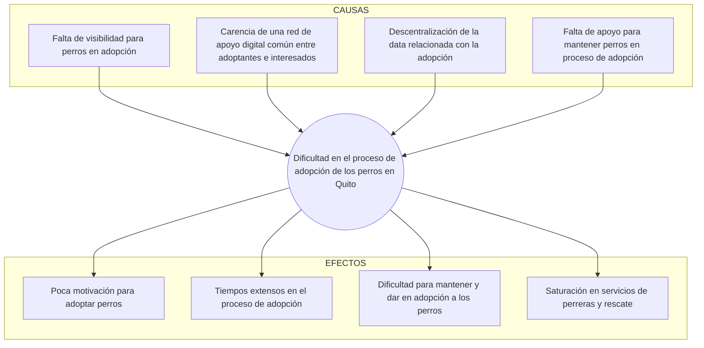
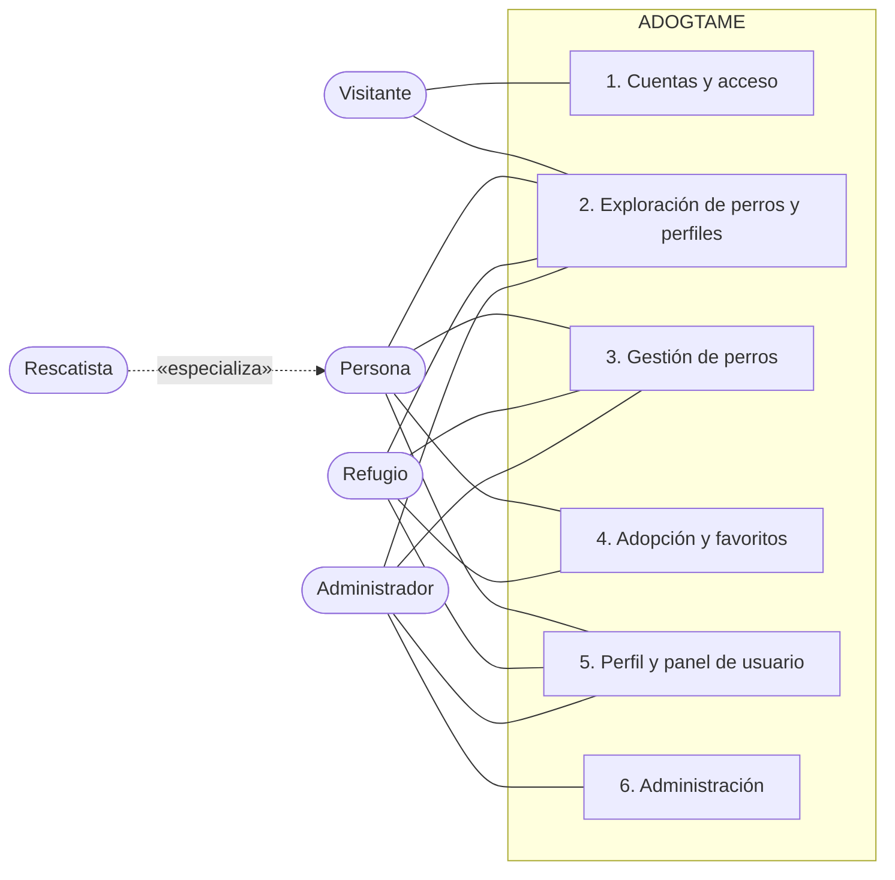
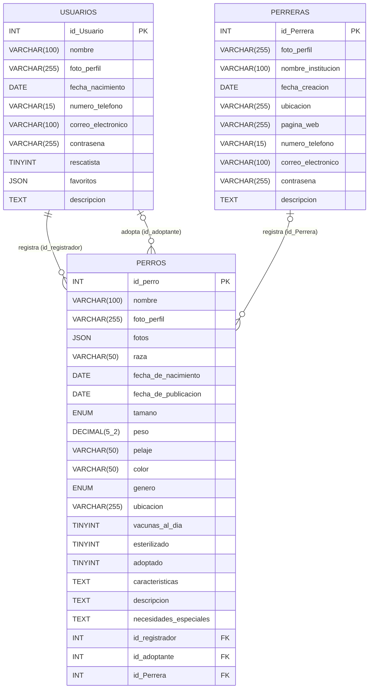
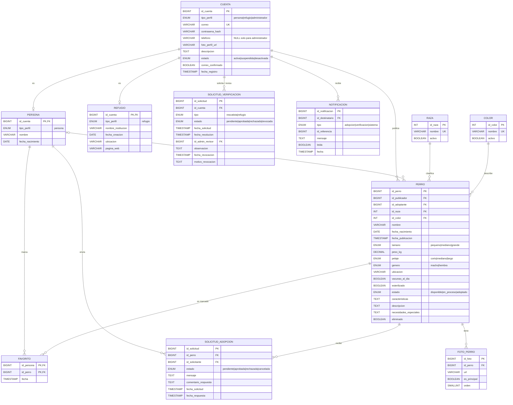

# ADOGTAME — Documento base de análisis (v2)

> Reconstrucción de lo planteado en el informe original (Grupo 1, 4.º semestre, ESPE) como punto de partida para la materia de **Construcción y Evolución de Software**.
> Fuente principal: `Grupo_1_-_Informe_Proyecto_ADOGTAME.pdf`. Donde se añade algo que **no** estaba en el informe, se marca explícitamente como _[Observación]_ o _[Propuesta]_. Las especificaciones nuevas definidas después del informe se marcan como _[Nuevo]_. Las especificaciones existentes modificadas después del informe se marcan como _[Actualizado]_.
>
> **Módulo de usuarios integrado.** _[Actualizado]_ Incorpora los roles, el administrador, los requisitos, casos de uso y DDL definidos en `Adogtame_modulo_usuarios.md` (v0.7), donde se documentan el análisis y las decisiones (DEC-01 a DEC-15) que los justifican.
>
> **Versión sin módulo de patrocinio.** Este documento excluye el patrocinio de perros, que queda descartado hasta nuevo aviso junto con el seguimiento post-adopción (ver [5.2](#52-módulos-diferidos-fuera-del-alcance-actual)).
>
> **Cambios de la v2.** _[v2]_ Se reemplaza el control de acceso basado en roles (RBAC) almacenado en la base de datos por un esquema de **perfil + verificación + estado**, con la matriz de permisos definida como especificación (DEC-01 revisada). Los roles Visitante, Persona, Rescatista, Refugio y Administrador se mantienen como concepto funcional. El análisis del cambio está en `revision-roles-sin-rbac.md`. Los puntos modificados se marcan con _[v2]_. Los casos de uso usan la numeración jerárquica de `Adogtame_CU.drawio` (CU-1.1 a CU-6.3.2), con su equivalencia en 3.3.

---

## Índice

1. [Problemática](#1-problemática)
2. [Requisitos](#2-requisitos)
3. [Casos de uso](#3-casos-de-uso)
4. [Actores / entidades identificados](#4-actores--entidades-identificados)
5. [Resumen de funcionalidades](#5-resumen-de-funcionalidades)
6. [Esquema relacional de base de datos](#6-esquema-relacional-de-base-de-datos)
7. [Observaciones e inconsistencias detectadas](#7-observaciones-e-inconsistencias-detectadas)
8. [Fuentes de consulta](#8-fuentes-de-consulta)

---

## 1. Problemática

### 1.1 Tema

Aplicación web de escritorio que actúe como **canal de comunicación central** para facilitar el proceso de adopción de perros en la ciudad de Quito.

### 1.2 Alcance

- Registro de perros en adopción ubicados en el **Distrito Metropolitano de Quito (DMQ)**.
- Visualización ágil de la información relevante para quien quiera **adoptar** un perro.
- Actualización del estado e información de perros y usuarios.
- **Fuera de alcance:** manejo de métodos de pago, pasarelas de pago o transacciones económicas de cualquier tipo.
- **Fuera de alcance:** patrocinio de perros y seguimiento post-adopción; quedan como módulos diferidos (ver 5.2).
- **Fuera de alcance:** versión móvil / diseño responsivo.

### 1.3 Contexto

#### 1.3.1 Magnitud del problema: perros en situación de calle en Quito

El informe original toma como cifra de referencia la de la Unidad de Bienestar Animal (UBA): **un perro callejero por cada 19 habitantes** en 2023. Las fuentes consultadas muestran que esta cifra es el punto más reciente de una tendencia sostenida de crecimiento:

| Año / periodo | Indicador | Fuente |
|---|---|---|
| 2018 | Estudio de la USFQ: un perro por cada 22 habitantes y cerca de 600 000 animales de compañía viviendo en las calles. | La Hora (2021) |
| Abril 2020 | Los abandonos registrados por el Municipio (Secretaría de Salud / Urbanimal) pasaron de **1 a 10 casos diarios** con la llegada de la pandemia. | La Hora (2021) |
| 2020–2021 | El abandono de perros en Quito creció alrededor de un **90 %** a raíz de la pandemia. | La Hora (2021) |
| 2021 | El Municipio reportaba unos 100 000 perros y gatos desamparados. | Primicias (2022) |
| 2023 | Estudio de la UBA en 53 parroquias: **un perro callejero por cada 19 habitantes**, con un crecimiento cercano al 500 % respecto a mediciones previas; alrededor de dos tercios de los perros se mueven en jauría. | El Comercio (2024) |
| 2023 | El Municipio estimó cerca de **1,3 millones de animales callejeros** (perros y gatos) en sus 65 parroquias; los animales en la calle son el principal problema ambiental percibido por los barrios. | Primicias (2024) |
| 2024 | La UBA estima que cerca del **70 %** de los perros que deambulan en la calle **sí tienen dueño**: son dejados fuera durante el día o forman parte de la comunidad. | El Telégrafo (2024) |

> **Nota sobre los datos:** las cifras no son del todo comparables entre sí (distintas metodologías, perros vs. perros y gatos, área urbana vs. todo el distrito). Lo consistente en todas las fuentes es la **tendencia creciente**. Para el nuevo documento conviene citar la cifra más reciente con su metodología y no mezclar estimaciones.

Zonas como Calderón, Condado, Cochapamba y Llano Chico, en el norte de la ciudad, registraron un agravamiento del problema en el estudio de 2023 _(El Comercio, 2024)_.

#### 1.3.2 Causas del abandono

Las fuentes coinciden en que el abandono no es un fenómeno aislado, sino el resultado de varios factores que se refuerzan:

- **Factores económicos:** la pérdida de empleo durante la pandemia aparece como un motivo frecuente de abandono, según Protección Animal Ecuador (PAE) _(La Hora, 2021)_. La crisis económica y de seguridad posterior agravó la situación _(Primicias, 2022)_.
- **Tenencia irresponsable:** la mayoría de perros en la calle tiene dueño, lo que indica que el problema no es solo de animales sin hogar sino de dueños que los dejan deambular _(El Telégrafo, 2024)_.
- **Falta de conciencia ciudadana:** se señala como una de las causas de la proliferación de perros en las calles, junto con el hacinamiento de los refugios y la falta de apoyo económico _(El Telégrafo, 2024)_.
- **Marco normativo reciente:** el Municipio promulgó la Ordenanza 019 de Bienestar Animal en enero de 2021, lo que evidencia que la regulación es relativamente nueva frente a un problema antiguo _(La Hora, 2021)_.

#### 1.3.3 El proceso de adopción actual y sus barreras

**Factores que condicionan la adopción.** Según La Hora (2018), concretar adopciones en Quito es difícil incluso para las organizaciones establecidas, y depende principalmente de tres factores:

1. **Características del animal:** la edad y el estado de salud influyen directamente en las posibilidades de encontrarle hogar. Perros adultos o con enfermedades (por ejemplo, epilepsia) pueden pasar años sin ser adoptados.
2. **La temporada:** la demanda de adopción varía a lo largo del año, según la coordinación de Urbanimal.
3. **El sector donde se realizan las ferias de adopción:** el alcance depende de dónde se organizan los eventos presenciales.

**El canal tradicional es presencial y limitado.** El principal mecanismo formal de difusión eran las **ferias de adopción**, que son difíciles de organizar: algunas organizaciones solo logran unas pocas al año o un máximo de tres por semestre, a menudo coordinando entre fundaciones. El proceso de adopción dura entre una y dos semanas y suele requerir copia de cédula, planilla de servicios básicos, solicitud y, según la organización, un contrato de adopción _(La Hora, 2018)_.

**El canal informal son las redes sociales.** El abandono y las solicitudes de adopción también se difunden por redes sociales _(La Hora, 2021)_, un medio abierto y sin filtros donde, como señala el informe, es difícil encontrar personas realmente comprometidas y destacar entre el volumen de publicaciones.

**Vacío de información centralizada.** Ni las ferias ni las redes sociales ofrecen un lugar único donde un interesado pueda comparar perros de distintos rescatistas y refugios, filtrarlos por sus características (edad, tamaño, esterilización, salud) y contactar directamente a quien los tiene a cargo. Esta es la brecha que Adogtame busca cubrir.

#### 1.3.4 Situación de rescatistas y refugios

- **Hacinamiento y falta de recursos:** los refugios están saturados y carecen de apoyo económico, lo que contribuye a que el problema no se resuelva _(El Telégrafo, 2024)_.
- **Dependencia de la autogestión:** la mayoría de refugios se sostiene con rifas, venta de productos, peluquería canina y donaciones. Con la pandemia y la crisis posterior, el apoyo disminuyó mientras los gastos de alimentación, veterinaria y personal aumentaron; algunos centros tuvieron que restringir el ingreso de nuevos animales _(Primicias, 2022)_.
- **El refugio como lugar de paso, no como destino:** académicos del proyecto *Poliperros* (EPN) señalan que la ciudadanía tiende a ver el refugio como un lugar permanente, cuando debería ser una estación temporal hacia un hogar definitivo. Rescatar no termina al sacar al perro de la calle: requiere dedicación y corresponsabilidad de quienes adoptan o apoyan _(El Telégrafo, 2024)_.
- **Necesidad de educación y articulación:** los rescatistas coinciden en que hace falta educar sobre bienestar animal, que los interesados comprendan el sentido de la adopción y contar con el respaldo de las autoridades _(El Telégrafo, 2024)_.

#### 1.3.5 Consecuencias

| Consecuencia | Evidencia |
|---|---|
| Permanencia prolongada de perros en refugios y hogares temporales | Adopciones difíciles de concretar; perros adultos o enfermos esperan años _(La Hora, 2018)_. |
| Saturación de refugios y límites para recibir más animales | Hacinamiento y restricción de ingresos _(El Telégrafo, 2024; Primicias, 2022)_. |
| Carga económica sobre rescatistas independientes | Testimonio de la entrevista (sección 1.7) y dependencia de autogestión _(Primicias, 2022)_. |
| Problema ambiental y de convivencia en los barrios | Los animales callejeros son el principal problema ambiental percibido _(Primicias, 2024)_. |

### 1.4 Problema central y necesidades identificadas

**Problema central:** _Dificultad en el proceso de adopción de los perros en Quito._

| Grupo | Situación | Necesidad | Respaldo |
|---|---|---|---|
| **Rescatistas independientes y familias** (camadas inesperadas, perros acogidos) | Mantienen varios perros con recursos propios hasta que sean adoptados. Difunden por redes sociales, un medio informal y poco efectivo. | Un canal formal y dirigido para dar en adopción. | Entrevista; La Hora (2021) |
| **Refugios y perreras** | Saturados, dependientes de la autogestión y con poca visibilidad; los eventos de adopción presenciales son escasos y costosos de organizar. | Visibilidad permanente, no limitada a ferias de adopción. | El Telégrafo (2024); Primicias (2022); La Hora (2018) |
| **Personas interesadas en adoptar** | La información está dispersa entre redes sociales y ferias ocasionales; es difícil comparar perros y saber si la fuente es confiable. | Información centralizada, filtrable (edad, salud, esterilización) y de fuentes verificadas. | La Hora (2018); entrevista |

### 1.5 Árbol de problemas



**Respaldo de cada nodo del árbol:**

| Nodo | Tipo | Evidencia |
|---|---|---|
| C1. Falta de visibilidad | Causa | Difusión limitada a ferias ocasionales y dependiente del sector donde se realizan _(La Hora, 2018)_; dificultad para destacar en redes sociales (informe). |
| C2. Carencia de una red de apoyo digital común | Causa | Uso de redes sociales abiertas como canal principal _(La Hora, 2021)_; no existe una plataforma que reúna a rescatistas, refugios y adoptantes (informe, entrevista). |
| C3. Descentralización de la información | Causa | Cada organización gestiona sus propios procesos, requisitos y eventos _(La Hora, 2018)_. |
| C4. Falta de apoyo para mantener perros | Causa | Refugios sin apoyo económico _(El Telégrafo, 2024)_ y dependientes de la autogestión _(Primicias, 2022)_; dificultades económicas de la rescatista entrevistada. |
| E1. Poca motivación para adoptar | Efecto | Baja comprensión del sentido de la adopción y percepción del refugio como destino final _(El Telégrafo, 2024)_. |
| E2. Tiempos extensos | Efecto | Perros adultos o enfermos que esperan años; procesos de una a dos semanas por adopción _(La Hora, 2018)_. |
| E3. Dificultad para mantener y dar en adopción | Efecto | Aumento de gastos de alimentación y veterinaria _(Primicias, 2022)_; entrevista. |
| E4. Saturación de refugios | Efecto | Hacinamiento _(El Telégrafo, 2024)_ y restricción de nuevos ingresos _(Primicias, 2022)_. |

### 1.6 Objetivos

1. Establecer un canal de comunicación común entre quienes ponen en adopción y quienes desean adoptar un perro en Quito.
2. Mejorar la visibilidad de los perros en proceso de adopción.

**Relación objetivo ↔ causa atacada:**

| Objetivo | Causas del árbol que ataca |
|---|---|
| 1. Canal de comunicación común | C2, C3 |
| 2. Mejorar la visibilidad | C1, C3 |

> La causa C4 (falta de apoyo para mantener perros) no queda cubierta por los objetivos del alcance actual; su atención corresponde al módulo de patrocinio diferido (ver 5.2).

### 1.7 Levantamiento de información (entrevista)

Se entrevistó a **Dayra Almeida**, rescatista independiente de perros y gatos con 18 años de experiencia (52 años, Quito), que en ese momento cuidaba 8 perros y 13 gatos con sus propios medios y forma parte de redes de apoyo entre rescatistas. Entrevista: <https://www.youtube.com/watch?v=yuA9b32NnHM>

**Objetivos del perfil:** brindar una vida digna a los animales abandonados y concientizar sobre la responsabilidad de tener una mascota.
**Frustraciones:** limitaciones constantes para mantener a los animales rescatados y trato con adoptantes irresponsables.

| Hallazgo de la entrevista | Coincidencia con las fuentes | Impacto en el sistema |
|---|---|---|
| Lo más difícil es conocer al adoptante y el espacio donde vivirá el perro. | Los procesos formales piden cédula, planilla de servicios y contrato _(La Hora, 2018)_. | Solicitud de adopción que el publicador aprueba o rechaza (FR-07). |
| La principal dificultad del cuidado es económica; perros ancianos o con enfermedades crónicas se adoptan menos. | Edad y salud como factores de adopción _(La Hora, 2018)_; crisis económica de refugios _(Primicias, 2022)_. | Campo de necesidades especiales (FR-05) y filtro por edad (FR-09). El apoyo económico queda fuera del alcance actual (ver 5.2). |
| La esterilización es el dato más determinante para adoptar; luego comportamiento y apariencia. | — | Información médica destacada (CR-01) y filtro por esterilizado (FR-09). |
| Para confiar en un adoptante se pide identificación y ubicación exacta, y se hace seguimiento. | Requisitos documentales de las organizaciones _(La Hora, 2018)_. | Módulo de seguimiento post-adopción, diferido (ver 5.2). |
| La comunicación debe ser directa; el teléfono debe ser muy visible. | — | Teléfono visible en perfiles (FR-11). |
| Centralizar la información permitiría ver perros de rescatistas independientes **y** de instituciones. | Ausencia de un canal común; dispersión en ferias y redes _(La Hora, 2018; 2021)_. | Tipos de usuario: general, rescatista, refugio. |
| Los rescatistas independientes, sin contactos ni difusión, se beneficiarían mucho de los patrocinios. | Falta de apoyo económico a quienes rescatan _(El Telégrafo, 2024)_. | Distintivo de rescatista verificado y directorio público (FR-03, FR-11). El patrocinio queda diferido (ver 5.2). |
| Se recomienda seguimiento activo tras la adopción para evitar abandono o maltrato. | La mayoría de perros en la calle tiene dueño _(El Telégrafo, 2024)_: la adopción sin seguimiento no garantiza que el perro no vuelva a la calle. | Módulo diferido (ver 5.2). |

### 1.8 Justificación y motivación

La evidencia muestra un problema **creciente** (de 1 perro por cada 22 habitantes en 2018 a 1 por cada 19 en 2023), **agravado por la pandemia** (incremento del abandono cercano al 90 %) y que recae sobre actores **sin recursos suficientes** (refugios saturados y rescatistas que financian el cuidado con medios propios).

Frente a esto, los canales existentes para conectar perros con adoptantes son **presenciales y escasos** (ferias de adopción difíciles de organizar) o **informales y sin filtro** (redes sociales). No existe un punto de encuentro que permita:

- ver en un solo lugar perros de rescatistas independientes y de refugios;
- filtrarlos por los criterios que más influyen en la decisión (edad, salud, esterilización);
- distinguir publicadores verificados de publicaciones anónimas.

Adogtame no pretende resolver el problema estructural del abandono (que depende de esterilización, regulación y educación), sino **reducir la fricción del proceso de adopción**: dar visibilidad permanente a los perros, centralizar la información y generar confianza entre las partes.

> _[Observación para la nueva versión]_ El Telégrafo (2024) recalca que la adopción requiere **dedicación y corresponsabilidad**. Esto refuerza dos funcionalidades que quedaron fuera del alcance: el **seguimiento post-adopción** (módulo diferido, ver 5.2) y contenido de **concientización** sobre tenencia responsable dentro de la plataforma.

---

## 2. Requisitos

### 2.1 Requisitos del cliente (CR)

| ID | Nombre | Descripción |
|---|---|---|
| CR-01 | Mostrar información médica de los perros | La plataforma debe mostrar claramente si el perro está esterilizado y si tiene necesidades especiales. |
| CR-02 | Verificación de usuarios especiales | Rescatistas y refugios deben pasar un proceso que asegure su compromiso con el bienestar animal, y ser fácilmente reconocibles en la plataforma. |

### 2.2 Requisitos funcionales (F)

| ID | Nombre | Descripción resumida | Origen |
|---|---|---|---|
| FR-01 | Registro para usuarios generales | Registro de persona independiente que puede adoptar y poner en adopción. Campos validados. _[Actualizado]_ El sistema envía un correo de confirmación al registrarse (también en FR-02); es el único correo que envía la plataforma. | CR-02 |
| FR-02 | Registro especial para refugios _[Actualizado]_ | Registro de institución con datos adicionales (ubicación, página web). Al registrarse se crea una solicitud de verificación que revisa un administrador. Mientras está pendiente, el refugio puede poner perros en adopción, sin distintivo y sin aparecer en el directorio de refugios. Si la verificación se rechaza o, una vez aprobada, se revoca, la cuenta se convierte automáticamente en persona: el nombre de la institución pasa a ser su nombre, se descartan ubicación y página web, se conservan sus perros publicados y no puede volver a solicitar verificación como refugio. Un refugio no adopta ni guarda favoritos. Campos validados. | CR-02 |
| FR-03 | Solicitud para rescatista _[Actualizado, v2]_ | Una persona sin verificación vigente ni solicitud pendiente solicita desde su perfil ser verificada como rescatista. Un administrador la aprueba o la rechaza con una observación. Al aprobarse, la cuenta pasa a ser **rescatista**: su perfil muestra el distintivo y aparece en el directorio de rescatistas. Un administrador puede revocar la verificación indicando el motivo; la cuenta deja de ser rescatista y pierde el distintivo y su lugar en el directorio. _[v2]_ La condición de rescatista se deriva de tener una verificación de rescatista aprobada; no se asigna como un rol aparte. El solicitante recibe una notificación con cada resultado. | CR-02 |
| FR-04 | Administrar panel de usuario _[Actualizado]_ | Actualizar información (foto, número, etc.) y ver perros en adopción, favoritos, notificaciones y estado de la solicitud de verificación según los permisos de la cuenta. | — |
| FR-05 | Agregar un perro en adopción _[Actualizado]_ | Persona, rescatista o refugio (incluido el refugio con verificación pendiente) publica un perro. **Obligatorios:** nombre, foto principal, raza (catálogo, solo valores activos), fecha de nacimiento (obligatoria: si la edad se desconoce, el publicador ingresa una fecha coherente con su estimación), edad (calculada), tamaño (grande/mediano/pequeño), peso (kg), pelaje (corto/mediano/largo), color (catálogo, solo valores activos), género, ubicación, vacunas al día, esterilizado. **Opcionales:** fotos adicionales, necesidades especiales, descripción. Campos validados. | CR-01 |
| FR-06 | Editar información del perro _[Actualizado]_ | Solo el publicador del perro, sea persona, rescatista o refugio, edita sus datos. El administrador no edita perros ajenos. Un perro no visible no admite edición (FR-13). | — |
| FR-07 | Solicitudes y notificaciones de adopción _[Actualizado]_ | Una persona o rescatista solicita adoptar un perro visible y disponible que no haya publicado. El publicador, sea persona, rescatista o refugio, recibe una notificación y acepta o rechaza la solicitud, con un comentario opcional al rechazar. La solicitud lleva solo un mensaje del solicitante; la identificación y la dirección del adoptante quedan para el contacto directo y la validación documental futura. El solicitante puede cancelarla mientras esté pendiente. Si la cuenta del solicitante o del publicador se suspende o desactiva, sus solicitudes pendientes se cancelan y se notifica a la contraparte. El administrador no accede a las solicitudes de adopción. | — |
| FR-08 | Favoritos _[Actualizado]_ | Solo personas y rescatistas guardan perros como favoritos; se reflejan en el panel, mostrando únicamente los perros visibles (FR-13). | — |
| FR-09 | Búsqueda y filtros | Filtros por raza, edad, tamaño, género, pelaje, color, fecha de publicación, esterilizado y nombre. | CR-01 |
| FR-10 | Visualizar información de perros | Perfil del perro con datos relevantes, publicador y opción de favorito. | CR-01 |
| FR-11 | Visualizar perfiles de usuarios _[Actualizado]_ | Perfil público con nombre, foto, descripción e indicador de rescatista o refugio verificado. El teléfono y el correo solo se muestran a usuarios con sesión iniciada; el visitante ve el resto del perfil. No se muestran perfiles de cuentas suspendidas o desactivadas. Los directorios de rescatistas y refugios incluyen solo cuentas activas con verificación vigente. | CR-02 |
| FR-12 | Eliminar perro _[Nuevo]_ | El publicador del perro o un administrador puede eliminarlo, previa confirmación; el administrador también puede eliminar, desde el panel de administración, los perros ocultos por la suspensión o desactivación de su publicador. La eliminación es siempre **lógica** para cualquier perfil, incluido el administrador: el registro se conserva marcado como eliminado; no existe borrado físico ni restauración. Las imágenes asociadas **no** se eliminan del proveedor de almacenamiento de objetos. Al eliminarse, las solicitudes de adopción pendientes se cancelan. | — |
| FR-13 | Visibilidad de perros _[Nuevo, actualizado]_ | Un perro es visible si no está eliminado y su publicador tiene la cuenta activa. Un perro no visible no aparece en listados, búsquedas, perfiles de usuario, *Mis perros* ni *Favoritos*; el acceso directo a su perfil responde con **404**, igual que un perro inexistente (NFR-07), y no admite edición, nuevas solicitudes de adopción ni ser marcado como favorito. Los perros ocultos por suspensión o desactivación de su publicador vuelven a mostrarse si la cuenta se reactiva. Los eliminados solo los consulta un administrador, en modo de solo lectura, desde el panel de administración. | — |
| FR-14 | Gestión de solicitudes de verificación _[Nuevo, v2]_ | El administrador consulta las solicitudes de verificación pendientes, las aprueba o las rechaza con observación, y revoca verificaciones vigentes indicando el motivo. Aprobar a un rescatista lo convierte en rescatista verificado; rechazar o revocar a un refugio lo convierte en persona (FR-02). | CR-02 |
| FR-15 | Gestión de estado de cuentas _[Nuevo, v2]_ | El administrador busca cuentas por correo o nombre, las filtra por tipo de cuenta (persona, rescatista, refugio, administrador), estado y verificación, y consulta su detalle sin ver nunca la contraseña. Puede suspender y reactivar cuentas, excepto la propia y la del último administrador activo. Un usuario puede desactivar su propia cuenta; solo un administrador puede reactivarla. Una cuenta no activa no puede iniciar sesión y sus perros dejan de ser visibles (FR-13). | CR-02 |
| FR-16 | Gestión de administradores _[Nuevo, v2]_ | Las cuentas de administrador no se crean por registro público: las crea otro administrador o el despliegue inicial, con un correo propio. Un administrador puede retirar a otro administrador, lo que desactiva su cuenta; nunca puede quedar el sistema sin administradores activos. _[v2]_ El perfil de la cuenta no cambia: reactivar una cuenta de administrador (CU-6.2.3) le devuelve el acceso administrativo, como a cualquier otra cuenta reactivada. | — |
| FR-17 | Gestión de catálogos _[Nuevo]_ | El administrador agrega, renombra, activa y desactiva valores de los catálogos de raza y color, y elimina los que no estén en uso. Los valores inactivos no se ofrecen al publicar ni editar perros; los perros que ya los usan los conservan. | FR-05 |

### 2.3 Requisitos no funcionales (NF)

| ID | Tipo | Descripción |
|---|---|---|
| NFR-01 | Eficiencia | La carga de elementos (incluida la consulta y presentación de datos) no debe superar **3 s**. |
| NFR-02 | Seguridad | Datos personales protegidos de forma confiable; **contraseñas cifradas** (hash). |
| NFR-03 | Usabilidad | Navegación sencilla; botones de distintos tamaños y colores para jerarquizar acciones; interfaz en **español**; tonos claros y diseño minimalista; orientado a escritorio (no móvil). |
| NFR-04 | Portabilidad | Funcionar en los navegadores populares (Chrome, Firefox, Safari) en PC o laptop. Diseño responsivo no prioritario. |
| NFR-05 | Integridad de datos _[Nuevo]_ | Ningún perro se elimina físicamente de la base de datos. La restricción se aplica en la propia base de datos, no solo en la capa de aplicación, de modo que tampoco un acceso administrativo directo pueda borrarlo. |
| NFR-06 | Mantenibilidad _[Nuevo]_ | El acceso al almacenamiento de imágenes se realiza mediante una capa de abstracción, de modo que el proveedor (Cloudinary en la implementación original) pueda sustituirse sin modificar la lógica de negocio. La base de datos guarda solo la URL o identificador de cada imagen. |
| NFR-07 | Seguridad y privacidad _[Nuevo, actualizado]_ | La respuesta ante un perro no visible (eliminado u oculto por la suspensión o desactivación de su publicador) debe ser indistinguible de la de un perro inexistente (mismo código 404 y mismo contenido), para no revelar que el registro existe. |
| NFR-08 | Eficiencia _[Nuevo, actualizado]_ | Excluir los perros no visibles, lo que implica cruzar `perro` con el estado de la cuenta de su publicador, no debe degradar las consultas de listado y búsqueda por encima del límite de NFR-01. |
| NFR-09 | Seguridad _[Nuevo, v2]_ | Toda acción se autoriza en el servidor por permiso y, cuando aplica, por propiedad del recurso. Los permisos de una cuenta se derivan de su perfil, su verificación vigente y su estado, según la matriz de permisos (6.4), que se define en un único punto del sistema. La interfaz solo oculta opciones; no es el mecanismo de autorización. |
| NFR-10 | Disponibilidad _[Nuevo]_ | El sistema debe estar disponible al menos el **99 %** del tiempo en cada mes calendario, excluyendo mantenimientos programados que se avisan con antelación. Si el servicio no está disponible, la interfaz muestra un mensaje de error comprensible en lugar de una página en blanco. |
| NFR-11 | Protección de datos personales _[Nuevo]_ | Toda comunicación entre el navegador y el servidor usa **HTTPS**. Solo se solicitan los datos personales necesarios para las funciones definidas (minimización). Los registros técnicos (logs) no contienen contraseñas, hashes, tokens de sesión ni teléfonos o correos completos. Complementa NFR-02, NFR-07 y FR-11. Su alineación con la Ley Orgánica de Protección de Datos Personales de Ecuador debe revisarse antes de publicar el sistema. |
| NFR-12 | Compatibilidad de pantalla _[Nuevo]_ | La interfaz se diseña para monitores de escritorio y portátiles de **14 a 24 pulgadas**. Como referencia, el mínimo es una ventana de **1280 px** de ancho (portátil de 14″, p. ej. 1366×768, o 1920×1080 con escala del 150 %) y el máximo, una de **1920 px** (monitor de 24″, 1920×1080 o 1920×1200). Entre ambos límites no hay desbordamiento horizontal, texto cortado ni controles superpuestos, y el número de columnas de tarjetas se ajusta al ancho. Por encima de 1920 px el contenido se centra con un ancho máximo. No se garantizan pantallas menores (tabletas, móviles; ver 1.2 y NFR-04). |

### 2.4 Requisitos técnicos (TR) — contexto de la implementación original

| ID | Capa | Tecnologías |
|---|---|---|
| TR-01 | Frontend | JavaScript, React, Next.js, CSS, TailwindCSS, DaisyUI, TanStack Query |
| TR-02 | Backend / infraestructura | Node.js, Express.js, Cloudinary (imágenes; proveedor sustituible, ver NFR-06), Vercel, Render, AWS |
| TR-03 | Base de datos | MongoDB + Mongoose |

### 2.5 Trazabilidad CR → FR

| CR | FR que lo cubren |
|---|---|
| CR-01 Información médica | FR-05, FR-09, FR-10 |
| CR-02 Verificación de usuarios especiales | FR-01, FR-02, FR-03, FR-11, FR-14, FR-15 |

---

## 3. Casos de uso

### 3.1 Diagramas

El informe tenía dos diagramas: uno para **Usuario/Rescatista** y otro para **Perrera (Refugio)**. Se retiró el caso de uso «Solicitar patrocinio». _[Nuevo]_ Se añadió «Eliminar perro». _[Actualizado]_ Con el módulo de usuarios se incorporan el actor **Visitante**, los casos del **Administrador**, «Solicitar verificación como rescatista», «Desactivar cuenta propia» y «Ver perfiles públicos y directorios»; «Usuario general» pasa a llamarse **Persona**. Las relaciones entre casos de uso indican explícitamente `<<extend>>` (Obs. 3).

_[v2]_ **Numeración jerárquica.** Los casos de uso se agrupan en paquetes y se numeran según su nivel de anidamiento: el nivel 1 usa números directos (1, 2, 3…), el nivel 2 agrega un dígito (1.1, 1.2…) y el nivel 3 otro (6.1.1, 6.1.2…). Los diagramas completos están en `Adogtame_CU.drawio`, con una pestaña por diagrama y una pestaña *Equivalencias* con la numeración anterior (CU-1.1 a CU-2.4).

**Nivel 1 — Diagrama general.**



> - **Visitante** representa a cualquier usuario sin sesión, incluido un administrador antes de iniciarla. Al registrarse pasa a ser Persona o Refugio; las cuentas de administrador solo se crean con CU-6.2.4.
> - **Rescatista** especializa a Persona y hereda todas sus asociaciones, salvo CU-5.3, que deja de estar disponible una vez verificado.
> - **Refugio** no adopta ni guarda favoritos: en el paquete 4 solo confirma adopciones de sus perros y recibe sus notificaciones.
> - El administrador no recibe notificaciones (DEC-12) ni accede a solicitudes de adopción.

**Niveles 2 y 3 — Paquetes y casos de uso.**

| Paquete | Nivel | Casos de uso | Actores | Relaciones `<<extend>>` |
|---|---|---|---|---|
| **1. Cuentas y acceso** | 2 | 1.1 Registrarse · 1.2 Iniciar sesión | Visitante | — |
| **2. Exploración de perros y perfiles** | 2 | 2.1 Ver perros en adopción · 2.2 Buscar y filtrar perros · 2.3 Ver información de perro · 2.4 Ver perfiles públicos y directorios | Visitante, Persona, Rescatista, Refugio, Administrador | 2.3 → 2.1 y 2.2 · 2.4 → 2.3 |
| **3. Gestión de perros** | 2 | 3.1 Poner perro en adopción · 3.2 Editar información de perro · 3.3 Eliminar perro | Persona, Rescatista, Refugio (3.1–3.3); Administrador (3.3) | — |
| **4. Adopción y favoritos** | 2 | 4.1 Agregar perro a favoritos · 4.2 Solicitar adopción · 4.3 Confirmar adopción · 4.4 Recibir notificación de solicitud | Persona, Rescatista (4.1–4.4); Refugio (4.3, 4.4) | 4.1 → 2.3 · 4.2 → 2.3 |
| **5. Perfil y panel de usuario** | 2 | 5.1 Revisar perfil · 5.2 Revisar notificaciones · 5.3 Solicitar verificación como rescatista · 5.4 Desactivar cuenta propia | Persona, Rescatista, Refugio, Administrador | 5.2 → 5.1 · 5.3 → 5.1 · 5.4 → 5.1 |
| **6. Administración** | 2 | Subpaquetes 6.1, 6.2 y 6.3 | Administrador | — |
| ↳ **6.1 Verificaciones** | 3 | 6.1.1 Revisar solicitudes de verificación · 6.1.2 Resolver solicitud de verificación · 6.1.3 Revocar verificación | Administrador | 6.1.2 → 6.1.1 · 6.1.3 → 6.2.1 |
| ↳ **6.2 Cuentas y administradores** | 3 | 6.2.1 Consultar cuentas de usuario · 6.2.2 Suspender cuenta · 6.2.3 Reactivar cuenta · 6.2.4 Crear administrador · 6.2.5 Retirar administrador | Administrador | 6.2.2, 6.2.3 y 6.2.5 → 6.2.1 |
| ↳ **6.3 Contenido y catálogos** | 3 | 6.3.1 Consultar perros eliminados · 6.3.2 Gestionar catálogos | Administrador (además usa 3.3) | — |

> Los casos que se inician desde el detalle de una solicitud o de una cuenta (6.1.2, 6.1.3, 6.2.2, 6.2.3, 6.2.5) extienden a 6.1.1 y 6.2.1 en lugar de conectarse directamente al actor.

### 3.2 Especificación de casos de uso

Los casos de los paquetes 1 a 5, salvo 2.4, 3.3, 5.3 y 5.4, provienen del informe; los marcados como _[Actualizado]_ ajustan actores y flujos alternativos según el modelo de roles. Los códigos de acción (CTA-, VER-, PER-, ADM-) y de decisión (DEC-) remiten a `Adogtame_modulo_usuarios.md`, donde está su justificación.

| ID | Nombre | Actor(es) principal(es) | Descripción | Flujo principal | Flujos alternativos | FR |
|---|---|---|---|---|---|---|
| CU-1.1 | Registrarse _[Actualizado, v2]_ | Visitante | Crear cuenta según el tipo de usuario. | 1. Selecciona tipo de cuenta (persona o refugio). 2. Completa formulario. 3. El sistema crea la cuenta con su perfil; si es refugio, crea también su solicitud de verificación pendiente. 4. El sistema envía correo de confirmación. | Campos inválidos → el sistema marca los errores. Correo ya registrado → error. | FR-01, FR-02 |
| CU-1.2 | Iniciar sesión _[Actualizado]_ | Visitante (cualquier usuario sin sesión, incluido el administrador) | Acceso con credenciales. | 1. Ingresa correo y contraseña. 2. El sistema valida. 3. Acceso al panel. | Credenciales incorrectas → mensaje de error. _[Nuevo]_ Cuenta suspendida o desactivada → mensaje de acceso no disponible, sin iniciar sesión. | FR-15 |
| CU-2.1 | Ver perros en adopción _[Actualizado]_ | Visitante, Persona, Rescatista, Refugio, Administrador | Listado de perros disponibles. | 1. Accede a «Perros en adopción». 2. Se cargan tarjetas con información básica de los perros visibles. | Sin conexión → mensaje de error. | FR-10, FR-13 |
| CU-2.2 | Buscar y filtrar perros _[Actualizado]_ | Visitante, Persona, Rescatista, Refugio, Administrador | Búsqueda con filtros. | 1. Ingresa a búsqueda. 2. Aplica filtros. 3. Resultados en tiempo real, solo con perros visibles. | Sin resultados → sugerir ajustar filtros. | FR-09, FR-13 |
| CU-2.3 | Ver información de perro _[Actualizado]_ | Visitante, Persona, Rescatista, Refugio, Administrador | Perfil detallado del perro. | _Sin especificación en el informe._ | _[Nuevo]_ Perro no visible o inexistente → página 404. Visitante → se muestran los datos del publicador sin teléfono ni correo. | FR-10, FR-11, FR-13 |
| CU-2.4 _[Nuevo]_ | Ver perfiles públicos y directorios | Visitante, Persona, Rescatista, Refugio, Administrador | Consultar el perfil público de un usuario y los directorios de rescatistas y refugios verificados. | 1. Accede a *Rescatistas* o *Refugios*, o al perfil del publicador desde un perro (CU-2.3). 2. El sistema lista las cuentas activas con verificación vigente (directorios) o muestra el perfil. 3. El perfil muestra nombre, foto, descripción, indicador de verificación y sus perros visibles. 4. Con sesión iniciada, muestra además teléfono y correo. | Cuenta suspendida, desactivada o inexistente → página 404. Visitante → teléfono y correo no se muestran. Sin cuentas verificadas → mensaje informativo. | FR-11 |
| CU-3.1 | Poner perro en adopción _[Actualizado]_ | Persona, Rescatista, Refugio (incluido el refugio pendiente de verificación) | Publicar un perro. | 1. Accede al formulario. 2. Ingresa datos (nombre, fotos, historial médico; raza y color de los catálogos activos). 3. El sistema valida y publica. | Datos incompletos → solicitar campos obligatorios. | FR-05 |
| CU-3.2 | Editar información de perro _[Actualizado]_ | Persona, Rescatista, Refugio (solo el publicador) | Actualizar datos de un perro. | 1. Accede al perfil del perro. 2. Modifica campos. 3. El sistema actualiza. | Campos inválidos → bloquea guardado. _[Nuevo]_ Perro no visible → página 404. No es el publicador (incluido el administrador) → la opción no está disponible. | FR-06, FR-13 |
| CU-3.3 | Eliminar perro _[Nuevo]_ | Persona, Rescatista, Refugio (publicador del perro); Administrador | Retirar un perro de la plataforma mediante borrado lógico. | 1. Accede al perfil del perro o a *Mis perros* (el administrador, a cualquier perro visible o, desde *Perros eliminados* de CU-6.3.1, a los perros no eliminados de cuentas suspendidas o desactivadas, que no son visibles). 2. Pulsa «Eliminar». 3. El sistema pide confirmación. 4. Confirma. 5. El sistema marca el perro como eliminado, sin borrar sus imágenes del almacenamiento. 6. Cancela las solicitudes de adopción pendientes. 7. El perro deja de mostrarse en todos los apartados. | Cancela la confirmación → no se realiza ningún cambio. Usuario que no es publicador ni administrador → la opción no está disponible. Perro ya eliminado → página 404. | FR-12, FR-13 |
| CU-4.1 | Agregar perro a favoritos _[Actualizado]_ | Persona, Rescatista | Guardar perfiles para revisar luego. | 1. Selecciona «Añadir a favoritos». 2. El sistema guarda en su lista. | Ya en favoritos → mensaje de duplicado. _[Nuevo]_ Perro no visible → deja de mostrarse en favoritos y no puede marcarse. | FR-08, FR-13 |
| CU-4.2 | Solicitar adopción _[Actualizado]_ | Persona, Rescatista | Solicitud formal de adopción. | 1. Selecciona perro. 2. Completa formulario. 3. El sistema notifica al publicador. | Perro ya adoptado → no disponible. _[Nuevo]_ Perro no visible → página 404. Perro propio → la opción no está disponible. | FR-07, FR-13 |
| CU-4.3 | Confirmar adopción _[Actualizado]_ | Persona, Rescatista, Refugio (solo el publicador) | Aprobar o rechazar una solicitud de adopción. | 1. Revisa la solicitud. 2. Aprueba o rechaza. 3. El sistema notifica al solicitante. | Rechazo → permite enviar comentarios. | FR-07 |
| CU-4.4 | Recibir notificación de solicitud _[Actualizado]_ | Persona, Rescatista, Refugio (solo el publicador) | Aviso de nueva solicitud. | 1. El sistema envía notificación al panel. 2. El destinatario la visualiza. | _[Actualizado]_ No hay recordatorio por correo: queda fuera del alcance (Obs. 17). | FR-07 |
| CU-5.1 | Revisar perfil _[Actualizado]_ | Persona, Rescatista, Refugio, Administrador | Acceso al panel de usuario. | _Sin especificación en el informe._ | _[Nuevo]_ Administrador → solo accede a los datos de su cuenta. Persona y refugio ven el estado de su solicitud de verificación. | FR-04 |
| CU-5.2 | Revisar notificaciones _[Actualizado]_ | Persona, Rescatista, Refugio | Bandeja de notificaciones. | _Sin especificación en el informe._ | _[Nuevo]_ Incluye avisos de resultado de verificación, conversión a persona y solicitudes canceladas por suspensión o desactivación. El administrador no recibe notificaciones. | FR-03, FR-07 |
| CU-5.3 _[Nuevo]_ | Solicitar verificación como rescatista | Persona | Pedir ser verificada como rescatista (VER-01). | 1. Desde su perfil (CU-5.1) pulsa «Solicitar verificación como rescatista». 2. El sistema explica lo que implica la verificación: distintivo visible y aparición en el directorio de rescatistas. 3. Confirma. 4. El sistema crea la solicitud en estado pendiente. 5. Su perfil muestra el estado de la solicitud (VER-02) hasta que un administrador la resuelva (CU-6.1.2). | Ya tiene una solicitud pendiente → la opción no está disponible y se muestra su estado. Ya es rescatista → la opción no está disponible. Su solicitud anterior fue rechazada o su verificación revocada → puede volver a solicitarla; el perfil muestra la última observación o motivo. Cancela la confirmación → no se realiza ningún cambio. | FR-03 |
| CU-5.4 _[Nuevo]_ | Desactivar cuenta propia | Persona, Rescatista, Refugio, Administrador | Retirarse de la plataforma; solo un administrador puede reactivar la cuenta (DEC-13). | 1. Desde su perfil (CU-5.1) pulsa «Desactivar mi cuenta». 2. El sistema pide confirmación, indicando que sus perros dejarán de mostrarse, que se cancelarán sus solicitudes de adopción pendientes y que solo un administrador puede reactivarla. 3. Confirma. 4. El sistema cambia el estado a `desactivada`. 5. Sus perros dejan de ser visibles, sin marcarse como eliminados. 6. Cancela sus solicitudes de adopción pendientes, enviadas y recibidas, y notifica a cada contraparte. 7. Invalida sus sesiones activas. | Cancela la confirmación → no se realiza ningún cambio. Es el último administrador activo → el sistema bloquea la acción. | FR-15 |
| CU-6.1.1 _[Nuevo]_ | Revisar solicitudes de verificación | Administrador | Consultar las solicitudes de verificación de rescatistas y refugios (VER-03). | 1. Accede a *Verificaciones* en el panel de administración. 2. El sistema lista las solicitudes pendientes, de la más antigua a la más reciente. 3. Selecciona una solicitud. 4. El sistema muestra los datos de la cuenta y de su perfil (persona: nombre y descripción; refugio: institución, ubicación y página web), su teléfono y correo. | No hay solicitudes → mensaje informativo. | FR-14 |
| CU-6.1.2 _[Nuevo, v2]_ | Resolver solicitud de verificación | Administrador | Aprobar o rechazar una solicitud pendiente (VER-04). | 1. Desde el detalle de la solicitud (CU-6.1.1) elige «Aprobar» o «Rechazar». 2. Si rechaza, ingresa la observación. 3. El sistema pide confirmación, indicando las consecuencias según el tipo (ver paso 5). 4. Confirma. 5. El sistema registra el estado, la fecha y el revisor y aplica el efecto: **rescatista aprobado** → la cuenta pasa a ser rescatista, con distintivo y presencia en el directorio; **refugio aprobado** → muestra el distintivo y lo incluye en el directorio; **rescatista rechazado** → sin otros cambios; **refugio rechazado** → convierte la cuenta en persona (reglas de 6.4). 6. Notifica el resultado al solicitante (DEC-12). | Rechazo sin observación → bloquea la confirmación. Cancela la confirmación → no se realiza ningún cambio. La solicitud ya fue resuelta por otro administrador → mensaje informativo y se recarga el listado. | FR-02, FR-03, FR-14 |
| CU-6.1.3 _[Nuevo, v2]_ | Revocar verificación | Administrador | Retirar la verificación vigente de un rescatista o refugio (VER-05). | 1. Desde el detalle de una cuenta verificada (CU-6.2.1) pulsa «Revocar verificación». 2. Ingresa el motivo. 3. El sistema pide confirmación, indicando las consecuencias según el tipo. 4. Confirma. 5. El sistema marca la solicitud aprobada como revocada, con fecha y motivo. 6. **Rescatista** → la cuenta deja de ser rescatista y vuelve a ser persona sin verificación; **refugio** → convierte la cuenta en persona (reglas de 6.4). 7. Deja de mostrarse el distintivo y la cuenta sale del directorio. 8. Notifica a la cuenta afectada (DEC-12). | Sin motivo → bloquea la confirmación. Cancela la confirmación → no se realiza ningún cambio. La cuenta no tiene verificación vigente → la opción no está disponible. | FR-03, FR-14 |
| CU-6.2.1 _[Nuevo, v2]_ | Consultar cuentas de usuario | Administrador | Buscar cuentas y ver su detalle para moderarlas (ADM-01, ADM-02). | 1. Accede a *Usuarios* en el panel de administración. 2. El sistema lista las cuentas. 3. Busca por correo o nombre y filtra por tipo de cuenta (persona, rescatista, refugio, administrador), estado de cuenta o verificación. 4. Selecciona una cuenta. 5. El sistema muestra datos de cuenta y perfil, tipo de cuenta, verificación vigente y estado, sin mostrar nunca el hash de la contraseña. 6. Según el tipo y el estado de la cuenta, ofrece las acciones de CU-6.1.3, CU-6.2.2, CU-6.2.3 o CU-6.2.5. | Sin resultados → sugerir ajustar la búsqueda o los filtros. | FR-15 |
| CU-6.2.2 _[Nuevo]_ | Suspender cuenta | Administrador | Bloquear el acceso de una cuenta (ADM-03). | 1. Desde el detalle de una cuenta activa (CU-6.2.1) pulsa «Suspender». 2. El sistema pide confirmación, indicando que sus perros dejarán de mostrarse y que se cancelarán sus solicitudes de adopción pendientes. 3. Confirma. 4. El sistema cambia el estado a `suspendida`. 5. Sus perros dejan de ser visibles, sin marcarse como eliminados (DEC-09). 6. Cancela sus solicitudes de adopción pendientes, enviadas y recibidas, y notifica a cada contraparte (DEC-12). 7. Invalida sus sesiones activas. | Es su propia cuenta → la opción no está disponible. Es el último administrador activo → el sistema bloquea la acción. Cancela la confirmación → no se realiza ningún cambio. | FR-15 |
| CU-6.2.3 _[Nuevo, v2]_ | Reactivar cuenta | Administrador | Devolver el acceso a una cuenta suspendida o desactivada (ADM-03, DEC-13). _[v2]_ La cuenta conserva su perfil; una cuenta de administrador recupera el acceso administrativo. | 1. Desde el detalle de una cuenta suspendida o desactivada (CU-6.2.1) pulsa «Reactivar». 2. El sistema pide confirmación. 3. Confirma. 4. El sistema cambia el estado a `activa`. 5. Sus perros vuelven a ser visibles. | Cancela la confirmación → no se realiza ningún cambio. Las solicitudes de adopción canceladas al suspender o desactivar **no** se reabren. | FR-15, FR-16 |
| CU-6.2.4 _[Nuevo, v2]_ | Crear administrador | Administrador | Dar de alta una nueva cuenta administrativa (ADM-04). | 1. Accede a *Administradores* en el panel. 2. Pulsa «Nuevo administrador». 3. Ingresa correo y contraseña inicial. 4. El sistema valida los campos. 5. Crea la cuenta con perfil `administrador`, sin teléfono. 6. Envía el correo de confirmación (CTA-04). 7. El administrador creador comunica la contraseña inicial por un medio externo; el nuevo administrador la cambia desde su perfil (CTA-07). | Correo ya registrado, incluso por una cuenta de persona o refugio → error; la cuenta administrativa requiere un correo propio (DEC-03). Campos inválidos → el sistema marca los errores. | FR-16 |
| CU-6.2.5 _[Nuevo, v2]_ | Retirar administrador | Administrador | Quitar el acceso administrativo a otra cuenta (ADM-05). | 1. Desde el detalle de una cuenta de administrador activa (CU-6.2.1) pulsa «Retirar administrador». 2. El sistema pide confirmación. 3. Confirma. 4. El sistema desactiva la cuenta (reglas de 6.4). | Es su propia cuenta → la opción no está disponible. Es el último administrador activo → el sistema bloquea la acción. Cancela la confirmación → no se realiza ningún cambio. | FR-16 |
| CU-6.3.1 _[Nuevo]_ | Consultar perros eliminados | Administrador | Revisar en modo de solo lectura los perros eliminados (PER-06, DEC-15). | 1. Accede a *Perros eliminados* en el panel. 2. El sistema lista los perros con `eliminado = TRUE`, con sus datos básicos y su publicador. _[Actualizado]_ Un filtro permite listar también los perros no eliminados de cuentas no activas, sobre los que el administrador puede aplicar CU-3.3. 3. Selecciona uno. 4. El sistema muestra su información en modo de solo lectura. | No hay perros eliminados → mensaje informativo. No existen opciones para editar ni restaurar (DEC-07). El acceso desde la parte pública sigue respondiendo 404 (NFR-07). | FR-12, FR-13 |
| CU-6.3.2 _[Nuevo]_ | Gestionar catálogos | Administrador | Mantener los catálogos de raza y color usados al publicar perros (ADM-06). | 1. Accede a *Catálogos* en el panel. 2. Elige raza o color. 3. El sistema lista los valores con su estado (activo / inactivo) y si están en uso. 4. Agrega un valor, cambia el nombre de uno existente, lo activa o lo desactiva, o elimina uno que no esté en uso. 5. El sistema valida y guarda. 6. Los valores inactivos dejan de ofrecerse al publicar y editar perros; los perros que ya los usan los conservan. | Nombre duplicado → error. El valor está en uso → no se ofrece eliminarlo, solo desactivarlo. Cambiar el nombre de un valor en uso → el sistema advierte que se reflejará en todos los perros que lo usan. | FR-17 |

### 3.3 Equivalencia de numeración _[v2]_

| Nueva | Anterior | Caso de uso |
|---|---|---|
| CU-1.1 | CU-01 | Registrarse |
| CU-1.2 | CU-02 | Iniciar sesión |
| CU-2.1 | CU-03 | Ver perros en adopción |
| CU-2.2 | CU-04 | Buscar y filtrar perros |
| CU-2.3 | CU-05 | Ver información de perro |
| CU-2.4 | CU-27 | Ver perfiles públicos y directorios |
| CU-3.1 | CU-07 | Poner perro en adopción |
| CU-3.2 | CU-08 | Editar información de perro |
| CU-3.3 | CU-14 | Eliminar perro |
| CU-4.1 | CU-06 | Agregar perro a favoritos |
| CU-4.2 | CU-09 | Solicitar adopción |
| CU-4.3 | CU-10 | Confirmar adopción |
| CU-4.4 | CU-11 | Recibir notificación de solicitud |
| CU-5.1 | CU-12 | Revisar perfil |
| CU-5.2 | CU-13 | Revisar notificaciones |
| CU-5.3 | CU-25 | Solicitar verificación como rescatista |
| CU-5.4 | CU-26 | Desactivar cuenta propia |
| CU-6.1.1 | CU-15 | Revisar solicitudes de verificación |
| CU-6.1.2 | CU-16 | Resolver solicitud de verificación |
| CU-6.1.3 | CU-17 | Revocar verificación |
| CU-6.2.1 | CU-18 | Consultar cuentas de usuario |
| CU-6.2.2 | CU-19 | Suspender cuenta |
| CU-6.2.3 | CU-20 | Reactivar cuenta |
| CU-6.2.4 | CU-21 | Crear administrador |
| CU-6.2.5 | CU-22 | Retirar administrador |
| CU-6.3.1 | CU-24 | Consultar perros eliminados |
| CU-6.3.2 | CU-23 | Gestionar catálogos |

---

## 4. Actores / entidades identificados

### 4.1 Actores del sistema

_[v2]_ Los actores conservan los mismos roles funcionales. Lo que cambia es cómo se representan en los datos: el **perfil** de la cuenta (persona, refugio o administrador), su **verificación vigente** y su **estado**.

| Actor | Descripción | Razón de haberlo escogido |
|---|---|---|
| **Visitante** _[Nuevo]_ | Cualquier usuario sin sesión iniciada. Puede registrarse, iniciar sesión y explorar perros, perfiles y directorios, sin ver el teléfono ni el correo de los usuarios. No se almacena. | Separar lo público de lo que requiere cuenta da visibilidad permanente a los perros (objetivo 2) sin exponer datos personales. |
| **Persona** (usuario general) _[v2]_ | Persona independiente que puede adoptar, guardar favoritos y poner perros en adopción (p. ej., una familia con una camada inesperada). Cuenta con perfil `persona`. | Representa tanto a la demanda (adoptantes) como a la oferta informal descrita en la problemática; es el actor base de la plataforma. |
| **Rescatista** _[v2]_ | Persona con una verificación de rescatista aprobada por un administrador. Hereda todo lo de Persona y además muestra un distintivo de verificación y aparece en el directorio de rescatistas. Por ahora no tiene permisos exclusivos; la matriz de permisos reserva su columna para módulos futuros (DEC-05). | Surge directamente de la entrevista: los rescatistas independientes carecen de difusión y necesitan un sello de confianza (CR-02). |
| **Refugio** _[v2]_ | Cuenta institucional con perfil `refugio`, datos adicionales (ubicación, página web) y verificación administrativa. Publica perros, pero **no adopta** ni guarda favoritos. Mientras su verificación está pendiente publica sin distintivo ni aparición en el directorio; si se rechaza o revoca, la cuenta se convierte en persona. | La problemática identifica a los refugios como saturados y con poca visibilidad; requieren un perfil institucional diferenciado y confiable. |
| **Administrador** _[v2]_ | Cuenta exclusivamente administrativa y de configuración, con perfil `administrador`. Verifica y revoca a refugios y rescatistas, suspende y reactiva cuentas, gestiona administradores y catálogos, elimina (de forma lógica) cualquier perro y consulta los eliminados. No publica, no adopta, no edita perros ajenos, no accede a solicitudes de adopción ni recibe notificaciones. Solo lo crea otro administrador o el despliegue inicial. | Necesario para cumplir CR-02, FR-02, FR-03, FR-12 y FR-14 a FR-17. El informe no lo modeló. |
| **Sistema** _(actor secundario)_ | Envía notificaciones en el panel y el correo de confirmación de registro. | Aparece en los flujos de CU-1.1, CU-4.3, CU-4.4, CU-3.3, CU-6.1.2, CU-6.1.3 y CU-6.2.2. |

> _[Actualizado]_ En el informe se usaban indistintamente «Perrera» y «Refugio»; este documento usa **Refugio** (Obs. 2).

### 4.2 Entidades de datos (del informe)

| Entidad | Descripción | Razón |
|---|---|---|
| **Perros** | Entidad principal: perros en adopción con datos físicos, médicos y de estado. | Es el objeto central de todo el proceso (publicar, buscar, adoptar). |
| **Usuarios** | Personas individuales que adoptan y registran perros; incluye el indicador de rescatista y la lista de favoritos. | Modela al actor Usuario general / Rescatista. |
| **Refugios (Perreras)** | Instituciones verificadas que registran perros pero no adoptan; tienen más campos de contacto y ubicación visible. | Se separan de Usuarios por tener atributos y permisos distintos. |

---

## 5. Resumen de funcionalidades

### 5.1 Funcionalidades por módulo

Agrupado por módulo, combinando requisitos, casos de uso y los apartados de construcción listados en el informe (crear cuenta, iniciar sesión, home, rescatistas, refugios, registrar perros, panel de usuario, editar usuario, notificaciones, mis perros, favoritos, filtros de búsqueda).

| Módulo | Funcionalidades |
|---|---|
| **Autenticación y cuentas** | Registro de persona; registro de refugio; correo de confirmación; inicio de sesión; contraseñas con hash. _[Nuevo]_ Estados de cuenta (activa, suspendida, desactivada); solo las cuentas activas inician sesión; desactivación de la propia cuenta, reversible solo por un administrador. |
| **Roles y permisos** _[Nuevo, v2]_ | Roles funcionales Visitante, Persona, Rescatista, Refugio y Administrador, derivados del perfil de la cuenta, su verificación vigente y su estado, sin tablas de roles ni de permisos. Matriz de permisos `recurso:acción[:alcance]` definida en un único punto del sistema (6.4). Autorización en el servidor por permiso y, cuando aplica, por propiedad del recurso. |
| **Verificación** | Solicitud de verificación como rescatista desde el perfil; verificación de refugios por un administrador; distintivo visible de rescatista/refugio verificado. _[Nuevo]_ Revocación de verificaciones; refugio pendiente que publica sin distintivo; conversión automática a persona del refugio rechazado o revocado. |
| **Administración** _[Nuevo]_ | Panel con solicitudes de verificación pendientes, consulta de cuentas, suspensión y reactivación, creación y retiro de administradores, catálogos de raza y color, y consulta de perros eliminados en solo lectura. |
| **Perfil y panel de usuario** | Editar datos (foto, teléfono, descripción); pestañas de *Mis perros*, *Favoritos* y *Notificaciones*; visualización del tipo de usuario; _[Nuevo]_ estado de la solicitud de verificación. |
| **Gestión de perros** | Publicar perro (campos obligatorios y opcionales, edad calculada, raza y color de los catálogos activos, galería de fotos); editar perro (solo el publicador); marcar estado de adoptado; _[Nuevo]_ eliminar perro (borrado lógico e irreversible, por el publicador o un administrador, sin borrar imágenes del almacenamiento). |
| **Exploración** | Página de inicio; listado de perros en tarjetas; búsqueda por nombre y filtros (raza, edad, tamaño, género, pelaje, color, fecha de publicación, esterilizado); perfil detallado del perro con información médica destacada; _[Nuevo]_ accesible para visitantes; solo se muestran perros visibles (no eliminados y con publicador activo), y el acceso directo a uno no visible responde 404. |
| **Directorios** | Página de rescatistas certificados; página de refugios certificados; perfil público de usuario. _[Nuevo]_ Teléfono y correo visibles solo con sesión iniciada; solo cuentas activas con verificación vigente. |
| **Favoritos** | Marcar/desmarcar con ícono de corazón (solo personas y rescatistas); control de duplicados; _[Nuevo]_ los perros no visibles no se muestran. |
| **Adopción** | Solicitud de adopción (con modal informativo); notificación al publicador; aprobación o rechazo con comentarios; bloqueo si el perro ya fue adoptado. _[Nuevo]_ Cancelación por el solicitante; cancelación automática de las solicitudes pendientes al suspender o desactivar una de las cuentas. |
| **Notificaciones** | Notificaciones en el panel (sin recordatorio por correo; el único correo del sistema es el de confirmación). _[Nuevo]_ Avisos de resultado de verificación, conversión a persona y solicitudes canceladas; el administrador no recibe notificaciones. |

**Recomendaciones futuras del informe (no implementadas):** 2FA y validación documental (cédula / RUC), versión móvil o responsiva, alianzas con veterinarias y ONGs, monetización (publicidad segmentada, suscripción premium), encuestas internas, monitoreo de rendimiento y expansión a Guayaquil y Cuenca. El seguimiento post-adopción se trata en 5.2.

### 5.2 Módulos diferidos (fuera del alcance actual)

Funcionalidades identificadas en el análisis que **no** forman parte del alcance actual. Se registran para conservar su justificación y retomarlas como módulos nuevos cuando se definan.

| Módulo | Qué cubriría | Motivo de exclusión | Respaldo de la necesidad |
|---|---|---|---|
| **Patrocinio** | Apoyo a perros de rescatistas o refugios verificados por parte de personas que no adoptan. | La plataforma no maneja ni debe manejar pasarelas de pago directas; el modelo de patrocinio requiere una definición más clara antes de implementarse. | Causa C4 del árbol; refugios sin apoyo económico _(El Telégrafo, 2024)_ y dependientes de la autogestión _(Primicias, 2022)_; entrevista. |
| **Seguimiento post-adopción** | Acompañamiento al adoptante después de concretar la adopción. | No contemplado en el alcance. | Recomendación de la entrevista; la mayoría de perros en la calle tiene dueño _(El Telégrafo, 2024)_. |

---

## 6. Esquema relacional de base de datos

La implementación original usó **MongoDB** (documentos). Sin embargo, el informe ya incluía un **modelo lógico relacional**. Primero se documenta tal cual y luego se propone una versión normalizada que resuelve sus vacíos.

### 6.1 Relaciones identificadas en el informe

| Relación | Entidades | Cardinalidad |
|---|---|---|
| adopta | Usuarios — Perros | 1:M (un usuario adopta muchos perros; un perro es adoptado por un usuario) |
| registra | Usuarios — Perros | 1:M |
| registra | Perreras — Perros | 1:M |

> Se omite la relación «patrocina» (Usuarios — Perros, N:M) del informe por estar fuera del alcance actual (ver 5.2).

### 6.2 Modelo lógico original



> Los tipos fueron leídos del diagrama del informe (imagen de baja resolución); conviene verificarlos contra el código fuente si está disponible. Se omiten la tabla `Patrocinadores` y la columna `patrocinador` del modelo original (fuera de alcance, ver 5.2).

**Problemas del modelo original:**

- `favoritos` y `fotos` son columnas JSON: reflejan el modelo documental de MongoDB y violan la 1FN en un modelo relacional.
- `id_registrador` e `id_Perrera` forman un **arco exclusivo** (un perro lo publica un usuario **o** un refugio) sin restricción que lo garantice.
- Usuarios y Perreras duplican credenciales (`correo_electronico`, `contrasena`), lo que complica el inicio de sesión unificado.
- No existen entidades para **solicitudes de adopción**, **notificaciones**, **verificación** ni **administradores**, aunque los requisitos FR-02, FR-03 y FR-07 las necesitan.
- No hay estado de verificación del refugio ni de la solicitud de rescatista; `rescatista` es solo un booleano.
- `raza` y `color` son texto libre, aunque FR-05 indica que se eligen de un catálogo.

> _[Actualizado]_ Todos estos problemas se resuelven en el esquema normalizado (6.3 y 6.4). Los relativos a usuarios (credenciales duplicadas, verificación y administradores) se resuelven con el modelo de perfiles y verificación del módulo de usuarios.

### 6.3 [Propuesta] Esquema relacional normalizado

Criterios: una sola tabla de cuentas para autenticación (supertipo) con subtipos `persona` y `refugio`; catálogos para raza y color; tablas propias para fotos, favoritos, solicitudes, verificación y notificaciones; la edad no se almacena (se deriva de `fecha_nacimiento`); _[Nuevo]_ los perros usan borrado lógico mediante el campo booleano `eliminado`.

_[Actualizado, v2]_ Criterios incorporados del módulo de usuarios y de la revisión de roles:

- **Autorización sin tablas de roles.** _[v2]_ Los permisos de una cuenta se derivan de tres datos: `cuenta.tipo_perfil`, la verificación vigente en `solicitud_verificacion` y `cuenta.estado`. La matriz de permisos (6.4) es una especificación que se implementa en un único punto de la lógica de la aplicación. El administrador no tiene tabla de subtipo.
- **Exclusividad garantizada en la base de datos.** `persona` y `refugio` referencian `cuenta` con una FK compuesta `(id_cuenta, tipo_perfil)`, de modo que una cuenta no puede tener ambos subtipos ni cambiar de perfil sin borrar antes el anterior.
- **Verificación con historial.** Se eliminan `cuenta.estado_verificacion` y `persona.es_rescatista`. _[v2]_ Tanto el rescatista como el refugio verificado se expresan con una `solicitud_verificacion` aprobada del tipo correspondiente.
- **Estado de cuenta.** `cuenta.estado` (`activa`, `suspendida`, `desactivada`) controla el acceso, los permisos y la visibilidad de los perros publicados.
- **Catálogos desactivables.** `raza` y `color` tienen `activo` para retirar valores sin romper las FK de `perro`.



> La vista `perro_visible` (6.4) no se muestra en el diagrama: concentra la regla de visibilidad de FR-13 sobre `perro` y `cuenta`. _[v2]_ Se retiran del diagrama `ROL`, `PERMISO`, `ROL_PERMISO` y `CUENTA_ROL`.

### 6.4 [Propuesta] DDL de referencia (PostgreSQL)

_[Actualizado, v2]_ DDL de referencia del análisis; no fija la tecnología definitiva. Se retiran las tablas y la semilla de RBAC.

```sql
-- =====================================================================
-- Catálogos
-- =====================================================================
-- Catálogos: un valor en uso se desactiva en lugar de borrarse (ADM-06)
CREATE TABLE raza (
    id_raza SERIAL      PRIMARY KEY,
    nombre  VARCHAR(60) NOT NULL UNIQUE,
    activo  BOOLEAN     NOT NULL DEFAULT TRUE
);

CREATE TABLE color (
    id_color SERIAL      PRIMARY KEY,
    nombre   VARCHAR(40) NOT NULL UNIQUE,
    activo   BOOLEAN     NOT NULL DEFAULT TRUE
);

-- =====================================================================
-- Cuenta (supertipo)
-- =====================================================================
CREATE TABLE cuenta (
    id_cuenta         BIGSERIAL    PRIMARY KEY,
    tipo_perfil       VARCHAR(13)  NOT NULL
                      CHECK (tipo_perfil IN ('persona', 'refugio', 'administrador')),
    correo            VARCHAR(120) NOT NULL UNIQUE,
    contrasena_hash   VARCHAR(255) NOT NULL,
    telefono          VARCHAR(15),
    foto_perfil_url   VARCHAR(255),
    descripcion       TEXT,
    estado            VARCHAR(11)  NOT NULL DEFAULT 'activa'
                      CHECK (estado IN ('activa', 'suspendida', 'desactivada')),
    correo_confirmado BOOLEAN      NOT NULL DEFAULT FALSE,
    fecha_registro    TIMESTAMP    NOT NULL DEFAULT now(),

    -- Teléfono obligatorio salvo para administradores (DEC-03)
    CONSTRAINT ck_cuenta_telefono
        CHECK (tipo_perfil = 'administrador' OR telefono IS NOT NULL),

    -- Destino de la FK compuesta de los subtipos (exclusividad)
    CONSTRAINT uq_cuenta_perfil UNIQUE (id_cuenta, tipo_perfil)
);

-- [v2] Filtro por tipo de cuenta en ADM-01 y conteo de administradores activos
CREATE INDEX ix_cuenta_perfil_estado ON cuenta (tipo_perfil, estado);

-- =====================================================================
-- Subtipo persona
-- =====================================================================
CREATE TABLE persona (
    id_cuenta        BIGINT       PRIMARY KEY,
    tipo_perfil      VARCHAR(13)  NOT NULL DEFAULT 'persona'
                     CHECK (tipo_perfil = 'persona'),
    nombre           VARCHAR(120) NOT NULL,   -- 120 por DEC-11 (antes 100)
    fecha_nacimiento DATE,

    CONSTRAINT fk_persona_cuenta FOREIGN KEY (id_cuenta, tipo_perfil)
        REFERENCES cuenta (id_cuenta, tipo_perfil) ON DELETE CASCADE
);

-- =====================================================================
-- Subtipo refugio
-- =====================================================================
CREATE TABLE refugio (
    id_cuenta          BIGINT       PRIMARY KEY,
    tipo_perfil        VARCHAR(13)  NOT NULL DEFAULT 'refugio'
                       CHECK (tipo_perfil = 'refugio'),
    nombre_institucion VARCHAR(120) NOT NULL,
    fecha_creacion     DATE,
    ubicacion          VARCHAR(255) NOT NULL,
    pagina_web         VARCHAR(255),

    CONSTRAINT fk_refugio_cuenta FOREIGN KEY (id_cuenta, tipo_perfil)
        REFERENCES cuenta (id_cuenta, tipo_perfil) ON DELETE CASCADE
);

-- =====================================================================
-- Verificación [Actualizado]
-- =====================================================================
-- [v2] Fuente de verdad del rescatista y del refugio verificado
CREATE TABLE solicitud_verificacion (
    id_solicitud      BIGSERIAL   PRIMARY KEY,
    id_cuenta         BIGINT      NOT NULL REFERENCES cuenta (id_cuenta),
    tipo              VARCHAR(10) NOT NULL CHECK (tipo IN ('rescatista', 'refugio')),
    estado            VARCHAR(9)  NOT NULL DEFAULT 'pendiente'
                      CHECK (estado IN ('pendiente', 'aprobada', 'rechazada', 'revocada')),
    fecha_solicitud   TIMESTAMP   NOT NULL DEFAULT now(),
    fecha_resolucion  TIMESTAMP,
    id_admin_revisor  BIGINT      REFERENCES cuenta (id_cuenta),
    observacion       TEXT,
    fecha_revocacion  TIMESTAMP,
    motivo_revocacion TEXT,

    -- Toda solicitud resuelta tiene fecha y revisor; una pendiente, ninguno
    CONSTRAINT ck_sv_fecha_resolucion
        CHECK ((estado = 'pendiente') = (fecha_resolucion IS NULL)),
    CONSTRAINT ck_sv_revisor
        CHECK ((estado = 'pendiente') = (id_admin_revisor IS NULL)),
    -- Rechazo con observación obligatoria (VER-04)
    CONSTRAINT ck_sv_observacion
        CHECK (estado <> 'rechazada' OR observacion IS NOT NULL),
    -- Revocación con fecha y motivo obligatorios (VER-05)
    CONSTRAINT ck_sv_revocacion
        CHECK ((estado = 'revocada') = (fecha_revocacion IS NOT NULL)),
    CONSTRAINT ck_sv_motivo_revocacion
        CHECK (estado <> 'revocada' OR motivo_revocacion IS NOT NULL),
    -- Coherencia temporal
    CONSTRAINT ck_sv_fechas CHECK (
        (fecha_resolucion IS NULL OR fecha_resolucion >= fecha_solicitud) AND
        (fecha_revocacion IS NULL OR fecha_revocacion >= fecha_resolucion))
);

-- Una sola solicitud pendiente por cuenta (VER-01)
CREATE UNIQUE INDEX ux_sv_pendiente ON solicitud_verificacion (id_cuenta)
    WHERE estado = 'pendiente';

-- Una sola verificación vigente por cuenta y tipo.
-- [v2] Además sirve para resolver si una persona es rescatista.
CREATE UNIQUE INDEX ux_sv_aprobada ON solicitud_verificacion (id_cuenta, tipo)
    WHERE estado = 'aprobada';

-- Una cuenta solo tiene una solicitud de refugio en toda su vida (DEC-11)
CREATE UNIQUE INDEX ux_sv_refugio_unica ON solicitud_verificacion (id_cuenta)
    WHERE tipo = 'refugio';

-- Listado del panel de administración (VER-03)
CREATE INDEX ix_sv_listado ON solicitud_verificacion (estado, fecha_solicitud);

-- =====================================================================
-- Perros, fotos, favoritos, solicitudes de adopción y notificaciones
-- =====================================================================
-- Perros
CREATE TABLE perro (
    id_perro               BIGSERIAL PRIMARY KEY,
    id_publicador          BIGINT NOT NULL REFERENCES cuenta(id_cuenta),
    id_adoptante           BIGINT REFERENCES persona(id_cuenta),
    id_raza                INT    NOT NULL REFERENCES raza(id_raza),
    id_color               INT    NOT NULL REFERENCES color(id_color),
    nombre                 VARCHAR(100) NOT NULL,
    fecha_nacimiento       DATE   NOT NULL,
    fecha_publicacion      TIMESTAMP NOT NULL DEFAULT now(),
    tamano                 VARCHAR(8)  NOT NULL CHECK (tamano IN ('pequeno','mediano','grande')),
    peso_kg                NUMERIC(5,2) NOT NULL CHECK (peso_kg > 0),
    pelaje                 VARCHAR(8)  NOT NULL CHECK (pelaje IN ('corto','mediano','largo')),
    genero                 VARCHAR(6)  NOT NULL CHECK (genero IN ('macho','hembra')),
    ubicacion              VARCHAR(255) NOT NULL,
    vacunas_al_dia         BOOLEAN NOT NULL,
    esterilizado           BOOLEAN NOT NULL,
    estado                 VARCHAR(12) NOT NULL DEFAULT 'disponible'
                           CHECK (estado IN ('disponible','en_proceso','adoptado')),
    caracteristicas        TEXT,
    descripcion            TEXT,
    necesidades_especiales TEXT,
    -- [Nuevo] Borrado lógico (FR-12)
    eliminado              BOOLEAN NOT NULL DEFAULT FALSE,
    CHECK ((estado = 'adoptado') = (id_adoptante IS NOT NULL))
);

CREATE TABLE foto_perro (
    id_foto      BIGSERIAL PRIMARY KEY,
    id_perro     BIGINT NOT NULL REFERENCES perro(id_perro) ON DELETE CASCADE,
    url          VARCHAR(255) NOT NULL,
    es_principal BOOLEAN NOT NULL DEFAULT FALSE,
    orden        SMALLINT NOT NULL DEFAULT 0
);
-- Una sola foto principal por perro
CREATE UNIQUE INDEX ux_foto_principal ON foto_perro(id_perro) WHERE es_principal;

CREATE TABLE favorito (
    id_persona BIGINT NOT NULL REFERENCES persona(id_cuenta) ON DELETE CASCADE,
    id_perro   BIGINT NOT NULL REFERENCES perro(id_perro)    ON DELETE CASCADE,
    fecha      TIMESTAMP NOT NULL DEFAULT now(),
    PRIMARY KEY (id_persona, id_perro)
);

-- Solicitudes
CREATE TABLE solicitud_adopcion (
    id_solicitud         BIGSERIAL PRIMARY KEY,
    id_perro             BIGINT NOT NULL REFERENCES perro(id_perro),
    id_solicitante       BIGINT NOT NULL REFERENCES persona(id_cuenta),
    estado               VARCHAR(10) NOT NULL DEFAULT 'pendiente'
                         CHECK (estado IN ('pendiente','aprobada','rechazada','cancelada')),
    mensaje              TEXT,
    comentario_respuesta TEXT,
    fecha_solicitud      TIMESTAMP NOT NULL DEFAULT now(),
    fecha_respuesta      TIMESTAMP
);

CREATE TABLE notificacion (
    id_notificacion BIGSERIAL PRIMARY KEY,
    id_destinatario BIGINT NOT NULL REFERENCES cuenta(id_cuenta) ON DELETE CASCADE,
    tipo            VARCHAR(12) NOT NULL CHECK (tipo IN ('adopcion','verificacion','sistema')),
    id_referencia   BIGINT,
    mensaje         TEXT NOT NULL,
    leida           BOOLEAN NOT NULL DEFAULT FALSE,
    fecha           TIMESTAMP NOT NULL DEFAULT now()
);

-- Índices de apoyo a filtros (FR-09) y NFR-01
-- [Nuevo] Índices parciales: solo perros no eliminados (NFR-08)
CREATE INDEX ix_perro_filtros ON perro (estado, tamano, genero, pelaje, esterilizado, id_raza, id_color)
    WHERE NOT eliminado;
CREATE INDEX ix_perro_publicacion ON perro (fecha_publicacion DESC)
    WHERE NOT eliminado;
CREATE INDEX ix_perro_publicador ON perro (id_publicador)
    WHERE NOT eliminado;
CREATE INDEX ix_notif_destinatario ON notificacion (id_destinatario, leida);

-- =====================================================================
-- Visibilidad de perros [Nuevo]
-- =====================================================================
-- Regla transversal de visibilidad (FR-13 ampliado por DEC-09)
CREATE VIEW perro_visible AS
SELECT p.*
FROM perro p
JOIN cuenta c ON c.id_cuenta = p.id_publicador
WHERE NOT p.eliminado
  AND c.estado = 'activa';

-- =====================================================================
-- Borrado lógico obligatorio (NFR-05) [Nuevo]
-- =====================================================================
-- Ningún perro se elimina físicamente, tampoco por acceso administrativo directo.
CREATE FUNCTION impedir_borrado_perro() RETURNS trigger AS $$
BEGIN
    RAISE EXCEPTION 'perro no admite borrado físico; use UPDATE perro SET eliminado = TRUE';
END;
$$ LANGUAGE plpgsql;

CREATE TRIGGER tg_perro_sin_delete
    BEFORE DELETE ON perro
    FOR EACH ROW EXECUTE FUNCTION impedir_borrado_perro();

CREATE TRIGGER tg_perro_sin_truncate
    BEFORE TRUNCATE ON perro
    FOR EACH STATEMENT EXECUTE FUNCTION impedir_borrado_perro();

-- Además, el rol de base de datos de la aplicación no recibe DELETE ni TRUNCATE sobre perro.
REVOKE DELETE, TRUNCATE ON perro FROM PUBLIC;
```

**Matriz de permisos por perfil** _[v2]_. Reemplaza la semilla de roles y permisos. Es la especificación que debe implementar el único punto de autorización del sistema (NFR-09). Las acciones disponibles para el visitante (registro, inicio de sesión, confirmación de correo y exploración de perros, perfiles y directorios) son públicas y no tienen permiso. Rescatista hereda todo lo de Persona y, por ahora, no tiene permisos propios (DEC-05).

| Permiso | Persona | Rescatista | Refugio | Administrador |
|---|:-:|:-:|:-:|:-:|
| `cuenta:editar:propio` | ✅ | ✅ | ✅ | ✅ |
| `cuenta:desactivar:propio` | ✅ | ✅ | ✅ | ✅ |
| `verificacion:solicitar:propio` | ✅ ¹ | ❌ | ❌ | ❌ |
| `verificacion:ver:propio` | ✅ | ✅ | ✅ | ❌ |
| `verificacion:listar:cualquiera` | ❌ | ❌ | ❌ | ✅ |
| `verificacion:resolver:cualquiera` | ❌ | ❌ | ❌ | ✅ |
| `verificacion:revocar:cualquiera` | ❌ | ❌ | ❌ | ✅ |
| `perro:publicar` | ✅ | ✅ | ✅ | ❌ |
| `perro:editar:propio` | ✅ | ✅ | ✅ | ❌ |
| `perro:eliminar:propio` | ✅ | ✅ | ✅ | ❌ |
| `perro:eliminar:cualquiera` | ❌ | ❌ | ❌ | ✅ |
| `perro:ver_eliminados` | ❌ | ❌ | ❌ | ✅ |
| `favorito:gestionar:propio` | ✅ | ✅ | ❌ | ❌ |
| `adopcion:solicitar` | ✅ | ✅ | ❌ | ❌ |
| `adopcion:cancelar:propio` | ✅ | ✅ | ❌ | ❌ |
| `adopcion:ver:propio` | ✅ | ✅ | ❌ | ❌ |
| `adopcion:ver_recibidas:propio` | ✅ | ✅ | ✅ | ❌ |
| `adopcion:resolver:propio` | ✅ | ✅ | ✅ | ❌ |
| `notificacion:gestionar:propio` | ✅ | ✅ | ✅ | ❌ |
| `usuario:listar` | ❌ | ❌ | ❌ | ✅ |
| `usuario:ver_detalle` | ❌ | ❌ | ❌ | ✅ |
| `usuario:suspender` | ❌ | ❌ | ❌ | ✅ |
| `admin:crear` | ❌ | ❌ | ❌ | ✅ |
| `admin:revocar` | ❌ | ❌ | ❌ | ✅ |
| `catalogo:gestionar` | ❌ | ❌ | ❌ | ✅ |

¹ Solo sin solicitud pendiente ni verificación vigente (CU-5.3).

**Resolución de permisos** _[v2]_:

- Una cuenta no activa no tiene ningún permiso.
- La columna se elige por `tipo_perfil`; una persona usa la columna Rescatista si tiene una verificación de rescatista aprobada.
- Un permiso con alcance `propio` exige además que la cuenta sea dueña del recurso; uno con alcance `cualquiera`, no.

**Primer administrador** _[Actualizado, v2]_ (script de despliegue, no se ejecuta desde la interfaz; el hash se genera con la misma función que usa la aplicación):

```sql
INSERT INTO cuenta (tipo_perfil, correo, contrasena_hash, correo_confirmado)
VALUES ('administrador', :correo_admin, :hash_admin, TRUE);
```

**Reglas de negocio que no caben en el DDL (validar en la capa de aplicación o con triggers):**

_Autorización y cuentas_

- _[Nuevo, v2]_ Toda acción se autoriza según la matriz de permisos y, si su alcance es `propio`, por propiedad del recurso (NFR-09). La matriz se define en un único punto; ninguna otra regla consulta `tipo_perfil` para decidir permisos. Los endpoints públicos omiten teléfono y correo cuando no hay sesión (FR-11).
- _[Nuevo]_ Toda petición autenticada exige `cuenta.estado = 'activa'`.
- _[Nuevo]_ Al suspender o desactivar una cuenta se cancelan sus solicitudes de adopción pendientes, enviadas y recibidas, y se notifica a cada contraparte. Al reactivarla, esas solicitudes no se reabren.
- _[Nuevo, v2]_ No se puede suspender ni desactivar al último administrador activo (cuenta con perfil `administrador` y estado `activa`); un administrador no se suspende ni se retira a sí mismo. Retirar a un administrador (CU-6.2.5) desactiva su cuenta.
- _[v2]_ Reactivar una cuenta conserva su perfil: una cuenta con perfil `administrador` recupera el acceso administrativo, sin pasos ni avisos adicionales.

_Verificación_

- _[Nuevo, v2]_ Transiciones válidas de `solicitud_verificacion`: `pendiente` → `aprobada` / `rechazada`; `aprobada` → `revocada`. Los demás estados son finales. `id_admin_revisor` corresponde a una cuenta con perfil `administrador`.
- _[Nuevo, v2]_ Las solicitudes de tipo `rescatista` solo las crea una cuenta con perfil `persona` sin verificación de rescatista aprobada; las de tipo `refugio` solo se crean en el registro.
- _[Nuevo, v2]_ Una persona es rescatista mientras tenga una solicitud de tipo `rescatista` en estado `aprobada`. Aprobarla la convierte en rescatista y revocarla le quita esa condición, sin otros cambios en los datos. Cada resultado se notifica al solicitante.
- _[Nuevo, v2]_ Rechazar o revocar la verificación de un refugio lo convierte en persona en la misma transacción, en este orden (lo impone la FK compuesta): borrar la fila de `refugio`, cambiar `cuenta.tipo_perfil` a `persona`, insertar la fila de `persona` con `nombre_institucion` como `nombre` y enviar una única notificación. Sus perros se conservan.

_Perros y adopción_

- Solo las cuentas con perfil `persona` pueden adoptar y marcar favoritos (FR-07, FR-08); la FK hacia `persona` lo garantiza aunque falle la autorización.
- Al aprobar una adopción, el perro pasa a `adoptado`, se asigna `id_adoptante` y se rechazan las demás solicitudes pendientes.
- Un usuario no puede solicitar adoptar su propio perro.
- Cada solicitud nueva o respondida genera un registro en `notificacion` (FR-07).
- _[Nuevo]_ Solo el publicador del perro o una cuenta con `perro:eliminar:cualquiera` puede eliminarlo; la eliminación es un `UPDATE` que asigna `eliminado = TRUE`, nunca un `DELETE`, y no es reversible (FR-12, NFR-05).
- _[Nuevo, actualizado]_ Toda consulta de la aplicación sobre perros (listados, búsqueda, perfiles, *Mis perros*, *Favoritos*) usa la vista `perro_visible` (FR-13). Solo la consulta de perros eliminados del administrador lee `perro` directamente.
- _[Nuevo, actualizado]_ Un perro no visible no admite `UPDATE` de sus datos, nuevas filas en `solicitud_adopcion` ni en `favorito` (FR-13).
- _[Nuevo]_ Al eliminar un perro, sus solicitudes `pendiente` pasan a `cancelada` (FR-12).
- _[Nuevo]_ Las filas de `favorito` y `foto_perro` de un perro eliminado se conservan; las imágenes no se borran del proveedor de almacenamiento (FR-12).

_Catálogos_

- _[Nuevo]_ Las razas y colores inactivos no se ofrecen al publicar ni editar; los perros que ya los usan los conservan. Un valor en uso no se elimina (la FK de `perro` lo impide).

### 6.5 Correspondencia MongoDB → relacional

| Colección / campo en Mongo (según informe) | Equivalente relacional |
|---|---|
| `usuarios` | `cuenta` (`tipo_perfil = 'persona'`) + `persona` |
| `refugios` / `perreras` | `cuenta` (`tipo_perfil = 'refugio'`) + `refugio` + `solicitud_verificacion` según su estado de verificación |
| `usuarios.favoritos[]` | `favorito` |
| `usuarios.rescatista` | _[v2]_ `solicitud_verificacion` de tipo `rescatista` aprobada |
| `perros.fotos[]` y `perros.foto_perfil` | `foto_perro` (con `es_principal`) |
| `perros.adoptado` | `perro.estado` + `perro.id_adoptante` |
| `perros.raza`, `perros.color` (texto) | `raza`, `color` (catálogos) |
| _(no existía)_ | `solicitud_adopcion`, `notificacion`, `perro.eliminado`; _[Nuevo]_ `cuenta.estado`, `perro_visible` y las cuentas de administrador |

---

## 7. Observaciones e inconsistencias detectadas

Útiles para la reestructuración en la nueva materia. _[Actualizado]_ Se agrega el estado de cada observación tras incorporar el módulo de usuarios.

| # | Artefacto | Observación | Estado |
|---|---|---|---|
| 1 | Diagrama de casos de uso | La flecha de generalización entre Usuario y Rescatista parece invertida: según FR-03, el **Rescatista especializa al Usuario**. | Resuelta: el diagrama de 3.1 muestra que Rescatista especializa a Persona. |
| 2 | Diagrama de casos de uso | Se usa «Perrera» en el diagrama y «Refugio» en el texto; conviene unificar el término. | Resuelta: se usa «Refugio» en diagramas, actores y modelo. |
| 3 | Diagrama de casos de uso | Las relaciones punteadas no indican `<<include>>` / `<<extend>>`. | Resuelta: los diagramas de 3.1 indican `<<extend>>`. |
| 4 | Diagrama de casos de uso | El diagrama original no mostraba al **Administrador**, aunque FR-02 y FR-03 dependen de él. | Resuelta: paquete 6 para el administrador y CU-5.3 para solicitar verificación como rescatista. |
| 5 | Diagrama vs. requisitos | Los directorios de rescatistas y refugios (y FR-11, ver perfil de usuario) existen en pruebas y construcción, pero no tienen caso de uso. | Resuelta: CU-2.4 cubre perfiles públicos y directorios (FR-11). |
| 6 | Detalle CU «Editar información de perro» | Lista como actores solo a Rescatista y Refugio, pero FR-05/FR-06 permiten que cualquier usuario general publique y edite su perro. | Resuelta: CU-3.2 depende de ser el publicador, sin importar el rol. |
| 7 | Detalle CU «Confirmar adopción» | Solo Rescatista y Refugio confirman, pero un usuario general que publicó un perro también debería poder confirmar adopciones (el diagrama sí lo conecta al Usuario). | Resuelta: CU-4.3 depende de ser el publicador, sin importar el rol. |
| 8 | Detalle de CU vs. requisitos | Comportamientos sin requisito asociado: correo de confirmación al registrarse, recordatorio por correo de notificaciones no leídas y comentarios al rechazar. | Resuelta: el correo de confirmación pasa a FR-01/FR-02, los comentarios al rechazar a FR-07, y el recordatorio se descarta (Obs. 17). |
| 9 | CU «Solicitar adopción» | No se definen los campos del formulario de solicitud. La entrevista sugiere identificación y dirección exacta del adoptante. | Resuelta: la solicitud lleva solo un mensaje (FR-07); identificación y dirección quedan para el contacto directo y la validación documental futura. |
| 10 | Caso de prueba TC001 | Menciona cédula y dirección en el registro, campos que no existen en FR-01 ni en el modelo de datos. | Fuera del documento: el plan de pruebas se replanteará a partir de este análisis. |
| 11 | FR-05 | Se pide fecha de nacimiento obligatoria, pero muchos perros rescatados tienen edad desconocida; podría admitirse una edad aproximada. | Resuelta: la fecha sigue siendo obligatoria; el publicador ingresa una fecha coherente con su estimación (FR-05). |
| 12 | Modelo de datos | Ver «Problemas del modelo original» (6.2): columnas JSON, arco exclusivo, credenciales duplicadas y falta de entidades para solicitudes, notificaciones y verificación. | Resuelta en el esquema de 6.3 y 6.4. |
| 13 | Requisitos no funcionales | Faltan NF de disponibilidad, escalabilidad, privacidad de datos personales (teléfono, ubicación), accesibilidad y mantenibilidad, varios de los cuales sí aparecen después en las métricas y en el plan de mantenimiento. | Resuelta: disponibilidad (NFR-10), privacidad y protección de datos (FR-11, NFR-07, NFR-09, NFR-11) y mantenibilidad (NFR-06); además NFR-12 fija las pantallas de escritorio soportadas. Escalabilidad, accesibilidad y recuperabilidad quedan fuera del alcance de este documento. |
| 14 | Métricas | La métrica «Tasa de errores HTTP» está duplicada. | Fuera del documento: las métricas se replantearán junto con el plan de pruebas. |
| 15 _[Nuevo]_ | Casos de uso vs. FR-15 | La desactivación de la propia cuenta está en FR-15, pero no tiene caso de uso. | Resuelta: CU-5.4. |
| 16 _[Nuevo]_ | CU-3.3 | El administrador llega a los perros desde las vistas públicas, que usan `perro_visible`; por eso no puede eliminar los perros de una cuenta suspendida o desactivada mientras siga inactiva. | Resuelta: el administrador los alcanza desde *Perros eliminados* (CU-6.3.1), que lee `perro` directamente (FR-12, CU-3.3). |
| 17 _[Nuevo]_ | CU-4.4 vs. módulo de usuarios | El módulo de usuarios mantiene la confirmación como único envío de correo de ese módulo (DEC-14), pero CU-4.4 conserva el recordatorio por correo de notificaciones no leídas. Conviene confirmar si el recordatorio sigue en alcance. | Resuelta: el recordatorio se descarta; la confirmación es el único correo (CU-4.4, 4.1, 5.1). |
| 18 _[Nuevo]_ | NFR-05 vs. DDL | NFR-05 exige que la base de datos impida el borrado físico de perros, pero el DDL no lo impone (no hay trigger ni revocación de `DELETE` sobre `perro`). | Resuelta: el DDL de 6.4 agrega triggers `BEFORE DELETE` y `BEFORE TRUNCATE` sobre `perro` y revoca esos permisos. |
| 19 _[v2]_ | Modelo de roles vs. modelo de datos | El RBAC con catálogo cerrado duplicaba información: el perfil y el rol base coincidían siempre, había que sincronizarlos en el registro, la conversión de refugio y el retiro de administradores, y RESCATISTA no tenía permisos propios. | Resuelta: se eliminan las tablas de roles y permisos; los permisos se derivan del perfil, la verificación vigente y el estado (DEC-01 revisada, 6.3 y 6.4). |
| 20 _[v2]_ | CU-6.2.3 vs. CU-6.2.5 | Sin roles, retirar a un administrador solo desactiva su cuenta; como su perfil sigue siendo `administrador`, reactivarla le devuelve el acceso administrativo. | Resuelta: es el comportamiento esperado. La reactivación mantiene el perfil de administrador y no muestra ninguna advertencia adicional (CU-6.2.3, FR-16). |

---

## 8. Fuentes de consulta

Citadas en el informe original (enlaces actualizados):

1. Gavilanes, P. (2024, 15 de abril). *Quito tiene un perro callejero por cada 19 habitantes*. El Comercio. <https://www.elcomercio.com/tendencias/perros-callejeros-quito-esterilizacion-adopcion.html>
2. La Hora. (2018, 11 de abril). *Adopción de mascotas en Quito depende de tres factores*. <https://www.lahora.com.ec/archivo/Adopcion-de-mascotas-en-Quito-depende-de-tres-factores-20180411-0180.html>
3. La Hora. (2021, 2 de mayo). *El abandono de perros en Quito se incrementó en 90%*. <https://www.lahora.com.ec/archivo/El-abandono-de-perros-en-Quito-se-incremento-en-90-20210502-0009.html>
4. Rubio, E. (2022, 6 de noviembre). *El abandono de mascotas agudiza la crisis de los refugios en Quito*. Primicias. <https://www.primicias.ec/noticias/sociedad/abandono-animales-agudiza-crisis-refugios-quito/>
5. Herrera, C. (2024, 7 de agosto). *Refugios de animales en Quito no solventan situación de los perros callejeros*. El Telégrafo. <https://www.eltelegrafo.com.ec/noticias/quito/220/refugios-de-animales-en-quito-no-solventan-situacion-de-los-perros-callejeros>
6. Machado, J. (2024, 25 de enero). *Animales callejeros, el principal problema ambiental con el que lidian los barrios*. Primicias. <https://www.primicias.ec/noticias/quito/animales-perros-gatos-hogares-inec/>
7. Entrevista a Dayra Almeida (rescatista). <https://www.youtube.com/watch?v=yuA9b32NnHM>

> **Corrección:** el informe original fechaba el artículo de La Hora sobre el aumento del 90 % en abril de 2024; según el enlace actualizado, su publicación es del **2 de mayo de 2021**.

Referencias metodológicas del informe (plan de pruebas y mantenimiento): TestRail (2024), myGESTION (2024) y EDUCAOPEN (2023).
