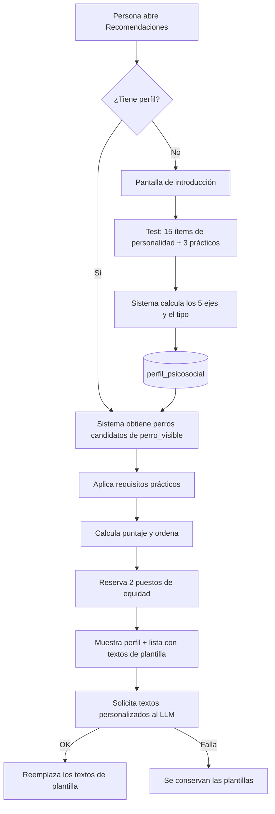

# ADOGTAME — Módulo de Recomendación Inteligente: especificación funcional

> Documento que especifica la **funcionalidad y el comportamiento** del módulo de recomendación basado en un test de perfil psicosocial del adoptante.
> **Relación con documentos previos:** la sección 1 (problemática) de `Adogtame_modulo_recomendacion.md` sigue vigente como justificación. Las secciones 2 a 5 de ese documento (formulario de estilo de vida → LLM → filtros, y nuevos campos en `perro`) quedan **reemplazadas** por este documento.
> Convenciones heredadas: _[Observación]_ = comentario de análisis, _[Propuesta]_ = idea pendiente de acuerdo, _[Nuevo]_ = especificación acordada. Las referencias FR-xx, CU-xx y NFR-xx apuntan a `Adogtame_Analisis_Final.md`. Los identificadores propios del módulo usan el prefijo **REC** (FR-REC, CU-REC, RN-REC) para no chocar con la numeración de otros módulos.

| Versión | Cambio |
|---|---|
| 1.0 | Primera versión: test de perfil, cálculo, algoritmo sobre atributos físicos existentes, explicaciones, pantallas, datos, requisitos y casos de uso. |

---

## Índice

1. [Propósito, enfoque y alcance](#1-propósito-enfoque-y-alcance)
2. [Actores y permisos](#2-actores-y-permisos)
3. [Flujo general](#3-flujo-general)
4. [Test de perfil psicosocial](#4-test-de-perfil-psicosocial)
5. [Cálculo del perfil](#5-cálculo-del-perfil)
6. [Atributos del perro utilizados](#6-atributos-del-perro-utilizados)
7. [Algoritmo de recomendación](#7-algoritmo-de-recomendación)
8. [Explicación de cada recomendación](#8-explicación-de-cada-recomendación)
9. [Interfaz y comportamiento](#9-interfaz-y-comportamiento)
10. [Modelo de datos](#10-modelo-de-datos)
11. [Requisitos funcionales y reglas de negocio](#11-requisitos-funcionales-y-reglas-de-negocio)
12. [Casos de uso](#12-casos-de-uso)
13. [Requisitos no funcionales](#13-requisitos-no-funcionales)
14. [Limitaciones y decisiones abiertas](#14-limitaciones-y-decisiones-abiertas)
15. [Fuentes de consulta](#15-fuentes-de-consulta)

---

## 1. Propósito, enfoque y alcance

### 1.1 Propósito

Ofrecer a quien quiere adoptar una **lista de perros potenciales** alineados con su forma de ser, como alternativa **didáctica** al buscador con filtros (FR-09). El usuario no necesita saber de antemano qué tamaño, edad o pelaje le conviene: responde un test corto, recibe un perfil comprensible y una lista ordenada en la que cada perro viene acompañado de **por qué encaja** y **lo que debe saber antes de adoptarlo**.

### 1.2 Enfoque

| Decisión | Razón |
|---|---|
| **La tabla `perro` no cambia.** El módulo usa solo atributos que ya existen (edad, tamaño, pelaje, necesidades especiales, esterilización, vacunas, fecha de publicación). | No complicar el registro del perro (FR-05). |
| **El test mide personalidad en escalas continuas** y la presenta con letras al estilo MBTI, más un quinto eje de estabilidad emocional (-A / -T). | Las letras hacen el resultado familiar; las escalas continuas evitan la inestabilidad de las categorías binarias del MBTI (ver 15). El quinto eje cubre el rasgo con más evidencia en la relación dueño-perro (neuroticismo), que el MBTI no mide. |
| **El orden de la lista lo calcula el sistema** con una fórmula fija. | Es predecible, explicable y no depende de un servicio externo. |
| **El LLM solo redacta textos** (perfil y explicaciones). Si no está disponible se usan plantillas. | El módulo funciona aunque el LLM falle. |
| **La recomendación es orientativa.** | Los mapeos personalidad → atributo físico son heurísticas didácticas, no resultados validados (ver 14.1). |

### 1.3 Alcance

- **Dentro:** test de perfil, cálculo del perfil, lista de hasta 12 perros recomendados con explicación, repetición del test y eliminación del perfil.
- **Fuera:** garantizar el éxito de una adopción; reemplazar la solicitud de adopción y el criterio del publicador (FR-07); evaluar la conducta de los perros; recomendar perros a refugios o administradores; filtrar por raza o color; recomendar por presencia de niños u otras mascotas (no hay atributos del perro para ello).

---

## 2. Actores y permisos

| Actor | Qué puede hacer en el módulo |
|---|---|
| **Persona** | Realizar el test, ver su perfil y sus recomendaciones, rehacer el test y eliminar su perfil. |
| **Rescatista** | Lo mismo que Persona (hereda sus permisos). |
| **Visitante** | Ve la entrada a *Recomendaciones* con una invitación a registrarse o iniciar sesión. No puede realizar el test. |
| **Refugio, Administrador** | No ven la sección (no adoptan, FR-07). El administrador no puede consultar perfiles psicosociales. |
| **Sistema** | Calcula el perfil y la lista; solicita al LLM los textos. |

_[Propuesta]_ Nuevo permiso `recomendacion:usar:propio`, asignado al rol PERSONA (RESCATISTA lo hereda). Se autoriza en el servidor (NFR-09).

---

## 3. Flujo general



---

## 4. Test de perfil psicosocial

### 4.1 Estructura

| Bloque | Ítems | Formato | Uso |
|---|---|---|---|
| Personalidad | 15 (3 por eje) | Dos frases opuestas (A y B) y escala de 5 puntos entre ellas | Calcula los 5 ejes |
| Situación práctica | 3 | Opción única | Requisitos y penalizaciones (7.2) |

- Duración objetivo: **3 a 4 minutos**.
- Todos los ítems son obligatorios.
- Los ítems se presentan en grupos de 3 por pantalla, en el orden de la tabla 4.3, mezclando ejes para que el usuario no perciba qué mide cada bloque.
- La escala no muestra números; se ve como cinco puntos entre las dos frases. El punto central significa «ambas por igual».

### 4.2 Ejes

Cada eje va de −1 (polo −) a +1 (polo +).

| Eje | Polo − (letra) | Polo + (letra) | Rasgo de referencia (Big Five) |
|---|---|---|---|
| **Ritmo** | Hogareño (I) | Explorador (E) | Extraversión |
| **Mirada** | Práctico (S) | Curioso (N) | Apertura |
| **Vínculo** | Racional (T) | Afectivo (F) | Amabilidad |
| **Rutina** | Espontáneo (P) | Planificador (J) | Responsabilidad |
| **Calma** | Sensible (-T) | Sereno (-A) | Estabilidad emocional (inverso de neuroticismo) |

> _[Observación]_ La correspondencia MBTI ↔ Big Five sigue a McCrae y Costa (1989). La letra T aparece en dos ejes (Racional y Sensible); no hay ambigüedad porque la de Calma siempre va tras el guion (ej. `ENFJ-T`).

### 4.3 Ítems de personalidad

A = valor 1, B = valor 5. «(inv)» indica que el polo + está en la frase A y el ítem se invierte al puntuar.

| # | Eje | Frase A | Frase B | Inv. |
|---|---|---|---|---|
| 1 | Ritmo | Un sábado libre prefiero quedarme en casa a recargar energía. | Un sábado libre prefiero salir a un lugar nuevo con gente. | |
| 2 | Mirada | Al elegir un restaurante voy al que ya conozco. | Al elegir un restaurante pruebo uno que nunca he visitado. | |
| 3 | Vínculo | Al decidir algo importante pienso en pros y contras. | Al decidir algo importante me guío por lo que siento. | |
| 4 | Rutina | Mi semana la voy improvisando. | Mi semana la tengo organizada. | |
| 5 | Calma | Cuando algo imprevisto cambia mis planes, me inquieta bastante. | Cuando algo imprevisto cambia mis planes, me adapto rápido. | |
| 6 | Ritmo | Después del trabajo o estudios prefiero calma. | Después del trabajo o estudios necesito moverme o salir. | |
| 7 | Mirada | Si algo no sale como esperaba, busco volver a lo seguro. | Si algo no sale como esperaba, me intriga ver qué resulta. | |
| 8 | Vínculo | Si un amigo tiene un problema, le ayudo a resolverlo. | Si un amigo tiene un problema, primero lo acompaño y escucho. | |
| 9 | Rutina | Antes de un viaje, empaco a última hora. | Antes de un viaje, tengo lista y horarios. | |
| 10 | Calma | Antes de una decisión importante le doy muchas vueltas. | Antes de una decisión importante decido y sigo. | |
| 11 | Ritmo | Mis vacaciones ideales: recorrer muchos lugares. | Mis vacaciones ideales: quedarme tranquilo en un solo sitio. | ✔ |
| 12 | Mirada | Al comprar algo importante me atrae lo distinto. | Al comprar algo importante elijo lo probado y recomendado. | ✔ |
| 13 | Vínculo | Ver a alguien que espera mucho tiempo ser elegido me parece parte del proceso. | Ver a alguien que espera mucho tiempo ser elegido me mueve a hacer algo. | |
| 14 | Rutina | Mis hábitos diarios (ejercicio, comidas) los mantengo con constancia. | Mis hábitos diarios dependen del día. | ✔ |
| 15 | Calma | Si algo sale mal en casa (una rotura, un desorden), lo tomo con humor. | Si algo sale mal en casa, me afecta el resto del día. | ✔ |

### 4.4 Ítems de situación práctica

| # | Pregunta | Opciones | Valor almacenado |
|---|---|---|---|
| 16 | ¿Dónde vivirá el perro? | Departamento · Casa sin patio · Casa con patio | `departamento` · `casa_sin_patio` · `casa_con_patio` |
| 17 | ¿Cuántas horas al día estaría solo? | Menos de 4 · Entre 4 y 8 · Más de 8 | `menos_4` · `entre_4_8` · `mas_8` |
| 18 | ¿Aceptarías un perro con necesidades especiales? | Sí · No | `TRUE` · `FALSE` |

---

## 5. Cálculo del perfil

### 5.1 Puntaje por eje

Para cada respuesta `r ∈ {1..5}`:

```
v = r − 3                 -- centra en 0: rango −2..+2
si el ítem es (inv): v = −v
eje = promedio(v de sus 3 ítems) / 2      -- rango −1..+1, redondeado a 2 decimales
```

### 5.2 Tipo y título

- **Letra por eje:** si `eje ≥ 0` se asigna la letra del polo +; si no, la del polo −.
- **Tipo:** cuatro letras en orden Ritmo, Mirada, Vínculo, Rutina, más el sufijo de Calma. Ejemplo: `ENFJ-A`.
- **Eje equilibrado:** si `|eje| < 0,20`, la descripción lo presenta como «equilibrado» aunque tenga letra asignada.
- **Eje dominante:** el de mayor `|eje|`. Si hay empate, gana el primero en el orden Calma, Ritmo, Rutina, Vínculo, Mirada (orden de mayor a menor peso en la recomendación).
- **Título del perfil:** nombre de los polos de los dos ejes con mayor `|eje|`, por ejemplo «Explorador Afectivo». No se usan los nombres de los 16 tipos de otros tests comerciales.

### 5.3 Reglas

- **RN-REC-01** El perfil se recalcula completo cada vez que se envía el test; no se editan respuestas sueltas.
- **RN-REC-02** Se guardan las 15 respuestas, además de los puntajes, para poder recalcular si cambian las fórmulas.
- **RN-REC-03** El tipo y los puntajes no se muestran a otros usuarios ni en el perfil público (FR-11).

---

## 6. Atributos del perro utilizados

Todos se derivan de columnas existentes de `perro` (6.4 del análisis final). Ningún atributo nuevo se pide al publicador.

| Rasgo derivado | Origen | Valores |
|---|---|---|
| `edad_n` | `fecha_nacimiento` → banda de edad | cachorro (< 1 año) **+1** · joven (1 a < 3) **+0,5** · adulto (3 a 8) **−0,5** · senior (> 8) **−1** |
| `es_cachorro` | idem | 1 si cachorro, 0 si no |
| `es_senior` | idem | 1 si senior, 0 si no |
| `tamano_n` | `tamano` | pequeño **−1** · mediano **0** · grande **+1** |
| `pelaje_n` | `pelaje` | corto **−1** · mediano **0** · largo **+1** |
| `necesidades_n` | `necesidades_especiales` (TEXT) | **1** si tiene texto no vacío; **0** si es NULL o vacío |
| `cuidados_n` | `esterilizado`, `vacunas_al_dia` | **−1** si ambos son TRUE; **+1** si falta alguno |
| `espera` | `fecha_publicacion` | días publicados / 180, con tope en **1** |

> _[Observación]_ Las bandas de edad son las mismas propuestas en `Adogtame_modulo_recomendacion.md` (3.3). La edad adulta real depende del tamaño; se aceptan como simplificación.

Vista de apoyo _[Propuesta]_:

```sql
CREATE VIEW perro_rasgos_rec AS
SELECT
    p.id_perro,
    p.id_publicador,
    p.fecha_publicacion,
    CASE
        WHEN age(current_date, p.fecha_nacimiento) <  interval '1 year'  THEN  1.0
        WHEN age(current_date, p.fecha_nacimiento) <  interval '3 years' THEN  0.5
        WHEN age(current_date, p.fecha_nacimiento) <= interval '8 years' THEN -0.5
        ELSE -1.0
    END                                                                AS edad_n,
    (age(current_date, p.fecha_nacimiento) <  interval '1 year')::int  AS es_cachorro,
    (age(current_date, p.fecha_nacimiento) >  interval '8 years')::int AS es_senior,
    CASE p.tamano WHEN 'pequeno' THEN -1 WHEN 'mediano' THEN 0 ELSE 1 END AS tamano_n,
    CASE p.pelaje WHEN 'corto'   THEN -1 WHEN 'mediano' THEN 0 ELSE 1 END AS pelaje_n,
    (COALESCE(TRIM(p.necesidades_especiales), '') <> '')::int          AS necesidades_n,
    CASE WHEN p.esterilizado AND p.vacunas_al_dia THEN -1 ELSE 1 END   AS cuidados_n,
    LEAST(EXTRACT(EPOCH FROM (now() - p.fecha_publicacion)) / 86400 / 180, 1.0) AS espera
FROM perro_visible p
WHERE p.estado = 'disponible';
```

La vista se apoya en `perro_visible`, de modo que respeta la regla de visibilidad (FR-13) y el borrado lógico.

---

## 7. Algoritmo de recomendación

### 7.1 Candidatos

**RN-REC-04** Son candidatos los perros de `perro_rasgos_rec`: visibles (FR-13), con `estado = 'disponible'` y **no publicados por el propio usuario** (no puede adoptarlos, FR-07).

### 7.2 Requisitos y penalizaciones prácticas

| Respuesta | Efecto |
|---|---|
| 17 = `mas_8` | **Requisito:** se excluyen cachorros (`es_cachorro = 1`). |
| 18 = No | **Requisito:** se excluyen perros con `necesidades_n = 1`. |
| 16 = `departamento` | **Penalización:** −1,5 al puntaje de perros grandes. |
| 16 = `casa_sin_patio` | **Penalización:** −0,5 al puntaje de perros grandes. |

**RN-REC-05** La vivienda penaliza pero no excluye, para no dejar sin visibilidad a los perros grandes (riesgo señalado en 1.6 de `Adogtame_modulo_recomendacion.md`).

### 7.3 Puntaje de afinidad

Con los ejes del usuario `R` (Ritmo), `M` (Mirada), `V` (Vínculo), `U` (Rutina) y `C` (Calma):

```
afinidad = 1,0 · R · (edad_n + 0,5·tamano_n)
         + 0,7 · C · (edad_n + tamano_n + necesidades_n + cuidados_n) / 2
         + 0,7 · U · (edad_n + pelaje_n + necesidades_n + cuidados_n) / 2
         + 0,5 · V · (espera + necesidades_n + es_senior)
         + 0,3 · M · (es_senior + espera + cuidados_n) / 2
         + penalización_vivienda
```

Lectura de la fórmula:

| Término | Polo + favorece | Polo − favorece |
|---|---|---|
| Ritmo | Cachorros y jóvenes, tamaños mayores | Adultos y seniors |
| Calma | Perros que piden más (cachorro, grande, necesidades, cuidados pendientes) | Perros con menos sorpresas (adulto o senior, pequeño, cuidados al día) |
| Rutina | Perros que piden constancia (cachorro, pelaje largo, necesidades, cuidados pendientes) | Bajo mantenimiento |
| Vínculo | Perros que esperan más, con necesidades, seniors | Perros recién publicados y sin necesidades |
| Mirada | Opciones menos convencionales (senior, larga espera, cuidados pendientes) | Opciones previsibles |

**RN-REC-06** Los pesos (1,0 · 0,7 · 0,7 · 0,5 · 0,3) son valores de partida; se guardan como configuración del sistema, no en el código, para poder ajustarlos.

Consulta de referencia _[Propuesta]_ (`$1..$5` = R, M, V, U, C; `$6` = id del usuario; `$7`, `$8`, `$9` = respuestas 16, 17 y 18):

```sql
SELECT r.id_perro,
       1.0 * $1 * (r.edad_n + 0.5 * r.tamano_n)
     + 0.7 * $5 * (r.edad_n + r.tamano_n + r.necesidades_n + r.cuidados_n) / 2
     + 0.7 * $4 * (r.edad_n + r.pelaje_n + r.necesidades_n + r.cuidados_n) / 2
     + 0.5 * $3 * (r.espera + r.necesidades_n + r.es_senior)
     + 0.3 * $2 * (r.es_senior + r.espera + r.cuidados_n) / 2
     + CASE WHEN r.tamano_n = 1 AND $7 = 'departamento'   THEN -1.5
            WHEN r.tamano_n = 1 AND $7 = 'casa_sin_patio' THEN -0.5
            ELSE 0 END                                         AS afinidad
FROM perro_rasgos_rec r
WHERE r.id_publicador <> $6
  AND NOT ($8 = 'mas_8' AND r.es_cachorro = 1)
  AND NOT ($9 = FALSE   AND r.necesidades_n = 1)
ORDER BY afinidad DESC, r.fecha_publicacion ASC;
```

Los parámetros se envían siempre como valores enlazados; ningún texto se concatena en la consulta.

### 7.4 Armado de la lista

1. Se toman los **10** primeros por afinidad. A igual afinidad, va primero el perro publicado hace más tiempo.
2. **Puestos de equidad (RN-REC-07):** de los candidatos que cumplen los requisitos y no entraron en los 10, se agregan los **2** con `fecha_publicacion` más antigua, con la etiqueta «Lleva tiempo esperando». Se muestran en las posiciones 6 y 12.
3. Si hay menos de 12 candidatos, se muestran todos con el mismo orden y sin puestos de equidad.
4. Si no hay candidatos, se muestra el mensaje MSG-REC-03 (9.4).

**RN-REC-08** La lista se calcula cada vez que se abre la sección; no se guarda. Refleja siempre los perros disponibles en ese momento.

**RN-REC-09** No se muestra la afinidad como número ni como porcentaje. Los tres primeros llevan la etiqueta «Muy afín»; el resto, sin etiqueta. Un número daría una falsa sensación de precisión.

---

## 8. Explicación de cada recomendación

### 8.1 Contenido

Cada perro de la lista muestra dos textos:

| Texto | Contenido | Límite |
|---|---|---|
| **Por qué encaja** | Conecta un atributo del perro con un rasgo del perfil, en el tono del eje dominante (8.2). | 200 caracteres |
| **Lo que debes saber** | Un desafío real derivado de sus atributos (8.3). | 160 caracteres |

**RN-REC-10** Todo perro recomendado lleva siempre un «Lo que debes saber». La explicación busca alinear las expectativas con la realidad, no convencer: las expectativas altas sobre la conducta se asociaron con devoluciones tempranas (Powell et al., 2022).

### 8.2 Tono según el eje dominante

| Eje dominante | Polo + | Polo − |
|---|---|---|
| Ritmo | Actividades compartidas, salidas, juego. | Compañía tranquila, rutinas de casa. |
| Mirada | Lo particular del perro, su historia, lo distinto. | Datos concretos y previsibles: edad, salud, cuidados al día. |
| Vínculo | Historia del perro y lo que significa adoptarlo. | Hechos y razones prácticas. |
| Rutina | Información estructurada: rutina, cuidados, preparación. | Lo sencillo de su cuidado. |
| Calma | Seguridad para asumir retos. | Tono tranquilizador; adaptación por etapas; a quién pedir ayuda (el publicador). |

### 8.3 Desafíos por atributo

Se elige el primero que aplique, en este orden:

| Condición | Texto base |
|---|---|
| `necesidades_n = 1` | «Tiene necesidades especiales; pregunta al publicador qué cuidados y costos implica.» |
| cachorro | «Es cachorro: necesitará entrenamiento, paciencia y varias salidas al día.» |
| grande | «Es grande: necesita espacio y paseos diarios.» |
| senior | «Es senior: conviene prever controles veterinarios más frecuentes.» |
| `cuidados_n = 1` | «Tiene cuidados pendientes (esterilización o vacunas) que deberás cubrir.» |
| pelaje largo | «Su pelaje largo necesita cepillado frecuente.» |
| ninguno | «Todo perro necesita unas semanas para adaptarse a un hogar nuevo.» |

### 8.4 Generación de textos

**Plantillas (siempre disponibles).** El sistema arma ambos textos con frases predefinidas por eje dominante y por atributo (8.2 y 8.3). Con ellas se muestra la lista de inmediato.

**LLM (mejora opcional).** Después de mostrar la lista, el sistema pide al LLM textos más naturales y reemplaza las plantillas cuando llega una respuesta válida.

- **Entrada:** puntajes de los 5 ejes, tipo, eje dominante y, por cada perro, `id_perro`, nombre, banda de edad, tamaño, pelaje, si tiene necesidades especiales, cuidados al día, días publicado y el desafío elegido en 8.3. **No se envían** datos del usuario (nombre, correo, teléfono, identificador), ni la ubicación del perro, ni los textos libres `descripcion` y `caracteristicas`.
- **Salida esperada** (validada contra un esquema):

```json
{
  "perfil": {
    "titulo": "Explorador Afectivo",
    "descripcion": "Disfrutas salir y conectar con otros, y te mueve ayudar a quien lo necesita."
  },
  "perros": [
    {
      "id_perro": 123,
      "por_que": "Luna es joven y llena de energía: una buena compañera para tus salidas de fin de semana.",
      "lo_que_debes_saber": "Es cachorra: necesitará entrenamiento, paciencia y varias salidas al día."
    }
  ]
}
```

**RN-REC-11** La respuesta del LLM se descarta y se conservan las plantillas si: no cumple el esquema; contiene un `id_perro` que no estaba en la lista; falta algún perro; o algún texto supera el límite. El `lo_que_debes_saber` del LLM debe referirse al mismo desafío elegido en 8.3.

**RN-REC-12** El LLM no ordena, no agrega ni quita perros.

---

## 9. Interfaz y comportamiento

### 9.1 Punto de entrada

- Ítem **Recomendaciones** en el menú principal, visible para Persona, Rescatista y Visitante.
- Visitante: ve una página con la explicación del módulo y el botón «Inicia sesión para descubrir tu perfil» (MSG-REC-01).

### 9.2 Pantalla de introducción (sin perfil)

- Explica en tres líneas qué hace el módulo, cuánto dura el test y que la recomendación es **orientativa**.
- Aviso de privacidad (MSG-REC-02): qué se guarda, que nadie más lo ve y que puede eliminarse.
- Botón «Empezar el test».

### 9.3 Test

- Seis pantallas: cinco con 3 ítems de personalidad y una con los 3 ítems prácticos.
- Barra de progreso; botones «Atrás» y «Siguiente».
- «Siguiente» solo se habilita con los 3 ítems respondidos.
- Si el usuario abandona, no se guarda nada (RN-REC-13).
- Al enviar, el sistema guarda el perfil y abre la pantalla de resultados.

### 9.4 Resultados

**Tarjeta de perfil** (arriba):
- Título y tipo (ej. «Explorador Afectivo · ENFJ-A»).
- Descripción breve.
- Cinco barras, una por eje, con el nombre de ambos polos y la posición del usuario. Los ejes equilibrados se rotulan como tales.
- Botones «Rehacer el test» y «Eliminar mi perfil».

**Lista de perros:**
- Tarjetas con el mismo componente del listado general: foto principal, nombre, edad, tamaño y género.
- Debajo, «Por qué encaja» y «Lo que debes saber».
- Etiquetas «Muy afín» (top 3) y «Lleva tiempo esperando» (puestos de equidad).
- Acciones de la tarjeta: ver perfil (FR-10) y favorito (FR-08). La solicitud de adopción sigue en el perfil del perro (FR-07).

**Pie:** texto «Estas sugerencias son orientativas» y enlace «Explorar todos los perros» al buscador (FR-09).

**Mensajes:**

| Código | Situación | Texto |
|---|---|---|
| MSG-REC-01 | Visitante | «Inicia sesión para descubrir qué perros van contigo.» |
| MSG-REC-02 | Antes del test | «Guardaremos tus respuestas para recomendarte perros. Nadie más puede verlas y puedes eliminarlas cuando quieras.» |
| MSG-REC-03 | Sin candidatos | «Por ahora no hay perros que cumplan tus condiciones. Vuelve pronto o explora el buscador.» |
| MSG-REC-04 | Error al calcular | «No pudimos cargar tus recomendaciones. Inténtalo de nuevo.» |
| MSG-REC-05 | Confirmar eliminación | «Se eliminará tu perfil y tus respuestas. ¿Continuar?» |

### 9.5 Comportamiento ante cambios

- Si un perro de la lista se adopta, se elimina o su publicador queda inactivo, desaparece al recargar (RN-REC-08).
- Si el usuario elimina su perfil, la sección vuelve a la pantalla de introducción.
- Si la cuenta se desactiva (FR-15) o se elimina, el perfil se elimina en cascada.

---

## 10. Modelo de datos

### 10.1 Nueva tabla _[Propuesta]_

```sql
CREATE TABLE perfil_psicosocial (
    id_persona          BIGINT PRIMARY KEY REFERENCES persona(id_cuenta) ON DELETE CASCADE,
    respuestas          SMALLINT[] NOT NULL
                        CHECK (cardinality(respuestas) = 15
                               AND 1 <= ALL(respuestas) AND 5 >= ALL(respuestas)),
    eje_ritmo           NUMERIC(3,2) NOT NULL CHECK (eje_ritmo   BETWEEN -1 AND 1),
    eje_mirada          NUMERIC(3,2) NOT NULL CHECK (eje_mirada  BETWEEN -1 AND 1),
    eje_vinculo         NUMERIC(3,2) NOT NULL CHECK (eje_vinculo BETWEEN -1 AND 1),
    eje_rutina          NUMERIC(3,2) NOT NULL CHECK (eje_rutina  BETWEEN -1 AND 1),
    eje_calma           NUMERIC(3,2) NOT NULL CHECK (eje_calma   BETWEEN -1 AND 1),
    tipo                VARCHAR(6)   NOT NULL CHECK (tipo ~ '^[EI][NS][FT][JP]-[AT]$'),
    vivienda            VARCHAR(14)  NOT NULL
                        CHECK (vivienda IN ('departamento','casa_sin_patio','casa_con_patio')),
    horas_solo          VARCHAR(9)   NOT NULL
                        CHECK (horas_solo IN ('menos_4','entre_4_8','mas_8')),
    acepta_necesidades  BOOLEAN      NOT NULL,
    fecha_actualizacion TIMESTAMP    NOT NULL DEFAULT now()
);
```

- Una fila por persona. Rehacer el test reemplaza la fila.
- Las respuestas se guardan en el orden de la tabla 4.3.
- **No hay cambios en `perro`.** Solo se agrega la vista `perro_rasgos_rec` (sección 6).

### 10.2 Configuración

_[Propuesta]_ Los pesos de 7.3, las penalizaciones de 7.2, el tamaño de la lista (12), los puestos de equidad (2) y el umbral de eje equilibrado (0,20) se guardan como parámetros de configuración (RN-REC-06).

---

## 11. Requisitos funcionales y reglas de negocio

### 11.1 Requisitos funcionales

| ID | Nombre | Descripción |
|---|---|---|
| FR-REC-01 | Realizar test de perfil | La persona responde 15 ítems de personalidad y 3 prácticos; el sistema calcula y guarda su perfil (4, 5). |
| FR-REC-02 | Ver perfil psicosocial | La persona ve su tipo, título, descripción y la posición en cada eje (9.4). |
| FR-REC-03 | Ver perros recomendados | El sistema muestra hasta 12 perros ordenados por afinidad, con puestos de equidad (7). |
| FR-REC-04 | Explicar recomendación | Cada perro muestra «Por qué encaja» y «Lo que debes saber» (8). |
| FR-REC-05 | Rehacer test | La persona vuelve a responder el test; el perfil anterior se reemplaza. |
| FR-REC-06 | Eliminar perfil | La persona elimina su perfil y sus respuestas, previa confirmación (MSG-REC-05). |

### 11.2 Reglas de negocio

| ID | Regla |
|---|---|
| RN-REC-01 | El perfil se recalcula completo con cada envío del test. |
| RN-REC-02 | Se guardan las respuestas y los puntajes. |
| RN-REC-03 | El perfil es privado: no lo ve otro usuario ni el administrador, ni aparece en el perfil público. |
| RN-REC-04 | Candidatos: perros visibles, disponibles y no publicados por el usuario. |
| RN-REC-05 | La vivienda penaliza a los perros grandes pero no los excluye. |
| RN-REC-06 | Pesos y umbrales son configurables. |
| RN-REC-07 | Dos puestos de la lista se reservan para los perros que más tiempo llevan publicados. |
| RN-REC-08 | La lista se calcula al abrir la sección y no se guarda. |
| RN-REC-09 | No se muestra la afinidad como número o porcentaje. |
| RN-REC-10 | Todo perro recomendado muestra un desafío real. |
| RN-REC-11 | Una respuesta inválida del LLM se descarta y se usan las plantillas. |
| RN-REC-12 | El LLM no ordena, agrega ni quita perros. |
| RN-REC-13 | Un test abandonado no se guarda. |

### 11.3 Impacto en requisitos existentes

| Artefacto | Acción | Detalle |
|---|---|---|
| FR-05 | `SIN CAMBIO` | El registro del perro no cambia. |
| FR-08, FR-10 | `SIN CAMBIO` | Se reutilizan desde las tarjetas de recomendación. |
| FR-09 | `SIN CAMBIO` | El buscador sigue disponible; la sección enlaza a él. |
| FR-13 | `SIN CAMBIO` | La vista del módulo se apoya en `perro_visible`. |
| FR-15 | `MODIFICA` | Al desactivar o eliminar la cuenta, se elimina el perfil psicosocial. |
| NFR-01 | `MODIFICA` | Se aclara que los textos del LLM se cargan después y no cuentan en los 3 s (13). |
| Roles y permisos | `MODIFICA` | Nuevo permiso `recomendacion:usar:propio` para PERSONA. |

---

## 12. Casos de uso

### CU-REC-01 Realizar test de perfil

| Campo | Detalle |
|---|---|
| Actores | Persona, Rescatista |
| Precondición | Sesión iniciada con rol Persona o Rescatista. |
| Flujo principal | 1. El usuario abre *Recomendaciones*. 2. El sistema muestra la introducción y MSG-REC-02. 3. El usuario pulsa «Empezar el test». 4. El sistema muestra las seis pantallas del test. 5. El usuario responde todos los ítems y envía. 6. El sistema calcula los ejes y el tipo, y guarda el perfil. 7. El sistema muestra los resultados (CU-REC-02). |
| Flujos alternativos | **A1. Abandono:** el usuario sale antes de enviar; no se guarda nada. **A2. Rehacer:** desde los resultados pulsa «Rehacer el test»; al enviar, el perfil anterior se reemplaza. **A3. Error al guardar:** el sistema muestra MSG-REC-04 y conserva las respuestas en pantalla para reintentar. |
| Postcondición | Existe una fila en `perfil_psicosocial` para el usuario. |

### CU-REC-02 Ver recomendaciones

| Campo | Detalle |
|---|---|
| Actores | Persona, Rescatista; Sistema (secundario) |
| Precondición | El usuario tiene perfil psicosocial. |
| Flujo principal | 1. El usuario abre *Recomendaciones*. 2. El sistema obtiene los candidatos (RN-REC-04) y aplica requisitos y penalizaciones (7.2). 3. Calcula la afinidad, ordena y agrega los puestos de equidad (7.4). 4. Muestra la tarjeta de perfil y la lista con textos de plantilla. 5. Solicita al LLM los textos personalizados. 6. Si la respuesta es válida, reemplaza los textos. 7. El usuario abre el perfil de un perro o lo marca como favorito. |
| Flujos alternativos | **A1. Sin candidatos:** se muestra MSG-REC-03 y el enlace al buscador. **A2. LLM falla o responde inválido:** se conservan las plantillas sin avisar al usuario (RN-REC-11). **A3. Error de cálculo:** MSG-REC-04 con opción de reintentar. |
| Postcondición | Ninguna; la lista no se guarda. |

### CU-REC-03 Eliminar perfil psicosocial

| Campo | Detalle |
|---|---|
| Actores | Persona, Rescatista |
| Precondición | El usuario tiene perfil psicosocial. |
| Flujo principal | 1. El usuario pulsa «Eliminar mi perfil». 2. El sistema muestra MSG-REC-05. 3. El usuario confirma. 4. El sistema elimina la fila y vuelve a la introducción. |
| Flujo alternativo | **A1.** El usuario cancela; no cambia nada. |
| Postcondición | No existe perfil psicosocial para el usuario. |

---

## 13. Requisitos no funcionales

| ID | Tipo | Detalle |
|---|---|---|
| NFR-REC-01 | Eficiencia | El perfil y la lista con textos de plantilla se muestran en menos de **3 s** (NFR-01). Los textos del LLM se cargan después, sin bloquear la pantalla, con un tiempo máximo de espera de **10 s**; pasado ese tiempo se conservan las plantillas. |
| NFR-REC-02 | Privacidad | El perfil psicosocial es un dato personal: solo lo lee y modifica su dueño (NFR-09), viaja por HTTPS y no aparece en logs (NFR-11). Al LLM solo se envía la información de 8.4. El tratamiento debe revisarse contra la Ley Orgánica de Protección de Datos Personales de Ecuador. |
| NFR-REC-03 | Disponibilidad | Si el LLM no está disponible, el módulo funciona completo con plantillas (NFR-10). |
| NFR-REC-04 | Transparencia | La interfaz indica que la recomendación es orientativa y permite ir al buscador en todo momento. |
| NFR-REC-05 | Mantenibilidad | Los pesos y umbrales se modifican por configuración, sin desplegar código (RN-REC-06). El proveedor del LLM se encapsula para poder sustituirlo (NFR-06). |

---

## 14. Limitaciones y decisiones abiertas

### 14.1 Limitaciones declaradas

- **Los mapeos son heurísticos.** La investigación encuentra relaciones modestas entre la personalidad del dueño y rasgos *conductuales* del perro (miedo, actividad, entrenabilidad), no físicos. El único vínculo razonable con atributos existentes es la edad, como aproximación del nivel de actividad. El resto de los mapeos de 7.3 son decisiones didácticas de este diseño.
- **La personalidad no predice el éxito de una adopción.** Walker et al. (2022) no encontraron que la personalidad del adoptante y del perro de refugio predijera la retención. Por eso el módulo se presenta como orientación y mantiene el buscador y la solicitud de adopción sin cambios.
- **El test no es un instrumento validado.** Sus ítems son de elaboración propia, con 3 ítems por eje; la confiabilidad es limitada.
- **El LLM puede redactar textos imprecisos.** Se mitiga con el esquema cerrado, los límites de longitud y el desafío fijado por el sistema (RN-REC-11).

### 14.2 Decisiones abiertas

| # | Pregunta | Por qué importa |
|---|---|---|
| 1 | ¿Se aprueban los 15 ítems o se ajusta su redacción con una prueba piloto con usuarios? | Ítems confusos producen perfiles poco útiles. |
| 2 | ¿Se aprueban los pesos de 7.3 y las penalizaciones de 7.2 como valores iniciales? | Definen el orden de la lista. |
| 3 | ¿Se aprueban las bandas de edad y el tope de 180 días para `espera`? | Afectan casi todos los términos de la fórmula. |
| 4 | ¿Se incluye un botón «¿Te sirvió esta recomendación?» para recoger retroalimentación? | Sería la única forma de evaluar el módulo mientras no exista seguimiento post-adopción. |
| 5 | ¿Qué proveedor y modelo de LLM se usa, y con qué presupuesto? | No definido. |
| 6 | ¿El visitante puede hacer el test sin guardar el perfil? | Podría atraer registros, pero duplica el flujo. Se propone que no. |

---

## 15. Fuentes de consulta

1. McCrae, R. R., & Costa, P. T. (1989). *Reinterpreting the Myers-Briggs Type Indicator from the perspective of the five-factor model of personality*. Journal of Personality, 57(1). <https://onlinelibrary.wiley.com/doi/abs/10.1111/j.1467-6494.1989.tb00759.x>
2. Pittenger, D. J. (2005). *Cautionary comments regarding the Myers-Briggs Type Indicator*. Consulting Psychology Journal, 57(3).
3. Turcsán, B., Range, F., Virányi, Z., Miklósi, Á., & Kubinyi, E. (2012). *Birds of a feather flock together? Perceived personality matching in owner–dog dyads*. Applied Animal Behaviour Science. <https://www.sciencedirect.com/science/article/abs/pii/S0168159112001785>
4. Chopik, W. J., & Weaver, J. R. (2019). *Old dog, new tricks: Age differences in dog personality traits, associations with human personality traits, and links to important outcomes*. Journal of Research in Personality.
5. Sundman, A.-S., et al. (2019). *Long-term stress levels are synchronized in dogs and their owners*. Scientific Reports. <https://www.nature.com/articles/s41598-019-43851-x>
6. Walker, J. K., et al. (2022). *Do canine and human personality assessments predict successful adoptions?* Anthrozoös, 35(5). <https://www.tandfonline.com/doi/abs/10.1080/08927936.2022.2027096>
7. Powell, L., et al. (2022). *Returning a shelter dog: The role of owner expectations and dog behavior*. Animals. <https://pmc.ncbi.nlm.nih.gov/articles/PMC9100056/>
8. Hirsh, J. B., Kang, S. K., & Bodenhausen, G. V. (2012). *Personalized persuasion: Tailoring persuasive appeals to recipients' personality traits*. Psychological Science, 23(6).
9. Matz, S. C., Kosinski, M., Nave, G., & Stillwell, D. J. (2017). *Psychological targeting as an effective approach to digital mass persuasion*. PNAS, 114(48).

> **Nota de verificación.** Las fuentes 1 y 3 a 7 se revisaron en la investigación previa del módulo. Las fuentes 2, 8 y 9 se citan por su referencia bibliográfica conocida, sin abrir el texto completo en esta etapa. Los ítems del test, los pesos, las penalizaciones, las bandas y los textos son criterio de este diseño, no resultados de las fuentes.
