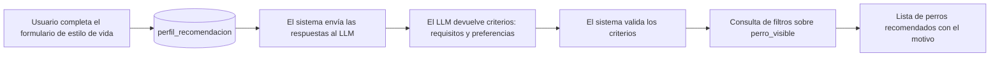

# ADOGTAME — Módulo de Recomendación Inteligente

> Documento de trabajo derivado de `Adogtame_Analisis_Final.md`. Plantea un módulo que recomiende perros a los usuarios con rol **Persona** o **Rescatista** (los únicos que adoptan, FR-07) a partir de características de su perfil.
> Convenciones heredadas: _[Observación]_ = comentario de análisis, _[Propuesta]_ = idea que aún no está acordada, _[Nuevo]_ = especificación acordada. Las referencias FR-xx, CU-xx y NFR-xx apuntan al documento base.
> **Estado:** redactadas la problemática (1) y el planteamiento de la iteración simple (2 a 5). Faltan requisitos, casos de uso y observaciones (6).

| Versión | Cambio |
|---|---|
| 0.1 | Sección 1: problemática, evidencia y características candidatas del perfil. |
| 0.2 | Secciones 2 a 5: alcance de la iteración simple (formulario → LLM → filtros), campos del formulario y nueva tabla `perfil_recomendacion`, dos campos nuevos en `perro` y contrato con el LLM. |

---

## Índice

1. [Problemática](#1-problemática)
2. [Alcance de la iteración y flujo](#2-alcance-de-la-iteración-y-flujo)
3. [Perfil de recomendación: formulario y nueva tabla](#3-perfil-de-recomendación-formulario-y-nueva-tabla)
4. [Ajustes a la tabla perro](#4-ajustes-a-la-tabla-perro)
5. [Contrato con el LLM y consulta de filtros](#5-contrato-con-el-llm-y-consulta-de-filtros)
6. Requisitos, casos de uso y observaciones _(pendiente)_
7. [Fuentes de consulta](#7-fuentes-de-consulta)

---

## 1. Problemática

### 1.1 Tema

Las personas que quieren adoptar un perro suelen **desconocer qué características del animal encajan con su estilo de vida** (tiempo disponible, espacio, experiencia, hogar, actividad). Elegir sin esa información lleva a adopciones que no se sostienen: el perro es devuelto, abandonado o termina en una convivencia insatisfactoria para ambas partes.

El módulo propone que Adogtame **sugiera perros compatibles** con el perfil de cada adoptante, en lugar de dejar toda la decisión a una búsqueda por filtros (FR-09) que exige que el usuario ya sepa qué buscar.

### 1.2 Evidencia de la problemática

#### 1.2.1 La adopción se decide por apariencia y sin planificar

En Ecuador, especialistas señalan que muchos animales se adquieren por su apariencia o por la preferencia hacia una raza, y se abandonan cuando crecen más de lo esperado, requieren más cuidados o desarrollan enfermedades. Barinia Cadena Le Dizes (Universidad Internacional del Ecuador y Asociación Ecuatoriana de Bienestar Animal) lo resume así: «Muchas familias incorporan una mascota sin evaluar las responsabilidades que implica su cuidado durante toda su vida» _(El Mercurio, 2026)_. La misma fuente atribuye el abandono a una combinación de factores económicos, sociales y culturales.

Un estudio con tutores de la parroquia urbana La Aurora (cantón Daule, Ecuador) preguntó por el desconocimiento de los cuidados básicos antes de adoptar como factor de abandono; «de acuerdo» fue la respuesta más frecuente, con **38,3 %** _(Revista Científica ECOA, Universidad de Guayaquil)_. El mismo estudio halló asociaciones estadísticas entre el conocimiento sobre manejo responsable de mascotas y la edad, el nivel educativo y el nivel de ingresos.

Esto se conecta con lo ya documentado en el análisis base (1.3.2): la mayoría de los perros que deambulan en Quito tiene dueño y la tenencia irresponsable es una de las causas del problema _(El Telégrafo, 2024)_. Esa evidencia no distingue cuántos casos se deben a una elección mal informada, pero indica que el momento de la elección es un punto donde la plataforma puede intervenir.

> _[Observación]_ Las fuentes ecuatorianas encontradas son descriptivas (percepciones, opinión de especialistas, muestras pequeñas). No hay una cifra local que cuantifique cuántos abandonos se deben a una mala elección del perro. Es una limitación a declarar en la justificación del módulo.

#### 1.2.2 Las expectativas de los adoptantes no coinciden con la realidad

- En una encuesta a **3 465** posibles adoptores en Australia, los beneficios esperados más frecuentes fueron más caminatas (89 %), felicidad (89 %) y menos estrés (74 %); los desafíos más citados fueron mayor responsabilidad (64 %), el entrenamiento (62 %) y los problemas de conducta (50 %). Los autores señalan que varias de las expectativas, como menor soledad o mayor felicidad, tienen poco respaldo en la evidencia disponible. Quienes ya habían tenido perro esperaban **más beneficios y menos desafíos** que quienes nunca habían tenido, lo que sugiere un recuerdo selectivo de lo positivo _(Powell et al., 2018)_.
- En un estudio con **132** adoptantes de un refugio en Carolina del Sur, **29 perros (22 %)** fueron devueltos en los primeros tres meses. Quienes los devolvieron esperaban más del perro: que no tuviera miedo en situaciones nuevas, que fuera amistoso con los niños, que diera apoyo emocional y que fuera sensible a sus sentimientos. La mediana de permanencia de los perros devueltos fue de **8 días** _(Powell et al., 2022)_.
- En esas devoluciones, el **58,6 %** se atribuyó a razones del animal (conducta) y el **34,5 %** a razones del dueño (vivienda, tiempo) _(Powell et al., 2022)_. Ambos grupos son, en parte, problemas de compatibilidad entre el perro y el hogar.
- Una revisión de la literatura plantea que la renuncia refleja en parte la **percepción del dueño** de que una conducta es un problema, por expectativas no cumplidas o por la distancia entre su estilo de vida y las necesidades del perro, y no solo trastornos propios del animal _(Expectations vs. Reality, PMC, 2020; ver fuentes)_.

> _[Observación]_ El tamaño de la muestra de Powell et al. (2022) es pequeño y proviene de un solo refugio de Estados Unidos. Se usa como indicio, no como cifra aplicable a Quito.

#### 1.2.3 Qué ha funcionado en otros contextos: el emparejamiento

Los refugios de otros países usan **programas de emparejamiento** que evalúan al adoptante (necesidades, preferencias, estilo de vida) y al perro (conducta, personalidad) para mostrar solo los perros que encajan:

- Una encuesta a **370** refugios y grupos de rescate de Estados Unidos encontró que los programas, entre ellos el **emparejamiento de adopciones**, se asociaron con mejores resultados, más que las características de la organización (presupuesto, personal). Las devoluciones medias fueron del 2 % en cachorros y del 6 % en perros _(Reese, 2021)_.
- Una revisión de programas de emparejamiento en adopciones de perros identifica como elementos asociados a buenos resultados: conversar con el adoptante antes de que vea a los perros, mostrar solo los perros que encajan y limitar la elección a los mejores candidatos _(Journal of Applied Animal Welfare Science, 2021)_.
- El programa *Meet Your Match* de la ASPCA reporta, en refugios que lo aplicaron, descensos de devoluciones de entre 35,7 % y 50 % y aumentos de adopciones de hasta 37,5 % _(ASPCA Pro; cifras reportadas por el programa, no verificadas de forma independiente)_.

> _[Observación]_ Estos programas funcionan **con entrevista presencial y evaluación conductual del perro hecha por personal del refugio**. Adogtame no tiene ninguno de los dos: los perros los publican personas, rescatistas y refugios con distinto nivel de conocimiento. Trasladar el emparejamiento a una plataforma digital abierta es una propuesta de este módulo y su efectividad no está respaldada por las fuentes revisadas.

### 1.3 Problema central y consecuencias

**Problema central:** _Los adoptantes desconocen qué características de un perro son compatibles con su estilo de vida, por lo que eligen sin criterios de compatibilidad._

| Causa | Evidencia |
|---|---|
| Elección por apariencia o raza, sin planificación | _El Mercurio (2026)_; especialistas en tenencia responsable. |
| Desconocimiento de los cuidados y necesidades del perro antes de adoptar | Estudio en La Aurora, Daule (38,3 %). |
| Expectativas irreales sobre conducta y vínculo | Powell et al. (2018, 2022). |
| La búsqueda por filtros (FR-09) presupone que el usuario sabe qué características le convienen | _[Observación]_ Los filtros actuales son atributos del perro (raza, tamaño, edad…); ninguno parte del adoptante. |

| Consecuencia | Evidencia |
|---|---|
| Devoluciones tempranas del perro al refugio o al rescatista | 22 % de devoluciones en tres meses en el estudio de Powell et al. (2022). |
| Abandono posterior cuando el perro «crece más de lo esperado» o requiere más tiempo y dinero | _El Mercurio (2026)_. |
| Pérdida de confianza y de tiempo para el publicador (rescatistas y refugios ya saturados, ver 1.3.4 del documento base) | _[Observación]_ Cada devolución reabre el proceso de adopción. |
| Menos probabilidad de adopción para perros menos «atractivos» (adultos, grandes, con necesidades especiales) cuando la decisión se guía por apariencia | _[Observación]_ Coherente con los factores de adopción de _La Hora (2018)_, en el documento base. |

### 1.4 Características del perfil del adoptante a investigar

La pregunta de partida del módulo es **qué características del perfil permiten anticipar la compatibilidad con un perro**. La tabla agrupa las que aparecen en las fuentes revisadas y valora qué tan respaldadas están. Es un insumo para decidir, no una selección final.

| Característica del adoptante | Qué se quiere saber | Respaldo en las fuentes | Nivel |
|---|---|---|---|
| **Experiencia previa con perros** | Primera vez, antes tuvo perro, tiene perro actualmente. | Powell et al. (2018): los dueños previos subestiman los desafíos y los primerizos los anticipan más. | Alto |
| **Tiempo disponible** | Horas al día que el perro estaría solo; horas disponibles para paseo, juego y entrenamiento. | La falta de tiempo es razón de devolución del lado del dueño (Powell et al., 2022). Se menciona como necesidad de «inversión» en caminatas y entrenamiento. | Alto |
| **Nivel de actividad física** | Qué tanto camina o hace ejercicio; si quiere un perro que lo acompañe. | Compatibilidad en gusto por el ejercicio asociada a mayor satisfacción del dueño (revisión sobre emparejamiento). Powell et al. (2018): se espera más caminata (89 %). | Medio-alto |
| **Vivienda** | Tipo (casa o departamento), espacio exterior, si es propia o arrendada. | La vivienda es razón de devolución del lado del dueño (Powell et al., 2022). Citada como atributo de emparejamiento en descripciones de sistemas comerciales y patentes. | Medio |
| **Composición del hogar** | Presencia y edad de niños, adultos mayores, otras mascotas. | Los adoptantes que devolvieron esperaban que el perro fuera amistoso con los niños (Powell et al., 2022). La edad y presencia de niños aparecen entre los atributos de adoptante en sistemas de emparejamiento. | Medio-alto |
| **Presupuesto para el cuidado** | Capacidad para costos de alimentación, veterinaria y esterilización. | Factor económico señalado en Ecuador (_El Mercurio, 2026_; ver también 1.3.2 del documento base). Costos como causa de renuncia en la literatura. | Medio-alto |
| **Expectativas sobre el perro** | Qué espera del perro: compañía, apoyo emocional, perro de guardia, amistoso con niños. | Powell et al. (2022): expectativas altas en conducta y vínculo se asociaron a devolución. | Medio |
| **Preferencias del adoptante** | Tamaño, edad, pelaje, esterilizado; disposición a adoptar un perro adulto o con necesidades especiales. | Son los atributos que Adogtame ya maneja (FR-05, FR-09). Preferencias de selección en refugios son un factor documentado. | Medio |
| **Tolerancia a conductas y cuidados** | Tolerancia al ruido, al pelo, al adiestramiento, a problemas de conducta iniciales. | Dos tercios de los adoptantes reportaron problemas de conducta iniciales y mejoraron en las semanas siguientes (Powell et al., 2022). | Bajo-medio |
| **Edad y nivel educativo del adoptante** | — | Solo se asocian al *conocimiento* sobre tenencia responsable en un estudio ecuatoriano; no hay respaldo de que predigan compatibilidad. Además, usarlos como criterio de recomendación plantea riesgo de **sesgo o discriminación**. | Bajo (no recomendada) |

_Nivel_ = juicio de este análisis sobre cuántas fuentes y qué tan directas son, no una métrica de las fuentes.

> _[Propuesta]_ Hay un dato que conviene decidir pronto: todas las características anteriores son **declaradas por el usuario**, así que su calidad depende de la honestidad y el autoconocimiento de quien responde, que es justamente lo que el problema describe como limitado. La experiencia de *Meet Your Match* sugiere que el cuestionario funciona mejor guiado por una conversación; en Adogtame esa función la tendría que cumplir el diseño del formulario (preguntas concretas sobre situaciones, no autoevaluaciones abstractas).

### 1.5 Brecha en el sistema actual

Para recomendar hace falta describir **a los dos lados**. Hoy Adogtame solo describe bien a uno.

| Lado | Qué existe en Adogtame | Qué falta para recomendar |
|---|---|---|
| **Perro** | Tamaño, peso, edad (de `fecha_nacimiento`), pelaje, color, género, esterilizado, vacunas, necesidades especiales, descripción (FR-05). | Atributos de **conducta y compatibilidad**: nivel de energía, relación con niños, con otros perros y con otras mascotas, tiempo que tolera estar solo, nivel de entrenamiento. El análisis base solo guarda `caracteristicas` y `descripcion` como texto libre. |
| **Adoptante** | Nombre, foto, descripción, teléfono y correo (FR-04, FR-11). | Ninguna de las características de 1.4. |
| **Historial** | Favoritos (FR-08) y solicitudes de adopción (FR-07). | Resultado de la adopción (si se sostuvo o se devolvió): no hay seguimiento post-adopción, que está diferido (5.2 del documento base). Sin eso no hay forma de comprobar si una recomendación funcionó. |

> _[Observación]_ El campo del perro es el cuello de botella: si los publicadores no completan datos de conducta de forma consistente, las recomendaciones no tendrán base. Esto implica que el módulo probablemente exigirá **ampliar FR-05** y definir quién responde por esos datos (el publicador, no el sistema).

### 1.6 Alcance y límites del módulo

- **Dentro del alcance:** recomendar perros publicados y visibles (FR-13) a usuarios con rol Persona o Rescatista, usando un perfil de estilo de vida que el propio usuario completa.
- **Fuera del alcance:** garantizar que una adopción tendrá éxito; reemplazar la entrevista o el criterio del publicador (FR-07 sigue siendo quien aprueba o rechaza); evaluar conductualmente a los perros; recomendar a refugios o administradores (no adoptan).
- **Principio:** la recomendación **orienta**, no decide. El usuario sigue pudiendo buscar y filtrar libremente (FR-09), y el sistema debería poder explicar por qué sugiere un perro.
- **Riesgo ético:** una recomendación mal calibrada puede dejar sin visibilidad a perros grandes, adultos o con necesidades especiales, que ya son los que menos se adoptan (_La Hora, 2018_). Conviene definir cómo se mitiga antes de diseñar el algoritmo.
- **Datos personales:** el perfil de estilo de vida (vivienda, hogar, ingresos aproximados) es información personal. Debe tratarse con los criterios de NFR-11 y no exponerse a otros usuarios.

### 1.7 Preguntas abiertas de esta sección

| # | Pregunta | Por qué importa |
|---|---|---|
| 1 | ¿Qué características de 1.4 entran en la primera versión? | Define el cuestionario y el esquema de datos. Se sugiere partir de experiencia, tiempo, actividad, vivienda y hogar. |
| 2 | ¿Quién describe la conducta del perro y con qué nivel de fiabilidad? | Sin datos del perro no hay recomendación. Es el cuello de botella de 1.5. |
| 3 | ¿El perfil de estilo de vida es obligatorio u opcional? | Afecta la fricción del registro y la cobertura del módulo. |
| 4 | ¿Cómo se valida que el módulo mejora la adopción? | Sin seguimiento post-adopción (diferido) no hay forma directa de medirlo. |
| 5 | ¿Se necesita una fuente local (estudio o entrevista) sobre elección y devoluciones en Quito? | Hoy la evidencia de devoluciones es extranjera. La entrevista a la rescatista del documento base podría ampliarse con preguntas sobre esto. |

---

## 2. Alcance de la iteración y flujo

### 2.1 Qué incluye esta iteración _[Propuesta]_

Una sección **Recomendaciones**, disponible para Persona y Rescatista (los que adoptan, FR-07), con este flujo:



1. El usuario responde un formulario corto sobre su estilo de vida y lo guarda en su perfil de recomendación (una fila por persona, que puede actualizar).
2. El sistema envía al LLM las respuestas, **sin datos que identifiquen** a la persona, y le pide **criterios de búsqueda** con un formato cerrado.
3. El sistema valida esos criterios y los aplica como filtros sobre los perros visibles y disponibles (FR-13), como lo haría la búsqueda de FR-09.
4. Muestra los perros que cumplen, ordenados por cuántas preferencias satisfacen, con un resumen de los criterios aplicados.

### 2.2 Decisiones de diseño que simplifican el módulo

| Decisión | Razón |
|---|---|
| **El LLM no recomienda perros ni escribe consultas SQL: solo traduce el perfil a criterios.** La consulta la arma el sistema con valores permitidos. | Evita que el modelo invente perros o produzca consultas inseguras, y mantiene la lógica de visibilidad (FR-13) en un solo lugar. |
| **Los criterios solo pueden usar atributos que existen en `perro`.** | Un criterio que no se puede consultar no sirve; por eso cada pregunta del formulario debe poder llegar a un atributo del perro (sección 3.2). |
| **No se filtra por raza ni por color.** | La raza explica solo el 9 % de la variación de conducta entre perros individuales _(Morrill et al., 2022)_, y eliminar las etiquetas de raza se asoció con mejores resultados en refugios _(Reese, 2021)_. La mayoría de los perros que llegan a Adogtame serán mestizos o de raza incierta. |
| **Una fila por persona, sin historial.** | Mantiene el modelo simple. Si el usuario cambia su situación, actualiza el formulario. |

> _[Observación]_ Con un formulario cerrado, reglas fijas (si responde X, filtrar Y) darían un resultado similar sin LLM. El LLM aporta valor en dos puntos: **interpretar el texto libre** («quiero un perro que me acompañe a correr») y **resolver respuestas que se contradicen** o combinan factores. Si el formulario no incluye texto libre, el LLM pierde buena parte de su justificación. Por eso la sección 3 conserva un campo de texto libre.

---

## 3. Perfil de recomendación: formulario y nueva tabla

### 3.1 Criterio de selección de los campos

Un campo entra en el formulario si cumple las tres condiciones:

1. **Está respaldado por la evidencia** de 1.4 (nivel alto o medio-alto), o es una preferencia explícita del usuario.
2. **Se puede contestar con una opción concreta**, sin autoevaluaciones abstractas (1.4, nota final).
3. **Llega a un atributo consultable del perro** (3.2). Si no, no se pregunta.

Los cuestionarios que usan refugios reales para adopción de perros preguntan por los mismos temas: horas que el perro estaría solo, cómo y cuánto ejercicio recibiría, tipo de vivienda, experiencia previa con perros y composición del hogar _(Austin Animal Services; Burbank Animal Shelter)_.

### 3.2 Campos del formulario _[Propuesta]_

| # | Pregunta | Opciones | Atributo del perro al que llega | Respaldo (ver 1.4) |
|---|---|---|---|---|
| 1 | ¿Qué experiencia tienes con perros? | Primera vez · Tuve antes · Tengo actualmente | `nivel_energia`, `necesidades_especiales` | Alto |
| 2 | ¿Dónde vivirá el perro? | Departamento · Casa sin patio · Casa con patio | `tamano`, `nivel_energia` | Medio |
| 3 | ¿Cuántas horas al día estaría solo? | Menos de 4 · Entre 4 y 8 · Más de 8 | edad (de `fecha_nacimiento`), `nivel_energia` | Alto |
| 4 | ¿Cuánta actividad física haces en tu rutina? | Baja · Media · Alta | `nivel_energia` | Medio-alto |
| 5 | ¿Viven niños en tu hogar? | Sí · No | `apto_ninos` | Medio-alto |
| 6 | ¿Qué capacidad tienes para gastos de alimentación y veterinaria? | Ajustada · Media · Holgada | `necesidades_especiales`, `tamano`, `peso_kg` | Medio-alto |
| 7 | ¿Aceptarías un perro con necesidades especiales? | Sí · No | `necesidades_especiales` | Medio |
| 8 | ¿Prefieres algún tamaño? | Pequeño · Mediano · Grande · Sin preferencia | `tamano` | Preferencia explícita |
| 9 | ¿Prefieres alguna edad? | Cachorro · Joven · Adulto · Senior · Sin preferencia | edad (de `fecha_nacimiento`) | Preferencia explícita |
| 10 | ¿Prefieres algún tipo de pelaje? | Corto · Mediano · Largo · Sin preferencia | `pelaje` | Preferencia explícita |
| 11 | Cuéntanos qué buscas en un perro (opcional) | Texto, máximo 500 caracteres | Lo interpreta el LLM | — |

**Cómo leer la tabla**
- Las preguntas 1 a 7 describen la **situación** del usuario; el sistema deduce qué perros encajan. Las preguntas 8 a 10 son **preferencias** que el usuario declara directamente.
- Son 11 preguntas, de las cuales solo la 11 es opcional y 8 a 10 admiten «sin preferencia». Se apunta a un formulario que se complete en pocos minutos.
- La pregunta 6 pregunta por **capacidad de gasto en bandas**, no por ingresos: reduce la sensibilidad del dato y es lo que realmente condiciona el cuidado.

**Campos considerados y descartados**

| Campo | Motivo |
|---|---|
| Edad, nivel educativo o ingresos exactos | No hay respaldo de que predigan compatibilidad y generan riesgo de sesgo (1.4). |
| Tolerancia a conductas problemáticas | Respaldo bajo-medio y difícil de contestar de forma concreta. Puede salir del texto libre. |
| Otras mascotas en el hogar | Útil, pero obligaría a un campo más en `perro` (convivencia con otros animales). Se deja para una iteración posterior. |
| Ubicación o barrio | `perro.ubicacion` es texto libre, no consultable con fiabilidad. |
| Raza o color preferidos | Se descartan por la evidencia de 2.2. |

> _[Observación]_ Qué opción de cada pregunta implica qué filtro (por ejemplo, «departamento» → tamaño pequeño o mediano) **no está respaldado por las fuentes**: la evidencia indica que estos factores importan, no con qué umbrales. Las reglas de 5.2 son heurísticas de este análisis y deben validarse, por ejemplo con rescatistas o con un veterinario, antes de fijarlas.

### 3.3 Nueva tabla `perfil_recomendacion` _[Propuesta]_

Solo las cuentas con perfil `persona` (que incluye al Rescatista, que es una persona con un rol adicional) pueden tener un perfil de recomendación, lo que garantiza la FK hacia `persona`.

```sql
CREATE TABLE perfil_recomendacion (
    id_persona                    BIGINT PRIMARY KEY REFERENCES persona(id_cuenta) ON DELETE CASCADE,
    experiencia                   VARCHAR(17) NOT NULL
        CHECK (experiencia IN ('primera_vez','tuvo_antes','tiene_actualmente')),
    vivienda                      VARCHAR(14) NOT NULL
        CHECK (vivienda IN ('departamento','casa_sin_patio','casa_con_patio')),
    horas_solo                    VARCHAR(9)  NOT NULL
        CHECK (horas_solo IN ('menos_4','entre_4_8','mas_8')),
    actividad                     VARCHAR(5)  NOT NULL
        CHECK (actividad IN ('baja','media','alta')),
    convive_con_ninos             BOOLEAN NOT NULL,
    capacidad_gastos              VARCHAR(8)  NOT NULL
        CHECK (capacidad_gastos IN ('ajustada','media','holgada')),
    acepta_necesidades_especiales BOOLEAN NOT NULL,
    pref_tamano                   VARCHAR(8)
        CHECK (pref_tamano IN ('pequeno','mediano','grande')),          -- NULL = sin preferencia
    pref_edad                     VARCHAR(8)
        CHECK (pref_edad IN ('cachorro','joven','adulto','senior')),    -- NULL = sin preferencia
    pref_pelaje                   VARCHAR(8)
        CHECK (pref_pelaje IN ('corto','mediano','largo')),             -- NULL = sin preferencia
    descripcion_libre             VARCHAR(500),
    fecha_actualizacion           TIMESTAMP NOT NULL DEFAULT now()
);
```

Reglas fuera del DDL:
- Solo el dueño del perfil lo lee y lo edita (NFR-09); ningún otro usuario, incluido el administrador, lo ve. _[Propuesta]_ Un permiso nuevo del estilo `recomendacion:gestionar:propio` para PERSONA (RESCATISTA lo hereda).
- La edad del perro se agrupa en bandas calculadas desde `fecha_nacimiento`. _[Propuesta]_ **cachorro** hasta 1 año, **joven** de 1 a 3, **adulto** de 3 a 8, **senior** más de 8. Son valores de partida; la edad adulta depende del tamaño y debe revisarse.
- El perfil es **privado** y se trata con los criterios de NFR-11. No se expone en perfiles públicos (FR-11).

---

## 4. Ajustes a la tabla perro

### 4.1 Qué falta hoy

La tabla `perro` describe bien lo físico (tamaño, peso, pelaje, edad, esterilización, necesidades especiales), pero **no dice nada de cómo es el perro para convivir** (1.5). Sin ese dato, las preguntas 1 a 4 del formulario solo podrían apoyarse en el tamaño y la edad, que son aproximaciones débiles del nivel de energía.

### 4.2 Campos que se proponen agregar _[Propuesta]_

Se proponen **solo dos**, ambos con una lista corta de opciones, para no recargar el registro del perro (FR-05):

| Campo | Valores | En el registro | Por qué |
|---|---|---|---|
| `nivel_energia` | `bajo` · `medio` · `alto` | Obligatorio al publicar un perro nuevo. | Es el atributo que conecta las preguntas 1 a 4 (experiencia, vivienda, horas solo y actividad). Una sola lista resume lo que de otro modo exigiría varios campos. |
| `apto_ninos` | `si` · `no` · `no_se` | Opcional; por defecto `no_se`. | Los adoptantes que devolvieron al perro esperaban que fuera amistoso con los niños (Powell et al., 2022). Con `no_se`, el publicador que lo ignora no queda obligado. |

```sql
ALTER TABLE perro
    ADD COLUMN nivel_energia VARCHAR(5)
        CHECK (nivel_energia IN ('bajo','medio','alto')),               -- NULL en perros anteriores al módulo
    ADD COLUMN apto_ninos VARCHAR(5) NOT NULL DEFAULT 'no_se'
        CHECK (apto_ninos IN ('si','no','no_se'));
```

**Para que el dato sea fiable**
- El formulario de publicación explica cada opción con una frase concreta. Por ejemplo, _bajo_: «paseos cortos, tranquilo en casa»; _medio_: «paseos diarios y algo de juego»; _alto_: «necesita ejercicio intenso casi todos los días».
- Es información que **declara el publicador**; el sistema no la evalúa. La recomendación orienta, y la solicitud de adopción (FR-07) sigue siendo la instancia donde el publicador y el adoptante se conocen.
- Los perros anteriores al módulo tienen `nivel_energia = NULL`. _[Propuesta]_ Se tratan como «sin dato»: no cumplen una preferencia de energía, pero tampoco se excluyen por ella.

### 4.3 Campos que se evaluaron y no se proponen

| Campo | Motivo |
|---|---|
| Convivencia con otros perros o gatos | Útil pero añade un campo más al registro; queda para una iteración posterior (3.2). |
| Tolerancia a estar solo | Se deduce de `nivel_energia` y la edad; pedirlo aparte duplicaría información. |
| Nivel de entrenamiento o conducta detallada | Requiere evaluación que Adogtame no hace (1.2.3) y alargaría el registro. |
| Reutilizar `caracteristicas` y `descripcion` (texto libre) | No son consultables con filtros. Podrían servir en una iteración posterior para que el LLM ordene resultados leyendo la descripción. |

---

## 5. Contrato con el LLM y consulta de filtros

### 5.1 Qué recibe y qué devuelve _[Propuesta]_

**Entrada.** Las respuestas del formulario, con los mismos valores permitidos de 3.3, y el texto libre. No se envían nombre, correo, teléfono, identificadores ni datos del perfil público.

**Salida.** Un objeto con formato fijo, validado contra un esquema que solo admite valores de las listas permitidas:

```json
{
  "requisitos": {
    "tamano": ["pequeno", "mediano"],
    "edad": ["adulto", "senior"],
    "pelaje": [],
    "excluir_apto_ninos_no": true,
    "sin_necesidades_especiales": true
  },
  "preferencias": {
    "nivel_energia": ["bajo", "medio"],
    "tamano": ["pequeno"],
    "edad": [],
    "pelaje": []
  },
  "resumen": "Busco perros tranquilos y de tamaño reducido porque vives en departamento y pasas varias horas fuera."
}
```

- **Requisitos** son filtros que el perro **debe** cumplir. **Preferencias** solo ordenan: se muestran primero los perros que cumplen más. Una lista vacía significa «sin restricción».
- El `resumen` se muestra al usuario para que vea qué criterios se aplicaron y pueda corregir su formulario si no se reconoce.
- Los modelos con salida estructurada pueden limitarse a un esquema con valores enumerados; conviene que cada campo tenga una salida de escape (lista vacía o `no_se`), porque un modelo obligado a elegir entre opciones que no encajan elegirá una equivocada con total seguridad _(guía de salidas estructuradas, Agenta)_.

### 5.2 Reglas orientativas que se le dan al LLM _[Propuesta]_

Heurísticas de partida (ver la advertencia de 3.2). Las respuestas del formulario se traducen así:

| Respuesta | Requisito | Preferencia |
|---|---|---|
| Convive con niños | Excluir perros con `apto_ninos = 'no'` | Priorizar `apto_ninos = 'si'` |
| No acepta necesidades especiales, o capacidad de gastos ajustada | Solo perros sin necesidades especiales | Tamaño pequeño o mediano |
| Más de 8 horas solo | Excluir cachorros | `nivel_energia` bajo o medio |
| Vivienda departamento | — | `nivel_energia` bajo o medio; tamaño pequeño o mediano |
| Actividad baja | — | `nivel_energia` bajo o medio |
| Actividad alta | — | `nivel_energia` medio o alto |
| Primera vez con perros | — | `nivel_energia` bajo o medio |
| Preferencia explícita de tamaño, edad o pelaje | Ese valor | — |
| Texto libre | Solo si pide algo expresable en los campos permitidos | Ídem; lo que no se pueda expresar se ignora |

### 5.3 Consulta sobre los perros _[Propuesta]_

1. El sistema valida la salida del LLM: solo valores permitidos y de las listas del esquema. Si no cumple, **no se aplica** y se muestra un error con la opción de reintentar.
2. La consulta usa **siempre** la vista `perro_visible` (FR-13), con `estado = 'disponible'`, y excluye los perros que el propio usuario publicó (no puede solicitar adoptarlos, FR-07).
3. Los requisitos se aplican como condiciones con parámetros; **el texto del LLM nunca se concatena en la consulta**.
4. Los resultados se ordenan por el número de preferencias que cumplen y, a igualdad, por fecha de publicación.
5. Si no hay ningún resultado, se informa y se sugiere ajustar el formulario; se puede ofrecer relajar las preferencias, nunca los requisitos.

### 5.4 Consideraciones

- **Privacidad (NFR-11).** Las respuestas del formulario se envían a un servicio externo. Se minimizan los datos enviados y se informa al usuario antes de usar la función. El texto libre es un riesgo: puede contener datos personales; el formulario debe advertirlo.
- **Tiempo de respuesta (NFR-01).** La llamada al LLM puede tardar más de 3 s. _[Propuesta]_ La carga de la sección *Recomendaciones* muestra un estado de espera, y NFR-01 se mantiene para los listados y búsquedas. Esto debe acordarse como excepción explícita.
- **Dependencia externa.** Si el servicio del LLM no está disponible, la sección informa el error y el resto del sistema sigue funcionando. Una alternativa es aplicar las reglas de 5.2 sin LLM; se deja como decisión abierta.
- **Sesgo.** Las reglas no usan características protegidas del adoptante (1.4). Debe revisarse que no dejen sistemáticamente sin visibilidad a los perros grandes, adultos o con necesidades especiales (1.6).

### 5.5 Decisiones abiertas de esta etapa

| # | Pregunta | Por qué importa |
|---|---|---|
| 1 | ¿Se aprueban las 11 preguntas, o se reducen? | Define el formulario, la tabla y las reglas. |
| 2 | ¿Se aprueban `nivel_energia` (obligatorio) y `apto_ninos` (opcional)? ¿Se admite solo `nivel_energia`? | Afecta FR-05, CU-07, CU-08 y a todos los perros ya publicados. |
| 3 | ¿Se validan las reglas de 5.2 y las bandas de edad con alguien con experiencia (rescatistas, veterinaria)? | Hoy son heurísticas sin respaldo directo. |
| 4 | ¿Es obligatorio completar el formulario para usar el sitio, o solo para la sección Recomendaciones? | Se propone lo segundo. |
| 5 | ¿El LLM es obligatorio, o hay respaldo con reglas fijas si falla? | Afecta disponibilidad y costos. |
| 6 | ¿Se guarda el resultado de cada consulta (criterios aplicados)? | Se propone **no** guardarlo en esta iteración, para mantener el modelo simple. |
| 7 | ¿Qué proveedor y modelo de LLM se usa, y con qué presupuesto? | No definido en este análisis. |

---

## 7. Fuentes de consulta

Fuentes usadas en la sección 1:

1. El Mercurio. (2026, 21 de julio). *Día Mundial del Perro: tenencia responsable reduce el abandono de mascotas*. <https://elmercurio.com.ec/nacional/2026/07/21/dia-mundial-perro-adopciones-impulsivas-abandono-ecuador/>
2. *Motivos asociados al abandono canino y su relación con factores sociodemográficos: percepción de tutores en una parroquia urbana de Ecuador*. Revista Científica ECOA, Universidad de Guayaquil. <https://revistas.ug.edu.ec/index.php/recoa/en/article/view/3359>
3. Powell, L., et al. (2018). *Expectations for dog ownership: Perceived physical, mental and psychosocial health consequences among prospective adopters*. PLOS ONE. <https://journals.plos.org/plosone/article?id=10.1371%2Fjournal.pone.0200276>
4. Powell, L., Lee, B., Reinhard, C. L., Morris, M., Satriale, D., Serpell, J., & Watson, B. (2022). *Returning a Shelter Dog: The Role of Owner Expectations and Dog Behavior*. Animals. <https://pmc.ncbi.nlm.nih.gov/articles/PMC9100056/>
5. Reese, L. (2021). Resumen en Faunalytics: *Shelter Dog Outcomes Related To Programs More Than Resources*. <https://faunalytics.org/shelter-dog-outcomes-related-to-programs-more-than-resources/>
6. *Make Me a Match: Prevalence and Outcomes Associated with Matching Programs in Dog Adoptions*. Journal of Applied Animal Welfare Science, 24(1), 2021. <https://pubmed.ncbi.nlm.nih.gov/33375872/>
7. ASPCA Pro. *Meet Your Match Pet Adoption Program*. <https://www.aspcapro.org/resource/meet-your-match-pet-adoption-program>
8. *Expectations Versus Reality: Long-Term Research on the Dog–Owner Relationship*. PMC. <https://pmc.ncbi.nlm.nih.gov/articles/PMC7278369/>
9. *Pet matching system and method* (patente US 9972056), como ejemplo de atributos de adoptante usados en sistemas comerciales. <https://image-ppubs.uspto.gov/dirsearch-public/print/downloadPdf/9972056>

Añadidas en las secciones 2 a 5:

10. Morrill, K., et al. (2022). *Ancestry-inclusive dog genomics challenges popular breed stereotypes*. Science. <https://www.science.org/doi/10.1126/science.abk0639>
11. Austin Animal Services. *Dog Adoption Questionnaire*. <https://www.austintexas.gov/sites/default/files/files/Animal_Services/Dog_Adoption_Questionnaire.pdf>
12. Burbank Animal Shelter. *Dog Adoption Questionnaire*. <https://www.burbankca.gov/documents/67263/1859403/DOG+ADOPTION+QUESTIONAIRRE+PDF.pdf>
13. Agenta. *The guide to structured outputs and function calling with LLMs*. <https://agenta.ai/blog/the-guide-to-structured-outputs-and-function-calling-with-llms>

De documentos previos: El Telégrafo (2024) y La Hora (2018), citados en `Adogtame_Analisis_Final.md`.

> **Nota de verificación (secciones 2 a 5).** La cifra del 9 % (Morrill et al., 2022) y el contenido de los cuestionarios de Austin y Burbank y de la guía de Agenta provienen de resúmenes de búsqueda; no abrí esos documentos completos. Las reglas de 5.2, las bandas de edad y la selección de campos son criterio de este análisis, no resultados de las fuentes.

> **Nota de verificación (sección 1).** Los datos de Powell et al. (2018 y 2022) y de Reese (2021) se leyeron en la fuente o en un resumen directo de ella. El estudio de La Aurora (38,3 %), *Make Me a Match*, las cifras de *Meet Your Match* y la afirmación sobre percepción del dueño atribuida a *Expectations Versus Reality* (1.2.2; apareció en los resultados de búsqueda sin abrir ese artículo) se tomaron de resúmenes de búsqueda y de la página del programa, sin acceder al texto completo; conviene revisarlos antes de citarlos en un entregable. No se usó una cifra del 37,9 % sobre tamaño de la mascota que aparecía asociada a Ecuador: corresponde a una encuesta a 30 familias en Dosquebradas (Colombia).
