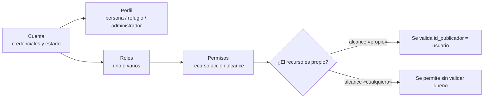
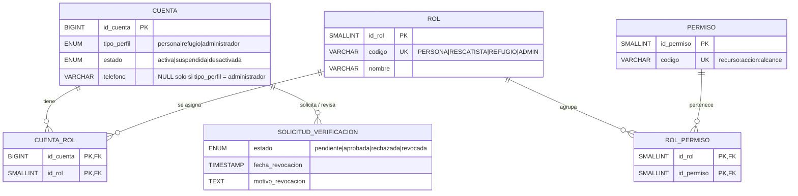
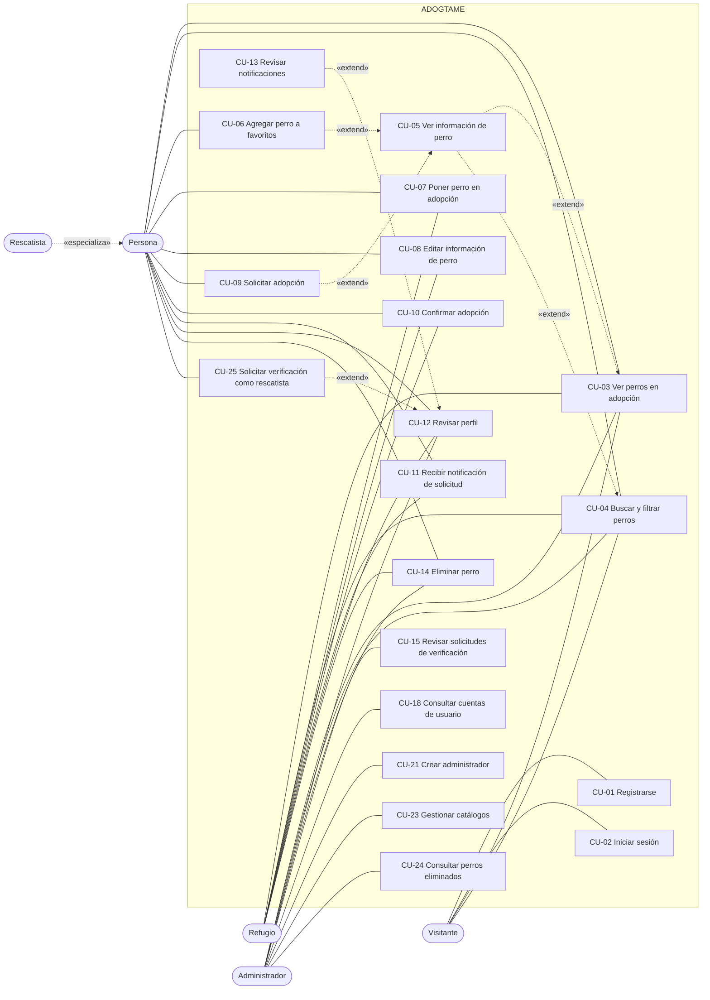
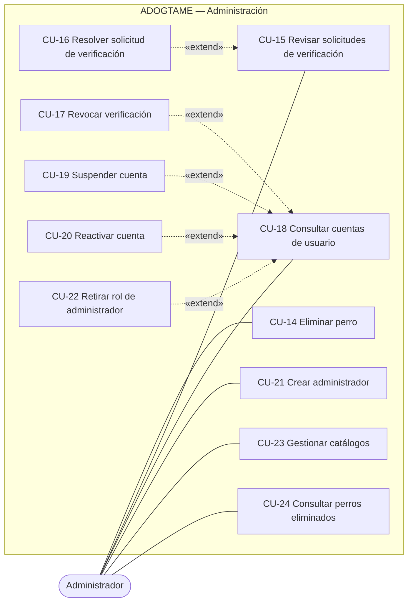

# ADOGTAME — Reestructuración del módulo de usuarios

> Documento de trabajo derivado de `Adogtame_Analisis_Base.md`. Evalúa el paso de un modelo de **tipos de cuenta** (persona / refugio) a un modelo de **usuarios y roles** que incorpore formalmente al **administrador**.
> Convenciones heredadas del documento base: _[Observación]_ = comentario de análisis, _[Propuesta]_ = algo que no estaba en el informe ni en el documento base, _[Nuevo]_ = especificación ya acordada después del informe. Las referencias como FR-03, CU-14 u «Obs. 4» apuntan al documento base.
> Las decisiones se identifican como **DEC-xx** (sección 7). A partir de v0.4 todas están cerradas.

| Versión | Cambio |
|---|---|
| 0.1 | Implicaciones del modelo usuarios/roles y catálogo de acciones por rol. |
| 0.2 | Simplificación: se retiran auditoría, restauración de perros, recuperación de contraseña, migración y parte de las notificaciones. |
| 0.3 | Cierre de DEC-01 a DEC-09, ajuste de la matriz y del esquema a lo decidido, revisión de coherencia y nuevas decisiones DEC-10 a DEC-15. |
| 0.4 | Cierre de DEC-10 a DEC-15. Sin decisiones abiertas. Se agrega la tabla de notificaciones del módulo y el ajuste de longitud de `persona.nombre`. |
| 0.5 | Justificación del discriminador `tipo_perfil` (6.1), DDL definitivo con FK compuesta, semilla de roles y permisos y reglas fuera del DDL (6.2). Las acciones del visitante pasan a ser endpoints públicos sin permiso. |
| 0.6 | Casos de uso del administrador CU-15 a CU-24 (6.8): diagrama, especificación y ajustes a CU-02, CU-12 y CU-14. La conversión persona → refugio queda fuera de alcance. |
| 0.7 | Redacción definitiva de FR-02, FR-03, FR-06, FR-07, FR-08, FR-11, FR-13 y de los requisitos nuevos (6.7.1); diagrama general de casos de uso y CU-25 (6.8); actores actualizados de CU-01 a CU-14. Ajustes de coherencia con las correcciones de v0.6 (VER-03, índice `ix_sv_listado`, ADM-05). |
| 0.8 | Integración en `Adogtame_Analisis_Base.md`: requisitos, casos de uso, actores, funcionalidades, esquema, DDL, semilla y observaciones. |

---

## Índice

1. [Punto de partida](#1-punto-de-partida)
2. [Conceptos: perfil, rol, permiso y propiedad](#2-conceptos-perfil-rol-permiso-y-propiedad)
3. [Alternativas de modelado](#3-alternativas-de-modelado)
4. [Roles](#4-roles)
5. [Catálogo de acciones por rol](#5-catálogo-de-acciones-por-rol)
6. [Implicaciones](#6-implicaciones)
7. [Decisiones](#7-decisiones)
8. [Fuera de alcance de esta versión](#8-fuera-de-alcance-de-esta-versión)
9. [Próximos pasos](#9-próximos-pasos)

---

## 1. Punto de partida

### 1.1 Qué existe hoy (documento base)

| Elemento | Estado actual | Referencia |
|---|---|---|
| Tipos de cuenta | `cuenta.tipo` ∈ {`persona`, `refugio`, `admin`}, con subtipos `persona` y `refugio`. El tipo `admin` no tiene tabla de perfil. | 6.3, 6.4 |
| Rescatista | Booleano `persona.es_rescatista` más una fila en `solicitud_verificacion`. | 6.3, FR-03 |
| Verificación | Un único campo `cuenta.estado_verificacion`, compartido por refugios y rescatistas. | 6.3 |
| Administrador | Aparece como actor solo en CU-14 (eliminar perro) y como `id_admin_revisor` en `solicitud_verificacion`. No hay casos de uso para verificar, ni forma definida de crear administradores. | 4.1, Obs. 4 |
| Permisos | Expresados como reglas de negocio basadas en el tipo de cuenta («solo `persona` puede adoptar», «solo el publicador o `admin` elimina»). | 6.4 |

### 1.2 Limitaciones de ese enfoque

- **El tipo mezcla identidad con autorización.** `tipo` responde a la vez a «qué datos tiene la cuenta» y a «qué puede hacer». Cualquier permiso nuevo obliga a tocar reglas dispersas por la aplicación.
- **Un usuario solo puede tener un tipo.** Rescatista ya es una excepción a eso (persona + algo más) y se resolvió con un booleano aparte.
- **El administrador no tiene perfil ni ciclo de vida.** No se sabe cómo se crea, quién lo crea, cómo se le retira el acceso ni qué queda registrado de sus acciones.
- **`estado_verificacion` es ambiguo.** No distingue si se verificó como refugio o como rescatista, ni conserva historial de revocaciones.
- **No hay estado de cuenta.** No existe forma de suspender a un usuario que publique contenido falso o actúe de mala fe, que es justamente lo que CR-02 intenta prevenir.

---

## 2. Conceptos: perfil, rol, permiso y propiedad

La reestructuración propone separar cuatro ideas que hoy están mezcladas en `cuenta.tipo`:

| Concepto | Pregunta que responde | Ejemplo en Adogtame |
|---|---|---|
| **Perfil** (subtipo) | ¿Qué **datos** tiene esta cuenta? | Una persona tiene nombre y fecha de nacimiento; un refugio tiene institución, ubicación y página web. |
| **Rol** | ¿Qué **tipo de participante** es en el sistema? | Persona, Refugio, Administrador. |
| **Permiso** | ¿Qué **acción concreta** puede ejecutar? | `perro:publicar`, `verificacion:resolver`. |
| **Propiedad** (alcance) | ¿Sobre **qué registros** puede ejecutarla? | Editar *su* perro vs. eliminar *cualquier* perro. |



> _[Observación]_ El punto clave es que **los roles por sí solos no bastan**: en Adogtame casi todas las acciones de usuarios normales dependen de la propiedad del recurso (editar *mi* perro, responder solicitudes de *mis* perros). Por eso el permiso incluye un **alcance** (`propio` / `cualquiera`), y la comprobación de dueño sigue existiendo en la lógica de negocio.

> _[Observación]_ El perfil **no desaparece**. Se conserva porque garantiza integridad en la base de datos: `favorito` y `solicitud_adopcion` referencian a `persona`, de modo que un refugio no puede adoptar ni marcar favoritos aunque falle la capa de aplicación.

---

## 3. Alternativas de modelado

| | A. Tipo de cuenta (actual) | B. Roles simples | C. Roles + permisos (RBAC) |
|---|---|---|---|
| **Estructura** | `cuenta.tipo` enum | `rol` + `cuenta_rol` (N:M) | `rol`, `permiso`, `rol_permiso`, `cuenta_rol` |
| **Comprobación en código** | `if (tipo === 'admin')` | `tieneRol('ADMIN')` | `tienePermiso('perro:eliminar:cualquiera')` |
| **Varios roles por usuario** | No | Sí | Sí |
| **Agregar una acción nueva** | Editar reglas en varios puntos | Editar reglas en varios puntos | Insertar un permiso y asignarlo a roles |
| **Dividir el administrador después** (p. ej., moderador) | Requiere refactorizar | Requiere revisar todas las comprobaciones de rol | Crear rol nuevo con un subconjunto de permisos |
| **Complejidad inicial** | Baja | Media-baja | Media |
| **Riesgo** | Reglas dispersas y difíciles de auditar | Comprobaciones por rol se vuelven «si es A o B o C…» | Sobreingeniería si se expone una UI de edición de permisos que nadie necesita |

**Decisión (DEC-01):** alternativa **C con catálogo cerrado**. Las tablas de permisos existen y el código comprueba permisos (no roles), pero los roles y sus permisos se cargan por **migración semilla**, sin pantalla para editarlos en esta versión.

---

## 4. Roles

| Rol | Cómo se obtiene | Cómo se pierde | Combinable con | Perfil asociado |
|---|---|---|---|---|
| **Visitante** _(implícito)_ | No autenticado. No es un rol almacenado. | Al iniciar sesión. | — | — |
| **Persona** | Registro público como persona (FR-01), o conversión de un refugio rechazado o revocado (DEC-04). | Suspensión o desactivación de la cuenta (pierde el acceso, no el rol). | Rescatista | `persona` |
| **Rescatista** | Un administrador aprueba su solicitud (FR-03): se inserta el rol en `cuenta_rol`. | Un administrador revoca la verificación: se retira el rol. | Persona (obligatorio) | `persona` |
| **Refugio** | Registro público como refugio (FR-02). Mientras su solicitud está pendiente conserva el rol y puede publicar, pero sin distintivo ni aparición en el directorio (DEC-10). | Rechazo o revocación de su verificación: se convierte en Persona (DEC-04, DEC-11). | — | `refugio` |
| **Administrador** | Lo crea otro administrador, o la semilla inicial del sistema. **Nunca** por registro público. | Otro administrador le retira el rol. | — (DEC-03) | Sin tabla de perfil; se identifica por su correo. |

**Verificación (transversal).** Se expresa de dos formas según el caso:

- **Rescatista:** la verificación vigente **es** el rol RESCATISTA (DEC-05). El historial queda en `solicitud_verificacion`.
- **Refugio:** el rol REFUGIO lo tiene tanto el refugio pendiente como el verificado; el distintivo y la aparición en el directorio se derivan de tener una `solicitud_verificacion` de tipo `refugio` en estado `aprobada`.

**Estado de cuenta (transversal).** `activa`, `suspendida` (por un administrador) o `desactivada` (por el propio usuario). Una cuenta no activa no puede iniciar sesión, independientemente de sus roles, y sus perros quedan ocultos (DEC-09).

> _[Observación]_ El rol RESCATISTA **no tiene permisos exclusivos** en esta versión: puede exactamente lo mismo que Persona y solo cambia su visibilidad (distintivo y directorio). Se mantiene como rol de forma deliberada (DEC-05) para que un módulo futuro, como el patrocinio diferido (5.2 del documento base), pueda asignarle permisos sin cambiar el modelo. En la semilla, RESCATISTA existe en `rol` pero no tiene filas en `rol_permiso`; sus permisos efectivos son los de PERSONA, que siempre lo acompaña.

---

## 5. Catálogo de acciones por rol

**Leyenda:** ✅ permitido · 🔸 permitido con condición (ver columna «Condición») · ❌ no permitido.
El **permiso** sigue el formato `recurso:acción[:alcance]`. Las acciones que también puede hacer el visitante son endpoints públicos y no tienen permiso (ver 6.2.6).
La columna **Refugio** incluye al refugio pendiente de verificación; las diferencias se indican en la condición.

**Regla transversal de visibilidad.** Un perro es **visible** si no está eliminado (FR-13) **y** su publicador tiene la cuenta `activa` (DEC-09). Toda acción que diga «perro visible» aplica esta regla; un perro no visible responde 404 por acceso directo, igual que uno eliminado o inexistente (NFR-07).

**Regla transversal de datos de contacto (DEC-02).** El teléfono y el correo de un usuario solo se muestran a cuentas autenticadas. El visitante ve el resto del perfil público.

### 5.1 Cuenta y autenticación

| ID | Acción | Visitante | Persona | Rescatista | Refugio | Admin | Permiso | Condición / nota |
|---|---|:-:|:-:|:-:|:-:|:-:|---|---|
| CTA-01 | Registrarse como persona | ✅ | ❌ | ❌ | ❌ | ❌ | _(público)_ | FR-01. |
| CTA-02 | Registrarse como refugio | ✅ | ❌ | ❌ | ❌ | ❌ | _(público)_ | FR-02. Genera automáticamente una solicitud de verificación. |
| CTA-03 | Iniciar sesión | ✅ | — | — | — | — | _(público)_ | Solo cuentas `activa`. |
| CTA-04 | Confirmar correo | ❌ | ✅ | ✅ | ✅ | ✅ | _(público vía enlace)_ | Comportamiento de CU-01 sin requisito asociado (Obs. 8). Es el único envío de correo del módulo (DEC-14). |
| CTA-06 | Editar perfil propio | ❌ | ✅ | ✅ | ✅ | ✅ | `cuenta:editar:propio` | FR-04. El administrador solo edita datos de `cuenta` (no tiene perfil). |
| CTA-07 | Cambiar contraseña propia | ❌ | ✅ | ✅ | ✅ | ✅ | `cuenta:editar:propio` | Pide la contraseña actual. |
| CTA-08 | Desactivar cuenta propia | ❌ | ✅ | ✅ | ✅ | 🔸 | `cuenta:desactivar:propio` | Admin: no puede si es el último administrador activo. Efectos: DEC-09. Solo un administrador puede reactivarla mediante ADM-03 (DEC-13). |
| CTA-09 | Ver perfil público de un usuario | 🔸 | ✅ | ✅ | ✅ | ✅ | _(público)_ | FR-11. Visitante: sin teléfono ni correo (DEC-02). Solo cuentas activas. |

> CTA-05 (recuperar contraseña) queda fuera de alcance (DEC-14, sección 8).

### 5.2 Verificación

| ID | Acción | Visitante | Persona | Rescatista | Refugio | Admin | Permiso | Condición / nota |
|---|---|:-:|:-:|:-:|:-:|:-:|---|---|
| VER-01 | Solicitar verificación como rescatista | ❌ | 🔸 | ❌ | ❌ | ❌ | `verificacion:solicitar:propio` | FR-03. Sin otra solicitud pendiente y sin rol RESCATISTA. Cubre el caso de uso faltante de Obs. 4. |
| VER-02 | Ver estado de la propia solicitud | ❌ | ✅ | ✅ | ✅ | ❌ | `verificacion:ver:propio` | Incluye la observación del revisor si fue rechazada. Un refugio convertido en persona ve aquí el motivo. |
| VER-03 | Listar solicitudes de verificación | ❌ | ❌ | ❌ | ❌ | ✅ | `verificacion:listar:cualquiera` | Lista las solicitudes pendientes, de la más antigua a la más reciente (CU-15). Es la forma en que el administrador se entera de solicitudes nuevas: no recibe notificaciones (DEC-12). |
| VER-04 | Aprobar o rechazar una solicitud | ❌ | ❌ | ❌ | ❌ | ✅ | `verificacion:resolver:cualquiera` | FR-02, FR-03. Rechazo con observación obligatoria. Aprobar rescatista → asigna rol RESCATISTA. Rechazar refugio → conversión a persona (DEC-04, DEC-11). Notifica el resultado al solicitante (DEC-12). |
| VER-05 | Revocar una verificación vigente | ❌ | ❌ | ❌ | ❌ | ✅ | `verificacion:revocar:cualquiera` | Motivo obligatorio. Rescatista → retira el rol RESCATISTA. Refugio → conversión a persona (DEC-11). Notifica al afectado (DEC-12). |

### 5.3 Perros

| ID | Acción | Visitante | Persona | Rescatista | Refugio | Admin | Permiso | Condición / nota |
|---|---|:-:|:-:|:-:|:-:|:-:|---|---|
| PER-01 | Ver listado, buscar y filtrar | ✅ | ✅ | ✅ | ✅ | ✅ | _(público)_ | FR-09, FR-10. Solo perros visibles. |
| PER-02 | Ver perfil de un perro | 🔸 | ✅ | ✅ | ✅ | ✅ | _(público)_ | Visitante: datos del publicador sin teléfono ni correo (DEC-02). No visible → 404. |
| PER-03 | Publicar perro | ❌ | ✅ | ✅ | ✅ | ❌ | `perro:publicar` | FR-05. Incluye al refugio pendiente, que publica sin distintivo (DEC-10). Admin ❌ (DEC-03). |
| PER-04 | Editar perro | ❌ | 🔸 | 🔸 | 🔸 | ❌ | `perro:editar:propio` | FR-06. Solo el publicador. Admin ❌ (DEC-06). Resuelve Obs. 6. |
| PER-05 | Eliminar perro (lógico) | ❌ | 🔸 | 🔸 | 🔸 | ✅ | `perro:eliminar:propio` / `:cualquiera` | FR-12, CU-14. Irreversible (DEC-07). |
| PER-06 | Ver perros eliminados | ❌ | ❌ | ❌ | ❌ | ✅ | `perro:ver_eliminados` | Solo lectura, desde el panel de administración (DEC-15). La parte pública sigue respondiendo 404. Sin datos de quién o cuándo eliminó (sección 8). |

### 5.4 Favoritos

| ID | Acción | Visitante | Persona | Rescatista | Refugio | Admin | Permiso | Condición / nota |
|---|---|:-:|:-:|:-:|:-:|:-:|---|---|
| FAV-01 | Marcar / desmarcar favorito | ❌ | ✅ | ✅ | ❌ | ❌ | `favorito:gestionar:propio` | FR-08. Perro visible. |
| FAV-02 | Ver mis favoritos | ❌ | ✅ | ✅ | ❌ | ❌ | `favorito:gestionar:propio` | Solo perros visibles; los ocultos por DEC-09 reaparecen si el publicador se reactiva. |

### 5.5 Adopción

| ID | Acción | Visitante | Persona | Rescatista | Refugio | Admin | Permiso | Condición / nota |
|---|---|:-:|:-:|:-:|:-:|:-:|---|---|
| ADO-01 | Solicitar adopción | ❌ | 🔸 | 🔸 | ❌ | ❌ | `adopcion:solicitar` | FR-07. Perro visible, disponible y no propio. |
| ADO-02 | Cancelar solicitud propia pendiente | ❌ | 🔸 | 🔸 | ❌ | ❌ | `adopcion:cancelar:propio` | El estado `cancelada` ya existe en el esquema. |
| ADO-03 | Ver solicitudes enviadas | ❌ | ✅ | ✅ | ❌ | ❌ | `adopcion:ver:propio` | Incluye las canceladas por DEC-09. |
| ADO-04 | Ver solicitudes recibidas | ❌ | 🔸 | 🔸 | 🔸 | ❌ | `adopcion:ver_recibidas:propio` | Solo de sus perros. Admin ❌ (DEC-06). |
| ADO-05 | Aprobar o rechazar solicitud | ❌ | 🔸 | 🔸 | 🔸 | ❌ | `adopcion:resolver:propio` | CU-10. Solo el publicador. Resuelve Obs. 7. |

### 5.6 Notificaciones y directorios

| ID | Acción | Visitante | Persona | Rescatista | Refugio | Admin | Permiso | Condición / nota |
|---|---|:-:|:-:|:-:|:-:|:-:|---|---|
| NOT-01 | Ver y marcar como leídas mis notificaciones | ❌ | ✅ | ✅ | ✅ | ❌ | `notificacion:gestionar:propio` | El administrador no recibe notificaciones (DEC-12). Ver tabla en 6.1. |
| DIR-01 | Ver directorio de rescatistas y de refugios | 🔸 | ✅ | ✅ | ✅ | ✅ | _(público)_ | FR-11. Rescatistas con rol vigente y refugios verificados, con cuenta activa. Visitante: sin teléfono ni correo. |

### 5.7 Administración

| ID | Acción | Visitante | Persona | Rescatista | Refugio | Admin | Permiso | Condición / nota |
|---|---|:-:|:-:|:-:|:-:|:-:|---|---|
| ADM-01 | Listar y buscar usuarios | ❌ | ❌ | ❌ | ❌ | ✅ | `usuario:listar` | Filtros por rol, estado de cuenta y verificación. |
| ADM-02 | Ver detalle de una cuenta | ❌ | ❌ | ❌ | ❌ | ✅ | `usuario:ver_detalle` | Muestra solo lo necesario para moderar; nunca el hash de la contraseña. |
| ADM-03 | Suspender / reactivar cuenta | ❌ | ❌ | ❌ | ❌ | 🔸 | `usuario:suspender` | No sobre sí mismo ni sobre el último administrador activo. Efectos: DEC-09. |
| ADM-04 | Crear cuenta de administrador | ❌ | ❌ | ❌ | ❌ | ✅ | `admin:crear` | DEC-08: cualquier ADMIN puede crear otro. |
| ADM-05 | Retirar el rol de administrador | ❌ | ❌ | ❌ | ❌ | 🔸 | `admin:revocar` | Nunca dejar el sistema sin administradores activos. También desactiva la cuenta (ver nota en 6.1). |
| ADM-06 | Gestionar catálogos de raza y color | ❌ | ❌ | ❌ | ❌ | ✅ | `catalogo:gestionar` | Configuración del sistema (DEC-03). Un valor en uso no se borra, se desactiva. |

> ADM-07 (bitácora de auditoría) se retiró en v0.2. Ver sección 8.

### 5.8 Resumen por rol

| Rol | Acciones propias | Acciones que no tiene respecto a Persona | Comentario |
|---|---|---|---|
| Visitante | Registro, inicio de sesión; ver perros, perfiles y directorios sin datos de contacto. | Todo lo que requiere sesión. | No persiste. |
| Persona | Todo el ciclo de adopción y publicación sobre lo propio. | — | Rol base. |
| Rescatista | Ninguna adicional; gana distintivo y aparece en directorio. | No vuelve a solicitar verificación. | Rol reservado para permisos futuros (DEC-05). |
| Refugio | Igual que Persona en publicación y respuesta a solicitudes. | Adoptar, favoritos, solicitar verificación de rescatista. | Si es rechazado o revocado, pasa a Persona. |
| Administrador | Verificación, suspensión y reactivación de cuentas, eliminación de perros y consulta de eliminados, catálogos y gestión de administradores. | Publicar, editar perros, adoptar, favoritos, ver solicitudes de adopción, notificaciones. | Cuenta exclusivamente administrativa. |

---

## 6. Implicaciones

### 6.1 Modelo de datos

Vista general de los cambios sobre el esquema 6.3 del documento base (solo tablas nuevas o modificadas). El DDL completo está en 6.2.



| Cambio | Motivo |
|---|---|
| `cuenta.tipo` pasa a `tipo_perfil` y deja de usarse para autorizar. | Separar datos de permisos (sección 2). Se conserva como discriminador de los subtipos (ver apartado siguiente). |
| `tipo_perfil = 'administrador'` no tiene tabla de subtipo. | DEC-03: el administrador no necesita datos de perfil; se identifica por su correo (también en `id_admin_revisor`). |
| `cuenta.telefono` admite `NULL` solo para administradores. | En el DDL base es `NOT NULL`, lo que obligaría a registrar un teléfono para una cuenta que nunca se muestra. `CHECK (tipo_perfil = 'administrador' OR telefono IS NOT NULL)`. |
| Se elimina `cuenta.estado_verificacion`. | Ambiguo; ver «Verificación» en la sección 4. |
| Se elimina `persona.es_rescatista`. | Lo reemplaza el rol RESCATISTA (DEC-05). |
| Nuevo `cuenta.estado`. | Suspensión y desactivación (ADM-03, CTA-08). |
| Nuevas tablas `rol`, `permiso`, `rol_permiso`, `cuenta_rol`. | RBAC (DEC-01). Se pueblan por migración semilla. |
| `solicitud_verificacion.estado` agrega `revocada`. | VER-05; conserva historial. |
| `notificacion` no cambia de estructura. | Solo se agregan nuevos eventos que la usan (ver tabla siguiente). Los administradores no son destinatarios (DEC-12). |
| `persona.nombre` pasa de `VARCHAR(100)` a `VARCHAR(120)`. | DEC-11 copia `refugio.nombre_institucion` (`VARCHAR(120)`) en `persona.nombre`; con la longitud actual, la conversión fallaría o truncaría nombres largos. |

#### Discriminador `tipo_perfil`

`cuenta` es el supertipo y `persona` y `refugio` son subtipos **exclusivos**: una cuenta es una cosa o la otra, nunca ambas. `tipo_perfil` es el **discriminador** de ese patrón y cumple tres funciones que RBAC no cubre:

1. **Indicar qué tabla de subtipo consultar**, sin buscar en todas con `LEFT JOIN`.
2. **Garantizar la exclusividad en la base de datos** mediante una FK compuesta `(id_cuenta, tipo_perfil)` desde cada subtipo (ver 6.2). Sin ella, nada impide que existan filas en `persona` y en `refugio` con el mismo `id_cuenta`.
3. **Identificar al administrador**, que no tiene tabla de subtipo. El `CHECK` del teléfono necesita ese dato en la misma fila, porque un `CHECK` no puede consultar `cuenta_rol`.

> _[Observación]_ El DDL del documento base (6.4) tenía `cuenta.tipo`, pero `persona` y `refugio` referenciaban solo `id_cuenta`, así que la exclusividad no estaba garantizada. El DDL de 6.2 lo corrige.

**Perfil y roles responden preguntas distintas:**

| | `tipo_perfil` | Roles (`cuenta_rol`) |
|---|---|---|
| Responde | Qué datos tiene la cuenta | Qué puede hacer |
| Cardinalidad | Exactamente uno | Uno o varios |
| Cambia | Solo en la conversión de DEC-11 | Al verificar, revocar o gestionar administradores |
| Lo garantiza | La base de datos (FK compuesta, `CHECK`) | La aplicación (semilla y lógica de negocio) |

Hoy coinciden en el rol base, de ahí la redundancia que regulan los invariantes de más abajo. Pero no son equivalentes: un rescatista cambia de roles sin cambiar de perfil, y un rol futuro (p. ej., MODERADOR) tampoco lo tocaría.

**Impacto sobre `persona` y `refugio`:**

- **Son una segunda capa de seguridad, independiente del RBAC.** `favorito`, `solicitud_adopcion` y `perro.id_adoptante` apuntan a `persona`. Si la semilla asignara por error `adopcion:solicitar` al rol REFUGIO, la base de datos igual rechazaría la fila. La contraparte es que **los subtipos limitan la flexibilidad de RBAC**: un permiso que escribe filas ligadas a `persona` solo funciona para cuentas con perfil persona, sin importar qué roles tengan.
- **Fijan el orden de la conversión de DEC-11.** Con la FK compuesta no se puede cambiar `tipo_perfil` mientras exista la fila de `refugio`, así que el orden es obligatorio: borrar `refugio` → cambiar `tipo_perfil` → insertar `persona` → reemplazar el rol. Si algún paso falla, la transacción completa se revierte y no quedan cuentas a medio convertir.
- **No intervienen en la verificación de rescatista.** La fila de `persona` no cambia; solo cambia `cuenta_rol`.

**Alternativas evaluadas:**

| Opción | Qué implica | Problema |
|---|---|---|
| **A. Mantener `tipo_perfil` con FK compuesta** _(elegida)_ | Exclusividad garantizada en la base de datos; RBAC solo para permisos. | Redundancia con el rol base, acotada a dos momentos: registro y conversión. |
| B. Eliminar `tipo_perfil` y deducir el perfil por la existencia de la fila | Una columna menos. | La exclusividad solo se garantiza con triggers; el administrador solo se reconoce por su rol y el `CHECK` del teléfono deja de ser posible. |
| C. Mantener `tipo_perfil` y quitar los roles base | Los permisos base se derivan del perfil y `cuenta_rol` guarda solo RESCATISTA y ADMIN. | Dos fuentes de permisos; el código deja de comprobar solo permisos, como exige DEC-01. |

**Invariantes entre perfil y roles.** Como cada cuenta tiene exactamente un perfil y un rol base, ambos datos son redundantes y deben mantenerse coherentes:

| `tipo_perfil` | Roles permitidos en `cuenta_rol` |
|---|---|
| `persona` | PERSONA (siempre) y, opcionalmente, RESCATISTA |
| `refugio` | REFUGIO (solo ese) |
| `administrador` | ADMIN (solo ese) |

Se validan en la capa de aplicación dentro de la misma transacción que cualquier cambio de perfil o rol (registro, aprobación, revocación, conversión de refugio). Si se quiere la garantía en la BD, puede añadirse un trigger sobre `cuenta_rol`.

> _[Observación]_ **ADM-05 deja una cuenta sin rol.** Al retirar el rol ADMIN, la cuenta conserva `tipo_perfil = 'administrador'` y queda sin roles, lo que viola la tabla anterior. Por eso ADM-05 también **desactiva** la cuenta (6.2.7, CU-22): la cuenta queda sin roles, pero no puede iniciar sesión.

**Notificaciones del módulo (DEC-12).** Solo se notifica al usuario afectado y se usan los tipos que ya existen en `notificacion.tipo`:

| Evento | Destinatario | `tipo` | `id_referencia` |
|---|---|---|---|
| Solicitud de verificación aprobada o rechazada (VER-04) | Solicitante | `verificacion` | `solicitud_verificacion` |
| Verificación revocada (VER-05) | Cuenta revocada | `verificacion` | `solicitud_verificacion` |
| Conversión de refugio a persona (DEC-11) | Cuenta convertida | `verificacion` | `solicitud_verificacion` que la originó |
| Solicitud de adopción cancelada porque el **publicador** fue suspendido o se desactivó (DEC-09) | Solicitante | `adopcion` | `solicitud_adopcion` |
| Solicitud de adopción cancelada porque el **solicitante** fue suspendido o se desactivó (DEC-09) | Publicador del perro | `adopcion` | `solicitud_adopcion` |

> _[Observación]_ La conversión ocurre en la misma transacción que el rechazo o la revocación, así que puede enviarse **una sola** notificación que comunique ambas cosas. La cuenta suspendida o desactivada no recibe aviso: no puede iniciar sesión para verlo.

### 6.2 DDL definitivo del módulo (PostgreSQL)

Sustituye las definiciones de `cuenta`, `persona`, `refugio`, `solicitud_verificacion`, `raza` y `color` de la sección 6.4 del documento base, y agrega las tablas de RBAC. Las demás tablas (`perro`, `foto_perro`, `favorito`, `solicitud_adopcion`, `notificacion`) **no cambian**: sus FK hacia `cuenta(id_cuenta)` y `persona(id_cuenta)` siguen siendo válidas porque ambas conservan `id_cuenta` como clave primaria.

#### 6.2.1 Cuentas y perfiles

```sql
-- =====================================================================
-- Cuenta (supertipo)
-- =====================================================================
CREATE TABLE cuenta (
    id_cuenta         BIGSERIAL    PRIMARY KEY,
    tipo_perfil       VARCHAR(13)  NOT NULL
                      CHECK (tipo_perfil IN ('persona', 'refugio', 'administrador')),
    correo            VARCHAR(120) NOT NULL UNIQUE,
    contrasena_hash   VARCHAR(255) NOT NULL,
    telefono          VARCHAR(15),
    foto_perfil_url   VARCHAR(255),
    descripcion       TEXT,
    estado            VARCHAR(11)  NOT NULL DEFAULT 'activa'
                      CHECK (estado IN ('activa', 'suspendida', 'desactivada')),
    correo_confirmado BOOLEAN      NOT NULL DEFAULT FALSE,
    fecha_registro    TIMESTAMP    NOT NULL DEFAULT now(),

    -- Teléfono obligatorio salvo para administradores (DEC-03)
    CONSTRAINT ck_cuenta_telefono
        CHECK (tipo_perfil = 'administrador' OR telefono IS NOT NULL),

    -- Destino de la FK compuesta de los subtipos (exclusividad)
    CONSTRAINT uq_cuenta_perfil UNIQUE (id_cuenta, tipo_perfil)
);

-- =====================================================================
-- Subtipo persona
-- =====================================================================
CREATE TABLE persona (
    id_cuenta        BIGINT       PRIMARY KEY,
    tipo_perfil      VARCHAR(13)  NOT NULL DEFAULT 'persona'
                     CHECK (tipo_perfil = 'persona'),
    nombre           VARCHAR(120) NOT NULL,   -- 120 por DEC-11 (antes 100)
    fecha_nacimiento DATE,

    CONSTRAINT fk_persona_cuenta FOREIGN KEY (id_cuenta, tipo_perfil)
        REFERENCES cuenta (id_cuenta, tipo_perfil) ON DELETE CASCADE
);

-- =====================================================================
-- Subtipo refugio
-- =====================================================================
CREATE TABLE refugio (
    id_cuenta          BIGINT       PRIMARY KEY,
    tipo_perfil        VARCHAR(13)  NOT NULL DEFAULT 'refugio'
                       CHECK (tipo_perfil = 'refugio'),
    nombre_institucion VARCHAR(120) NOT NULL,
    fecha_creacion     DATE,
    ubicacion          VARCHAR(255) NOT NULL,
    pagina_web         VARCHAR(255),

    CONSTRAINT fk_refugio_cuenta FOREIGN KEY (id_cuenta, tipo_perfil)
        REFERENCES cuenta (id_cuenta, tipo_perfil) ON DELETE CASCADE
);
```

> La FK compuesta no declara `ON UPDATE`, así que usa el comportamiento por defecto (`NO ACTION`): un `UPDATE` de `cuenta.tipo_perfil` falla mientras exista la fila del subtipo anterior. Es lo que impone el orden de la conversión (6.2.5).

#### 6.2.2 RBAC

```sql
CREATE TABLE rol (
    id_rol SMALLSERIAL PRIMARY KEY,
    codigo VARCHAR(20) NOT NULL UNIQUE,
    nombre VARCHAR(60) NOT NULL
);

CREATE TABLE permiso (
    id_permiso SMALLSERIAL PRIMARY KEY,
    codigo     VARCHAR(60) NOT NULL UNIQUE
               -- recurso:acción[:alcance]
               CHECK (codigo ~ '^[a-z_]+:[a-z_]+(:(propio|cualquiera))?$')
);

CREATE TABLE rol_permiso (
    id_rol     SMALLINT NOT NULL REFERENCES rol (id_rol)         ON DELETE CASCADE,
    id_permiso SMALLINT NOT NULL REFERENCES permiso (id_permiso) ON DELETE CASCADE,
    PRIMARY KEY (id_rol, id_permiso)
);

CREATE TABLE cuenta_rol (
    id_cuenta BIGINT   NOT NULL REFERENCES cuenta (id_cuenta) ON DELETE CASCADE,
    id_rol    SMALLINT NOT NULL REFERENCES rol (id_rol),
    PRIMARY KEY (id_cuenta, id_rol)
);

-- Filtro por rol en ADM-01 y conteo de administradores activos (último admin)
CREATE INDEX ix_cuenta_rol_rol ON cuenta_rol (id_rol);
```

#### 6.2.3 Verificación

```sql
CREATE TABLE solicitud_verificacion (
    id_solicitud      BIGSERIAL   PRIMARY KEY,
    id_cuenta         BIGINT      NOT NULL REFERENCES cuenta (id_cuenta),
    tipo              VARCHAR(10) NOT NULL CHECK (tipo IN ('rescatista', 'refugio')),
    estado            VARCHAR(9)  NOT NULL DEFAULT 'pendiente'
                      CHECK (estado IN ('pendiente', 'aprobada', 'rechazada', 'revocada')),
    fecha_solicitud   TIMESTAMP   NOT NULL DEFAULT now(),
    fecha_resolucion  TIMESTAMP,
    id_admin_revisor  BIGINT      REFERENCES cuenta (id_cuenta),
    observacion       TEXT,
    fecha_revocacion  TIMESTAMP,
    motivo_revocacion TEXT,

    -- Toda solicitud resuelta tiene fecha y revisor; una pendiente, ninguno
    CONSTRAINT ck_sv_fecha_resolucion
        CHECK ((estado = 'pendiente') = (fecha_resolucion IS NULL)),
    CONSTRAINT ck_sv_revisor
        CHECK ((estado = 'pendiente') = (id_admin_revisor IS NULL)),
    -- Rechazo con observación obligatoria (VER-04)
    CONSTRAINT ck_sv_observacion
        CHECK (estado <> 'rechazada' OR observacion IS NOT NULL),
    -- Revocación con fecha y motivo obligatorios (VER-05)
    CONSTRAINT ck_sv_revocacion
        CHECK ((estado = 'revocada') = (fecha_revocacion IS NOT NULL)),
    CONSTRAINT ck_sv_motivo_revocacion
        CHECK (estado <> 'revocada' OR motivo_revocacion IS NOT NULL),
    -- Coherencia temporal
    CONSTRAINT ck_sv_fechas CHECK (
        (fecha_resolucion IS NULL OR fecha_resolucion >= fecha_solicitud) AND
        (fecha_revocacion IS NULL OR fecha_revocacion >= fecha_resolucion))
);

-- Una sola solicitud pendiente por cuenta (VER-01)
CREATE UNIQUE INDEX ux_sv_pendiente ON solicitud_verificacion (id_cuenta)
    WHERE estado = 'pendiente';

-- Una sola verificación vigente por cuenta y tipo
CREATE UNIQUE INDEX ux_sv_aprobada ON solicitud_verificacion (id_cuenta, tipo)
    WHERE estado = 'aprobada';

-- Una cuenta solo tiene una solicitud de refugio en toda su vida (DEC-11)
CREATE UNIQUE INDEX ux_sv_refugio_unica ON solicitud_verificacion (id_cuenta)
    WHERE tipo = 'refugio';

-- Listado del panel de administración (VER-03)
CREATE INDEX ix_sv_listado ON solicitud_verificacion (estado, fecha_solicitud);
```

> `ux_sv_refugio_unica` lleva DEC-11 a la base de datos: aunque la cuenta convertida conserva en su historial la solicitud de refugio rechazada o revocada, no se le puede crear otra.

#### 6.2.4 Catálogos y visibilidad

```sql
-- Catálogos: un valor en uso se desactiva en lugar de borrarse (ADM-06)
CREATE TABLE raza (
    id_raza SERIAL      PRIMARY KEY,
    nombre  VARCHAR(60) NOT NULL UNIQUE,
    activo  BOOLEAN     NOT NULL DEFAULT TRUE
);

CREATE TABLE color (
    id_color SERIAL      PRIMARY KEY,
    nombre   VARCHAR(40) NOT NULL UNIQUE,
    activo   BOOLEAN     NOT NULL DEFAULT TRUE
);

-- Regla transversal de visibilidad (FR-13 ampliado por DEC-09)
CREATE VIEW perro_visible AS
SELECT p.*
FROM perro p
JOIN cuenta c ON c.id_cuenta = p.id_publicador
WHERE NOT p.eliminado
  AND c.estado = 'activa';
```

> La vista concentra la regla de visibilidad en un solo lugar: los listados, búsquedas, perfiles, *Mis perros* y *Favoritos* consultan `perro_visible` en lugar de repetir el filtro. El cruce con `cuenta` se resuelve por su clave primaria y los índices parciales existentes de `perro` (`WHERE NOT eliminado`) siguen aplicando; aun así, debe medirse contra NFR-01 y NFR-08. PER-06 (perros eliminados) consulta `perro` directamente.

#### 6.2.5 Conversión de refugio a persona (DEC-11)

Secuencia de referencia para el rechazo. La revocación es igual, cambiando el paso 1 por la actualización a `revocada` con `fecha_revocacion` y `motivo_revocacion`. Los valores `:nombre`, `:id`, etc. son parámetros de la aplicación.

```sql
BEGIN;

-- 0. La aplicación lee el nombre de la institución antes de borrar el subtipo
SELECT nombre_institucion FROM refugio WHERE id_cuenta = :id;   -- → :nombre

-- 1. Resolver la solicitud
UPDATE solicitud_verificacion
   SET estado = 'rechazada', fecha_resolucion = now(),
       id_admin_revisor = :id_admin, observacion = :observacion
 WHERE id_solicitud = :id_solicitud AND estado = 'pendiente';

-- 2–4. Cambio de perfil (el orden lo impone la FK compuesta)
DELETE FROM refugio WHERE id_cuenta = :id;
UPDATE cuenta SET tipo_perfil = 'persona' WHERE id_cuenta = :id;
INSERT INTO persona (id_cuenta, nombre) VALUES (:id, :nombre);

-- 5. Reemplazo de rol
DELETE FROM cuenta_rol
 WHERE id_cuenta = :id
   AND id_rol = (SELECT id_rol FROM rol WHERE codigo = 'REFUGIO');
INSERT INTO cuenta_rol (id_cuenta, id_rol)
SELECT :id, id_rol FROM rol WHERE codigo = 'PERSONA';

-- 6. Una sola notificación para el rechazo y la conversión (DEC-12)
INSERT INTO notificacion (id_destinatario, tipo, id_referencia, mensaje)
VALUES (:id, 'verificacion', :id_solicitud, :mensaje);

COMMIT;
```

Los perros publicados por la cuenta no se tocan: `perro.id_publicador` apunta a `cuenta`, que conserva su `id_cuenta`.

#### 6.2.6 Semilla de roles y permisos

**Acciones públicas.** Las acciones disponibles para el visitante (registro, inicio de sesión, confirmación de correo, ver perros, perfiles y directorios) son **endpoints públicos sin permiso**: el visitante no tiene roles, así que un permiso no le podría ser asignado. Lo único que cambia con la sesión es que la respuesta incluye o no teléfono y correo (DEC-02).

**RESCATISTA** no tiene filas en `rol_permiso` (sección 4): sus permisos efectivos son los de PERSONA.

```sql
INSERT INTO rol (codigo, nombre) VALUES
    ('PERSONA',    'Persona'),
    ('RESCATISTA', 'Rescatista verificado'),
    ('REFUGIO',    'Refugio'),
    ('ADMIN',      'Administrador');

INSERT INTO permiso (codigo) VALUES
    -- Cuenta
    ('cuenta:editar:propio'),
    ('cuenta:desactivar:propio'),
    -- Verificación
    ('verificacion:solicitar:propio'),
    ('verificacion:ver:propio'),
    ('verificacion:listar:cualquiera'),
    ('verificacion:resolver:cualquiera'),
    ('verificacion:revocar:cualquiera'),
    -- Perros
    ('perro:publicar'),
    ('perro:editar:propio'),
    ('perro:eliminar:propio'),
    ('perro:eliminar:cualquiera'),
    ('perro:ver_eliminados'),
    -- Favoritos
    ('favorito:gestionar:propio'),
    -- Adopción
    ('adopcion:solicitar'),
    ('adopcion:cancelar:propio'),
    ('adopcion:ver:propio'),
    ('adopcion:ver_recibidas:propio'),
    ('adopcion:resolver:propio'),
    -- Notificaciones
    ('notificacion:gestionar:propio'),
    -- Administración
    ('usuario:listar'),
    ('usuario:ver_detalle'),
    ('usuario:suspender'),
    ('admin:crear'),
    ('admin:revocar'),
    ('catalogo:gestionar');

INSERT INTO rol_permiso (id_rol, id_permiso)
SELECT r.id_rol, p.id_permiso
FROM (VALUES
    -- PERSONA
    ('PERSONA', 'cuenta:editar:propio'),
    ('PERSONA', 'cuenta:desactivar:propio'),
    ('PERSONA', 'verificacion:solicitar:propio'),
    ('PERSONA', 'verificacion:ver:propio'),
    ('PERSONA', 'perro:publicar'),
    ('PERSONA', 'perro:editar:propio'),
    ('PERSONA', 'perro:eliminar:propio'),
    ('PERSONA', 'favorito:gestionar:propio'),
    ('PERSONA', 'adopcion:solicitar'),
    ('PERSONA', 'adopcion:cancelar:propio'),
    ('PERSONA', 'adopcion:ver:propio'),
    ('PERSONA', 'adopcion:ver_recibidas:propio'),
    ('PERSONA', 'adopcion:resolver:propio'),
    ('PERSONA', 'notificacion:gestionar:propio'),
    -- REFUGIO
    ('REFUGIO', 'cuenta:editar:propio'),
    ('REFUGIO', 'cuenta:desactivar:propio'),
    ('REFUGIO', 'verificacion:ver:propio'),
    ('REFUGIO', 'perro:publicar'),
    ('REFUGIO', 'perro:editar:propio'),
    ('REFUGIO', 'perro:eliminar:propio'),
    ('REFUGIO', 'adopcion:ver_recibidas:propio'),
    ('REFUGIO', 'adopcion:resolver:propio'),
    ('REFUGIO', 'notificacion:gestionar:propio'),
    -- ADMIN
    ('ADMIN', 'cuenta:editar:propio'),
    ('ADMIN', 'cuenta:desactivar:propio'),
    ('ADMIN', 'verificacion:listar:cualquiera'),
    ('ADMIN', 'verificacion:resolver:cualquiera'),
    ('ADMIN', 'verificacion:revocar:cualquiera'),
    ('ADMIN', 'perro:eliminar:cualquiera'),
    ('ADMIN', 'perro:ver_eliminados'),
    ('ADMIN', 'usuario:listar'),
    ('ADMIN', 'usuario:ver_detalle'),
    ('ADMIN', 'usuario:suspender'),
    ('ADMIN', 'admin:crear'),
    ('ADMIN', 'admin:revocar'),
    ('ADMIN', 'catalogo:gestionar')
) AS v (rol, permiso)
JOIN rol     r ON r.codigo = v.rol
JOIN permiso p ON p.codigo = v.permiso;
```

**Primer administrador** (script de despliegue, no se ejecuta desde la interfaz). El hash se genera con la misma función que usa la aplicación; nunca se guarda la contraseña en texto plano.

```sql
WITH nueva AS (
    INSERT INTO cuenta (tipo_perfil, correo, contrasena_hash, correo_confirmado)
    VALUES ('administrador', :correo_admin, :hash_admin, TRUE)
    RETURNING id_cuenta
)
INSERT INTO cuenta_rol (id_cuenta, id_rol)
SELECT n.id_cuenta, r.id_rol
FROM nueva n
JOIN rol r ON r.codigo = 'ADMIN';
```

#### 6.2.7 Reglas que no caben en el DDL

Se validan en la capa de aplicación, dentro de la transacción de la operación correspondiente:

| Regla | Origen |
|---|---|
| Invariantes entre `tipo_perfil` y roles (tabla de 6.1). | DEC-01, DEC-03, DEC-05 |
| `id_admin_revisor` corresponde a una cuenta con rol ADMIN. | VER-04 |
| Transiciones válidas de `solicitud_verificacion`: `pendiente` → `aprobada` / `rechazada`; `aprobada` → `revocada`. Los demás estados son finales. | VER-04, VER-05 |
| Las solicitudes de tipo `rescatista` solo las crea una cuenta con perfil `persona` sin rol RESCATISTA; las de tipo `refugio` solo se crean en el registro. | VER-01, CTA-02, DEC-11 |
| Aprobar una solicitud de rescatista asigna RESCATISTA; revocarla lo retira. Rechazar o revocar la de un refugio ejecuta la conversión (6.2.5). | DEC-05, DEC-11 |
| Toda petición autenticada exige `cuenta.estado = 'activa'`. | DEC-09 |
| Al suspender o desactivar una cuenta se cancelan sus solicitudes de adopción pendientes, enviadas y recibidas, y se notifica a cada contraparte. | DEC-09, DEC-12 |
| No se puede suspender, desactivar ni retirar el rol ADMIN al último administrador activo; un administrador no se suspende ni se retira el rol a sí mismo. | ADM-03, ADM-05, CTA-08 |
| Retirar el rol ADMIN desactiva la cuenta. | ADM-05 (ver observación en 6.1) |
| Las razas y colores inactivos no se ofrecen al publicar ni editar; los perros que ya los usan los conservan. | ADM-06 |
| Las respuestas sin sesión omiten teléfono y correo. | DEC-02 |

### 6.3 Lógica de autorización

| Regla actual (documento base 6.4) | Regla con roles y permisos |
|---|---|
| Solo `persona` o `refugio` publican perros. | Requiere `perro:publicar` (PERSONA y REFUGIO; ADMIN no lo tiene). |
| Solo `persona` adopta y marca favoritos. | Requiere `adopcion:solicitar` / `favorito:gestionar:propio`. La FK hacia `persona` sigue como red de seguridad. |
| Solo el publicador o `admin` elimina un perro. | `perro:eliminar:propio` + `id_publicador = usuario`, **o** `perro:eliminar:cualquiera`. |
| Toda consulta de perros filtra `NOT eliminado` (FR-13). | Filtra perros **visibles**: `NOT eliminado` y publicador con `estado = 'activa'`. |
| _(no existía)_ | Toda petición autenticada verifica `cuenta.estado = 'activa'`. |
| _(no existía)_ | Las respuestas con datos de usuario omiten teléfono y correo si no hay sesión (DEC-02). Debe resolverse en el backend, no ocultarse en el frontend. |

### 6.4 Sesión y tokens

- Si los roles viajan dentro del JWT, un cambio de rol o una suspensión **no tiene efecto hasta que el token expira**. Opciones: tokens de vida corta con renovación, o consultar estado y roles en cada petición (con caché breve).
- Recomendación: el token lleva solo el `id_cuenta`; los permisos se resuelven en el servidor con caché de pocos minutos que se invalida al suspender, cambiar roles o convertir un refugio.

### 6.5 Seguridad

- **Sin escalada por registro:** los endpoints de registro asignan únicamente PERSONA o REFUGIO; el rol ADMIN solo se asigna desde un endpoint protegido por `admin:crear`.
- **Primer administrador:** se crea por semilla o script de despliegue, no desde la interfaz.
- **Último administrador:** el sistema impide suspender, desactivar o quitar el rol al último administrador activo.
- **Acciones sobre sí mismo:** un administrador no se suspende ni se retira el rol a sí mismo. (Como no puede pedir verificación, la regla de autorrevisión de v0.1 deja de aplicar.)
- **Mínimo privilegio en datos:** el administrador ve lo necesario para moderar (ADM-02) y no accede a solicitudes de adopción (DEC-06).

### 6.6 Interfaz

- Nuevo **panel de administración**: solicitudes de verificación, usuarios, perros eliminados (solo lectura) y catálogos.
- Menús y botones condicionados por permisos, no por tipo de cuenta.
- Vista pública para visitantes: mismo listado y perfiles, con los datos de contacto reemplazados por una invitación a iniciar sesión.
- El distintivo se muestra según el rol RESCATISTA o la verificación aprobada del refugio.

### 6.7 Requisitos afectados

| Requisito | Efecto |
|---|---|
| CR-02 | Se cumple: hay quién verifica y quién revoca. |
| FR-02 | Reemplazar «si no se valida, queda como usuario general» por: «mientras su verificación está pendiente, puede publicar sin distintivo ni aparición en el directorio (DEC-10); si se rechaza o revoca, la cuenta se convierte en persona (DEC-04, DEC-11)». |
| FR-03 | Se completa con revocación; la verificación se materializa como rol RESCATISTA. |
| FR-04 | El panel varía según permisos, no según tipo. |
| FR-06, FR-07 | Pasan a «el publicador», sin importar su rol (cierra Obs. 6 y 7). |
| FR-11 | Teléfono y correo visibles solo para usuarios autenticados (DEC-02). |
| FR-13 | Se amplía: tampoco se muestran perros de publicadores suspendidos o desactivados, con la misma respuesta 404 (DEC-09). |
| NFR-02 | Se amplía con control de acceso basado en roles. |
| NFR-08 | Ahora el filtro de visibilidad cruza `perro` con `cuenta.estado`; los índices parciales actuales solo cubren `NOT eliminado`. Debe comprobarse que el cruce no supere los 3 s de NFR-01. |

**Requisitos nuevos** (redacción completa en 6.7.1):

| ID | Nombre | Acciones que cubre |
|---|---|---|
| FR-14 | Gestión de solicitudes de verificación | VER-03, VER-04, VER-05 |
| FR-15 | Gestión de estado de cuentas | ADM-01, ADM-02, ADM-03, CTA-08 |
| FR-16 | Gestión de administradores | ADM-04, ADM-05 |
| FR-17 | Gestión de catálogos | ADM-06 |
| NFR-09 | Control de acceso | Toda acción se autoriza en el servidor por permiso y, cuando aplica, por propiedad del recurso. |

#### 6.7.1 Redacción actualizada de requisitos

Texto definitivo de los requisitos afectados, en el formato de la sección 2.2 del documento base, listo para reemplazar la versión anterior. Se agrega FR-08, que no estaba en la lista de 6.7 pero también cambia por DEC-09.

| ID | Nombre | Descripción resumida | Origen |
|---|---|---|---|
| FR-02 | Registro especial para refugios | Registro de institución con datos adicionales (ubicación, página web). Al registrarse se crea una solicitud de verificación que revisa un administrador. Mientras está pendiente, el refugio puede poner perros en adopción, sin distintivo y sin aparecer en el directorio de refugios. Si la verificación se rechaza o, una vez aprobada, se revoca, la cuenta se convierte automáticamente en persona: el nombre de la institución pasa a ser su nombre, se descartan ubicación y página web, se conservan sus perros publicados y no puede volver a solicitar verificación como refugio. Un refugio no adopta ni guarda favoritos. Campos validados. | CR-02 |
| FR-03 | Solicitud para rescatista | Una persona sin verificación vigente ni solicitud pendiente solicita desde su perfil ser verificada como rescatista. Un administrador la aprueba o la rechaza con una observación. Al aprobarse, la cuenta obtiene el rol de rescatista: su perfil muestra el distintivo y aparece en el directorio de rescatistas. Un administrador puede revocar la verificación indicando el motivo; la cuenta pierde el rol, el distintivo y su lugar en el directorio. El solicitante recibe una notificación con cada resultado. | CR-02 |
| FR-06 | Editar información del perro | Solo el publicador del perro, sea persona, rescatista o refugio, edita sus datos. El administrador no edita perros ajenos. Un perro eliminado no admite edición (FR-13). | — |
| FR-07 | Solicitudes y notificaciones de adopción | Una persona o rescatista solicita adoptar un perro visible y disponible que no haya publicado. El publicador, sea persona, rescatista o refugio, recibe una notificación y acepta o rechaza la solicitud; el solicitante puede cancelarla mientras esté pendiente. Si la cuenta del solicitante o del publicador se suspende o desactiva, sus solicitudes pendientes se cancelan y se notifica a la contraparte. El administrador no accede a las solicitudes de adopción. | — |
| FR-08 | Favoritos | Solo personas y rescatistas guardan perros como favoritos; se reflejan en el panel, mostrando únicamente los perros visibles (FR-13). | — |
| FR-11 | Visualizar perfiles de usuarios | Perfil público con nombre, foto, descripción e indicador de rescatista o refugio verificado. El teléfono y el correo solo se muestran a usuarios con sesión iniciada; el visitante ve el resto del perfil. No se muestran perfiles de cuentas suspendidas o desactivadas. Los directorios de rescatistas y refugios incluyen solo cuentas activas con verificación vigente. | CR-02 |
| FR-13 | Visibilidad de perros | Un perro es visible si no está eliminado y su publicador tiene la cuenta activa. Un perro no visible no aparece en listados, búsquedas, perfiles de usuario, *Mis perros* ni *Favoritos*; el acceso directo a su perfil responde con **404**, igual que un perro inexistente (NFR-07), y no admite edición, nuevas solicitudes de adopción ni ser marcado como favorito. Los perros ocultos por suspensión o desactivación de su publicador vuelven a mostrarse si la cuenta se reactiva. Los eliminados solo los consulta un administrador, en modo de solo lectura, desde el panel de administración. | — |

**Requisitos nuevos:**

| ID | Nombre | Descripción resumida | Origen |
|---|---|---|---|
| FR-14 | Gestión de solicitudes de verificación | El administrador consulta las solicitudes de verificación pendientes, las aprueba o las rechaza con observación, y revoca verificaciones vigentes indicando el motivo. Aprobar a un rescatista le asigna el rol; rechazar o revocar a un refugio lo convierte en persona (FR-02). | CR-02 |
| FR-15 | Gestión de estado de cuentas | El administrador busca cuentas por correo o nombre, las filtra por rol, estado y verificación, y consulta su detalle sin ver nunca la contraseña. Puede suspender y reactivar cuentas, excepto la propia y la del último administrador activo. Un usuario puede desactivar su propia cuenta; solo un administrador puede reactivarla. Una cuenta no activa no puede iniciar sesión y sus perros dejan de ser visibles (FR-13). | CR-02 |
| FR-16 | Gestión de administradores | Las cuentas de administrador no se crean por registro público: las crea otro administrador o el despliegue inicial, con un correo propio. Un administrador puede retirar el rol a otro, lo que también desactiva esa cuenta; nunca puede quedar el sistema sin administradores activos. | — |
| FR-17 | Gestión de catálogos | El administrador agrega, renombra, activa y desactiva valores de los catálogos de raza y color, y elimina los que no estén en uso. Los valores inactivos no se ofrecen al publicar ni editar perros; los perros que ya los usan los conservan. | FR-05 |

| ID | Tipo | Descripción |
|---|---|---|
| NFR-09 | Seguridad | Toda acción se autoriza en el servidor por permiso y, cuando aplica, por propiedad del recurso. La interfaz solo oculta opciones; no es el mecanismo de autorización. |

### 6.8 Casos de uso

- El actor **Administrador** deja de estar vinculado solo a CU-14 y pasa a tener los casos propios CU-15 a CU-24.
- Se agrega CU-25 «Solicitar verificación como rescatista» para Persona (pendiente desde Obs. 4).
- Se agrega el actor **Visitante** (DEC-02) y «Usuario general» pasa a llamarse **Persona**, como el rol.
- Con RESCATISTA como rol (DEC-05), se conserva la relación «Rescatista especializa a Persona» con la dirección corregida en el documento base (Obs. 1).

#### 6.8.1 Diagrama general de casos de uso

Actualiza el diagrama 3.1 del documento base con los roles del módulo. Las relaciones entre casos de uso indican `<<include>>` o `<<extend>>` (Obs. 3). Los casos del administrador se muestran por sus puntos de entrada; sus extensiones están en 6.8.2.



> - **Visitante** representa a cualquier usuario sin sesión, incluido un administrador antes de iniciarla. Al registrarse pasa a ser Persona o Refugio; las cuentas de administrador solo se crean con CU-21.
> - **Rescatista** especializa a Persona y no tiene asociaciones propias: hereda todas las de Persona salvo CU-25, que deja de estar disponible una vez verificado.
> - CU-06 y CU-09 extienden el perfil del perro (CU-05) y además se asocian directamente a Persona para indicar que solo ella puede ejecutarlos.
> - CU-13 extiende a CU-12 para Persona, Rescatista y Refugio; el administrador no recibe notificaciones (DEC-12).

#### 6.8.2 Diagrama de casos de uso del administrador

A diferencia del diagrama del documento base (Obs. 3), aquí las relaciones indican explícitamente `<<include>>` o `<<extend>>`.



> CU-16, CU-17, CU-19, CU-20 y CU-22 se inician desde el detalle de una solicitud o de una cuenta, por eso extienden a CU-15 y CU-18 en lugar de conectarse directamente al actor.

#### 6.8.3 Especificación

Mismo formato que la sección 3.2 del documento base. La columna FR usa la redacción de 6.7.1.

| ID | Nombre | Actor(es) principal(es) | Descripción | Flujo principal | Flujos alternativos | FR |
|---|---|---|---|---|---|---|
| CU-15 | Revisar solicitudes de verificación | Administrador | Consultar las solicitudes de verificación de rescatistas y refugios (VER-03). | 1. Accede a *Verificaciones* en el panel de administración. 2. El sistema lista las solicitudes pendientes, de la más antigua a la más reciente. 3. Selecciona una solicitud. 4. El sistema muestra los datos de la cuenta y de su perfil (persona: nombre y descripción; refugio: institución, ubicación y página web), su teléfono y correo. | No hay solicitudes → mensaje informativo. | FR-14 |
| CU-16 | Resolver solicitud de verificación | Administrador | Aprobar o rechazar una solicitud pendiente (VER-04). | 1. Desde el detalle de la solicitud (CU-15) elige «Aprobar» o «Rechazar». 2. Si rechaza, ingresa la observación. 3. El sistema pide confirmación, indicando las consecuencias según el tipo (ver paso 5). 4. Confirma. 5. El sistema registra el estado, la fecha y el revisor y aplica el efecto: **rescatista aprobado** → asigna el rol RESCATISTA; **refugio aprobado** → muestra el distintivo y lo incluye en el directorio; **rescatista rechazado** → sin otros cambios; **refugio rechazado** → convierte la cuenta en persona (6.2.5). 6. Notifica el resultado al solicitante (DEC-12). | Rechazo sin observación → bloquea la confirmación. Cancela la confirmación → no se realiza ningún cambio. La solicitud ya fue resuelta por otro administrador → mensaje informativo y se recarga el listado. | FR-02, FR-03, FR-14 |
| CU-17 | Revocar verificación | Administrador | Retirar la verificación vigente de un rescatista o refugio (VER-05). | 1. Desde el detalle de una cuenta verificada (CU-18) pulsa «Revocar verificación». 2. Ingresa el motivo. 3. El sistema pide confirmación, indicando las consecuencias según el tipo. 4. Confirma. 5. El sistema marca la solicitud aprobada como revocada, con fecha y motivo. 6. **Rescatista** → retira el rol RESCATISTA; **refugio** → convierte la cuenta en persona (6.2.5). 7. Deja de mostrarse el distintivo y la cuenta sale del directorio. 8. Notifica a la cuenta afectada (DEC-12). | Sin motivo → bloquea la confirmación. Cancela la confirmación → no se realiza ningún cambio. La cuenta no tiene verificación vigente → la opción no está disponible. | FR-03, FR-14 |
| CU-18 | Consultar cuentas de usuario | Administrador | Buscar cuentas y ver su detalle para moderarlas (ADM-01, ADM-02). | 1. Accede a *Usuarios* en el panel de administración. 2. El sistema lista las cuentas. 3. Busca por correo o nombre y filtra por rol, estado de cuenta o verificación. 4. Selecciona una cuenta. 5. El sistema muestra datos de cuenta y perfil, roles y estado, sin mostrar nunca el hash de la contraseña. 6. Según el estado de la cuenta, ofrece las acciones de CU-17, CU-19, CU-20 o CU-22. | Sin resultados → sugerir ajustar la búsqueda o los filtros. | FR-15 |
| CU-19 | Suspender cuenta | Administrador | Bloquear el acceso de una cuenta (ADM-03). | 1. Desde el detalle de una cuenta activa (CU-18) pulsa «Suspender». 2. El sistema pide confirmación, indicando que sus perros dejarán de mostrarse y que se cancelarán sus solicitudes de adopción pendientes. 3. Confirma. 4. El sistema cambia el estado a `suspendida`. 5. Sus perros dejan de ser visibles, sin marcarse como eliminados (DEC-09). 6. Cancela sus solicitudes de adopción pendientes, enviadas y recibidas, y notifica a cada contraparte (DEC-12). 7. Invalida sus sesiones activas (6.4). | Es su propia cuenta → la opción no está disponible. Es el último administrador activo → el sistema bloquea la acción. Cancela la confirmación → no se realiza ningún cambio. | FR-15 |
| CU-20 | Reactivar cuenta | Administrador | Devolver el acceso a una cuenta suspendida o desactivada (ADM-03, DEC-13). | 1. Desde el detalle de una cuenta suspendida o desactivada (CU-18) pulsa «Reactivar». 2. El sistema pide confirmación. 3. Confirma. 4. El sistema cambia el estado a `activa`. 5. Sus perros vuelven a ser visibles. | Cancela la confirmación → no se realiza ningún cambio. Las solicitudes de adopción canceladas al suspender o desactivar **no** se reabren. | FR-15 |
| CU-21 | Crear administrador | Administrador | Dar de alta una nueva cuenta administrativa (ADM-04). | 1. Accede a *Administradores* en el panel. 2. Pulsa «Nuevo administrador». 3. Ingresa correo y contraseña inicial. 4. El sistema valida los campos. 5. En una transacción, crea la cuenta con perfil `administrador`, sin teléfono, y le asigna el rol ADMIN. 6. Envía el correo de confirmación (CTA-04). 7. El administrador creador comunica la contraseña inicial por un medio externo; el nuevo administrador la cambia desde su perfil (CTA-07). | Correo ya registrado, incluso por una cuenta de persona o refugio → error; la cuenta administrativa requiere un correo propio (DEC-03). Campos inválidos → el sistema marca los errores. | FR-16 |
| CU-22 | Retirar rol de administrador | Administrador | Quitar el acceso administrativo a otra cuenta (ADM-05). | 1. Desde el detalle de una cuenta administradora (CU-18) pulsa «Retirar rol de administrador». 2. El sistema pide confirmación. 3. Confirma. 4. El sistema retira el rol ADMIN y desactiva la cuenta (6.2.7). | Es su propia cuenta → la opción no está disponible. Es el último administrador activo → el sistema bloquea la acción. Cancela la confirmación → no se realiza ningún cambio. | FR-16 |
| CU-23 | Gestionar catálogos | Administrador | Mantener los catálogos de raza y color usados al publicar perros (ADM-06). | 1. Accede a *Catálogos* en el panel. 2. Elige raza o color. 3. El sistema lista los valores con su estado (activo / inactivo) y si están en uso. 4. Agrega un valor, cambia el nombre de uno existente, lo activa o lo desactiva, o elimina uno que no esté en uso. 5. El sistema valida y guarda. 6. Los valores inactivos dejan de ofrecerse al publicar y editar perros; los perros que ya los usan los conservan. | Nombre duplicado → error. El valor está en uso → no se ofrece eliminarlo, solo desactivarlo. Cambiar el nombre de un valor en uso → el sistema advierte que se reflejará en todos los perros que lo usan. | FR-17 |
| CU-24 | Consultar perros eliminados | Administrador | Revisar en modo de solo lectura los perros eliminados (PER-06, DEC-15). | 1. Accede a *Perros eliminados* en el panel. 2. El sistema lista los perros con `eliminado = TRUE`, con sus datos básicos y su publicador. 3. Selecciona uno. 4. El sistema muestra su información en modo de solo lectura. | No hay perros eliminados → mensaje informativo. No existen opciones para editar ni restaurar (DEC-07). El acceso desde la parte pública sigue respondiendo 404 (NFR-07). | FR-12, FR-13 |
| CU-25 | Solicitar verificación como rescatista | Persona | Pedir ser verificada como rescatista (VER-01). | 1. Desde su perfil (CU-12) pulsa «Solicitar verificación como rescatista». 2. El sistema explica lo que implica la verificación: distintivo visible y aparición en el directorio de rescatistas. 3. Confirma. 4. El sistema crea la solicitud en estado pendiente. 5. Su perfil muestra el estado de la solicitud (VER-02) hasta que un administrador la resuelva (CU-16). | Ya tiene una solicitud pendiente → la opción no está disponible y se muestra su estado. Ya es rescatista → la opción no está disponible. Su solicitud anterior fue rechazada o su verificación revocada → puede volver a solicitarla; el perfil muestra la última observación o motivo. Cancela la confirmación → no se realiza ningún cambio. | FR-03 |

#### 6.8.4 Ajustes a casos de uso existentes

Actores actualizados de los casos de uso del documento base (3.2) según la matriz de la sección 5, y cambios de flujo derivados de las decisiones.

| CU | Actor(es) principal(es) | Ajuste |
|---|---|---|
| CU-01 Registrarse | Visitante | El registro como refugio crea su solicitud de verificación pendiente (FR-02). |
| CU-02 Iniciar sesión | Visitante (incluido el administrador antes de iniciar sesión) | Nuevo flujo alternativo: cuenta suspendida o desactivada → mensaje de acceso no disponible, sin iniciar sesión. |
| CU-03 Ver perros en adopción | Visitante, Persona, Rescatista, Refugio, Administrador | Solo perros visibles (FR-13). |
| CU-04 Buscar y filtrar perros | Visitante, Persona, Rescatista, Refugio, Administrador | Solo perros visibles (FR-13). |
| CU-05 Ver información de perro | Visitante, Persona, Rescatista, Refugio, Administrador | El visitante no ve teléfono ni correo del publicador (FR-11). Perro no visible → 404. |
| CU-06 Agregar perro a favoritos | Persona, Rescatista | Solo perros visibles. |
| CU-07 Poner perro en adopción | Persona, Rescatista, Refugio | Incluye al refugio pendiente de verificación (DEC-10). |
| CU-08 Editar información de perro | Persona, Rescatista, Refugio (solo el publicador) | Resuelve Obs. 6. El administrador no edita (DEC-06). |
| CU-09 Solicitar adopción | Persona, Rescatista | Perro visible, disponible y no propio. |
| CU-10 Confirmar adopción | Persona, Rescatista, Refugio (solo el publicador) | Resuelve Obs. 7. |
| CU-11 Recibir notificación de solicitud | Persona, Rescatista, Refugio (solo el publicador) | — |
| CU-12 Revisar perfil | Persona, Rescatista, Refugio, Administrador | El administrador solo accede a los datos de su cuenta (CTA-06, CTA-07). Persona y refugio ven el estado de su solicitud de verificación (VER-02). |
| CU-13 Revisar notificaciones | Persona, Rescatista, Refugio | Se agregan las notificaciones de verificación y de solicitudes canceladas (DEC-12). |
| CU-14 Eliminar perro | Persona, Rescatista, Refugio (solo el publicador), Administrador | Sin cambios de flujo. _[Observación]_ El administrador llega a los perros desde las vistas públicas, que usan `perro_visible`; por eso no puede eliminar los perros de una cuenta suspendida o desactivada mientras siga inactiva. |

### 6.9 Pruebas

La matriz de la sección 5 se convierte directamente en casos de prueba: cada celda ✅ o 🔸 es una prueba positiva y cada ❌ es una prueba negativa que debe responder 403 (o 404 cuando se trate de un perro no visible, por NFR-07). Las condiciones 🔸 requieren además una prueba de «recurso ajeno», y las acciones de visitante, una prueba de que la respuesta no contiene teléfono ni correo.

---

## 7. Decisiones

Todas las decisiones están cerradas a partir de v0.4.


| ID | Decisión | Resolución | Dónde impacta |
|---|---|---|---|
| DEC-01 | Modelo de autorización | RBAC con catálogo cerrado. | Secciones 3 y 6.1. |
| DEC-02 | Qué ve un visitante | Perros y directorios, sin teléfono ni correo. | CTA-09, PER-01, PER-02, DIR-01; FR-11. |
| DEC-03 | Naturaleza de la cuenta admin | Exclusivamente administrativa y de configuración del sistema. | PER-03, FAV, ADO; sin tabla de perfil. |
| DEC-04 | Refugio no verificado | Se convierte en persona. | VER-04, rol Refugio; FR-02. Abre DEC-10 y DEC-11. |
| DEC-05 | Rescatista | Rol RESCATISTA, pensado para permisos futuros. | Sección 4; elimina `persona.es_rescatista`. |
| DEC-06 | Alcance del admin sobre contenido ajeno | Solo elimina perros. | PER-04, ADO-04. |
| DEC-07 | Restaurar perros eliminados | No. | Se retira PER-07. Abre DEC-15. |
| DEC-08 | Niveles de administración | Un solo rol ADMIN. | ADM-04, ADM-05. |
| DEC-09 | Efectos de suspensión o desactivación | Perros ocultos sin marcarlos como eliminados; se cancelan las solicitudes pendientes enviadas y recibidas. | Regla de visibilidad; FR-13, NFR-08. |
| DEC-10 | Refugio con verificación pendiente | Publica sin distintivo y sin aparecer en el directorio. | Rol Refugio, PER-03, DIR-01. |
| DEC-11 | Conversión refugio → persona | Automática, en la misma transacción que el rechazo o la revocación: `nombre_institucion` pasa a `persona.nombre`, se borra la fila de `refugio` (ubicación y web se pierden), REFUGIO se reemplaza por PERSONA y `tipo_perfil` cambia. Sus perros se conservan porque `id_publicador` apunta a `cuenta`. No puede volver a pedir verificación como refugio; sí como rescatista. | VER-04, VER-05; invariantes y longitud de `persona.nombre` en 6.1. |
| DEC-12 | Notificaciones del módulo | Solo al usuario afectado: resultado de verificación, conversión a persona y solicitudes canceladas por DEC-09. | NOT-01, VER-03 a VER-05; tabla de eventos en 6.1. |
| DEC-13 | Reactivación de una cuenta desactivada por su dueño | Solo un administrador puede reactivarla. | CTA-08, ADM-03. |
| DEC-14 | Envíos de correo | Solo se mantiene la confirmación de correo. | CTA-04; CTA-05 fuera de alcance. |
| DEC-15 | Ver perros eliminados | Sí, solo lectura. | PER-06, panel de administración. |

---

## 8. Fuera de alcance de esta versión

Elementos evaluados en v0.1 y retirados en v0.2 por agregar complejidad no necesaria en el estado inicial del proyecto. Se registran para poder retomarlos.

| Elemento | Qué cubría | Consecuencia de no tenerlo |
|---|---|---|
| Bitácora de auditoría (ADM-07, tabla `auditoria`) | Registro de acciones administrativas. | No queda constancia de quién suspendió una cuenta o eliminó un perro, ni del motivo de una suspensión. Las resoluciones de verificación sí quedan en `solicitud_verificacion`. |
| `perro.fecha_eliminacion` / `id_eliminado_por` | Quién y cuándo eliminó un perro. | El listado de PER-06 (DEC-15) muestra los perros eliminados, pero no permite saber quién los eliminó ni cuándo. |
| `cuenta.motivo_estado` | Motivo de suspensión. | El usuario suspendido no recibe explicación desde el sistema. |
| `cuenta_rol.fecha_asignacion` / `asignado_por` | Trazabilidad de asignación de roles. | — |
| Restauración de perros (PER-07) | Revertir eliminaciones. | Cerrado por DEC-07. |
| Recuperación de contraseña (CTA-05) | Restablecer la contraseña mediante un enlace al correo. | Cerrado por DEC-14. Un usuario que olvida su contraseña no tiene forma de recuperar el acceso desde el sistema. |
| Notificaciones a administradores | Aviso de nuevas solicitudes de verificación. | Cerrado por DEC-12. El administrador revisa periódicamente la lista de VER-03. |
| Conversión de persona a refugio | Que una cuenta de persona existente pase a ser refugio. | Quien quiera representar a un refugio debe registrar una cuenta nueva con otro correo; los perros publicados desde su cuenta de persona permanecen en ella. |
| 2FA para administradores | Protección de la cuenta con más privilegios. | Ya figuraba en las recomendaciones futuras del informe. |
| Migración desde MongoDB | Correspondencia de datos existentes. | La tabla 6.5 del documento base queda desactualizada (`usuarios.rescatista` ya no va a `persona.es_rescatista`, sino al rol RESCATISTA). |

---

## 9. Próximos pasos

Completados. El contenido de este módulo está integrado en `Adogtame_Analisis_Base.md`; las observaciones que quedan abiertas (15 a 18) se registran en la sección 7 de ese documento.