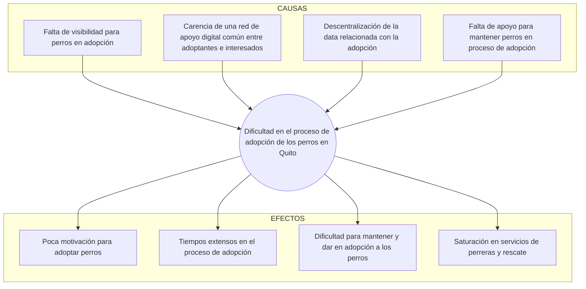

# ADOGTAME — Problemática, necesidad y oportunidad

> Describe el problema real, a quién afecta y por qué debe resolverse. No contiene decisiones de solución, tecnología ni diseño. Documento derivado de `adog_maestro.md`.

---

## Índice

1. [Tema y alcance](#1-tema-y-alcance)
2. [Contexto](#2-contexto)
3. [Problema central y árbol de problemas](#3-problema-central-y-árbol-de-problemas)
4. [Necesidad](#4-necesidad)
5. [Levantamiento de información (entrevista)](#5-levantamiento-de-información-entrevista)
6. [Oportunidad, objetivos y justificación](#6-oportunidad-objetivos-y-justificación)
7. [Consecuencias de no resolver el problema](#7-consecuencias-de-no-resolver-el-problema)
8. [Beneficiarios directos](#8-beneficiarios-directos)
9. [Fuentes de consulta](#9-fuentes-de-consulta)

---

## 1. Tema y alcance

**Tema.** Aplicación web responsive que actúe como **canal de comunicación central** para facilitar el proceso de adopción de perros en la ciudad de Quito.

**Dentro del alcance:**

- Registro de perros en adopción ubicados en el **Distrito Metropolitano de Quito (DMQ)**.
- Visualización ágil de la información relevante para quien quiera **adoptar** un perro.
- Actualización del estado y de la información de perros y usuarios.

**Fuera del alcance:**

- Manejo de métodos de pago, pasarelas de pago o transacciones económicas de cualquier tipo.
- Patrocinio de perros y seguimiento post-adopción (módulos diferidos).
- Versión para una aplicación móvil nativa.
- El problema estructural del abandono (esterilización, regulación, educación).

---

## 2. Contexto

### 2.1 Magnitud del problema: perros en situación de calle en Quito

La cifra de referencia del informe original es la de la Unidad de Bienestar Animal (UBA): **un perro callejero por cada 19 habitantes** en 2023. Es el punto más reciente de una tendencia sostenida de crecimiento:

| Año / periodo | Indicador | Fuente |
|---|---|---|
| 2018 | Estudio de la USFQ: un perro por cada 22 habitantes y cerca de 600 000 animales de compañía viviendo en las calles. | La Hora (2021) |
| Abril 2020 | Los abandonos registrados por el Municipio (Secretaría de Salud / Urbanimal) pasaron de **1 a 10 casos diarios** con la llegada de la pandemia. | La Hora (2021) |
| 2020–2021 | El abandono de perros en Quito creció alrededor de un **90 %** a raíz de la pandemia. | La Hora (2021) |
| 2021 | El Municipio reportaba unos 100 000 perros y gatos desamparados. | Rubio (2022) |
| 2023 | Estudio de la UBA en 53 parroquias: **un perro callejero por cada 19 habitantes**, con un crecimiento cercano al 500 % respecto a mediciones previas; alrededor de dos tercios de los perros se mueven en jauría. | Gavilanes (2024) |
| 2023 | El Municipio estimó cerca de **1,3 millones de animales callejeros** (perros y gatos) en sus 65 parroquias; los animales en la calle son el principal problema ambiental percibido por los barrios. | Machado (2024) |
| 2024 | La UBA estima que cerca del **70 %** de los perros que deambulan en la calle **sí tienen dueño**: son dejados fuera durante el día o forman parte de la comunidad. | Herrera (2024) |

> **Sobre las cifras:** provienen de estudios con metodologías distintas (solo perros o perros y gatos; zona urbana o todo el distrito), por lo que no son estrictamente comparables. Lo que todas confirman es la **tendencia creciente**. Al citarlas conviene usar la más reciente con su metodología y no mezclar estimaciones.

Zonas como Calderón, Condado, Cochapamba y Llano Chico, en el norte de la ciudad, registraron un agravamiento del problema en el estudio de 2023 (Gavilanes, 2024).

### 2.2 Causas del abandono

El abandono no se explica por una sola causa; varios factores se refuerzan entre sí:

- **Económicos:** la pérdida de empleo durante la pandemia fue un motivo frecuente de abandono, según Protección Animal Ecuador (La Hora, 2021); la crisis económica y de seguridad posterior agravó la situación (Rubio, 2022).
- **Tenencia irresponsable:** la mayoría de perros en la calle tiene dueño; el problema no es solo de animales sin hogar sino de dueños que los dejan deambular (Herrera, 2024).
- **Falta de conciencia ciudadana**, junto con refugios hacinados y sin apoyo económico (Herrera, 2024).
- **Regulación reciente:** la Ordenanza 019 de Bienestar Animal se promulgó en enero de 2021, frente a un problema de larga data (La Hora, 2021).

Resolver el abandono de raíz excede lo que puede hacer una iniciativa de adopción. Sí puede abordarse otra parte del problema: **cuando un perro ya está en manos de alguien que quiere darlo en adopción, a esa persona le resulta muy difícil encontrarle un hogar.**

### 2.3 El proceso de adopción actual y sus barreras

**Factores que condicionan la adopción** (La Hora, 2018):

1. **Características del animal:** la edad y el estado de salud influyen directamente; perros adultos o con enfermedades (p. ej., epilepsia) pueden pasar años sin ser adoptados.
2. **La temporada:** la demanda de adopción varía a lo largo del año.
3. **El sector donde se realizan las ferias de adopción.**

**Medios disponibles y sus limitaciones:**

| Medio actual | Limitación |
|---|---|
| **Ferias de adopción presenciales** | Difíciles de organizar: algunas organizaciones logran solo unas pocas al año o un máximo de tres por semestre, y su alcance depende del sector donde se realicen (La Hora, 2018). |
| **Redes sociales** | Medio abierto y sin filtros, donde es difícil destacar entre el volumen de publicaciones y encontrar personas realmente comprometidas (La Hora, 2021; entrevista). |
| **Gestión propia de cada organización** | Cada una maneja sus requisitos, procesos y eventos. El trámite dura entre una y dos semanas y suele pedir copia de cédula, planilla de servicios básicos, solicitud y, según el caso, contrato (La Hora, 2018). |

**Vacío de información centralizada.** Ni las ferias ni las redes sociales ofrecen un lugar único donde un interesado pueda comparar perros de distintos rescatistas y refugios, filtrarlos por sus características (edad, tamaño, esterilización, salud), saber si la fuente es confiable y contactar directamente a quien los tiene a cargo. Esta es la brecha que Adogtame busca cubrir.

### 2.4 Situación de rescatistas y refugios

- **Hacinamiento y falta de recursos:** los refugios están saturados y carecen de apoyo económico (Herrera, 2024).
- **Dependencia de la autogestión:** la mayoría se sostiene con rifas, venta de productos, peluquería canina y donaciones. Con la pandemia el apoyo disminuyó mientras subían los gastos de alimentación, veterinaria y personal; algunos centros restringieron el ingreso de nuevos animales (Rubio, 2022).
- **El refugio como lugar de paso, no como destino:** académicos del proyecto *Poliperros* (EPN) señalan que la ciudadanía tiende a ver el refugio como un lugar permanente, cuando debería ser una estación temporal hacia un hogar definitivo; rescatar requiere dedicación y corresponsabilidad (Herrera, 2024).
- **Necesidad de educación y articulación:** hace falta educar sobre bienestar animal y contar con el respaldo de las autoridades (Herrera, 2024).
- **Rescatistas independientes y familias:** mantienen varios perros con recursos propios mientras logran darlos en adopción (ver entrevista, sección 5).

---

## 3. Problema central y árbol de problemas

**Problema central:** _Dificultad en el proceso de adopción de los perros en Quito._

| Nodo | Tipo | Evidencia |
|---|---|---|
| C1. Falta de visibilidad | Causa | Difusión limitada a ferias ocasionales y dependiente del sector (La Hora, 2018); dificultad para destacar en redes sociales (informe). |
| C2. Carencia de una red de apoyo digital común | Causa | Redes sociales abiertas como canal principal (La Hora, 2021); no existe una plataforma que reúna a rescatistas, refugios y adoptantes (informe, entrevista). |
| C3. Descentralización de la información | Causa | Cada organización gestiona sus propios procesos, requisitos y eventos (La Hora, 2018). |
| C4. Falta de apoyo para mantener perros | Causa | Refugios sin apoyo económico (Herrera, 2024) y dependientes de la autogestión (Rubio, 2022); dificultades económicas de la rescatista entrevistada. |
| E1. Poca motivación para adoptar | Efecto | Baja comprensión del sentido de la adopción y percepción del refugio como destino final (Herrera, 2024). |
| E2. Tiempos extensos | Efecto | Perros adultos o enfermos que esperan años; procesos de una a dos semanas (La Hora, 2018). |
| E3. Dificultad para mantener y dar en adopción | Efecto | Aumento de gastos de alimentación y veterinaria (Rubio, 2022); entrevista. |
| E4. Saturación de refugios | Efecto | Hacinamiento (Herrera, 2024) y restricción de nuevos ingresos (Rubio, 2022). |

---

## 4. Necesidad

La necesidad identificada es **facilitar que los perros en adopción de Quito encuentren un hogar definitivo, reduciendo el tiempo y el esfuerzo que hoy exige conectar a quien da con quien adopta.**

| Grupo | Situación | Necesidad concreta | Respaldo |
|---|---|---|---|
| **Rescatistas independientes y familias** (camadas inesperadas, perros acogidos) | Mantienen varios perros con recursos propios; difunden por redes sociales, un medio informal y poco efectivo. | Un medio formal y dirigido para dar perros en adopción. | Entrevista; La Hora (2021) |
| **Refugios y perreras** | Saturados, dependientes de la autogestión y con poca visibilidad; los eventos presenciales son escasos y costosos. | Visibilidad permanente, no limitada a ferias de adopción. | Herrera (2024); Rubio (2022); La Hora (2018) |
| **Personas interesadas en adoptar** | La información está dispersa; es difícil comparar perros y saber si la fuente es confiable. | Información centralizada, comparable por edad, salud y esterilización, y de fuentes verificadas. | La Hora (2018); entrevista |

---

## 5. Levantamiento de información (entrevista)

Se entrevistó a **Dayra Almeida**, rescatista independiente de perros y gatos con 18 años de experiencia (52 años, Quito), que en ese momento cuidaba 8 perros y 13 gatos con sus propios medios y forma parte de redes de apoyo entre rescatistas. Entrevista: <https://www.youtube.com/watch?v=yuA9b32NnHM>

- **Objetivos del perfil:** brindar una vida digna a los animales abandonados y concientizar sobre la responsabilidad de tener una mascota.
- **Frustraciones:** limitaciones constantes para mantener a los animales rescatados y trato con adoptantes irresponsables.

| Hallazgo | Coincidencia con las fuentes | Impacto en el sistema |
|---|---|---|
| Lo más difícil es conocer al adoptante y el espacio donde vivirá el perro. | Los procesos formales piden cédula, planilla y contrato (La Hora, 2018). | Solicitud de adopción que el publicador aprueba o rechaza. |
| La principal dificultad del cuidado es económica; perros ancianos o con enfermedades crónicas se adoptan menos. | Edad y salud como factores de adopción (La Hora, 2018); crisis de refugios (Rubio, 2022). | Campo de necesidades especiales y filtro por edad. El apoyo económico queda diferido. |
| La esterilización es el dato más determinante para adoptar; luego comportamiento y apariencia. | — | Información médica destacada y filtro por esterilizado. |
| Para confiar en un adoptante se pide identificación y ubicación exacta, y se hace seguimiento. | Requisitos documentales de las organizaciones (La Hora, 2018). | Seguimiento post-adopción y validación documental: diferidos. |
| La comunicación debe ser directa; el teléfono debe ser muy visible. | — | Teléfono visible en perfiles para usuarios con sesión. |
| Centralizar la información permitiría ver perros de rescatistas independientes **y** de instituciones. | Ausencia de un canal común (La Hora, 2018; 2021). | Perfiles Persona, Rescatista y Refugio. |
| Los rescatistas independientes, sin contactos ni difusión, se beneficiarían de los patrocinios. | Falta de apoyo económico (Herrera, 2024). | Distintivo de rescatista verificado y directorio. Patrocinio diferido. |
| Se recomienda seguimiento activo tras la adopción para evitar abandono o maltrato. | La mayoría de perros en la calle tiene dueño (Herrera, 2024). | Módulo diferido. |

---

## 6. Oportunidad, objetivos y justificación

### 6.1 Oportunidad

1. **Existe una brecha clara.** Ni las ferias ni las redes sociales ofrecen un punto único donde ver, comparar y contactar perros de rescatistas y refugios de distintas procedencias.
2. **Hay oferta y demanda que hoy no se encuentran.** La dificultad está en la conexión, no en la falta de interés; la adopción es la alternativa que las organizaciones promueven frente al abandono (Gavilanes, 2024; Herrera, 2024).
3. **La confianza puede construirse.** Hacer visible quién es quién y mostrar la información que más pesa en la decisión reduce la incertidumbre de ambas partes.
4. **El impacto es acotado y alcanzable.** Se busca **reducir la fricción del proceso de adopción**: visibilidad permanente, información centralizada y confianza entre las partes.

### 6.2 Objetivos

1. Establecer un canal de comunicación común entre quienes ponen en adopción y quienes desean adoptar un perro en Quito.
2. Mejorar la visibilidad de los perros en proceso de adopción.

| Objetivo | Causas del árbol que ataca |
|---|---|
| 1. Canal de comunicación común | C2, C3 |
| 2. Mejorar la visibilidad | C1, C3 |

> La causa **C4** (falta de apoyo para mantener perros) no queda cubierta por el alcance actual; corresponde al módulo de patrocinio diferido.

### 6.3 Justificación

La evidencia muestra un problema **creciente** (de 1 perro por cada 22 habitantes en 2018 a 1 por cada 19 en 2023), **agravado por la pandemia** (abandono +90 %) y que recae sobre actores **sin recursos suficientes**. Los canales existentes son **presenciales y escasos** o **informales y sin filtro**. No existe un punto de encuentro que permita:

- ver en un solo lugar perros de rescatistas independientes y de refugios;
- filtrarlos por los criterios que más influyen en la decisión (edad, salud, esterilización);
- distinguir publicadores verificados de publicaciones anónimas.

> _[Observación]_ Herrera (2024) recalca que la adopción requiere **dedicación y corresponsabilidad**. Esto respalda dos líneas futuras: el **seguimiento post-adopción** (diferido) y contenido de **concientización** sobre tenencia responsable.

---

## 7. Consecuencias de no resolver el problema

| Consecuencia | Evidencia |
|---|---|
| **Permanencia prolongada de perros** en refugios y hogares temporales; los adultos o enfermos pueden esperar años. | La Hora (2018) |
| **Saturación de refugios** y restricción para recibir nuevos animales, lo que deja más perros en la calle. | Herrera (2024); Rubio (2022) |
| **Desgaste económico y personal de rescatistas independientes.** | Rubio (2022); entrevista |
| **Procesos de adopción lentos y poco confiables**, que desalientan a quien quiere adoptar y favorecen adopciones poco comprometidas. | La Hora (2018); entrevista |
| **Menor motivación para adoptar**, al percibirse el refugio como destino final. | Herrera (2024) |
| **Deterioro de la convivencia y del entorno barrial.** | Machado (2024) |

---

## 8. Beneficiarios directos

| Beneficiario | Cómo se beneficia |
|---|---|
| **Rescatistas independientes y familias que acogen perros** | Vía formal y visible hacia un hogar definitivo; menos tiempo y costo de mantenimiento y menos desgaste buscando adoptantes sin filtro. |
| **Refugios y perreras** | Visibilidad permanente sin depender de ferias; al colocar más perros liberan espacio y recursos. |
| **Personas interesadas en adoptar** | Información comparable y de fuentes confiables en un solo lugar, y contacto directo con quien tiene al perro. |
| **Los perros en adopción** | Menor tiempo de espera, en especial los de mayor edad o con necesidades especiales. |
| **La ciudadanía de Quito** | Menor presión de los animales sin hogar sobre los barrios, sin sustituir las medidas estructurales. |

---

## 9. Fuentes de consulta

1. Gavilanes, P. (2024, 15 de abril). *Quito tiene un perro callejero por cada 19 habitantes*. El Comercio. <https://www.elcomercio.com/tendencias/perros-callejeros-quito-esterilizacion-adopcion.html>
2. La Hora. (2018, 11 de abril). *Adopción de mascotas en Quito depende de tres factores*. <https://www.lahora.com.ec/archivo/Adopcion-de-mascotas-en-Quito-depende-de-tres-factores-20180411-0180.html>
3. La Hora. (2021, 2 de mayo). *El abandono de perros en Quito se incrementó en 90%*. <https://www.lahora.com.ec/archivo/El-abandono-de-perros-en-Quito-se-incremento-en-90-20210502-0009.html>
4. Rubio, E. (2022, 6 de noviembre). *El abandono de mascotas agudiza la crisis de los refugios en Quito*. Primicias. <https://www.primicias.ec/noticias/sociedad/abandono-animales-agudiza-crisis-refugios-quito/>
5. Herrera, C. (2024, 7 de agosto). *Refugios de animales en Quito no solventan situación de los perros callejeros*. El Telégrafo. <https://www.eltelegrafo.com.ec/noticias/quito/220/refugios-de-animales-en-quito-no-solventan-situacion-de-los-perros-callejeros>
6. Machado, J. (2024, 25 de enero). *Animales callejeros, el principal problema ambiental con el que lidian los barrios*. Primicias. <https://www.primicias.ec/noticias/quito/animales-perros-gatos-hogares-inec/>
7. Entrevista a Dayra Almeida, rescatista independiente (Quito). <https://www.youtube.com/watch?v=yuA9b32NnHM>
