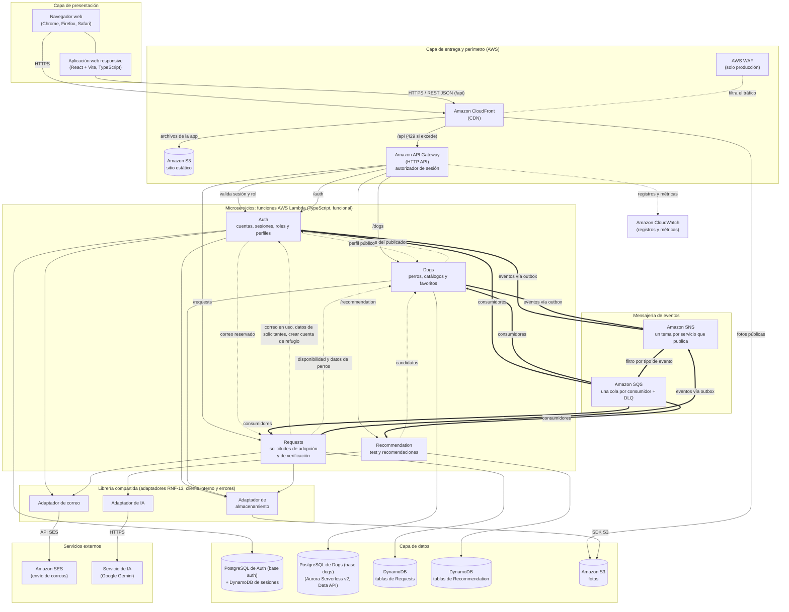

# ADOGTAME — Arquitectura

> **Derivado de:** ERS v2.1.0 (13/11/2026), requisitos no funcionales (§7, resumidos en `adog_RNF.md`), `adog_MER.md` (datos) y `adog_REC.md` (módulo de recomendación). Diagrama preliminar del Taller 2.2 (`parcial2/taller2.2/mermaid/componentes.md`), ajustado a **microservicios con base de datos por servicio**. Si este documento y el ERS difieren, prevalece el ERS y este debe actualizarse.
> Describe **cómo se organiza el sistema**: microservicios, servicios de AWS, integraciones externas, comunicación y las decisiones que cumplen los RNF. Las entidades conceptuales y las funciones que implementan cada servicio están en `adog_CLS.md`, y el **detalle de cada microservicio** (operaciones, reglas, llamadas y flujos que cruzan servicios) está en `adog_MS.md`. Es una arquitectura **preliminar**: lo marcado como *por definir* se decide durante la construcción.
> Convenciones: los nombres de los servicios de AWS son los oficiales; los **microservicios llevan nombre en inglés** (`Auth`, `Dogs`, `Requests`, `Recommendation`) y coinciden con los paquetes de `adog_CLS.md`; el resto de la documentación está en español.

---

## 1. Resumen y estilo arquitectónico

- **Estilo:** aplicación web desplegada en **AWS serverless** (RNF-18) con un backend de **4 microservicios**: `Auth`, `Dogs`, `Requests` y `Recommendation`. Cada uno es una función AWS Lambda con **despliegue propio e independiente**, detrás de una API REST común. La aplicación web (frontend) no es un microservicio.
- **Propiedad de los datos (base de datos por servicio):** cada microservicio es **dueño de sus datos**: tiene su propia base de datos y es el único que la lee y escribe. Ningún servicio accede a la base de otro; lo que necesita lo pide por su API. **No hay claves foráneas, JOIN ni transacciones entre servicios.** El almacenamiento es **políglota**, con el motor que mejor encaja con cada servicio y con el menor costo: `Dogs` y `Auth` usan bases **relacionales** (PostgreSQL), cada una con su propia base de datos dentro de **un mismo cluster** de Amazon Aurora Serverless; `Auth` guarda además sus sesiones y enlaces de correo en una tabla de **Amazon DynamoDB** por su expiración automática. `Requests` y `Recommendation` usan tablas de DynamoDB (bajo demanda, con cobro por uso). El acceso se controla con permisos IAM por servicio (DynamoDB y Data API). El cluster es solo la infraestructura que aloja las bases `auth` y `dogs`: **ningún servicio lee ni escribe la base del otro**.
- **Comunicación mixta:** las **consultas** entre servicios son síncronas, con límite de tiempo; las **escrituras que cruzan servicios** viajan como **eventos** por Amazon SNS y Amazon SQS, publicados con el patrón *outbox* (sección 4).
- **Lenguaje y paradigma:** TypeScript en cliente y servidor. El servidor usa **programación funcional**: **no se implementan clases reales**; el comportamiento son funciones que reciben datos y devuelven datos (las «clases» de `adog_CLS.md` son un modelo conceptual y sus operaciones se implementan como funciones).
- **Integraciones aisladas:** el almacenamiento de imágenes, el envío de correos y el Servicio de IA se acceden solo mediante **adaptadores**, que forman una **librería compartida** (no un servicio): un tipo de contrato y un módulo de funciones que lo cumple, recibido como parámetro, de modo que el proveedor pueda cambiarse sin tocar el negocio (RNF-13). La librería compartida incluye también el cliente de comunicación entre servicios y el contrato de errores (sección 4).
- **Infraestructura como código con SST v4:** cada microservicio, la aplicación web y la infraestructura base tienen **su propio repositorio** con su aplicación de SST, y se despliegan por separado en dos etapas: `dev` y `prod`. Los repositorios se enlazan desde `adogtame-docs` como submódulos en `repos/` (sección 8).
- **Sin estado en el servidor:** las funciones no guardan información entre peticiones; el estado vive en la base de datos de cada servicio (las sesiones, en la de `Auth`) y en S3.

---

## 2. Vista de componentes

| Campo | Descripción |
|---|---|
| Nombre | Diagrama de componentes del sistema Adogtame |
| Objetivo | Mostrar cómo se organiza todo el sistema, qué microservicios y servicios de AWS intervienen, qué datos posee cada uno y por dónde viaja cada petición, desde el navegador hasta la base de datos y los servicios externos. |
| Elementos principales | **Capas:** presentación, entrega y perímetro, microservicios, integración (librería compartida), datos y servicios externos. **Componentes:** navegador y aplicación web; CloudFront, S3, WAF (solo en producción) y API Gateway (HTTP API); cuatro microservicios en Lambda (`Auth`, `Dogs`, `Requests`, `Recommendation`); tres adaptadores; una base de datos por servicio (bases PostgreSQL `auth` y `dogs` en un cluster de Aurora Serverless; tablas DynamoDB para las sesiones de `Auth`, `Requests` y `Recommendation`) y S3 (fotos); SNS y SQS para los eventos; SES y Servicio de IA (Google Gemini); CloudWatch. |
| Reglas aplicadas | Todo el tráfico va por HTTPS y entra por CloudFront (con WAF en producción) hacia API Gateway (50 peticiones/s, 429 al exceder). Cada servicio autoriza por rol y propiedad y accede solo a su propia base de datos. Las consultas entre servicios son síncronas y las escrituras que cruzan servicios son eventos; ambas se resumen en la sección 3.2. Los servicios externos se acceden únicamente por adaptadores. |
| Justificación | Separa las responsabilidades por dominio con propiedad de datos y despliegue independiente, hace visible dónde se cumple cada RNF (seguridad, costo, disponibilidad, sustitución de proveedores) y se mantiene barato: las bases relacionales de `Auth` y `Dogs` comparten un cluster que se pausa sin uso; los demás servicios usan DynamoDB bajo demanda. |
| Imagen | El diagrama completo está en el bloque Mermaid de abajo. |

Las flechas punteadas entre microservicios son consultas síncronas internas; las flechas gruesas son eventos que pasan por SNS y SQS (sección 4). Todos los servicios, además, validan la sesión contra `Auth` mediante el autorizador de API Gateway.

---

## 3. Microservicios

Cada microservicio agrupa los casos de uso de un dominio. Todos validan y sanitizan las entradas (RNF-21), autorizan en el servidor por rol y propiedad del recurso (RNF-04), acceden solo a su propia base de datos (con parámetros enlazados u ORM en PostgreSQL y expresiones con valores enlazados en DynamoDB, RNF-20) y se despliegan por separado.

| Componente | Responsabilidad | Observación de diseño |
|---|---|---|
| APIs HTTP (API Gateway) | Exponen cada microservicio por HTTPS, ejecutan el autorizador de sesión y limitan el tráfico. | Una API por microservicio, con dominio propio; CloudFront las reúne en `/api/<servicio>`. |
| Microservicios (Lambda) | Ejecutan las reglas de cada dominio. | Funciones TypeScript sin estado; despliegue independiente; base de datos propia. |
| Mensajería (SNS + SQS) | Lleva los eventos de las escrituras que cruzan servicios. | Un tema SNS por servicio que publica; una cola SQS por consumidor, con filtro por tipo de evento y cola de mensajes fallidos (DLQ). |
| Librería compartida | Adaptadores (S3, SES, IA), cliente interno, contrato de errores, validación y sanitización. | No es un servicio; se incluye en cada despliegue. Cambiar de proveedor no toca la lógica de negocio (RNF-13). |
| Bases de datos (una por servicio) | PostgreSQL en Aurora Serverless para `Auth` y `Dogs` (una base cada uno en el mismo cluster); tablas DynamoDB para las sesiones de `Auth`, `Requests` y `Recommendation`. Entre ellas se reparten las 15 entidades del MER. | Cada servicio es dueño de su base; sin FK, JOIN ni transacciones entre bases; borrado lógico. |
| Almacenamiento de fotos (S3 + CloudFront) | Guarda y sirve las imágenes públicas. | La base solo guarda la clave del archivo. |
| Perímetro (CloudFront, WAF) | Entrega HTTPS, filtra tráfico malicioso. El WAF se activa solo en producción. | Primera línea de defensa (RNF-05, RNF-23). |
| Observabilidad (CloudWatch, Budgets) | Registros, métricas y alertas de gasto. | Los registros no incluyen datos personales (RNF-08). |

### 3.1. Responsabilidad de cada microservicio

| Microservicio | Entidades del MER (su base de datos) | Responsabilidad | Requisitos principales |
|---|---|---|---|
| `Auth` | `USUARIO`, `ROL`, `USUARIO_ROL`, `PERSONA`, `REFUGIO`, `TOKEN_CORREO`, `SESION` | Registro, confirmación de correo, inicio y cierre de sesión (30 min de inactividad; cierre en todos los dispositivos), recuperación y definición de contraseña, enlaces de un solo uso, perfiles de persona y de refugio, cambio de correo y de contraseña, baja y restauración de cuentas, roles y permisos, administración de usuarios, y emisión de la identidad y el rol de cada petición. | RF-03 a RF-05, RF-07 a RF-11, RF-26 a RF-28, RF-31, RF-34; RNF-03, RNF-06, RNF-25 |
| `Dogs` | `PERRO`, `FOTO_PERRO`, `RAZA`, `COLOR`, `FAVORITO` | Publicar, editar, eliminar y cambiar de estado un perro; fotos (hasta 5); listado, búsqueda y filtros; catálogos de raza y color; favoritos; gestión de perros por el administrador. | RF-01, RF-02, RF-12, RF-19 a RF-21, RF-23, RF-29, RF-30, RF-32, RF-33 |
| `Requests` | `SOLICITUD_ADOPCION`, `SOLICITUD_VERIFICACION` | Dos módulos internos: **adopción** (crear, aceptar, rechazar y cancelar solicitudes; mensaje de contacto; rechazo automático al adoptar o eliminar un perro) y **verificación** (solicitudes de rescatista y de refugio; aprobación o rechazo por el administrador; creación de la cuenta del refugio al aprobar). Las dos tablas se mantienen separadas. | RF-06, RF-16 a RF-18, RF-22, RF-24, RF-25 |
| `Recommendation` | `PERFIL_ADOPTANTE` | Test de estilo de vida, preselección de 20 candidatos por fórmula de afinidad, consulta al Servicio de IA, validación de la respuesta y respaldo con plantillas. Detalle en `adog_REC.md`. | RF-13, RF-14, RF-15; RNF-02, RNF-09, RNF-19 |

> `Requests` agrupa dos flujos con un mismo patrón de estados (pendiente y luego resuelta). Se separan en módulos internos para que puedan dividirse en dos servicios si hiciera falta, y la lógica común de transición de estados vive en la librería compartida.

### 3.2. Llamadas entre microservicios

| Origen | Destino | Para qué | Modo |
|---|---|---|---|
| Todos (por el autorizador) | `Auth` | Validar la sesión y obtener el usuario y su rol en cada petición. | Consulta síncrona |
| `Requests` (verificación) | `Auth` | Comprobar que un correo no pertenece a una cuenta. | Consulta síncrona |
| `Requests` (verificación) | `Auth` | Crear la cuenta del refugio al aprobar (flujo F2). | Escritura síncrona idempotente |
| `Requests` (verificación) | `Auth` | Cambiar el rol a RESCATISTA al aprobar. | Evento `RescatistaAprobado` |
| `Requests` (adopción) | `Auth` | Obtener nombre y teléfono vigentes del solicitante para el mensaje (RN-30) y los datos de los solicitantes (nombre, foto y contacto) para el panel del publicador, en lote. | Consulta síncrona |
| `Requests` (adopción) | `Dogs` | Comprobar que el perro está disponible y quién lo publica; obtener los datos de varios perros (historial y solicitudes recibidas). | Consulta síncrona |
| `Requests` (adopción) | `Dogs` | Marcar el perro como adoptado al aceptar una solicitud. | Evento `AdopcionAceptada` |
| `Auth` | `Requests` | Comprobar si un correo tiene una solicitud de refugio pendiente (registro, creación de usuarios y cambio de correo). | Consulta síncrona |
| `Dogs` | `Requests` | Rechazar las solicitudes pendientes cuando el perro pasa a adoptado o se elimina. | Evento `PerroAdoptado` / `PerroEliminado` |
| `Dogs` | `Auth` | Datos del publicador para listados y fichas, pedidos en lote. | Consulta síncrona |
| `Auth` | `Dogs`, `Requests`, `Recommendation` | Baja o restauración de cuenta: ocultar o mostrar sus perros, rechazar sus solicitudes pendientes y borrar su test. | Evento `CuentaEliminada` / `CuentaRestaurada` |
| `Auth` | `Dogs` | Perfil público: lista de perros publicados (RF-03). | Consulta síncrona |
| `Recommendation` | `Dogs` | Obtener los perros candidatos. | Consulta síncrona |

Reglas de estas llamadas:
- **Sin ciclos síncronos:** una consulta interna **no vuelve a llamar al invocante**. Como las escrituras entre servicios son eventos, `Dogs` y `Requests` ya no se llaman entre sí para escribir: al aceptar una solicitud, `Requests` rechaza por sí mismo las demás pendientes y publica `AdopcionAceptada`; `Dogs` marca el perro y publica `PerroAdoptado`, que `Requests` procesa sin efecto porque ya no quedan pendientes (idempotencia).
- **Profundidad máxima de dos saltos** por petición del usuario.
- Los contratos exactos (rutas, tipos, errores) se fijan en el incremento de cimientos del plan.

### 3.3. Presentación

| Componente | Responsabilidad | Requisitos |
|---|---|---|
| Aplicación web responsive | Interfaz en español: listados con filtros, ficha del perro, test, favoritos, solicitudes y paneles de cada rol. Consume la API REST por HTTPS. Los menús se adaptan al rol, pero **no sustituyen** la autorización del servidor. | RNF-04, RNF-14, RNF-16, RNF-17, RNF-21 |
| Navegador | Chrome, Firefox y Safari (2 últimas versiones) en escritorio; la interfaz se adapta desde 360 px. No hay aplicación móvil nativa. | RNF-16, RNF-17 |

> La aplicación web usa **React con Vite** (TypeScript) y se publica como archivos estáticos en S3, servidos por CloudFront. El sistema original usaba React/Next.js; Vite se elige porque el despliegue es solo estático.

### 3.4. Entrega y perímetro

| Componente | Responsabilidad | Requisitos |
|---|---|---|
| Amazon CloudFront | Punto de entrada HTTPS; sirve los archivos de la aplicación (S3 sitio estático) y las fotos públicas (S3 fotos), y envía cada ruta `/api/<servicio>` a la API de ese microservicio, de modo que la aplicación y las APIs comparten dominio. Se define con el componente `Router` de SST. Aplica la política de seguridad de contenido (CSP). | RNF-05, RNF-21 |
| Amazon S3 (sitio estático) | Aloja la aplicación compilada. | RNF-18 |
| AWS WAF | Asociado a CloudFront. Bloquea IP con más de 500 peticiones en 5 minutos y aplica reglas administradas contra ataques comunes. Las IP bloqueadas por tasa reciben **429**; las peticiones que bloquean las reglas administradas reciben 403. Se activa solo en la etapa `prod`. **Hoy está desactivado** para mantener el costo en cero mientras no se revise el despliegue (unos USD 9 al mes); se probó en `prod` el 22 de noviembre de 2026 y se vuelve a activar cambiando `ENABLE_WAF` en `adogtame-infra`. Mientras tanto, la limitación de API Gateway sigue activa en todas las etapas. | RNF-23 |
| Amazon API Gateway | Una API HTTP por microservicio (`<servicio>-api.<dominio>`). No admite WAF directo; por eso el WAF va en CloudFront. Cada API limita el tráfico a 50 peticiones por segundo (ráfagas de 100) y responde 429 al exceder, en todas las etapas, y ejecuta el autorizador de sesión. | RNF-23 |

### 3.5. Integración (adaptadores)

| Adaptador | Contrato (tipo, ver `adog_CLS.md`) | Implementación actual (módulo de funciones) | Lo usan |
|---|---|---|---|
| Almacenamiento | `IAlmacenamientoImagenes` | Amazon S3 (`AlmacenamientoS3`) | `Auth` (foto de perfil), `Dogs`, `Requests` (foto de la solicitud de refugio) |
| Correo | `IServicioCorreo` | Amazon SES (`CorreoSES`) | `Auth` (enlaces), `Requests` (resultado de verificación) |
| IA | `IServicioIA` | Google Gemini, modelo Flash-Lite en su versión estable vigente al implementar (`ServicioIAExterno`) | `Recommendation` |

Las imágenes se validan por su contenido real, se guardan con nombre generado y sin metadatos y se sirven sin permisos de ejecución (RNF-22). Al Servicio de IA solo se envían las respuestas del test y los atributos de los candidatos, nunca datos de identidad (RNF-09). **Quién envía cada correo:** `Auth` envía todos los enlaces de sus tokens (confirmación de registro, recuperación, cambio de correo y definición de contraseña, incluido el aviso de aprobación del refugio, que lleva ese enlace); `Requests` envía los resultados de verificación (rescatista aprobado o rechazado y refugio rechazado). Cada envío sale de la cola del propio servicio (sección 4.2).

**Servicio de IA:** la clave de Gemini se guarda como secreto de SST (`sst.Secret`). Su costo se paga en Google, fuera del presupuesto de AWS, y se controla con el tope de USD 5 al mes (RNF-18). En la capa gratuita, Google puede usar lo enviado para mejorar sus productos; por RNF-09 no se envían datos de identidad.

### 3.6. Datos

Cada microservicio posee su base de datos. El modelo conceptual de `adog_MER.md` se reparte entre las cuatro; el diseño de cada una (tablas, claves e índices) está en `adog_MS.md`.

| Microservicio | Almacén | Entidades | Por qué este motor | Requisitos |
|---|---|---|---|---|
| `Dogs` | PostgreSQL en Amazon Aurora Serverless v2 (**relacional**, base `dogs`), con Data API y pausa automática | `PERRO`, `FOTO_PERRO`, `RAZA`, `COLOR`, `FAVORITO` | Listados con 9 filtros combinables, integridad entre perros, fotos y catálogos. | RNF-01, RNF-10, RNF-18, RNF-20 |
| `Auth` | PostgreSQL en el mismo cluster de Aurora (**relacional**, base `auth`) | `USUARIO`, `ROL`, `USUARIO_ROL`, `PERSONA`, `REFUGIO` | Integridad entre cuenta, rol y perfil (claves foráneas, `UNIQUE` del correo, `CHECK`); la asignatura pide el modelo de identidad en una base relacional. | RNF-03, RNF-10, RNF-20 |
| `Auth` (sesiones) | Amazon DynamoDB (bajo demanda), tabla `auth-sessions` | `TOKEN_CORREO`, `SESION` | Acceso por hash, expiración automática con TTL y sin despertar la base relacional para validar cada sesión. | RNF-06, RNF-25 |
| `Requests` | Amazon DynamoDB (bajo demanda) | `SOLICITUD_ADOPCION`, `SOLICITUD_VERIFICACION` | Accesos por solicitante, publicador, perro y estado; unicidad de pendientes con escrituras condicionales. | RNF-10, RNF-11 |
| `Recommendation` | Amazon DynamoDB (bajo demanda) | `PERFIL_ADOPTANTE` | Un registro por persona. | RNF-10, RNF-18 |
| Fotos | Amazon S3 | Archivos de las fotos de perros, de perfil y de solicitudes de refugio; cada base guarda solo la clave de almacenamiento. | Almacenamiento de objetos. | RNF-22 |

Consecuencias de que cada servicio sea dueño de sus datos:
- **Referencias entre servicios:** se guardan por identificador, sin integridad automática; el dato se pide al servicio dueño, en lote, al consultarlo (`adog_MER.md`, referencias lógicas). Como los usuarios y los perros nunca se borran físicamente (RNF-10), no quedan referencias huérfanas.
- **Datos replicados mínimos:** solo los que no se pueden pedir sin acoplar las bases: `id_publicador` en la solicitud de adopción y la marca `publicador_eliminado` en el perro (decididos en `adog_MER.md`).
- **Consistencia:** sin transacciones entre servicios, las operaciones que los cruzan se recuperan con idempotencia y reintento (sección 4.3); entre un paso y otro puede haber una inconsistencia temporal aceptada.
- **Un cluster, dos bases:** el cluster de Aurora lo crea `adogtame-infra` y publica su ARN y el del secreto en SSM. Dentro hay una base por servicio (`auth` y `dogs`); cada servicio solo se conecta a la suya. Se usa **un solo secreto** (el del usuario maestro, USD 0,40 al mes): la separación es por base de datos y por permisos IAM, no por usuario de PostgreSQL. Un usuario por servicio costaría USD 0,40 más cada uno y se puede agregar si el proyecto lo exige.
- **Costos y red:** el cluster tiene capacidad mínima de **0 ACU** y se pausa a los 5 minutos sin conexiones; pausado solo se paga el almacenamiento (centavos). **Nada programado lo despierta**: las sesiones están en DynamoDB y el *outbox* no usa tareas periódicas (§4.2). Las funciones acceden a Aurora por la **Data API** (HTTPS), así que **ninguna función se ubica en una VPC** ni requiere NAT o RDS Proxy, y el arranque en frío no empeora. La base sí vive en una VPC que crea SST, sin NAT y sin acceso público.
- **Solo en `dev` por ahora:** la etapa `prod` no tiene cluster hasta que se necesite; mientras tanto, `Auth` y `Dogs` responden `DEPENDENCIA_NO_DISPONIBLE` en las operaciones que lo usan. Activarlo es cambiar una lista en `adogtame-infra`, desplegar y correr las migraciones.
- **Regenerable:** el esquema vive en el repositorio de cada servicio como migraciones de Drizzle, más un *seed* con los catálogos. Si el cluster se borra, se recrea con `sst deploy`, `db:bootstrap` (crea las bases) y `db:migrate` + `db:seed` en cada servicio.
- **Reanudación de la base:** tras una pausa, la Data API responde un error de reanudación durante unos 15 segundos. El acceso a datos reintenta con espera creciente dentro del límite de la petición y, si no alcanza, responde `DEPENDENCIA_NO_DISPONIBLE`.
- **Acceso a datos:** `Auth` y `Dogs` usan **Drizzle ORM** sobre la Data API; las tablas DynamoDB (sesiones de `Auth`, `Requests` y `Recommendation`) usan el **AWS SDK v3** (`DynamoDBDocumentClient`), sin librerías adicionales.
- **Desarrollo local sin Docker:** `sst dev` corre las funciones en la máquina conectadas a los recursos reales de la etapa `dev`. Las pruebas de integración usan **PGlite** (PostgreSQL compilado a WASM dentro de Node) con las mismas migraciones, sin AWS ni Docker.

### 3.7. Transversales

| Componente | Responsabilidad | Requisitos |
|---|---|---|
| Amazon CloudWatch | Registros y métricas de API Gateway y de las funciones. Los registros no contienen contraseñas, tokens ni teléfonos o correos completos. | RNF-08 |
| AWS Budgets | Alertas por correo al 50 %, 80 % y 100 % del presupuesto mensual de AWS, fijado en **USD 20** (estimación en la sección 5.1). | RNF-24 |

---

## 4. Comunicación

### 4.1. Principios

- **Consultas síncronas:** cuando un servicio necesita un dato de otro para continuar (validar la sesión, saber si un perro está disponible, obtener candidatos), lo pide con una llamada síncrona con límite de tiempo.
- **Escrituras entre servicios por eventos:** cuando un cambio en un servicio debe provocar un cambio en otro (marcar un perro adoptado, rechazar solicitudes, dar de baja una cuenta, cambiar un rol), el servicio guarda su cambio y publica un **evento**. Los servicios interesados lo reciben por su cola y aplican su parte.
- **Excepción:** crear la cuenta del refugio al aprobar su solicitud (flujo F2) es síncrono, porque `Auth` puede rechazarla (correo en uso) y el administrador debe ver el resultado en el momento.
- **`async/await` de TypeScript no difiere trabajo:** una función Lambda se congela al responder, por lo que **no se usan promesas sin esperar (*fire-and-forget*)**. El trabajo diferido siempre pasa por una cola.

### 4.2. Eventos: SNS, SQS y *outbox*

- **Temas y colas:** cada servicio que publica tiene **un tema SNS** (`Auth`, `Dogs` y `Requests`), definido en `adogtame-infra` para que ningún microservicio dependa del despliegue de otro; su ARN se publica en SSM. Cada servicio que consume tiene **su cola SQS**, suscrita a los temas que le interesan con un **filtro por tipo de evento**, y una **cola de mensajes fallidos (DLQ)** tras 5 intentos. Se definen en SST con `sst.aws.SnsTopic`, `sst.aws.Queue` y `subscribeQueue`.
- ***Outbox* en DynamoDB** (`Requests`): el cambio y el registro del evento se guardan en la **misma transacción** (`TransactWriteItems`). DynamoDB Streams entrega los registros nuevos del *outbox* a una función que los publica en SNS.
- ***Outbox* en PostgreSQL** (`Auth` y `Dogs`): una tabla `outbox` se escribe en la **misma transacción** que el cambio. La función publica el evento justo después de confirmar la transacción y lo marca como enviado. Si la publicación falla, el evento queda pendiente y **la siguiente invocación del servicio que use la base** lo reenvía antes de responder (con un límite por invocación). No hay tarea programada: una tarea periódica despertaría la base pausada (unos USD 3 a 4 al mes por cada una). A cambio, un evento pendiente puede tardar hasta la siguiente petición en salir.
- **Contenido de un evento:** identificador único, tipo, fecha del cambio, identificador de la entidad, clave de idempotencia, identificador de petición y los datos mínimos para aplicarlo.
- **Entrega al menos una vez:** SQS puede entregar un evento más de una vez, por lo que **todo consumidor es idempotente** (clave de idempotencia, como el id de la solicitud o del usuario).
- **Sin orden garantizado:** los eventos pueden llegar desordenados (por ejemplo, `CuentaRestaurada` antes que `CuentaEliminada`). El consumidor compara la fecha del cambio con la última que aplicó a esa entidad e ignora los eventos más antiguos.
- **Consistencia eventual:** entre la publicación y el consumo pasa un intervalo corto (normalmente segundos). Por ejemplo, al aceptar una adopción, el perro puede verse disponible un momento más; una solicitud que entre en ese intervalo queda rechazada al procesarse `PerroAdoptado`.
- **Correos:** cada servicio guarda el dato (token o resultado) junto con un evento de correo en su *outbox*; su propio consumidor envía el correo por SES. Si SES falla, SQS reintenta; el dato nunca se pierde (RNF-11).

| Evento | Lo publica | Lo consumen | Efecto |
|---|---|---|---|
| `AdopcionAceptada` | `Requests` | `Dogs` | Marca el perro como adoptado. |
| `PerroAdoptado` / `PerroEliminado` | `Dogs` | `Requests` | Rechaza las solicitudes pendientes del perro. |
| `RescatistaAprobado` | `Requests` | `Auth` | Cambia el rol de MIEMBRO a RESCATISTA. |
| `CuentaEliminada` | `Auth` | `Dogs`, `Requests`, `Recommendation` | Oculta sus perros, rechaza sus solicitudes pendientes (incluida la de rescatista) y borra su test. |
| `CuentaRestaurada` | `Auth` | `Dogs` | Vuelve a mostrar sus perros; no reabre solicitudes ni recupera el test. |
| `CorreoSolicitado` | `Auth`, `Requests` | El mismo servicio | Envía el correo por SES. |

### 4.3. Consultas entre microservicios

- **Cliente interno** en la librería compartida, que concentra *timeout*, reintentos, identificador de petición y propagación de la identidad. Así puede cambiarse el transporte sin tocar el negocio (en la línea de RNF-13).
- **Transporte:** invocación directa de Lambda en modo síncrono (con permisos IAM, sin pasar por WAF ni API Gateway). El servicio llamado valida que el llamante sea otro servicio de Adogtame.
- **Reintento acotado** solo en operaciones seguras de repetir.
- **Profundidad máxima de dos saltos** y datos de otros dominios pedidos **en lote**, para no acumular *cold starts* frente a los topes de RNF-01.

### 4.4. Tiempos límite

Los límites se fijan al máximo que permite AWS. Cada nivel queda por debajo del que lo contiene, para que el servicio alcance a responder con el contrato de errores (`DEPENDENCIA_NO_DISPONIBLE`) o con el respaldo antes de que API Gateway corte la petición.

| Nivel | Límite | Motivo |
|---|---|---|
| API Gateway (HTTP API) | 30 s | Máximo fijo de AWS. |
| Funciones que atienden al usuario | 30 s | Máximo útil: API Gateway corta a los 30 s. |
| Consultas internas síncronas | 25 s | Deja margen a la función que llama. |
| Servicio de IA | 20 s, recortado a lo que quede de la petición menos 2 s | RNF-02; pasado ese tiempo se usa el respaldo. El recorte asegura que el respaldo se responda antes del corte de 30 s, aunque la consulta previa a `Dogs` haya tardado. |
| Funciones que consumen colas | 60 s | SQS oculta el mensaje 6 veces ese tiempo (6 min); con el máximo de 900 s, un mensaje colgado se reintentaría a los 90 min. |
| Tamaño máximo por foto | 2 MB | Igual que la foto de la solicitud de refugio; muy por debajo del límite de 6 MB de Lambda. |

### 4.5. Con el frontend

- API REST en JSON por la ruta `/api/<servicio>` de CloudFront. **El frontend nunca orquesta entre servicios**: cada servicio compone lo que necesita de los demás (por ejemplo, `Dogs` pide los datos del publicador a `Auth`).
- **Contrato de errores único** (código y mensaje en español), que incluye los casos de RNF-07 (404 idéntico para recursos inexistentes o eliminados) y RNF-23 (429).
- **Estados de carga:** indicador de carga, *timeout* y cancelación en el cliente, y reintento automático solo en consultas. Esto cubre el *cold start* de hasta 8 s (RNF-01).
- **Sesión:** viaja en una ***cookie* HttpOnly, Secure y SameSite=Strict**, que el navegador envía sola porque la aplicación y la API comparten dominio. El autorizador la valida contra `Auth` en cada petición (RNF-25). Contra CSRF, además, los servicios comprueban la cabecera `Origin` en toda petición que cambia datos.
- **Fotos:** se suben **antes** de crear o editar el perro, **de una en una**, con una clave temporal. La función las valida por su contenido, les quita los metadatos (RNF-22) y las guarda bajo un prefijo temporal; al crear el perro se pasan las claves y `Dogs` las mueve a su ubicación final. Así un perro nunca existe sin fotos (1 a 5). Las fotos temporales sin usar se borran solas a las 24 horas con una regla del *bucket*.

---

## 5. Decisiones de diseño y trazabilidad con los RNF

| Decisión | Motivo | RNF |
|---|---|---|
| Despliegue 100 % serverless (Lambda, DynamoDB, Aurora Serverless, S3) | Cobro por uso y costo acotado; el servicio de IA no supera USD 5 al mes. | RNF-18 |
| 4 microservicios, cada uno dueño de su base de datos | Autonomía real de los datos: cada servicio evoluciona y se despliega sin coordinar esquemas con otro. | RNF-13 |
| Almacenamiento políglota: PostgreSQL para `Auth` y `Dogs` (una base cada uno en un cluster compartido) y DynamoDB para las sesiones de `Auth`, `Requests` y `Recommendation` | Cada motor se usa donde encaja (integridad relacional y filtros combinados frente a accesos por clave con expiración); la asignatura pide el modelo de identidad en una base relacional; un solo cluster pausado mantiene el costo en centavos. | RNF-18 |
| Datos replicados mínimos (`id_publicador`, `publicador_eliminado`) | Evita llamadas entre servicios en cada listado y en las bajas de cuenta. | RNF-01, RNF-07 |
| `Auth` unifica cuentas, sesiones, perfiles y roles | Están fuertemente acoplados; separarlos solo agregaría llamadas. | RNF-04, RNF-25 |
| `Requests` agrupa solicitudes de adopción y de verificación | Mismo patrón de estados; un servicio y un despliegue menos; módulos internos separados. | RNF-13 |
| Todo el tráfico por HTTPS vía CloudFront y API Gateway | Cifrado de extremo a extremo con cliente y servicios externos. | RNF-05 |
| WAF en CloudFront solo en producción, hoy desactivado; *throttling* de API Gateway en todas las etapas | Protección perimetral y limitación de tráfico (429) donde hay usuarios reales, sin pagar el WAF mientras el sistema no tenga uso real. | RNF-18, RNF-23 |
| Autorización en cada servicio, no en el cliente | Ocultar opciones en la interfaz no es seguridad. | RNF-04 |
| Sesiones y enlaces de correo de `Auth` en DynamoDB con `token_hash` y TTL | Permite cerrar por inactividad y en todos los dispositivos sin estado en el servidor; validar una sesión no despierta Aurora y la limpieza es gratuita. | RNF-25 |
| Adaptadores para S3, SES e IA en una librería compartida | Cambiar de proveedor sin modificar el negocio. | RNF-13 |
| Consultas síncronas; escrituras entre servicios por eventos (SNS + SQS + *outbox*) | Una escritura que cruza servicios no depende de que el otro esté disponible en ese momento: SQS reintenta, la DLQ guarda lo que falla y el *outbox* garantiza que el evento sale si el cambio se guardó. | RNF-11 |
| Correos por cola; recomendaciones síncronas con *timeout* y respaldo | Si el correo falla, SQS lo reintenta sin perder el dato; si la IA falla, se muestran las recomendaciones de respaldo. | RNF-02, RNF-11, RNF-19 |
| SST v4 como infraestructura como código, un repositorio por servicio | Cada servicio se despliega sin coordinar con los demás; dos etapas (`dev` y `prod`). | RNF-13, RNF-18 |
| Aurora Serverless v2 con Data API y pausa automática (0 ACU), un cluster para `Auth` y `Dogs` | Sin funciones en VPC, sin NAT ni RDS Proxy, sin costo de capacidad cuando no se usa y un solo secreto. | RNF-01, RNF-18 |
| *Outbox* de PostgreSQL sin tarea periódica | Los pendientes se reenvían en la siguiente petición; nada despierta la base sin usuarios. | RNF-11, RNF-18 |
| Sesión en *cookie* HttpOnly, Secure y SameSite=Strict | El token no es accesible desde JavaScript; CloudFront sirve la aplicación y la API en el mismo dominio. | RNF-21, RNF-25 |
| Indicador de carga en el cliente | Cold start aceptado por diseño (hasta 8 s en la primera petición). | RNF-01 |
| Profundidad máxima de dos saltos y consultas en lote | Limita la acumulación de *cold starts*. | RNF-01 |
| Misma respuesta 404 para recursos inexistentes o eliminados | No revelar la existencia de recursos eliminados. | RNF-07 |

### 5.1. Estimación de costo mensual

Las dos etapas viven en la misma cuenta de AWS (us-east-1). El objetivo es mantener el costo **en el mínimo posible** mientras el sistema no tenga uso real.

| Servicio | Antes de I0.4 | Con Aurora solo en `dev` (I0.4) |
|---|---|---|
| Aurora Serverless v2 (0 ACU, pausa a los 5 min; solo almacenamiento en pausa) | — | centavos, más unos USD 0,06 por cada hora de uso real |
| Secrets Manager (un secreto, el del usuario maestro) | — | USD 0,40 |
| Data API | — | USD 0,35 por millón de peticiones (prácticamente 0) |
| WAF (desactivado; USD 5 más USD 1 por cada una de sus 4 reglas) | — | — |
| Lambda, API Gateway, DynamoDB, SNS, SQS, S3, CloudFront, SES y CloudWatch | USD 0 a 1 (capa gratuita) | USD 0 a 1 |
| **Total de la cuenta** | **menos de USD 1** | **unos USD 1 a 2** |

El presupuesto mensual de AWS se fija en **USD 20** (RNF-24). La etapa `prod` no tiene cluster hasta que se necesite; con él suma lo mismo que `dev`. Lo que más mueve el costo es cuánto tiempo pasa la base despierta: cada vez que despierta corre al menos 5 minutos a 0,5 ACU, por eso no se programan tareas que la usen. Si se activa el WAF, suma unos USD 9. El Servicio de IA se paga aparte en Google, con su propio tope de USD 5 (RNF-18). Son valores aproximados que deben confirmarse en la calculadora de precios de AWS.

---

## 6. Seguridad por capa

| Capa | Controles |
|---|---|
| Cliente | Escape de salida, sin HTML en campos, CSP sin scripts en línea (RNF-21). |
| Perímetro | HTTPS, WAF en producción, *throttling* en todas las etapas (RNF-05, RNF-23). |
| Negocio | Sesión en *cookie* HttpOnly, Secure y SameSite=Strict con comprobación de `Origin` contra CSRF (RNF-25), autorización por rol y propiedad, validación y sanitización, contraseñas con hash y sal, enlaces de un solo uso con caducidad, textos del usuario enviados a la IA como datos y no como instrucciones; las llamadas entre servicios solo se aceptan de otros servicios de Adogtame (RNF-03, RNF-04, RNF-06, RNF-19). |
| Datos | Consultas parametrizadas u ORM (PostgreSQL) y expresiones con valores enlazados (DynamoDB), permisos IAM por servicio y una base de datos por servicio en PostgreSQL, borrado lógico, tokens y sesiones solo como hash (RNF-03, RNF-04, RNF-10, RNF-20). |
| Archivos | Validación por contenido, nombre generado, sin metadatos ni ejecución (RNF-22). |

---

## 7. Decisiones tomadas en I0.2

| Punto | Decisión |
|---|---|
| *Framework* de la aplicación web | React con Vite (TypeScript), publicado como archivos estáticos (§3.3). |
| Acceso a datos | Drizzle ORM sobre la Data API de Aurora para `Auth` y `Dogs`; AWS SDK v3 (`DynamoDBDocumentClient`) para las tablas DynamoDB (§3.6; actualizado en I0.4). |
| Transporte de la sesión | *Cookie* HttpOnly, Secure y SameSite=Strict, con comprobación de `Origin` (§4.5). |
| Infraestructura como código | SST v4, un repositorio por servicio, etapas `dev` y `prod` (§1 y §8). |
| Red de las bases PostgreSQL | Data API: ninguna función en VPC (§3.6). |
| Costo de las bases y presupuesto | Un cluster de Aurora Serverless v2 a 0 ACU para `Auth` y `Dogs`, solo en `dev` por ahora; presupuesto de AWS de USD 20 al mes (§5.1; actualizado en I0.4). |
| WAF | Solo en la etapa `prod`; desactivado hasta que se necesite (§3.4). |
| Servicio de IA | Google Gemini, modelo Flash-Lite estable vigente (§3.5). |
| Comunicación entre servicios | Consultas síncronas; escrituras por eventos con SNS, SQS y *outbox* (§4). |
| Tiempos límite y tamaño de foto | Tabla de la sección 4.4. |
| Quién envía cada correo | `Auth` los enlaces; `Requests` los resultados de verificación (§3.5). |

Queda pendiente el diseño detallado de claves e índices de DynamoDB de `Requests` y de las sesiones de `Auth` (propuesta preliminar en `adog_MS.md`), que se resuelve en I0.4b.

### 7.1. Decisiones tomadas en I0.4

| Punto | Decisión |
|---|---|
| Base de `Auth` | PostgreSQL (base `auth`) para `USUARIO`, `ROL`, `USUARIO_ROL`, `PERSONA` y `REFUGIO`; DynamoDB con TTL para `SESION` y `TOKEN_CORREO` (§3.6). |
| Cluster | Uno solo, en `adogtame-infra`, con una base por servicio y un solo secreto (§3.6). |
| Etapas con base | Solo `dev`; `prod` se activa cuando se necesite (§3.6). |
| *Outbox* en PostgreSQL | Sin tarea periódica; los pendientes se reenvían en la siguiente petición (§4.2). |
| Desarrollo y pruebas | `sst dev` contra la etapa `dev`; pruebas con PGlite, sin Docker (§3.6). |
| Ramas de los repositorios de código | `main` (producción), `dev` (integración) y `testing` (pruebas). |

---

## 8. Repositorios y ambientes

Cada repositorio tiene su aplicación de SST y se enlaza como submódulo en `repos/`. Para clonar todo: `git clone --recurse-submodules`.

| Repositorio | Contenido | `dev` | `prod` |
|---|---|---|---|
| `adogtame-infra` | CloudFront (`Router`), WAF (definido, desactivado), bucket de fotos, temas SNS, rutas `/api/<servicio>` y cluster de Aurora (solo `dev`) | https://dev.adogtame.vieerr.xyz | https://adogtame.vieerr.xyz |
| `adogtame-web` | Aplicación web (React + Vite) | https://dev.adogtame.vieerr.xyz | https://adogtame.vieerr.xyz |
| `adogtame-auth-ms` | Microservicio `Auth` | https://auth-api.dev.adogtame.vieerr.xyz | https://auth-api.adogtame.vieerr.xyz |
| `adogtame-dogs-ms` | Microservicio `Dogs` | https://dogs-api.dev.adogtame.vieerr.xyz | https://dogs-api.adogtame.vieerr.xyz |
| `adogtame-requests-ms` | Microservicio `Requests` | https://requests-api.dev.adogtame.vieerr.xyz | https://requests-api.adogtame.vieerr.xyz |
| `adogtame-recommendation-ms` | Microservicio `Recommendation` | https://recommendation-api.dev.adogtame.vieerr.xyz | https://recommendation-api.adogtame.vieerr.xyz |

- **Orden de despliegue:** primero `adogtame-infra` (publica en SSM el ID de la distribución, el nombre del bucket de fotos, los temas SNS y, en las etapas con base, el cluster de Aurora), luego `adogtame-web` y los microservicios.
- **DNS:** los dominios son registros de la zona `vieerr.xyz` en Route 53; SST crea los registros y los certificados.
- **Cuenta:** perfil de AWS `bier-personal`, región us-east-1.
