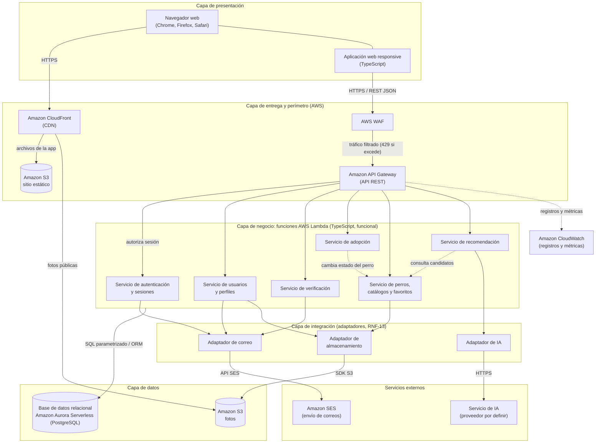

# ADOGTAME — Arquitectura

> **Derivado de:** ERS v2.1.0 (13/11/2026), requisitos no funcionales (§7, resumidos en `adog_RNF.md`), `adog_MER.md` (datos) y `adog_REC.md` (módulo de recomendación). Diagrama preliminar del Taller 2.2 (`parcial2/taller2.2/mermaid/componentes.md`). Si este documento y el ERS difieren, prevalece el ERS y este debe actualizarse.
> Describe **cómo se organiza el sistema**: capas, componentes, servicios de AWS, integraciones externas y las decisiones que cumplen los RNF. Las entidades conceptuales y las funciones que implementan cada componente están en `adog_CLS.md`. Es una arquitectura **preliminar**: lo marcado como *por definir* se decide durante la construcción.
> Convenciones: los nombres de los servicios de AWS son los oficiales; los nombres de los componentes de negocio están en español y coinciden con los paquetes de `adog_CLS.md`.

---

## 1. Resumen y estilo arquitectónico

- **Estilo:** aplicación web de **tres capas lógicas** (presentación, negocio y datos) desplegada en **AWS serverless** (RNF-18). El negocio se divide en **servicios por dominio** que se ejecutan como funciones AWS Lambda detrás de una API REST; no son microservicios independientes: comparten una sola base de datos y un solo despliegue.
- **Lenguaje y paradigma:** TypeScript en cliente y servidor. El servidor usa **programación funcional**: **no se implementan clases reales**; el comportamiento son funciones que reciben datos y devuelven datos (las «clases» de `adog_CLS.md` son un modelo conceptual y sus operaciones se implementan como funciones).
- **Integraciones aisladas:** el almacenamiento de imágenes, el envío de correos y el Servicio de IA se acceden solo mediante **adaptadores** (un tipo de contrato y un módulo de funciones que lo cumple, que se recibe como parámetro), de modo que el proveedor pueda cambiarse sin tocar el negocio (RNF-13).
- **Sin estado en el servidor:** las funciones no guardan información entre peticiones; el estado vive en la base de datos (incluidas las sesiones, tabla `SESION`) y en S3.

---

## 2. Vista de componentes

| Campo | Descripción |
|---|---|
| Nombre | Diagrama de componentes del sistema Adogtame |
| Objetivo | Mostrar cómo se organiza todo el sistema por capas, qué servicios de AWS intervienen y por dónde viaja cada petición, desde el navegador hasta la base de datos y los servicios externos. |
| Elementos principales | **Capas:** presentación, entrega y perímetro, negocio, integración, datos y servicios externos. **Componentes:** navegador y aplicación web; CloudFront, S3, WAF y API Gateway; seis servicios de negocio en Lambda; tres adaptadores; Aurora Serverless y S3 (fotos); SES y Servicio de IA; CloudWatch. |
| Reglas aplicadas | Todo el tráfico va por HTTPS y atraviesa WAF y API Gateway (50 peticiones/s, 429 al exceder). Cada servicio autoriza por rol y propiedad. Solo hay dos dependencias entre servicios (Adopción→Perros y Recomendación→Perros). Los servicios externos se acceden únicamente por adaptadores. |
| Justificación | Separa las responsabilidades por capa y por dominio, hace visible dónde se cumple cada RNF (seguridad, costo, disponibilidad, sustitución de proveedores) y mantiene el sistema simple y barato: un solo despliegue serverless y una sola base de datos. |
| Imagen | El diagrama completo está en el bloque Mermaid de abajo. |

---

## 3. Capas y componentes

Resumen en el formato de la plantilla del Taller 2.2 (componente, responsabilidad y observación de diseño); las subsecciones siguientes detallan cada capa con sus requisitos.

| Componente | Responsabilidad | Observación de diseño |
|---|---|---|
| API REST (API Gateway) | Expone los servicios de negocio al cliente por HTTPS y limita el tráfico. | Punto de entrada único; detrás del WAF. |
| Servicios de negocio (Lambda) | Ejecutan las reglas de cada dominio (cuentas, verificación, perros, adopción, recomendación). | Funciones TypeScript sin estado; un servicio por dominio, un solo despliegue. |
| Adaptadores (almacenamiento, correo, IA) | Aíslan S3, SES y el proveedor de IA detrás de un contrato. | Cambiar de proveedor no toca la lógica de negocio (RNF-13). |
| Base de datos (Aurora Serverless) | Guarda las 15 entidades del MER. | Cobro por uso; borrado lógico y consultas parametrizadas. |
| Almacenamiento de fotos (S3 + CloudFront) | Guarda y sirve las imágenes públicas. | La base solo guarda la clave del archivo. |
| Perímetro (CloudFront, WAF) | Entrega HTTPS, filtra tráfico malicioso. | Primera línea de defensa (RNF-05, RNF-23). |
| Observabilidad (CloudWatch, Budgets) | Registros, métricas y alertas de gasto. | Los registros no incluyen datos personales (RNF-08). |

### 3.1. Presentación

| Componente | Responsabilidad | Requisitos |
|---|---|---|
| Aplicación web responsive | Interfaz en español: listados con filtros, ficha del perro, test, favoritos, solicitudes y paneles de cada rol. Consume la API REST por HTTPS. Los menús se adaptan al rol, pero **no sustituyen** la autorización del servidor. | RNF-04, RNF-14, RNF-16, RNF-17, RNF-21 |
| Navegador | Chrome, Firefox y Safari (2 últimas versiones) en escritorio; la interfaz se adapta desde 360 px. No hay aplicación móvil nativa. | RNF-16, RNF-17 |

> El *framework* de la aplicación web (el sistema original usaba React/Next.js) está **por definir**; solo se fija que es TypeScript y que se publica como archivos estáticos.

### 3.2. Entrega y perímetro

| Componente | Responsabilidad | Requisitos |
|---|---|---|
| Amazon CloudFront | Punto de entrada HTTPS; sirve los archivos de la aplicación (S3 sitio estático) y las fotos públicas (S3 fotos). Aplica la política de seguridad de contenido (CSP). | RNF-05, RNF-21 |
| Amazon S3 (sitio estático) | Aloja la aplicación compilada. | RNF-18 |
| AWS WAF | Bloquea IP con más de 500 peticiones en 5 minutos y aplica reglas administradas contra ataques comunes. | RNF-23 |
| Amazon API Gateway | API REST única; limita el tráfico a 50 peticiones por segundo (ráfagas de 100) y responde 429 al exceder; enruta a la función de cada servicio. | RNF-23 |

### 3.3. Negocio (funciones AWS Lambda)

Cada servicio agrupa los casos de uso de un dominio. Todos validan y sanitizan las entradas (RNF-21), autorizan en el servidor por rol y propiedad del recurso (RNF-04) y acceden a la base de datos con parámetros enlazados u ORM (RNF-20).

| Servicio | Responsabilidad | Requisitos principales |
|---|---|---|
| Autenticación y sesiones | Registro, confirmación de correo, inicio y cierre de sesión (30 min de inactividad; cierre en todos los dispositivos), recuperación y definición de contraseña, enlaces de un solo uso. | RF-05, RF-07, RF-08, RF-10, RF-34; RNF-03, RNF-06, RNF-25 |
| Usuarios y perfiles | Perfil de persona y de refugio, cambio de correo y contraseña, baja de cuenta (borrado lógico), foto de perfil. | RF-09, RF-11, RF-27, RF-28, RF-31 |
| Verificación | Solicitudes de rescatista y de refugio; aprobación o rechazo por el administrador; creación de la cuenta de refugio al aprobar. | RF-06, RF-24, RF-25, RF-26 |
| Perros, catálogos y favoritos | Publicar, editar, eliminar y cambiar de estado un perro; fotos (hasta 5); listado, búsqueda y filtros; catálogos de raza y color; favoritos. | RF-01 a RF-03, RF-12, RF-19 a RF-21, RF-23, RF-29, RF-30, RF-32, RF-33 |
| Adopción | Crear, aceptar, rechazar y cancelar solicitudes; generar el mensaje de contacto; rechazo automático cuando el perro se adopta o se elimina. | RF-16, RF-17, RF-18, RF-22 |
| Recomendación | Test de estilo de vida, preselección de 20 candidatos por fórmula de afinidad, consulta al Servicio de IA, validación de la respuesta y respaldo con plantillas. Detalle en `adog_REC.md`. | RF-13, RF-14, RF-15; RNF-02, RNF-09, RNF-19 |

Dependencias entre servicios (flechas punteadas del diagrama): **Adopción** invoca a **Perros** para cambiar el estado del perro, y **Recomendación** invoca a **Perros** para obtener los candidatos. Ningún otro servicio llama a otro; se comunican por la base de datos o por el cliente.

### 3.4. Integración (adaptadores)

| Adaptador | Contrato (tipo, ver `adog_CLS.md`) | Implementación actual (módulo de funciones) | Lo usan |
|---|---|---|---|
| Almacenamiento | `IAlmacenamientoImagenes` | Amazon S3 (`AlmacenamientoS3`) | Usuarios, Perros |
| Correo | `IServicioCorreo` | Amazon SES (`CorreoSES`) | Autenticación, Usuarios, Verificación |
| IA | `IServicioIA` | Proveedor por definir (`ServicioIAExterno`) | Recomendación |

Las imágenes se validan por su contenido real, se guardan con nombre generado y sin metadatos y se sirven sin permisos de ejecución (RNF-22). Al Servicio de IA solo se envían las respuestas del test y los atributos de los candidatos, nunca datos de identidad (RNF-09).

### 3.5. Datos

| Componente | Contenido | Requisitos |
|---|---|---|
| Amazon Aurora Serverless (PostgreSQL) | Las 15 entidades de `adog_MER.md`. Borrado lógico en usuarios y perros. | RNF-10, RNF-18, RNF-20 |
| Amazon S3 (fotos) | Archivos de las fotos de perros y de perfil; la base guarda solo la clave de almacenamiento. | RNF-22 |

### 3.6. Transversales

| Componente | Responsabilidad | Requisitos |
|---|---|---|
| Amazon CloudWatch | Registros y métricas de API Gateway y de las funciones. Los registros no contienen contraseñas, tokens ni teléfonos o correos completos. | RNF-08 |
| AWS Budgets | Alertas por correo al 50 %, 80 % y 100 % del presupuesto mensual de AWS. | RNF-24 |

---

## 4. Decisiones de diseño y trazabilidad con los RNF

| Decisión | Motivo | RNF |
|---|---|---|
| Despliegue 100 % serverless (Lambda, Aurora Serverless, S3) | Cobro por uso y costo acotado; el servicio de IA no supera USD 5 al mes. | RNF-18 |
| Todo el tráfico por HTTPS vía CloudFront y API Gateway | Cifrado de extremo a extremo con cliente y servicios externos. | RNF-05 |
| WAF delante de API Gateway, con *throttling* | Protección perimetral y limitación de tráfico (429). | RNF-23 |
| Autorización en cada servicio, no en el cliente | Ocultar opciones en la interfaz no es seguridad. | RNF-04 |
| Sesiones en base de datos con `token_hash` | Permite cerrar por inactividad y en todos los dispositivos sin estado en el servidor. | RNF-25 |
| Adaptadores para S3, SES e IA | Cambiar de proveedor sin modificar el negocio. | RNF-13 |
| Respaldo del Servicio de IA con la fórmula de afinidad y plantillas | Si la IA falla, tarda más de 10 s (15 s con cold start) o responde algo inválido, se muestran igualmente las recomendaciones. | RNF-02, RNF-11, RNF-19 |
| Indicador de carga en el cliente | Cold start aceptado por diseño (hasta 8 s en la primera petición). | RNF-01 |
| Servicios sin acoplamiento salvo Adopción→Perros y Recomendación→Perros | Mantiene los dominios separados y fáciles de probar. | RNF-13 |
| Misma respuesta 404 para recursos inexistentes o eliminados | No revelar la existencia de recursos eliminados. | RNF-07 |

---

## 5. Seguridad por capa

| Capa | Controles |
|---|---|
| Cliente | Escape de salida, sin HTML en campos, CSP sin scripts en línea (RNF-21). |
| Perímetro | HTTPS, WAF, *throttling* (RNF-05, RNF-23). |
| Negocio | Autorización por rol y propiedad, validación y sanitización, contraseñas con hash y sal, enlaces de un solo uso con caducidad, textos del usuario enviados a la IA como datos y no como instrucciones (RNF-03, RNF-04, RNF-06, RNF-19). |
| Datos | Consultas parametrizadas u ORM, borrado lógico, tokens y sesiones solo como hash (RNF-03, RNF-10, RNF-20). |
| Archivos | Validación por contenido, nombre generado, sin metadatos ni ejecución (RNF-22). |

---

## 6. Decisiones abiertas

- *Framework* de la aplicación web y librería de acceso a datos (ORM).
- Proveedor y modelo del Servicio de IA (`adog_REC.md`).
- Mecanismo de transporte de la sesión (p. ej. *cookie* HttpOnly) y si se utilizará alguna herramienta de despliegue de infraestructura como código.
- Si Aurora Serverless se ubica en una red privada (VPC) y cómo se conectan las funciones, con su impacto en el *cold start*.
