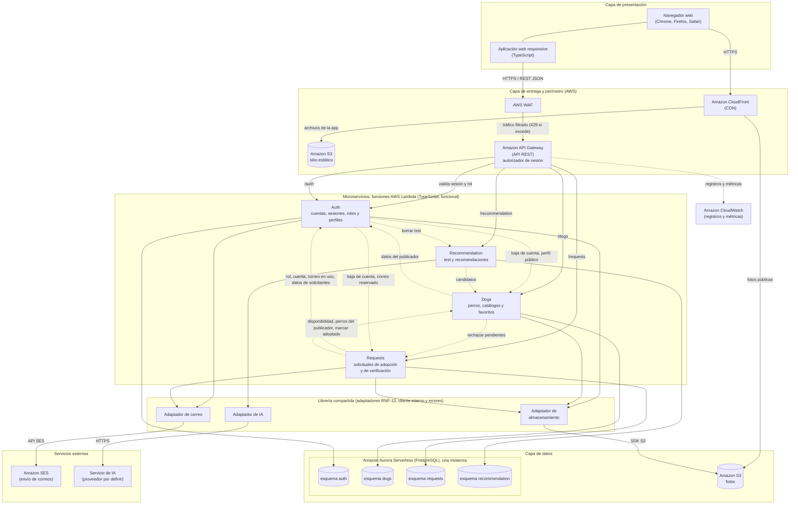

# ADOGTAME — Arquitectura

> **Derivado de:** ERS v2.1.0 (13/11/2026), requisitos no funcionales (§7, resumidos en `adog_RNF.md`), `adog_MER.md` (datos) y `adog_REC.md` (módulo de recomendación). Diagrama preliminar del Taller 2.2 (`parcial2/taller2.2/mermaid/componentes.md`), ajustado a **microservicios**. Si este documento y el ERS difieren, prevalece el ERS y este debe actualizarse.
> Describe **cómo se organiza el sistema**: microservicios, servicios de AWS, integraciones externas, comunicación y las decisiones que cumplen los RNF. Las entidades conceptuales y las funciones que implementan cada servicio están en `adog_CLS.md`, y el **detalle de cada microservicio** (operaciones, reglas, llamadas y flujos que cruzan servicios) está en `adog_MS.md`. Es una arquitectura **preliminar**: lo marcado como *por definir* se decide durante la construcción.
> Convenciones: los nombres de los servicios de AWS son los oficiales; los **microservicios llevan nombre en inglés** (`Auth`, `Dogs`, `Requests`, `Recommendation`) y coinciden con los paquetes de `adog_CLS.md`; el resto de la documentación está en español.

---

## 1. Resumen y estilo arquitectónico

- **Estilo:** aplicación web desplegada en **AWS serverless** (RNF-18) con un backend de **4 microservicios**: `Auth`, `Dogs`, `Requests` y `Recommendation`. Cada uno es una función AWS Lambda con **despliegue propio e independiente**, detrás de una API REST común. La aplicación web (frontend) no es un microservicio.
- **Propiedad de los datos:** hay **una sola instancia de Aurora Serverless (PostgreSQL)**, pero cada microservicio tiene **su propio esquema** y es el único que lo lee y escribe. **No hay claves foráneas ni JOIN entre esquemas**: lo que un servicio necesita de otro lo pide por su API. Cada servicio usa un usuario de base de datos con permisos solo sobre su esquema. La separación es lógica; separarla físicamente (una base de datos por servicio) solo requeriría cambiar la configuración.
- **Comunicación síncrona, sin colas ni eventos:** los servicios se llaman entre sí con peticiones síncronas con límite de tiempo (sección 4). No se usa ningún bróker de mensajes.
- **Lenguaje y paradigma:** TypeScript en cliente y servidor. El servidor usa **programación funcional**: **no se implementan clases reales**; el comportamiento son funciones que reciben datos y devuelven datos (las «clases» de `adog_CLS.md` son un modelo conceptual y sus operaciones se implementan como funciones).
- **Integraciones aisladas:** el almacenamiento de imágenes, el envío de correos y el Servicio de IA se acceden solo mediante **adaptadores**, que forman una **librería compartida** (no un servicio): un tipo de contrato y un módulo de funciones que lo cumple, recibido como parámetro, de modo que el proveedor pueda cambiarse sin tocar el negocio (RNF-13). La librería compartida incluye también el cliente de comunicación entre servicios y el contrato de errores (sección 4).
- **Sin estado en el servidor:** las funciones no guardan información entre peticiones; el estado vive en la base de datos (incluidas las sesiones, tabla `SESION`) y en S3.

---

## 2. Vista de componentes

| Campo | Descripción |
|---|---|
| Nombre | Diagrama de componentes del sistema Adogtame |
| Objetivo | Mostrar cómo se organiza todo el sistema, qué microservicios y servicios de AWS intervienen, qué datos posee cada uno y por dónde viaja cada petición, desde el navegador hasta la base de datos y los servicios externos. |
| Elementos principales | **Capas:** presentación, entrega y perímetro, microservicios, integración (librería compartida), datos y servicios externos. **Componentes:** navegador y aplicación web; CloudFront, S3, WAF y API Gateway; cuatro microservicios en Lambda (`Auth`, `Dogs`, `Requests`, `Recommendation`); tres adaptadores; Aurora Serverless con un esquema por servicio y S3 (fotos); SES y Servicio de IA; CloudWatch. |
| Reglas aplicadas | Todo el tráfico va por HTTPS y atraviesa WAF y API Gateway (50 peticiones/s, 429 al exceder). Cada servicio autoriza por rol y propiedad y accede solo a su esquema. Las llamadas entre servicios son síncronas y se resumen en la sección 3.2. Los servicios externos se acceden únicamente por adaptadores. |
| Justificación | Separa las responsabilidades por dominio con propiedad de datos y despliegue independiente, hace visible dónde se cumple cada RNF (seguridad, costo, disponibilidad, sustitución de proveedores) y se mantiene barato: una sola instancia de base de datos y cobro por uso. |
| Imagen | El diagrama completo está en el bloque Mermaid de abajo. |

Las flechas punteadas entre microservicios son llamadas síncronas internas (sección 4). Todos los servicios, además, validan la sesión contra `Auth` mediante el autorizador de API Gateway.

---

## 3. Microservicios

Cada microservicio agrupa los casos de uso de un dominio. Todos validan y sanitizan las entradas (RNF-21), autorizan en el servidor por rol y propiedad del recurso (RNF-04), acceden solo a su esquema con parámetros enlazados u ORM (RNF-20) y se despliegan por separado.

| Componente | Responsabilidad | Observación de diseño |
|---|---|---|
| API REST (API Gateway) | Expone los microservicios al cliente por HTTPS, ejecuta el autorizador de sesión y limita el tráfico. | Punto de entrada único; una ruta por servicio; detrás del WAF. |
| Microservicios (Lambda) | Ejecutan las reglas de cada dominio. | Funciones TypeScript sin estado; despliegue independiente; esquema propio. |
| Librería compartida | Adaptadores (S3, SES, IA), cliente interno, contrato de errores, validación y sanitización. | No es un servicio; se incluye en cada despliegue. Cambiar de proveedor no toca la lógica de negocio (RNF-13). |
| Base de datos (Aurora Serverless) | Guarda las 15 entidades del MER repartidas en cuatro esquemas. | Una sola instancia (costo); sin FK ni JOIN entre esquemas; borrado lógico y consultas parametrizadas. |
| Almacenamiento de fotos (S3 + CloudFront) | Guarda y sirve las imágenes públicas. | La base solo guarda la clave del archivo. |
| Perímetro (CloudFront, WAF) | Entrega HTTPS, filtra tráfico malicioso. | Primera línea de defensa (RNF-05, RNF-23). |
| Observabilidad (CloudWatch, Budgets) | Registros, métricas y alertas de gasto. | Los registros no incluyen datos personales (RNF-08). |

### 3.1. Responsabilidad de cada microservicio

| Microservicio | Entidades del MER (su esquema) | Responsabilidad | Requisitos principales |
|---|---|---|---|
| `Auth` | `USUARIO`, `ROL`, `USUARIO_ROL`, `PERSONA`, `REFUGIO`, `TOKEN_CORREO`, `SESION` | Registro, confirmación de correo, inicio y cierre de sesión (30 min de inactividad; cierre en todos los dispositivos), recuperación y definición de contraseña, enlaces de un solo uso, perfiles de persona y de refugio, cambio de correo y de contraseña, baja y restauración de cuentas, roles y permisos, administración de usuarios, y emisión de la identidad y el rol de cada petición. | RF-03 a RF-05, RF-07 a RF-11, RF-26 a RF-28, RF-31, RF-34; RNF-03, RNF-06, RNF-25 |
| `Dogs` | `PERRO`, `FOTO_PERRO`, `RAZA`, `COLOR`, `FAVORITO` | Publicar, editar, eliminar y cambiar de estado un perro; fotos (hasta 5); listado, búsqueda y filtros; catálogos de raza y color; favoritos; gestión de perros por el administrador. | RF-01, RF-02, RF-12, RF-19 a RF-21, RF-23, RF-29, RF-30, RF-32, RF-33 |
| `Requests` | `SOLICITUD_ADOPCION`, `SOLICITUD_VERIFICACION` | Dos módulos internos: **adopción** (crear, aceptar, rechazar y cancelar solicitudes; mensaje de contacto; rechazo automático al adoptar o eliminar un perro) y **verificación** (solicitudes de rescatista y de refugio; aprobación o rechazo por el administrador; creación de la cuenta del refugio al aprobar). Las dos tablas se mantienen separadas. | RF-06, RF-16 a RF-18, RF-22, RF-24, RF-25 |
| `Recommendation` | `PERFIL_ADOPTANTE` | Test de estilo de vida, preselección de 20 candidatos por fórmula de afinidad, consulta al Servicio de IA, validación de la respuesta y respaldo con plantillas. Detalle en `adog_REC.md`. | RF-13, RF-14, RF-15; RNF-02, RNF-09, RNF-19 |

> `Requests` agrupa dos flujos con un mismo patrón de estados (pendiente y luego resuelta). Se separan en módulos internos para que puedan dividirse en dos servicios si hiciera falta, y la lógica común de transición de estados vive en la librería compartida.

### 3.2. Llamadas entre microservicios

| Quién llama | A quién | Para qué | Operación |
|---|---|---|---|
| Todos (por el autorizador) | `Auth` | Validar la sesión y obtener el usuario y su rol en cada petición. | Consulta |
| `Requests` (verificación) | `Auth` | Cambiar el rol a RESCATISTA o crear la cuenta del refugio al aprobar; comprobar que un correo no pertenece a una cuenta. | Escritura idempotente / consulta |
| `Requests` (adopción) | `Auth` | Obtener nombre y teléfono vigentes del solicitante para el mensaje (RN-30) y los datos de los solicitantes (nombre, foto y contacto) para el panel del publicador, en lote. | Consulta |
| `Requests` (adopción) | `Dogs` | Comprobar que el perro está disponible y quién lo publica; marcarlo adoptado al aceptar; obtener los datos de varios perros (historial) y los perros de un publicador (solicitudes recibidas). | Consulta / escritura idempotente |
| `Auth` | `Requests` | Comprobar si un correo tiene una solicitud de refugio pendiente (registro, creación de usuarios y cambio de correo). | Consulta |
| `Dogs` | `Requests` | Rechazar las solicitudes pendientes cuando el perro pasa a adoptado manualmente o se elimina. | Escritura idempotente |
| `Dogs` | `Auth` | Datos del publicador para listados y fichas, pedidos en lote. | Consulta |
| `Auth` | `Dogs`, `Requests`, `Recommendation` | Baja o restauración de cuenta: ocultar o mostrar sus perros, rechazar sus solicitudes pendientes y borrar su test. Perfil público: lista de perros publicados (RF-03). | Escritura idempotente / consulta |
| `Recommendation` | `Dogs` | Obtener los perros candidatos. | Consulta |

Reglas de estas llamadas:
- **Sin ciclos en una misma petición:** un endpoint que otro servicio invoca **no vuelve a llamar al invocante**. Para evitar el ciclo entre `Dogs` y `Requests`, al aceptar una solicitud `Requests` pide a `Dogs` marcar el perro como adoptado con una marca de origen para que `Dogs` no le llame de vuelta, y `Requests` rechaza por sí mismo las demás pendientes. Cuando el cambio nace en `Dogs` (adopción manual o eliminación), `Dogs` llama una sola vez a `Requests`.
- **Profundidad máxima de dos saltos** por petición del usuario.
- Los contratos exactos (rutas, tipos, errores) se fijan en el incremento de cimientos del plan.

### 3.3. Presentación

| Componente | Responsabilidad | Requisitos |
|---|---|---|
| Aplicación web responsive | Interfaz en español: listados con filtros, ficha del perro, test, favoritos, solicitudes y paneles de cada rol. Consume la API REST por HTTPS. Los menús se adaptan al rol, pero **no sustituyen** la autorización del servidor. | RNF-04, RNF-14, RNF-16, RNF-17, RNF-21 |
| Navegador | Chrome, Firefox y Safari (2 últimas versiones) en escritorio; la interfaz se adapta desde 360 px. No hay aplicación móvil nativa. | RNF-16, RNF-17 |

> El *framework* de la aplicación web (el sistema original usaba React/Next.js) está **por definir**; solo se fija que es TypeScript y que se publica como archivos estáticos.

### 3.4. Entrega y perímetro

| Componente | Responsabilidad | Requisitos |
|---|---|---|
| Amazon CloudFront | Punto de entrada HTTPS; sirve los archivos de la aplicación (S3 sitio estático) y las fotos públicas (S3 fotos). Aplica la política de seguridad de contenido (CSP). | RNF-05, RNF-21 |
| Amazon S3 (sitio estático) | Aloja la aplicación compilada. | RNF-18 |
| AWS WAF | Bloquea IP con más de 500 peticiones en 5 minutos y aplica reglas administradas contra ataques comunes. | RNF-23 |
| Amazon API Gateway | API REST única; limita el tráfico a 50 peticiones por segundo (ráfagas de 100) y responde 429 al exceder; ejecuta el autorizador de sesión y enruta a la función de cada servicio (`/auth`, `/dogs`, `/requests`, `/recommendation`). | RNF-23 |

### 3.5. Integración (adaptadores)

| Adaptador | Contrato (tipo, ver `adog_CLS.md`) | Implementación actual (módulo de funciones) | Lo usan |
|---|---|---|---|
| Almacenamiento | `IAlmacenamientoImagenes` | Amazon S3 (`AlmacenamientoS3`) | `Auth` (foto de perfil), `Dogs`, `Requests` (foto de la solicitud de refugio) |
| Correo | `IServicioCorreo` | Amazon SES (`CorreoSES`) | `Auth` (enlaces), `Requests` (resultado de verificación) |
| IA | `IServicioIA` | Proveedor por definir (`ServicioIAExterno`) | `Recommendation` |

Las imágenes se validan por su contenido real, se guardan con nombre generado y sin metadatos y se sirven sin permisos de ejecución (RNF-22). Al Servicio de IA solo se envían las respuestas del test y los atributos de los candidatos, nunca datos de identidad (RNF-09). Qué servicio envía cada correo se fija en los contratos: la regla es que `Auth` envía los enlaces de sus tokens y `Requests` el aviso de resultado de la verificación.

### 3.6. Datos

| Componente | Contenido | Requisitos |
|---|---|---|
| Amazon Aurora Serverless (PostgreSQL) | Las 15 entidades de `adog_MER.md` en cuatro esquemas (`auth`, `dogs`, `requests`, `recommendation`). Borrado lógico en usuarios y perros. | RNF-10, RNF-18, RNF-20 |
| Amazon S3 (fotos) | Archivos de las fotos de perros y de perfil; la base guarda solo la clave de almacenamiento. | RNF-22 |

### 3.7. Transversales

| Componente | Responsabilidad | Requisitos |
|---|---|---|
| Amazon CloudWatch | Registros y métricas de API Gateway y de las funciones. Los registros no contienen contraseñas, tokens ni teléfonos o correos completos. | RNF-08 |
| AWS Budgets | Alertas por correo al 50 %, 80 % y 100 % del presupuesto mensual de AWS. | RNF-24 |

---

## 4. Comunicación

### 4.1. Principios

- **Todo es síncrono (petición y respuesta).** No se usan colas ni mecanismos de eventos para evitar complejidad adicional.
- **`async/await` de TypeScript no difiere trabajo:** sirve para no bloquear mientras se espera una respuesta y para **paralelizar** llamadas independientes con `Promise.all`. Una función Lambda se congela al devolver su respuesta, por lo que el trabajo que no se espere antes de responder puede perderse; **no se usan promesas sin esperar (*fire-and-forget*)**.
- Diferir trabajo de verdad (invocación asíncrona de Lambda o una cola) queda como **reserva documentada**, no implementada: solo se consideraría si el volumen lo exigiera.

### 4.2. Casos que podrían parecer asíncronos

| Caso | Diseño | Por qué |
|---|---|---|
| Correos (SES) | Síncrono dentro de la petición. Primero se guarda el dato (token, resultado de la solicitud) y luego se envía el correo con `await`. Si falla, el dato ya está guardado y se responde con un mensaje claro: un token no enviado se reenvía y el resultado de una verificación no se revierte, solo se avisa de que el correo no salió. | El envío toma unos cientos de milisegundos; no se pierden datos (RNF-11). |
| Recomendaciones (IA) | Síncrono con *timeout* y respaldo. `Recommendation` llama a la IA con un límite de 10 s (15 s con *cold start*); si vence, falla o la respuesta es inválida, devuelve la fórmula de afinidad con plantillas. La función Lambda se configura con un tiempo máximo mayor al de la IA (valor inicial 20 s, a ajustar) y por debajo del límite de 29 s de API Gateway. | RNF-02, RNF-11 y RNF-19 ya describen este comportamiento; no se guardan resultados (RN-47). |

### 4.3. Entre microservicios

- **Cliente interno** en la librería compartida, que concentra *timeout*, reintentos, identificador de petición y propagación de la identidad. Así puede cambiarse el transporte sin tocar el negocio (en la línea de RNF-13).
- **Transporte:** invocación directa de Lambda en modo síncrono (con permisos IAM, sin pasar por WAF ni API Gateway). El servicio llamado valida que el llamante sea otro servicio de Adogtame.
- **Tiempo límite** de cada llamada interna (valor inicial 3 s) y **reintento acotado solo en operaciones seguras de repetir**.
- **Idempotencia:** toda escritura que cruza servicios lleva una clave (por ejemplo, el id de la solicitud). Si `Requests` aprueba un refugio y `Auth` ya había creado la cuenta, repetir la llamada no la duplica. Si algo falla, la solicitud sigue pendiente y el administrador puede reintentar.
- **Orden de las operaciones que cruzan dominios:** primero el efecto en el servicio de la regla más fuerte y por último el cambio de estado propio; un fallo intermedio se recupera repitiendo la operación.
- **Profundidad máxima de dos saltos** y datos de otros dominios pedidos **en lote**, para no acumular *cold starts* frente a los topes de RNF-01.

### 4.4. Con el frontend

- API REST en JSON por API Gateway, con una ruta por servicio. **El frontend nunca orquesta entre servicios**: cada servicio compone lo que necesita de los demás (por ejemplo, `Dogs` pide los datos del publicador a `Auth`).
- **Contrato de errores único** (código y mensaje en español), que incluye los casos de RNF-07 (404 idéntico para recursos inexistentes o eliminados) y RNF-23 (429).
- **Estados de carga:** indicador de carga, *timeout* y cancelación en el cliente, y reintento automático solo en consultas. Esto cubre el *cold start* de hasta 8 s (RNF-01).
- **Sesión:** cada petición lleva la sesión y la valida el autorizador contra `Auth` (RNF-25).
- **Fotos:** las funciones Lambda síncronas aceptan cargas de hasta 6 MB (10 MB en API Gateway); las fotos se suben **de una en una** y se validan por su contenido en el servicio (RNF-22). El tamaño máximo por foto se confirma con RF-19.

---

## 5. Decisiones de diseño y trazabilidad con los RNF

| Decisión | Motivo | RNF |
|---|---|---|
| Despliegue 100 % serverless (Lambda, Aurora Serverless, S3) | Cobro por uso y costo acotado; el servicio de IA no supera USD 5 al mes. | RNF-18 |
| 4 microservicios con un esquema por servicio en una sola instancia de Aurora | Propiedad de los datos y despliegue independiente sin multiplicar el costo de la base de datos. | RNF-13, RNF-18 |
| `Auth` unifica cuentas, sesiones, perfiles y roles | Están fuertemente acoplados; separarlos solo agregaría llamadas. | RNF-04, RNF-25 |
| `Requests` agrupa solicitudes de adopción y de verificación | Mismo patrón de estados; un servicio y un despliegue menos; módulos internos separados. | RNF-13 |
| Todo el tráfico por HTTPS vía CloudFront y API Gateway | Cifrado de extremo a extremo con cliente y servicios externos. | RNF-05 |
| WAF delante de API Gateway, con *throttling* | Protección perimetral y limitación de tráfico (429). | RNF-23 |
| Autorización en cada servicio, no en el cliente | Ocultar opciones en la interfaz no es seguridad. | RNF-04 |
| Sesiones en base de datos con `token_hash` | Permite cerrar por inactividad y en todos los dispositivos sin estado en el servidor. | RNF-25 |
| Adaptadores para S3, SES e IA en una librería compartida | Cambiar de proveedor sin modificar el negocio. | RNF-13 |
| Comunicación síncrona, sin colas ni eventos | Evita complejidad adicional; las operaciones se recuperan por idempotencia y reintento. | RNF-11 |
| Correos y recomendaciones síncronos con *timeout* y respaldo | Si la IA o el correo fallan, los datos ya registrados no se pierden y se muestran las recomendaciones de respaldo. | RNF-02, RNF-11, RNF-19 |
| Indicador de carga en el cliente | Cold start aceptado por diseño (hasta 8 s en la primera petición). | RNF-01 |
| Profundidad máxima de dos saltos y consultas en lote | Limita la acumulación de *cold starts*. | RNF-01 |
| Misma respuesta 404 para recursos inexistentes o eliminados | No revelar la existencia de recursos eliminados. | RNF-07 |

---

## 6. Seguridad por capa

| Capa | Controles |
|---|---|
| Cliente | Escape de salida, sin HTML en campos, CSP sin scripts en línea (RNF-21). |
| Perímetro | HTTPS, WAF, *throttling* (RNF-05, RNF-23). |
| Negocio | Autorización por rol y propiedad, validación y sanitización, contraseñas con hash y sal, enlaces de un solo uso con caducidad, textos del usuario enviados a la IA como datos y no como instrucciones; las llamadas entre servicios solo se aceptan de otros servicios de Adogtame (RNF-03, RNF-04, RNF-06, RNF-19). |
| Datos | Consultas parametrizadas u ORM, un usuario de base de datos por esquema, borrado lógico, tokens y sesiones solo como hash (RNF-03, RNF-10, RNF-20). |
| Archivos | Validación por contenido, nombre generado, sin metadatos ni ejecución (RNF-22). |

---

## 7. Decisiones abiertas

- *Framework* de la aplicación web y librería de acceso a datos (ORM).
- Proveedor y modelo del Servicio de IA (`adog_REC.md`).
- Mecanismo de transporte de la sesión (p. ej. *cookie* HttpOnly) y si se utilizará alguna herramienta de despliegue de infraestructura como código.
- Si Aurora Serverless se ubica en una red privada (VPC) y cómo se conectan las funciones, con su impacto en el *cold start*.
- Valores finales de los tiempos límite (internos, de la IA y de cada Lambda) y del tamaño máximo por foto.
- Qué servicio envía cada correo (la regla propuesta está en 3.5).
