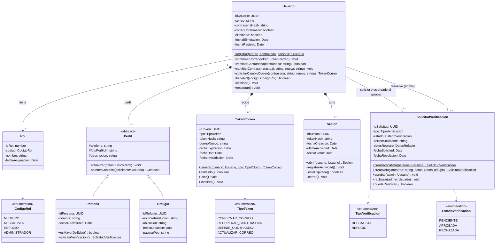
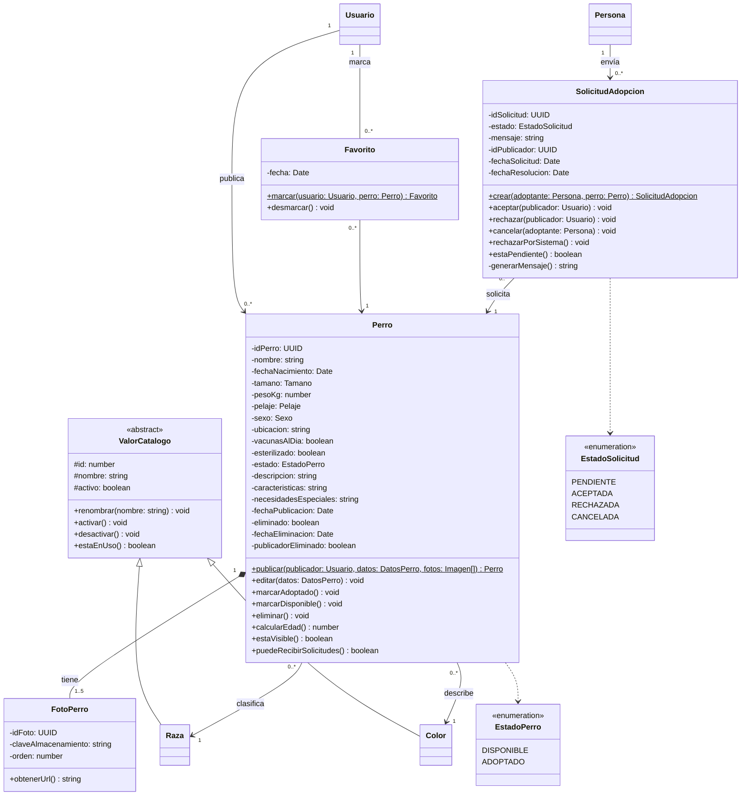
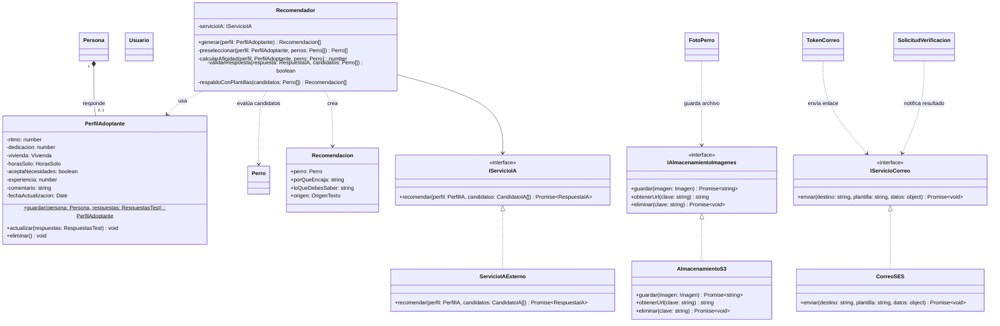

# ADOGTAME — Diagramas de clases (preliminar)

> **Derivado de:** `adog_MER.md` (datos), `adog_ARCH.md` (componentes e integraciones), `adog_RF.md` y `adog_RN.md` (comportamiento), `adog_REC.md` (recomendación) y el diagrama de clases del Taller 2.2 (`parcial2/taller2.2/mermaid/clases.md`). Si este documento y el ERS difieren, prevalece el ERS y este debe actualizarse.
> Describe el **modelo conceptual de clases** del servidor: qué conceptos maneja el negocio, sus atributos, sus operaciones y cómo se relacionan. **En el desarrollo no se usarán clases reales**: el sistema se implementa con **programación funcional** en TypeScript (ver `adog_ARCH.md` §1). Por eso cada clase se traduce a un **tipo de datos** (sus atributos) y a **funciones** (sus operaciones), que se especifican en la sección 5. Es un diseño **preliminar**: las firmas exactas se precisan al construir.
> Convenciones: `-` privado, `#` protegido, `+` público, `$` operación de creación (en código, una función que valida y devuelve el dato). Los nombres están en español y se derivan de las entidades del MER; los atributos pasan de `snake_case` (base de datos) a `camelCase` (código). Una operación de dominio **no** accede a la base de datos: la persistencia es responsabilidad de las funciones de acceso a datos (ver sección 6).

---

## 1. Visión general

| Campo | Descripción |
|---|---|
| Nombre | Diagramas de clases de Adogtame |
| Objetivo | Mostrar los conceptos del negocio (cuentas, perros, adopción, recomendación), qué datos guarda cada uno, qué operaciones se les aplican y cómo se relacionan, como base para especificar las funciones del servidor. |
| Elementos principales | 18 clases, 3 interfaces de integración y sus 3 implementaciones, organizadas en tres diagramas (secciones 2 a 4), con enumeraciones para los estados y tipos. |
| Reglas aplicadas | Cardinalidades del MER (un usuario tiene un perfil y un rol; un perro tiene de 1 a 5 fotos; una solicitud apunta a un perro y a un adoptante), herencia de `Perfil` y de `ValorCatalogo`, y dependencia del negocio solo de interfaces para S3, SES y la IA. |
| Justificación | Aunque en el código no existirán clases, el diagrama ordena las reglas de negocio por concepto: cada operación es una función por especificar y cada atributo un campo de un tipo de dato. Reutiliza los nombres del MER para mantener la trazabilidad. |
| Imagen | Los diagramas completos están en los bloques Mermaid de las secciones 2 a 4. |

El modelo se divide en tres bloques (diagramas), y cada clase pertenece a uno de los 4 microservicios de `adog_ARCH.md` §3:

| Bloque | Clases | Microservicio |
|---|---|---|
| Cuentas y verificación | `Usuario`, `Rol`, `Perfil`, `Persona`, `Refugio`, `TokenCorreo`, `Sesion` | `Auth` |
| | `SolicitudVerificacion` | `Requests` (módulo de verificación) |
| Perros y adopción | `Perro`, `FotoPerro`, `ValorCatalogo` (`Raza`, `Color`), `Favorito` | `Dogs` |
| | `SolicitudAdopcion` | `Requests` (módulo de adopción) |
| Recomendación e integración | `PerfilAdoptante`, `Recomendador`, `Recomendacion` | `Recommendation` |
| | Interfaces `IServicioIA`, `IServicioCorreo`, `IAlmacenamientoImagenes` con sus implementaciones | Librería compartida (adaptadores, RNF-13) |

Las asociaciones de los diagramas que cruzan de un microservicio a otro (`Usuario` publica `Perro`, `Persona` envía `SolicitudAdopcion`, `SolicitudAdopcion` solicita `Perro`, `Favorito` con `Usuario`, `SolicitudVerificacion` con `Usuario` y `Persona`, `Persona` con `PerfilAdoptante`, `Recomendador` evalúa `Perro`) son **referencias lógicas por identificador**: el servicio guarda el id y obtiene los datos del otro servicio mediante una llamada síncrona (sección 5.5), sin JOIN.

Decisiones de modelado:

- **Herencia de perfiles:** `Persona` y `Refugio` heredan de `Perfil` (abstracta). Un `Usuario` tiene un solo perfil (RN: un rol por usuario); los roles MIEMBRO, RESCATISTA y ADMINISTRADOR usan `Persona` y REFUGIO usa `Refugio`.
- **Rol como asociación:** el MER guarda el rol en `USUARIO_ROL`; en las clases, `Usuario` tiene un único `Rol` y `fechaAsignacion` (en RESCATISTA y REFUGIO, la de aprobación) se conserva en `Rol`.
- **Catálogos:** `Raza` y `Color` comparten comportamiento en `ValorCatalogo` (renombrar, activar, desactivar, saber si están en uso; RN-26, RN-27).
- **Operaciones de creación (`$`):** los datos con reglas de creación (`registrar`, `publicar`, `crear`, etc.) se obtienen con una función que valida la regla y devuelve el dato o un error, evitando estados inválidos.
- **Interfaces para integraciones:** el negocio depende de `IServicioIA`, `IServicioCorreo` e `IAlmacenamientoImagenes` (tipos de contrato), nunca de AWS ni del proveedor de IA (RNF-13). La implementación se pasa como parámetro a las funciones que la necesitan.
- **Datos derivados:** la edad del perro (`calcularEdad`), su visibilidad (`estaVisible`) y la lista de recomendaciones no se guardan (ver MER §3). Lo que **sí se guarda** por tener una base por servicio: `Perro.publicadorEliminado` y `SolicitudAdopcion.idPublicador` (`adog_MER.md`, datos replicados).

---

## 2. Cuentas y verificación

| Clase | Responsabilidad | Entidad MER | Requisitos |
|---|---|---|---|
| `Usuario` | La cuenta: credenciales, confirmación de correo, cambio de correo y contraseña, borrado lógico. | `USUARIO`, `USUARIO_ROL` | RF-05, RF-07, RF-11, RF-28, RF-31 |
| `Rol` / `CodigoRol` | Tipo de cuenta y fecha de asignación. | `ROL`, `USUARIO_ROL` | RF-25, RF-26 |
| `Perfil` (abstracta) | Datos comunes de contacto y descripción; decide qué datos de contacto se muestran a un solicitante. | — | RF-09 |
| `Persona` | Perfil de miembros, rescatistas y administradores; comprueba la mayoría de edad y puede pedir la verificación como rescatista. | `PERSONA` | RF-05, RF-09, RF-27 |
| `Refugio` | Perfil institucional. | `REFUGIO` | RF-06, RF-09 |
| `TokenCorreo` | Enlace de un solo uso (10 min; 24 h en confirmación de registro), guardado solo como hash. | `TOKEN_CORREO` | RF-08, RF-25, RF-26, RF-31; RNF-06 |
| `Sesion` | Sesión abierta; se cierra a los 30 min sin actividad o a petición. | `SESION` | RF-07, RF-10, RF-34; RNF-25 |
| `SolicitudVerificacion` | Solicitud de rescatista o de refugio; el administrador la aprueba o rechaza. Notifica el resultado por correo. | `SOLICITUD_VERIFICACION` | RF-06, RF-24, RF-25 |

Ver el ciclo de vida de `SolicitudVerificacion` en `estados/03_solicitud_verificacion.md`.

---

## 3. Perros y adopción

| Clase | Responsabilidad | Entidad MER | Requisitos |
|---|---|---|---|
| `Perro` | Perro publicado: validación de datos, estados disponible/adoptado, borrado lógico, edad calculada y visibilidad (oculto si el perro o su publicador fueron eliminados). | `PERRO` | RF-01, RF-02, RF-19 a RF-21, RF-23, RF-29, RF-32 |
| `FotoPerro` | Foto del perro (1 a 5; la de orden 1 es la principal). Guarda la clave del archivo, no la imagen. | `FOTO_PERRO` | RF-19, RF-20; RNF-22 |
| `ValorCatalogo`, `Raza`, `Color` | Catálogos administrados por el administrador; un valor en uso no se elimina, se desactiva. | `RAZA`, `COLOR` | RF-19, RF-30; RN-26, RN-27 |
| `Favorito` | Perro marcado por un usuario. | `FAVORITO` | RF-12, RF-33 |
| `SolicitudAdopcion` | Solicitud de un adoptante a un perro; genera el mensaje de contacto con nombre, teléfono vigente y enlace. Solo cambia de estado si está pendiente; el sistema la rechaza al adoptar o eliminar el perro o la cuenta. | `SOLICITUD_ADOPCION` | RF-16, RF-17, RF-18, RF-22; RN-28 a RN-34 |

Ver los ciclos de vida de `SolicitudAdopcion` y `Perro` en `estados/01_solicitud_adopcion.md` y `estados/02_gestion_perro.md`.

---

## 4. Recomendación e integración

| Clase | Responsabilidad | Entidad MER / componente | Requisitos |
|---|---|---|---|
| `PerfilAdoptante` | Respuestas del test de 7 preguntas; se actualiza o se borra de forma definitiva. | `PERFIL_ADOPTANTE` | RF-13, RF-15; RN-53 |
| `Recomendador` | Preselecciona 20 candidatos con la fórmula de afinidad, pide a la IA elegir y redactar, valida la respuesta (6 perros, sin repetidos, textos dentro del límite) y usa plantillas si la IA falla o tarda. | Servicio de recomendación | RF-14; RNF-02, RNF-11, RNF-19 |
| `Recomendacion` | Resultado mostrado: perro, «Por qué encaja» (máx. 200 caracteres), «Lo que debes saber» (máx. 160) y origen del texto (IA o plantilla). No se guarda (RN-47). | — | RF-14 |
| `IServicioIA`, `ServicioIAExterno` | Contrato y adaptador del proveedor de IA; recibe solo datos sin identidad (`PerfilIA`, `CandidatoIA`). | Adaptador de IA | RNF-09, RNF-13 |
| `IServicioCorreo`, `CorreoSES` | Contrato y adaptador de envío de correos. | Adaptador de correo | RNF-13 |
| `IAlmacenamientoImagenes`, `AlmacenamientoS3` | Contrato y adaptador de almacenamiento de imágenes. | Adaptador de almacenamiento | RNF-13, RNF-22 |

> Los detalles de la fórmula de afinidad, el prompt y los textos de plantilla están en `adog_REC.md`; aquí solo se muestran las clases que los implementan.

---

## 5. Funciones principales

Como no se usarán clases reales, las operaciones de las clases más importantes se especifican como **funciones** (programación funcional): reciben datos, devuelven un dato nuevo o un resultado y no guardan estado. Las que cambian datos devuelven el registro actualizado para que la capa de acceso a datos lo persista. Una función rechaza la operación con un error de negocio cuando no se cumple una regla.

### 5.1. Cuentas y sesiones

| Función (clase de origen) | Entradas | Salida | Reglas principales | Requisitos |
|---|---|---|---|---|
| `registrar` (`Usuario`) | correo, contraseña, datos de persona | Usuario sin confirmar (rol MIEMBRO) y enlace de confirmación | Correo único y no reutilizado; mayor de 18 años; teléfono de 10 dígitos que inicia con 09; contraseña guardada solo como hash con sal. | RF-05; RNF-03 |
| `confirmarCorreo` (`Usuario`) | usuario, token | Usuario con correo confirmado | El token debe ser válido (no usado, no invalidado, no vencido) y se marca como usado. | RF-05; RNF-06 |
| `verificarContrasena` (`Usuario`) | usuario, contraseña | verdadero o falso | Compara contra el hash; nunca devuelve la contraseña. | RF-07; RNF-03 |
| `cambiarContrasena` (`Usuario`) | usuario, contraseña actual, contraseña nueva | Usuario actualizado | Exige la contraseña actual. | RF-27 |
| `solicitarCambioCorreo` (`Usuario`) | usuario, contraseña, correo nuevo | Token `actualizar_correo` | El correo nuevo no pertenece a otra cuenta; el correo vigente no cambia hasta confirmar. | RF-31 |
| `eliminar` / `restaurar` (`Usuario`) | usuario | Usuario con borrado lógico aplicado o revertido | Nunca borra físicamente; oculta sus perros y rechaza sus solicitudes pendientes; al restaurar no se reabren. | RF-28; RNF-10 |
| `generar` (`TokenCorreo`) | usuario, tipo | Token (se envía el valor en claro, se guarda su hash) | Caduca a los 10 min (24 h en `confirmar_correo`); invalida el token anterior del mismo tipo. | RF-08; RNF-06 |
| `esValido` / `usar` (`TokenCorreo`) | token | verdadero o falso / token marcado como usado | Un solo uso. | RNF-06 |
| `abrir` (`Sesion`) | usuario | Sesión con identificador aleatorio (se guarda su hash) | Solo cuentas con correo confirmado y no eliminadas. | RF-07 |
| `estaExpirada` / `registrarActividad` (`Sesion`) | sesión, fecha actual | verdadero o falso / sesión con actividad actualizada | Vence a los 30 min sin actividad. | RNF-25 |
| `cerrar` (`Sesion`) | sesión (o usuario, para todos los dispositivos) | Sesión cerrada | Marca `fechaCierre`. | RF-10, RF-34 |

### 5.2. Verificación

| Función (clase de origen) | Entradas | Salida | Reglas principales | Requisitos |
|---|---|---|---|---|
| `crearRescatista` (`SolicitudVerificacion`) | persona | Solicitud pendiente | Solo con rol MIEMBRO y sesión iniciada; sin otra pendiente; con más de 5 min desde un rechazo. | RF-24 |
| `crearRefugio` (`SolicitudVerificacion`) | correo, datos del formulario | Solicitud pendiente (sin cuenta) | El correo no pertenece a una cuenta ni tiene otra pendiente; no se crea cuenta ni se pide contraseña. | RF-06 |
| `aprobar` (`SolicitudVerificacion`) | solicitud, administrador | Rescatista: rol RESCATISTA. Refugio: cuenta nueva con perfil y enlace para definir contraseña | Solo si está pendiente («La solicitud ya fue resuelta»); en refugio es una **operación atómica**; borra `correoSolicitante` y `datosRegistro`; avisa por correo. | RF-25, RF-26 |
| `rechazar` (`SolicitudVerificacion`) | solicitud, administrador | Solicitud rechazada | Solo si está pendiente; avisa por correo sin motivo; en refugio borra correo y datos. | RF-25 |
| `puedeReenviar` (`SolicitudVerificacion`) | persona o correo, fecha actual | verdadero o falso | Rescatista: espera de 5 min tras un rechazo; refugio: inmediato. | RF-06, RF-24 |

### 5.3. Perros y adopción

| Función (clase de origen) | Entradas | Salida | Reglas principales | Requisitos |
|---|---|---|---|---|
| `publicar` (`Perro`) | publicador, datos del perro, fotos | Perro disponible con sus fotos | Raza y color activos; de 1 a 5 fotos validadas por contenido; peso de 0,5 a 90 kg; fecha de nacimiento no futura ni de más de 20 años; registra `fechaPublicacion`. | RF-19; RNF-22 |
| `editar` (`Perro`) | perro, datos, publicador | Perro actualizado | Solo el publicador. | RF-20 |
| `marcarAdoptado` (`Perro`) | perro, publicador | Perro adoptado y solicitudes pendientes rechazadas | Solo el publicador; puede hacerse sin solicitud aceptada. | RF-23 |
| `marcarDisponible` (`Perro`) | perro, publicador | Perro disponible | Conserva la fecha de publicación; las solicitudes aceptadas se mantienen. | RF-23 |
| `eliminar` (`Perro`) | perro, publicador o administrador | Perro con borrado lógico | Pide confirmación; rechaza las solicitudes pendientes sin motivo ni aviso. | RF-21, RF-29; RNF-10 |
| `calcularEdad` / `estaVisible` (`Perro`) | perro, fecha actual | edad / verdadero o falso | La edad es derivada y no se guarda; el perro está oculto si fue eliminado o si `publicadorEliminado` es verdadero (responde 404). | RF-02; RNF-07 |
| `crear` (`SolicitudAdopcion`) | adoptante, perro | Solicitud pendiente con mensaje generado | Perro disponible y no propio; el adoptante no es refugio ni tiene otra pendiente para ese perro; el mensaje lleva nombre, teléfono vigente y enlace; guarda `idPublicador` tomado del perro. | RF-16 |
| `aceptar` / `rechazar` (`SolicitudAdopcion`) | solicitud, publicador | Solicitud resuelta (al aceptar, el perro pasa a adoptado y las demás pendientes se rechazan) | Solo el publicador y solo si está pendiente. | RF-18, RF-22 |
| `cancelar` (`SolicitudAdopcion`) | solicitud, adoptante | Solicitud cancelada | Solo si sigue pendiente: «La solicitud ya no está pendiente y no puede cancelarse». | RF-17 |
| `rechazarPorSistema` (`SolicitudAdopcion`) | solicitud | Solicitud rechazada | Se invoca al adoptar o eliminar un perro o una cuenta. | RF-21, RF-23, RF-28 |

### 5.4. Recomendación

| Función (clase de origen) | Entradas | Salida | Reglas principales | Requisitos |
|---|---|---|---|---|
| `guardar` / `actualizar` (`PerfilAdoptante`) | persona, respuestas del test | Perfil guardado | Preguntas con los valores del MER; el comentario es opcional (máx. 150 caracteres). | RF-13 |
| `eliminar` (`PerfilAdoptante`) | perfil | — | Borrado definitivo (única excepción al borrado lógico). | RF-15; RN-53 |
| `calcularAfinidad` (`Recomendador`) | perfil, perro | número | Fórmula de `adog_REC.md`. | RF-14 |
| `preseleccionar` (`Recomendador`) | perfil, perros disponibles | Hasta 20 candidatos | Ordena por afinidad. | RF-14 |
| `generar` (`Recomendador`) | perfil, servicio de IA | Lista de recomendaciones | Envía a la IA solo respuestas del test y atributos de los candidatos, sin datos de identidad; límite de 20 s; usa el respaldo si falla o tarda. | RF-14; RNF-02, RNF-09 |
| `validarRespuesta` (`Recomendador`) | respuesta de la IA, candidatos | verdadero o falso | Exactamente 6 perros (o todos si eran 6 o menos), todos candidatos, sin repetidos; textos de máx. 200 y 160 caracteres. | RNF-19 |
| `respaldoConPlantillas` (`Recomendador`) | candidatos | Recomendaciones con textos de plantilla | Se muestran las mejores por afinidad. | RNF-11 |

> Los detalles de la fórmula, el prompt y las plantillas están en `adog_REC.md`.

### 5.5. Llamadas entre microservicios

Las consultas son funciones del cliente interno de la librería compartida (síncronas, con *timeout*). Las escrituras que cruzan servicios son **eventos** publicados con el patrón *outbox* y consumidos desde colas SQS, con clave de idempotencia; la única escritura síncrona es `crearCuentaRefugio`. Los nombres son orientativos y los contratos se fijan en el incremento de cimientos (`adog_ARCH.md` §3.2 y §4, `adog_MS.md` §7).

| Función | Servicio que la expone | La usa | Entradas | Salida | Reglas principales |
|---|---|---|---|---|---|
| `validarSesion` | `Auth` | Todos (autorizador) | token de sesión | usuario y rol, o error | Actualiza `ultimaActividad`; rechaza sesiones expiradas o de cuentas eliminadas. |
| `obtenerPublicadores` | `Auth` | `Dogs` | ids de usuario | nombre, tipo de cuenta y verificación (y contacto si hay sesión) | Pedido en lote; oculta el contacto al visitante (RF-04). |
| `obtenerContactoSolicitante` | `Auth` | `Requests` | ids de persona (en lote) | nombre, foto, teléfono y correo vigentes | Para el mensaje (RN-30) y el panel del publicador. |
| `existeCuentaConCorreo` | `Auth` | `Requests` | correo | verdadero o falso | Incluye cuentas eliminadas (RN-01). |
| `existeSolicitudRefugioPendiente` | `Requests` | `Auth` | correo | verdadero o falso | Sin distinguir mayúsculas; reserva el correo en registro, creación de usuarios y cambio de correo. |
| `cambiarRol` (evento `RescatistaAprobado`) | `Auth` | `Requests` | id de usuario, rol, id de solicitud | usuario actualizado | Idempotente por id de solicitud; solo de MIEMBRO a RESCATISTA. |
| `crearCuentaRefugio` | `Auth` | `Requests` | datos del refugio, correo, id de solicitud | cuenta creada con su enlace para definir contraseña | Idempotente por id de solicitud; correo confirmado, sin contraseña, rol REFUGIO. |
| `consultarPerro` | `Dogs` | `Requests`, `Recommendation` | ids de perro, en lote (o criterios y límite, para candidatos) | datos y estado de los perros (o lista de candidatos) | No devuelve eliminados ni de cuentas eliminadas (404, RNF-07). |
| `marcarAdoptado` (evento `AdopcionAceptada`) | `Dogs` | `Requests` | id de perro, id de solicitud | perro adoptado | Idempotente por id de solicitud; publica `PerroAdoptado`, que `Requests` procesa sin efecto. |
| `rechazarPendientesDelPerro` (eventos `PerroAdoptado` / `PerroEliminado`) | `Requests` | `Dogs` | id de perro, motivo (adoptado o eliminado) | cantidad rechazada | Idempotente; sin motivo ni aviso al adoptante. |
| `darBajaCuenta` / `restaurarCuenta` (eventos `CuentaEliminada` / `CuentaRestaurada`) | `Dogs`, `Requests`, `Recommendation` | `Auth` | id de usuario, fecha del cambio | ok | `Dogs` activa o desactiva la marca `publicadorEliminado` de sus perros; `Requests` rechaza sus pendientes (por `idPublicador`, por solicitante y la de rescatista); `Recommendation` borra su test. Al restaurar no se reabren. Se ignoran eventos con fecha anterior al último cambio aplicado. |
| `listarPerrosDePublicador` | `Dogs` | `Auth` | id de usuario | perros visibles | Para el perfil público (RF-03). No llama de vuelta a `Auth`. |

---

## 6. Módulos de apoyo y observaciones para la construcción

Para no recargar los diagramas, estos elementos se introducen al construir:

| Tipo | Rol | Ejemplos |
|---|---|---|
| Servicios de aplicación (módulos de funciones) | Uno por microservicio de `adog_ARCH.md` (`Requests` con dos módulos: adopción y verificación); orquestan las funciones de dominio, autorizan por rol y propiedad del recurso (RNF-04), llaman a otros servicios con el cliente interno y controlan la transacción dentro de su base de datos. | `Auth`, `Dogs`, `Requests`, `Recommendation` |
| Funciones de acceso a datos | Leen y escriben en la base de datos **propia del servicio** (PostgreSQL en `Dogs`; DynamoDB en los demás) con consultas parametrizadas u ORM, o expresiones con valores enlazados (RNF-20); devuelven datos de dominio. | `buscarUsuarioPorCorreo`, `guardarPerro`, `listarSolicitudesPendientes` |
| Tipos de transferencia | Datos de entrada y salida de la API, ya validados y sanitizados (RNF-21). | `DatosPerro`, `DatosPerfil`, `DatosRefugio`, `RespuestasTest`, `PerfilIA`, `CandidatoIA`, `RespuestaIA`, `Imagen`, `Contacto` |
| Manejadores | Punto de entrada de cada función Lambda; traducen la petición HTTP al servicio correspondiente. | manejador de perros, manejador de adopción |

- **Dependencias permitidas:** manejador → servicio de aplicación → funciones de dominio y de acceso a datos → base de datos. Las funciones de dominio no dependen de la base de datos ni de AWS; las integraciones se reciben como parámetro con el tipo de contrato de la interfaz.
- **Enumeraciones del MER:** `Tamano`, `Pelaje`, `Sexo`, `Vivienda` y `HorasSolo` se omiten de los diagramas y se tratan como tipos con los valores de `adog_MER.md` §4; `OrigenTexto` distingue el texto de IA del de plantilla.
- **Borrado lógico (RNF-10):** `eliminar` marca `eliminado` y `fechaEliminacion`; las consultas excluyen los eliminados y responden 404 como si no existieran (RNF-07).
- **Roles:** el MER especifica un esquema multi-rol por usuario, pero la especificación de la aplicación ya tiene claramente definida las acciones sobre cada rol, por lo que se mantendrá que cada usuario pueda tener un único rol asociado (y por ende un grupo de permisos habilitados).
