# ADOGTAME — Modelo entidad-relación

> **Derivado de:** ERS v2.1.0 (13/11/2026): requisitos funcionales (§6), reglas de negocio (§5) y requisitos no funcionales (§7), y de `adog_REC.md` §10 (datos del test). Si este documento y el ERS difieren, prevalece el ERS y este debe actualizarse.
> Describe **qué datos** conserva el sistema y cómo se relacionan: las 15 entidades, sus atributos y un diccionario de datos. Los detalles de implementación (índices, restricciones técnicas y script de base de datos) se desarrollan en el script DBML. Material de apoyo en `support/dev/`: `solicitudes_verificacion.md` (cómo se manejan las solicitudes de rescatista y de refugio) y `manejo_roles.md` (roles y acciones de cada tipo de usuario).
> Convenciones: los tipos de dato son **orientativos** e independientes del motor de base de datos. Los atributos entre comillas del diagrama resumen la regla de cada campo; el diccionario (sección 4) los detalla.

---

## 1. Diagrama entidad-relación

```mermaid
erDiagram
    USUARIO ||--o{ USUARIO_ROL : "tiene"
    ROL ||--o{ USUARIO_ROL : "se asigna"
    USUARIO ||--o| PERSONA : "datos personales"
    USUARIO ||--o| REFUGIO : "datos institucionales"
    USUARIO ||--o{ TOKEN_CORREO : "recibe"
    USUARIO ||--o{ SESION : "abre"
    USUARIO |o--o{ SOLICITUD_VERIFICACION : "solicita o es creado al aprobar"
    USUARIO |o--o{ SOLICITUD_VERIFICACION : "resuelve (admin)"
    PERSONA ||--o| PERFIL_ADOPTANTE : "tiene"
    PERSONA ||--o{ SOLICITUD_ADOPCION : "envia"
    USUARIO ||--o{ PERRO : "publica"
    USUARIO ||--o{ FAVORITO : "marca"
    RAZA ||--o{ PERRO : "clasifica"
    COLOR ||--o{ PERRO : "describe"
    PERRO ||--o{ FOTO_PERRO : "tiene"
    PERRO ||--o{ FAVORITO : "es marcado"
    PERRO ||--o{ SOLICITUD_ADOPCION : "recibe"
 
    USUARIO {
        UUID id_usuario PK
        VARCHAR correo UK "max 120"
        VARCHAR contrasena_hash "NULL hasta definirla"
        BOOLEAN correo_confirmado
        BOOLEAN eliminado
        TIMESTAMP fecha_eliminacion
        TIMESTAMP fecha_registro
    }
    ROL {
        SMALLINT id_rol PK
        VARCHAR codigo UK "MIEMBRO, RESCATISTA, REFUGIO, ADMINISTRADOR"
        VARCHAR nombre
    }
    USUARIO_ROL {
        UUID id_usuario PK, FK
        SMALLINT id_rol PK, FK "un solo rol por usuario, lo controla la aplicacion"
        TIMESTAMP fecha_asignacion "fecha de asignacion del rol, en RESCATISTA y REFUGIO la de aprobacion"
    }
    PERSONA {
        UUID id_persona PK
        UUID id_usuario FK, UK
        VARCHAR nombre "max 120"
        VARCHAR telefono "10 digitos, inicia con 09"
        VARCHAR foto_perfil_url
        VARCHAR descripcion "max 500"
        DATE fecha_nacimiento "mayor de 18"
    }
    REFUGIO {
        UUID id_refugio PK
        UUID id_usuario FK, UK
        VARCHAR nombre_institucion "max 120"
        VARCHAR ubicacion "max 255"
        VARCHAR telefono "10 digitos, inicia con 09"
        VARCHAR foto_perfil_url
        VARCHAR descripcion "max 500"
        DATE fecha_creacion "opcional, no futura"
        VARCHAR pagina_web "opcional, http o https"
    }
    TOKEN_CORREO {
        UUID id_token PK
        UUID id_usuario FK
        ENUM tipo "confirmar_correo, recuperar_contrasena, definir_contrasena, actualizar_correo"
        VARCHAR token_hash UK
        VARCHAR correo_nuevo "max 120, solo actualizar_correo, sin UK"
        TIMESTAMP fecha_creacion
        TIMESTAMP fecha_expiracion
        TIMESTAMP fecha_uso "NULL si no se uso"
        TIMESTAMP fecha_invalidacion "NULL si no fue reemplazado"
    }
    SESION {
        UUID id_sesion PK
        UUID id_usuario FK
        VARCHAR token_hash UK
        TIMESTAMP fecha_creacion
        TIMESTAMP ultima_actividad "cierre a los 30 min sin actividad"
        TIMESTAMP fecha_cierre "NULL si esta activa"
    }
    SOLICITUD_VERIFICACION {
        UUID id_solicitud PK
        ENUM tipo "rescatista, refugio"
        ENUM estado "pendiente, aprobada, rechazada"
        UUID id_usuario FK "rescatista: solicitante. refugio: NULL hasta aprobar, luego la cuenta creada"
        VARCHAR correo_solicitante "max 120, solo refugio, unico entre pendientes, NULL al resolver"
        JSON datos_registro "solo refugio, datos del formulario RF-06 sin correo, NULL al resolver"
        UUID id_admin_revisor FK
        TIMESTAMP fecha_solicitud
        TIMESTAMP fecha_resolucion
    }
    PERFIL_ADOPTANTE {
        UUID id_persona PK, FK
        SMALLINT ritmo "-1 tranquilo, 0 moderado, 1 activo"
        SMALLINT dedicacion "-1 poco, 0 normal, 1 mucho"
        ENUM vivienda "departamento, casa_sin_patio, casa_con_patio"
        ENUM horas_solo "menos_4, entre_4_8, mas_8"
        BOOLEAN acepta_necesidades
        SMALLINT experiencia "-1 primera vez, 0 alguno, 1 mucha"
        VARCHAR comentario "max 150"
        TIMESTAMP fecha_actualizacion
    }
    RAZA {
        SMALLINT id_raza PK
        VARCHAR nombre UK "max 60"
        BOOLEAN activo
    }
    COLOR {
        SMALLINT id_color PK
        VARCHAR nombre UK "max 40"
        BOOLEAN activo
    }
    PERRO {
        UUID id_perro PK
        UUID id_publicador FK
        SMALLINT id_raza FK
        SMALLINT id_color FK
        VARCHAR nombre "max 100"
        DATE fecha_nacimiento "real o estimada"
        ENUM tamano "pequeno, mediano, grande"
        DECIMAL peso_kg "0.5 a 90"
        ENUM pelaje "corto, mediano, largo"
        ENUM sexo "macho, hembra"
        VARCHAR ubicacion "max 255"
        BOOLEAN vacunas_al_dia
        BOOLEAN esterilizado
        ENUM estado "disponible, adoptado"
        TEXT descripcion "max 1000"
        TEXT caracteristicas "max 1000"
        TEXT necesidades_especiales "NULL si no tiene"
        TIMESTAMP fecha_publicacion
        BOOLEAN eliminado
        TIMESTAMP fecha_eliminacion
    }
    FOTO_PERRO {
        UUID id_foto PK
        UUID id_perro FK
        VARCHAR clave_almacenamiento "nombre generado"
        SMALLINT orden "1 a 5, 1 es la principal, UNIQUE con id_perro"
    }
    FAVORITO {
        UUID id_usuario PK, FK
        UUID id_perro PK, FK
        TIMESTAMP fecha
    }
    SOLICITUD_ADOPCION {
        UUID id_solicitud PK
        UUID id_perro FK
        UUID id_solicitante FK "PERSONA.id_persona"
        ENUM estado "pendiente, aceptada, rechazada, cancelada"
        TEXT mensaje "generado al solicitar"
        TIMESTAMP fecha_solicitud
        TIMESTAMP fecha_resolucion
    }
```

---

## 2. Entidades y trazabilidad

| Entidad | Qué guarda | Requisitos y reglas |
|---|---|---|
| `USUARIO` | La cuenta: correo, contraseña, confirmación y borrado lógico | RF-05, RF-07, RF-11, RF-28, RF-31; RN-01, RN-02, RN-09 |
| `ROL` | Catálogo de tipos de cuenta (MIEMBRO, RESCATISTA, REFUGIO, ADMINISTRADOR) | RF-25, RF-26; RN-04, RN-38 |
| `USUARIO_ROL` | Rol vigente de cada usuario (uno solo, lo controla la aplicación) | RF-05, RF-25, RF-26; RN-04, RN-12 |
| `PERSONA` | Datos personales de miembros, rescatistas y administradores | RF-05, RF-09, RF-27; RN-14, RN-15 |
| `REFUGIO` | Datos institucionales de un refugio | RF-06, RF-09, RF-25; RN-35 |
| `TOKEN_CORREO` | Enlaces de un solo uso enviados por correo | RF-05, RF-08, RF-25, RF-26, RF-31; RN-05 a RN-07, RN-13; RNF-06 |
| `SESION` | Sesiones abiertas de cada usuario | RF-07, RF-08, RF-10, RF-34; RN-54, RN-55; RNF-25 |
| `SOLICITUD_VERIFICACION` | Solicitudes de verificación de rescatistas y de registro de refugios | RF-06, RF-24, RF-25; RN-35 a RN-37 |
| `PERFIL_ADOPTANTE` | Respuestas del test de estilo de vida | RF-13, RF-14, RF-15; RN-39 a RN-42, RN-53 |
| `RAZA` | Catálogo de razas | RF-19, RF-30; RN-26, RN-27 |
| `COLOR` | Catálogo de colores | RF-19, RF-30; RN-26, RN-27 |
| `PERRO` | Perros en adopción y su estado | RF-01, RF-02, RF-19 a RF-21, RF-23, RF-29, RF-32; RN-16, RN-17, RN-21 a RN-25 |
| `FOTO_PERRO` | Fotos de cada perro (hasta 5) | RF-02, RF-19, RF-20; RN-23; RNF-22 |
| `FAVORITO` | Perros marcados como favoritos por cada usuario | RF-12, RF-33; RN-19 |
| `SOLICITUD_ADOPCION` | Solicitudes de adopción de un perro | RF-16, RF-17, RF-18, RF-22; RN-28 a RN-34 |

### Propiedad de los datos por microservicio

Cada entidad pertenece al esquema de un único microservicio (ver `adog_ARCH.md` §1 y §3). Las tablas están en **una sola instancia de base de datos**, pero **no hay claves foráneas ni JOIN entre esquemas**.

| Microservicio (esquema) | Entidades |
|---|---|
| `Auth` (`auth`) | `USUARIO`, `ROL`, `USUARIO_ROL`, `PERSONA`, `REFUGIO`, `TOKEN_CORREO`, `SESION` |
| `Dogs` (`dogs`) | `PERRO`, `FOTO_PERRO`, `RAZA`, `COLOR`, `FAVORITO` |
| `Requests` (`requests`) | `SOLICITUD_ADOPCION`, `SOLICITUD_VERIFICACION` |
| `Recommendation` (`recommendation`) | `PERFIL_ADOPTANTE` |

Las relaciones del diagrama que cruzan de un esquema a otro se tratan como **referencias lógicas** (el identificador se guarda, pero la integridad la controla la aplicación y no la base de datos):

| Referencia lógica | Desde | Hacia |
|---|---|---|
| `PERRO.id_publicador` | `Dogs` | `USUARIO` (`Auth`) |
| `FAVORITO.id_usuario` | `Dogs` | `USUARIO` (`Auth`) |
| `SOLICITUD_ADOPCION.id_solicitante` | `Requests` | `PERSONA` (`Auth`) |
| `SOLICITUD_ADOPCION.id_perro` | `Requests` | `PERRO` (`Dogs`) |
| `SOLICITUD_VERIFICACION.id_usuario` e `id_admin_revisor` | `Requests` | `USUARIO` (`Auth`) |
| `PERFIL_ADOPTANTE.id_persona` | `Recommendation` | `PERSONA` (`Auth`) |

Como los usuarios y los perros nunca se borran físicamente (RNF-10), estas referencias no quedan huérfanas. Las restricciones `CHECK` y `UNIQUE` dentro de cada esquema se mantienen como están en el diccionario (sección 4).

---

## 3. Convenciones del modelo

- **Identificadores:** UUID en las entidades de negocio; SMALLINT en los catálogos (`ROL`, `RAZA`, `COLOR`).
- **Borrado lógico (RNF-10):** los usuarios y los perros nunca se eliminan físicamente; se marcan con `eliminado` y `fecha_eliminacion`. Excepciones: el test (`PERFIL_ADOPTANTE`) se borra de forma definitiva (RN-53) y los valores de catálogo sin uso pueden eliminarse (RN-27).
- **Rol y perfil:** cada usuario tiene un solo rol. Los roles MIEMBRO, RESCATISTA y ADMINISTRADOR tienen una fila en `PERSONA`; el rol REFUGIO tiene una en `REFUGIO`. Esto lo controla la aplicación (ver `manejo_roles.md`).
- **Solicitudes de refugio:** se guardan sin cuenta asociada; sus datos viven en `datos_registro` hasta que se resuelven (ver `solicitudes_verificacion.md`).
- **Valores derivados que no se guardan:** la edad del perro, la lista de recomendaciones (RN-47), la espera tras un rechazo (se calcula con `fecha_resolucion`) y si un perro está oculto por la eliminación de su publicador.
- **Texto de las solicitudes de adopción:** `mensaje` conserva el teléfono vigente al solicitar (RN-30); no se actualiza después.

---

## 4. Diccionario de datos

Las restricciones usan: **PK** (clave primaria), **FK** (clave foránea, con su destino), **UK** (único), **NOT NULL** y **NULL** (opcional), **CHECK** (condición de valor) y **DEFAULT** (valor inicial). Los rangos y formatos provienen de las entradas de los requisitos del ERS.

| Entidad | Campo | Tipo | Restricción | Descripción |
|---|---|---|---|---|
| USUARIO | id_usuario | UUID | PK | Identificador de la cuenta |
| USUARIO | correo | VARCHAR(120) | UK, NOT NULL | Correo de acceso; no se reutiliza |
| USUARIO | contrasena_hash | VARCHAR(255) | NULL | Hash de la contraseña; vacío hasta que se defina |
| USUARIO | correo_confirmado | BOOLEAN | NOT NULL, DEFAULT false | Indica si el correo fue confirmado |
| USUARIO | eliminado | BOOLEAN | NOT NULL, DEFAULT false | Marca de borrado lógico |
| USUARIO | fecha_eliminacion | TIMESTAMP | NULL | Fecha del borrado lógico; vacía si está activa |
| USUARIO | fecha_registro | TIMESTAMP | NOT NULL | Fecha de creación de la cuenta |
| ROL | id_rol | SMALLINT | PK | Identificador del rol |
| ROL | codigo | VARCHAR(20) | UK, NOT NULL | Código del rol: MIEMBRO, RESCATISTA, REFUGIO o ADMINISTRADOR |
| ROL | nombre | VARCHAR(50) | NOT NULL | Nombre del rol para mostrar |
| USUARIO_ROL | id_usuario | UUID | PK, FK | Usuario al que se asigna el rol |
| USUARIO_ROL | id_rol | SMALLINT | PK, FK | Rol asignado; uno solo por usuario (lo controla la aplicación) |
| USUARIO_ROL | fecha_asignacion | TIMESTAMP | NOT NULL | Fecha de asignación; en RESCATISTA y REFUGIO, la de aprobación |
| PERSONA | id_persona | UUID | PK | Identificador del perfil personal |
| PERSONA | id_usuario | UUID | FK, UK, NOT NULL | Cuenta a la que pertenece |
| PERSONA | nombre | VARCHAR(120) | NOT NULL | Nombre completo |
| PERSONA | telefono | VARCHAR(10) | NOT NULL, CHECK (10 dígitos, inicia con 09) | Teléfono de contacto |
| PERSONA | foto_perfil_url | VARCHAR(255) | NULL | Ubicación de la foto de perfil |
| PERSONA | descripcion | VARCHAR(500) | NULL | Descripción del perfil |
| PERSONA | fecha_nacimiento | DATE | NOT NULL, CHECK (mayor de 18 años) | Fecha de nacimiento |
| REFUGIO | id_refugio | UUID | PK | Identificador del perfil institucional |
| REFUGIO | id_usuario | UUID | FK, UK, NOT NULL | Cuenta a la que pertenece |
| REFUGIO | nombre_institucion | VARCHAR(120) | NOT NULL | Nombre de la institución |
| REFUGIO | ubicacion | VARCHAR(255) | NOT NULL | Dirección de la institución |
| REFUGIO | telefono | VARCHAR(10) | NOT NULL, CHECK (10 dígitos, inicia con 09) | Teléfono de contacto |
| REFUGIO | foto_perfil_url | VARCHAR(255) | NULL | Ubicación de la foto de perfil |
| REFUGIO | descripcion | VARCHAR(500) | NULL | Descripción de la institución |
| REFUGIO | fecha_creacion | DATE | NULL, CHECK (no futura) | Fecha de creación de la institución |
| REFUGIO | pagina_web | VARCHAR(255) | NULL, CHECK (http o https) | Página web de la institución |
| TOKEN_CORREO | id_token | UUID | PK | Identificador del enlace |
| TOKEN_CORREO | id_usuario | UUID | FK, NOT NULL | Cuenta a la que corresponde |
| TOKEN_CORREO | tipo | ENUM('confirmar_correo','recuperar_contrasena','definir_contrasena','actualizar_correo') | NOT NULL | Finalidad del enlace |
| TOKEN_CORREO | token_hash | VARCHAR(255) | UK, NOT NULL | Hash del enlace; no se guarda en claro |
| TOKEN_CORREO | correo_nuevo | VARCHAR(120) | NULL | Correo por confirmar; solo en `actualizar_correo` |
| TOKEN_CORREO | fecha_creacion | TIMESTAMP | NOT NULL | Fecha de emisión |
| TOKEN_CORREO | fecha_expiracion | TIMESTAMP | NOT NULL | Fecha límite de uso (10 min o 24 h, RNF-06) |
| TOKEN_CORREO | fecha_uso | TIMESTAMP | NULL | Fecha en que se usó; vacía si no |
| TOKEN_CORREO | fecha_invalidacion | TIMESTAMP | NULL | Fecha en que fue reemplazado; vacía si no |
| SESION | id_sesion | UUID | PK | Identificador de la sesión |
| SESION | id_usuario | UUID | FK, NOT NULL | Usuario de la sesión |
| SESION | token_hash | VARCHAR(255) | UK, NOT NULL | Hash del identificador de sesión |
| SESION | fecha_creacion | TIMESTAMP | NOT NULL | Fecha de inicio de sesión |
| SESION | ultima_actividad | TIMESTAMP | NOT NULL | Última actividad; cierra a los 30 min sin uso |
| SESION | fecha_cierre | TIMESTAMP | NULL | Fecha de cierre; vacía si está activa |
| SOLICITUD_VERIFICACION | id_solicitud | UUID | PK | Identificador de la solicitud |
| SOLICITUD_VERIFICACION | tipo | ENUM('rescatista','refugio') | NOT NULL | Tipo de verificación solicitada |
| SOLICITUD_VERIFICACION | estado | ENUM('pendiente','aprobada','rechazada') | NOT NULL, DEFAULT 'pendiente' | Estado de la solicitud |
| SOLICITUD_VERIFICACION | id_usuario | UUID | FK, NULL | Rescatista: solicitante. Refugio: vacío hasta aprobar, luego la cuenta creada |
| SOLICITUD_VERIFICACION | correo_solicitante | VARCHAR(120) | NULL, UK entre pendientes | Correo del refugio; vacío al resolver |
| SOLICITUD_VERIFICACION | datos_registro | JSON | NULL | Datos del formulario del refugio, sin correo; vacío al resolver |
| SOLICITUD_VERIFICACION | id_admin_revisor | UUID | FK, NULL | Administrador que la resolvió |
| SOLICITUD_VERIFICACION | fecha_solicitud | TIMESTAMP | NOT NULL | Fecha de envío |
| SOLICITUD_VERIFICACION | fecha_resolucion | TIMESTAMP | NULL | Fecha de resolución; vacía si está pendiente |
| PERFIL_ADOPTANTE | id_persona | UUID | PK, FK | Persona dueña del test |
| PERFIL_ADOPTANTE | ritmo | SMALLINT | NOT NULL, CHECK (-1, 0 o 1) | Ritmo de vida: tranquilo, moderado o activo |
| PERFIL_ADOPTANTE | dedicacion | SMALLINT | NOT NULL, CHECK (-1, 0 o 1) | Tiempo y cuidado que puede dedicar: poco, normal o mucho |
| PERFIL_ADOPTANTE | vivienda | ENUM('departamento','casa_sin_patio','casa_con_patio') | NOT NULL | Lugar donde vivirá el perro |
| PERFIL_ADOPTANTE | horas_solo | ENUM('menos_4','entre_4_8','mas_8') | NOT NULL | Horas diarias que el perro estaría solo |
| PERFIL_ADOPTANTE | acepta_necesidades | BOOLEAN | NOT NULL | Si acepta perros con necesidades especiales |
| PERFIL_ADOPTANTE | experiencia | SMALLINT | NOT NULL, CHECK (-1, 0 o 1) | Experiencia previa: primera vez, alguna o mucha |
| PERFIL_ADOPTANTE | comentario | VARCHAR(150) | NULL | Comentario libre opcional; solo lo usa la IA |
| PERFIL_ADOPTANTE | fecha_actualizacion | TIMESTAMP | NOT NULL | Fecha de la última respuesta guardada |
| RAZA | id_raza | SMALLINT | PK | Identificador de la raza |
| RAZA | nombre | VARCHAR(60) | UK, NOT NULL | Nombre de la raza |
| RAZA | activo | BOOLEAN | NOT NULL, DEFAULT true | Si se ofrece al publicar |
| COLOR | id_color | SMALLINT | PK | Identificador del color |
| COLOR | nombre | VARCHAR(40) | UK, NOT NULL | Nombre del color |
| COLOR | activo | BOOLEAN | NOT NULL, DEFAULT true | Si se ofrece al publicar |
| PERRO | id_perro | UUID | PK | Identificador del perro |
| PERRO | id_publicador | UUID | FK, NOT NULL | Usuario que lo publica |
| PERRO | id_raza | SMALLINT | FK, NOT NULL | Raza del perro |
| PERRO | id_color | SMALLINT | FK, NOT NULL | Color del perro |
| PERRO | nombre | VARCHAR(100) | NOT NULL | Nombre del perro |
| PERRO | fecha_nacimiento | DATE | NOT NULL, CHECK (no futura ni de hace más de 20 años) | Fecha real o estimada; de ella se calcula la edad |
| PERRO | tamano | ENUM('pequeno','mediano','grande') | NOT NULL | Tamaño del perro |
| PERRO | peso_kg | DECIMAL(5,2) | NOT NULL, CHECK (0,5 a 90) | Peso en kilogramos |
| PERRO | pelaje | ENUM('corto','mediano','largo') | NOT NULL | Tipo de pelaje |
| PERRO | sexo | ENUM('macho','hembra') | NOT NULL | Género del perro |
| PERRO | ubicacion | VARCHAR(255) | NOT NULL | Ubicación del perro |
| PERRO | vacunas_al_dia | BOOLEAN | NOT NULL | Si tiene las vacunas al día |
| PERRO | esterilizado | BOOLEAN | NOT NULL | Si está esterilizado |
| PERRO | estado | ENUM('disponible','adoptado') | NOT NULL, DEFAULT 'disponible' | Estado de adopción |
| PERRO | descripcion | TEXT | NULL, CHECK (máx. 1000 caracteres) | Descripción libre |
| PERRO | caracteristicas | TEXT | NULL, CHECK (máx. 1000 caracteres) | Carácter y rasgos del perro |
| PERRO | necesidades_especiales | TEXT | NULL, CHECK (máx. 1000 caracteres) | Necesidades especiales; vacío si no tiene |
| PERRO | fecha_publicacion | TIMESTAMP | NOT NULL | Fecha de publicación; se conserva al volver a disponible |
| PERRO | eliminado | BOOLEAN | NOT NULL, DEFAULT false | Marca de borrado lógico |
| PERRO | fecha_eliminacion | TIMESTAMP | NULL | Fecha del borrado lógico |
| FOTO_PERRO | id_foto | UUID | PK | Identificador de la foto |
| FOTO_PERRO | id_perro | UUID | FK, NOT NULL | Perro al que pertenece |
| FOTO_PERRO | clave_almacenamiento | VARCHAR(255) | NOT NULL | Nombre generado del archivo en el almacenamiento |
| FOTO_PERRO | orden | SMALLINT | NOT NULL, CHECK (1 a 5), UK con id_perro | Posición de la foto; 1 es la principal |
| FAVORITO | id_usuario | UUID | PK, FK | Usuario que marca el favorito |
| FAVORITO | id_perro | UUID | PK, FK | Perro marcado |
| FAVORITO | fecha | TIMESTAMP | NOT NULL | Fecha en que se marcó |
| SOLICITUD_ADOPCION | id_solicitud | UUID | PK | Identificador de la solicitud |
| SOLICITUD_ADOPCION | id_perro | UUID | FK, NOT NULL | Perro solicitado |
| SOLICITUD_ADOPCION | id_solicitante | UUID | FK, NOT NULL | Persona que solicita |
| SOLICITUD_ADOPCION | estado | ENUM('pendiente','aceptada','rechazada','cancelada') | NOT NULL, DEFAULT 'pendiente' | Estado de la solicitud |
| SOLICITUD_ADOPCION | mensaje | TEXT | NOT NULL | Mensaje generado al solicitar (nombre, teléfono y enlace) |
| SOLICITUD_ADOPCION | fecha_solicitud | TIMESTAMP | NOT NULL | Fecha de envío |
| SOLICITUD_ADOPCION | fecha_resolucion | TIMESTAMP | NULL | Fecha de resolución; vacía si está pendiente |