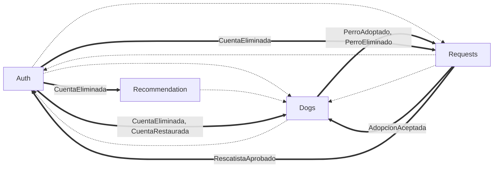

# ADOGTAME — Microservicios

> **Derivado de:** `adog_ARCH.md` (arquitectura, datos y comunicación), `adog_MER.md` (modelo conceptual de datos), `adog_CLS.md` (funciones), `adog_RF.md`, `adog_RN.md`, `adog_RNF.md` y `adog_CU.md` (requisitos), `adog_REC.md` (recomendación) y el material de apoyo `support/dev/manejo_roles.md` y `support/dev/solicitudes_verificacion.md`. Si este documento y el ERS difieren, prevalece el ERS y este debe actualizarse; si difiere de `adog_ARCH.md` en una decisión de arquitectura, prevalece `adog_ARCH.md`.
> Describe **cada uno de los 4 microservicios** (`Auth`, `Dogs`, `Requests` y `Recommendation`): qué datos posee, qué operaciones ofrece, qué reglas aplica, a quién llama y cómo se prueba, y los **flujos que cruzan servicios**. Es una especificación **preliminar** para comenzar la construcción: las rutas, los nombres y los tipos exactos se fijan en el contrato de cada servicio durante el incremento de cimientos (`planning/Adogtame_planificacion_v2.xlsx`).
> Convenciones: los servicios y las rutas llevan nombre en inglés; los textos al usuario, en español. «Registrado» es cualquier usuario con sesión; «Adoptante» es un usuario registrado con rol MIEMBRO, RESCATISTA o ADMINISTRADOR (no REFUGIO); «Publicador» es el usuario registrado que publica un perro (`manejo_roles.md` §3).

---

## 1. Visión general

| Microservicio | Ruta base | Entidades que posee (almacén) | Módulos internos | Requisitos funcionales |
|---|---|---|---|---|
| `Auth` | `/auth` | `USUARIO`, `ROL`, `USUARIO_ROL`, `PERSONA`, `REFUGIO`, `TOKEN_CORREO`, `SESION` (DynamoDB) | cuentas, sesiones, perfiles, administración de usuarios | RF-03 a RF-05, RF-07 a RF-11, RF-26 a RF-28, RF-31, RF-34 |
| `Dogs` | `/dogs` | `PERRO`, `FOTO_PERRO`, `RAZA`, `COLOR`, `FAVORITO` (PostgreSQL) | perros, catálogos, favoritos | RF-01, RF-02, RF-12, RF-19 a RF-21, RF-23, RF-29, RF-30, RF-32, RF-33 |
| `Requests` | `/requests` | `SOLICITUD_ADOPCION`, `SOLICITUD_VERIFICACION` (DynamoDB) | adopción, verificación | RF-06, RF-16 a RF-18, RF-22, RF-24, RF-25 |
| `Recommendation` | `/recommendation` | `PERFIL_ADOPTANTE` (DynamoDB) | test, recomendaciones | RF-13 a RF-15 |

Cada servicio es una función AWS Lambda con despliegue propio y es **dueño de sus datos**: tiene su propia base de datos y es el único que la lee y escribe. El almacenamiento es políglota: `Dogs` usa PostgreSQL (Amazon Aurora Serverless v2) y los demás usan Amazon DynamoDB (`adog_ARCH.md` §3.6). Las consultas entre servicios son síncronas (flechas punteadas) y las escrituras que cruzan servicios son eventos por SNS y SQS (flechas gruesas):

---

## 2. Convenciones comunes

### 2.1. Identidad de cada petición

Todas las rutas públicas pasan por el autorizador de API Gateway, que valida la sesión contra `Auth` y entrega al servicio la **identidad** de la petición:

| Dato | Descripción |
|---|---|
| `idUsuario` | Usuario con sesión; vacío para un visitante. |
| `idPersona` / `idRefugio` | Perfil del usuario (uno solo, según su rol). |
| `rol` | `MIEMBRO`, `RESCATISTA`, `REFUGIO` o `ADMINISTRADOR`; vacío para un visitante. |

El servicio **nunca confía en un rol enviado por el cliente**. Cada operación declara qué roles la ejecutan y, cuando aplica, la condición de propiedad del recurso (RNF-04, `manejo_roles.md` §5). Ante un usuario sin rol o con más de uno se deniega toda acción y se registra la anomalía.

### 2.2. Rutas y formato

- API REST con JSON, una ruta base por servicio. Las fechas van en formato ISO 8601 y los identificadores son UUID.
- Las rutas de este documento son **orientativas**: sirven para dimensionar el trabajo y se confirman en el contrato.
- Las operaciones internas (entre servicios) no se exponen por API Gateway (sección 7).

### 2.3. Contrato de errores

Todos los servicios responden los errores con la misma estructura: un código estable, un mensaje en español y, si aplica, el detalle por campo.

| Estado HTTP | Código | Cuándo |
|---|---|---|
| 400 | `VALIDACION` | Datos inválidos o faltantes (con el detalle por campo). |
| 401 | `NO_AUTENTICADO` | Sin sesión, sesión inválida o expirada. |
| 403 | `SIN_PERMISO` | El rol o la propiedad del recurso no lo permite. |
| 404 | `NO_ENCONTRADO` | Recurso inexistente **o eliminado** (misma respuesta, RNF-07). |
| 409 | `CONFLICTO` | Duplicado o estado que no lo permite (por ejemplo «La solicitud ya fue resuelta»). |
| 429 | `LIMITE_EXCEDIDO` | Exceso de peticiones (lo responde API Gateway o, en producción, el WAF; RNF-23). |
| 502/504 | `DEPENDENCIA_NO_DISPONIBLE` | Otro servicio o un proveedor externo no respondió a tiempo. |
| 500 | `ERROR_INTERNO` | Error no previsto; sin detalles internos al cliente. |

Los mensajes de negocio son los del ERS (por ejemplo «El correo ya está registrado»).

### 2.4. Comunicación entre servicios

Resumen de `adog_ARCH.md` §4, que se aplica a todo el catálogo de la sección 7:

- **Consultas:** invocación síncrona de Lambda mediante el cliente interno de la librería compartida; el servicio llamado comprueba que el llamante es otro servicio de Adogtame. Tiempo límite de 25 s y reintento acotado solo en operaciones seguras de repetir.
- **Escrituras que cruzan servicios:** el servicio guarda su cambio y el evento en la **misma transacción** (*outbox*) y el evento llega por SNS a la cola SQS de cada consumidor. La única escritura síncrona es `crearCuentaRefugio` (flujo F2).
- Todo evento y toda escritura síncrona llevan una **clave de idempotencia** (por ejemplo el id de la solicitud); los consumidores la usan porque SQS puede entregar un evento más de una vez, e ignoran los eventos con fecha anterior al último cambio aplicado.
- Se propaga el identificador de petición y la identidad; máximo **dos saltos** de consultas por petición del usuario y datos de otros dominios pedidos **en lote**.
- Una consulta invocada por otro servicio **no vuelve a llamar al invocante**.

### 2.5. Estructura interna de cada servicio

Programación funcional (sin clases): manejador de Lambda → funciones de aplicación (orquestan, autorizan y controlan la transacción dentro de su propia base de datos) → funciones de dominio (reglas puras) y funciones de acceso a datos (consultas parametrizadas u ORM, RNF-20). Los adaptadores (almacenamiento, correo, IA) y el cliente interno se reciben como parámetro desde la librería compartida. El acceso a la base de cada servicio se limita con permisos IAM propios (DynamoDB) o credenciales propias guardadas como secreto (PostgreSQL); ningún servicio puede leer la base de otro.

### 2.6. Datos que no se guardan

Se calculan al consultar: la edad del perro, la lista de recomendaciones (RN-47), la espera tras un rechazo (se calcula con `fecha_resolucion`) y los perfiles públicos (`adog_MER.md` §3).

### 2.7. Datos y consistencia con una base por servicio

- **Referencias entre servicios:** se guardan por identificador, sin clave foránea. El dato referenciado se pide al servicio dueño, en lote, al consultarlo.
- **Datos replicados mínimos** (`adog_MER.md`): `id_publicador` en la solicitud de adopción y la marca `publicador_eliminado` en el perro.
- **Sin transacciones entre servicios:** solo se garantizan transacciones dentro de la base de cada servicio. Las operaciones que cruzan servicios usan idempotencia y reintento (sección 8) y pueden dejar una inconsistencia temporal entre un paso y otro.
- **Unicidad:** cada regla de unicidad vive en la base del servicio dueño (el correo en `Auth`; las pendientes en `Requests`). Entre servicios solo hay comprobaciones por llamada, con una carrera posible que se documenta en el flujo F1.
- **DynamoDB:** el diseño de cada servicio parte de sus accesos; las claves e índices de las secciones 3.2, 5.2 y 6.2 son una **propuesta preliminar** que se confirma durante el incremento de cimientos. Las lecturas que sostienen una unicidad (candados) son fuertemente consistentes. Las claves llevan prefijo de tipo (por ejemplo `USER#`) y las expiraciones usan el TTL nativo.

---

## 3. Microservicio `Auth`

### 3.1. Propósito y límites

Es dueño de **quién es cada usuario y qué puede hacer**: cuentas, credenciales, sesiones, enlaces de correo, perfiles (de persona y de refugio) y roles. Emite la identidad de cada petición. **No** conoce perros, solicitudes ni tests: cuando una baja de cuenta debe afectarlos, se lo pide al servicio dueño.

### 3.2. Datos

| Entidad | Notas |
|---|---|
| `USUARIO`, `ROL`, `USUARIO_ROL` | Un solo rol por usuario (lo garantiza la aplicación). El rol solo cambia por MIEMBRO → RESCATISTA al aprobar una verificación (`manejo_roles.md` §6). |
| `PERSONA`, `REFUGIO` | Perfil de la cuenta: personal para MIEMBRO, RESCATISTA y ADMINISTRADOR; institucional para REFUGIO. |
| `TOKEN_CORREO`, `SESION` | Se guardan solo como hash. Los enlaces son de un solo uso (10 min; 24 h en la confirmación de registro) y las sesiones se cierran a los 30 min sin actividad. |

Invariantes: todo usuario tiene exactamente un rol; el perfil corresponde al rol; siempre hay al menos un administrador activo (RN-11).

**Almacenamiento (Amazon DynamoDB, una tabla `auth`).** Propuesta preliminar:

| Elemento | Clave (PK / SK) | Contenido | Para qué |
|---|---|---|---|
| Usuario | `USER#id` / `PROFILE` | Correo, hash de la contraseña, correo confirmado, rol y su fecha de asignación, borrado lógico, fecha de registro y el perfil incrustado (persona o refugio). Reúne `USUARIO`, `USUARIO_ROL` y `PERSONA` o `REFUGIO`; `ROL` es un catálogo fijo de 4 valores en el código. | Lectura por id en una sola operación. |
| Correo | `EMAIL#correo en minúsculas` / `OWNER` | Id del usuario. Se escribe en la misma transacción que el usuario, con la condición «no existe». | Unicidad del correo (también el de cuentas eliminadas, que no se libera). El cambio de correo mueve este elemento en una transacción. |
| Enlace de correo | `TOKEN#hash` / `TOKEN` | Usuario, tipo, correo nuevo, fechas de creación, uso e invalidación; el TTL es la expiración. | Validar un enlace por su hash. El usuario guarda el hash vigente de cada tipo para invalidar el anterior al emitir uno nuevo. |
| Sesión | `SESSION#hash` / `SESSION` | Usuario, fechas de creación, última actividad y cierre; el TTL limpia las expiradas. | Validar la sesión en cada petición. La última actividad se actualiza como máximo una vez por minuto para limitar las escrituras. |

Índices secundarios: **GSI1** (`USER#id` / `SESSION#fecha`) para cerrar todas las sesiones de un usuario; **GSI2** (`ROL#rol` / nombre e id, solo cuentas activas) para los listados de rescatistas y refugios, la búsqueda del administrador por rol y el recuento de administradores activos (RN-11, con una carrera posible entre dos bajas simultáneas que se acepta). La búsqueda del administrador por nombre filtra sobre un volumen pequeño.

### 3.3. Operaciones públicas

| Método y ruta | RF | Quién | Qué hace y reglas principales |
|---|---|---|---|
| `POST /auth/register` | RF-05 | Visitante | Valida datos (nombre máx. 120, teléfono de 10 dígitos que inicia con 09, mayor de 18 años) y que el correo sea único **sin pertenecer a ninguna cuenta ni a una solicitud de refugio pendiente**. Crea la cuenta como MIEMBRO y envía el enlace de confirmación. |
| `POST /auth/email/confirm` | RF-05 | Visitante | Confirma el correo con el enlace (un solo uso, 24 h). Sin confirmar no se inicia sesión. |
| `POST /auth/login` | RF-07 | Visitante | Valida credenciales, correo confirmado y cuenta no eliminada; abre la sesión. Los mensajes no revelan si un correo está registrado. |
| `POST /auth/logout` | RF-34 | Registrado | Cierra la sesión actual o todas las del usuario. |
| `POST /auth/password/forgot` | RF-08 | Visitante | Envía un enlace de 10 min (mismo mensaje exista o no el correo). |
| `POST /auth/password/reset` | RF-08 | Visitante | Define la contraseña con el enlace y cierra todas las sesiones. |
| `POST /auth/password/define` | RF-25, RF-26 | Visitante | Define la contraseña de una cuenta creada por aprobación o por un administrador; el mismo enlace confirma el correo (RN-13). |
| `PUT /auth/me/password` | RF-10 | Registrado | Exige la contraseña actual; cierra las demás sesiones y mantiene la actual. |
| `GET` y `PUT /auth/me` | RF-09 | Registrado | Consulta y edita los datos del propio perfil, excepto correo y tipo de cuenta. La foto se guarda por el adaptador de almacenamiento. |
| `POST /auth/me/email` y `POST /auth/me/email/confirm` | RF-31 | Registrado | Pide el cambio con la contraseña actual y envía el enlace al nuevo correo; el correo solo cambia al confirmar. La unicidad se comprueba al pedirlo y al confirmarlo (RN-07). |
| `DELETE /auth/me` | RF-11 | Registrado, excepto ADMINISTRADOR | Advierte y, al confirmar, da de baja la cuenta (sección 8, flujo F6). |
| `GET /auth/rescuers` y `GET /auth/shelters` | RF-03 | Público | Listados de cuentas verificadas (nombre, foto e insignia). |
| `GET /auth/users/{id}` | RF-03, RF-04 | Público | Perfil público con los perros publicados (pedidos a `Dogs`). Teléfono y correo solo con sesión (RN-15). Una cuenta eliminada responde 404. |
| `POST /auth/users` | RF-26 | ADMINISTRADOR | Crea cuentas de persona, rescatista, refugio o administrador; rescatistas y refugios quedan verificados (RN-38) y reciben el enlace para definir su contraseña. Comprueba el correo como en el registro. |
| `GET /auth/users` y `PUT /auth/users/{id}` | RF-27 | ADMINISTRADOR | Busca y edita datos, excepto correo, contraseña y tipo de cuenta. |
| `DELETE /auth/users/{id}` y `POST /auth/users/{id}/restore` | RF-28 | ADMINISTRADOR | Baja o restauración lógica; no puede eliminarse a sí mismo ni dejar el sistema sin administradores (RN-11). |

### 3.4. Operaciones internas que expone

| Operación | La usa | Descripción |
|---|---|---|
| `validarSesion` | Autorizador | Devuelve la identidad (usuario, perfil y rol) y actualiza la última actividad; rechaza sesiones expiradas o de cuentas eliminadas. |
| `obtenerPublicadores` / `obtenerContactoSolicitante` | `Dogs`, `Requests` | Datos de varios usuarios en lote (nombre, foto, tipo de cuenta, verificación y, si hay sesión, contacto). |
| `existeCuentaConCorreo` | `Requests` | Indica si un correo pertenece a una cuenta, activa o eliminada. |
| `crearCuentaRefugio` | `Requests` | Crea cuenta, perfil y enlace para definir la contraseña en su propia transacción, idempotente por el id de la solicitud; **no** consulta a `Requests` porque ya viene de una solicitud. |

### 3.5. Llamadas que realiza

| A | Para qué |
|---|---|
| `Requests` | Comprobar si un correo tiene una solicitud de refugio pendiente (registro, creación de usuarios y cambio de correo). |
| `Dogs` | Listar los perros de un perfil público. |

**Eventos que publica:** `CuentaEliminada` y `CuentaRestaurada` (los consumen `Dogs`, `Requests` y `Recommendation`) y `CorreoSolicitado` (lo consume el propio `Auth` para enviar los enlaces).
**Eventos que consume:** `RescatistaAprobado` (cambia el rol de MIEMBRO a RESCATISTA, idempotente por el id de la solicitud).

### 3.6. Adaptadores y requisitos

Usa los adaptadores de **correo** (enlaces y avisos) y de **almacenamiento** (foto de perfil). Requisitos transversales: RNF-03 (contraseñas con hash y sal), RNF-04, RNF-05, RNF-06, RNF-07, RNF-08 y RNF-25.

### 3.7. Pruebas clave

Un solo uso y caducidad de los enlaces; cierre de sesión a los 30 min y en todos los dispositivos; unicidad del correo incluyendo cuentas eliminadas y solicitudes de refugio pendientes; el administrador no puede eliminarse ni dejar el sistema sin administradores; el rol solo cambia por la vía de la aprobación; una cuenta eliminada responde 404.

---

## 4. Microservicio `Dogs`

### 4.1. Propósito y límites

Es dueño de **los perros y todo lo que los rodea**: publicación, fotos, estado de adopción, catálogos de raza y color, listados con filtros y favoritos. **No** conoce a los usuarios más allá de su identificador: los datos del publicador los pide a `Auth`. **No** gestiona solicitudes: al cambiar el estado de un perro avisa a `Requests`.

### 4.2. Datos

| Entidad | Notas |
|---|---|
| `PERRO` | Estados disponible y adoptado, borrado lógico irreversible, fecha de publicación que se conserva al volver a disponible. |
| `FOTO_PERRO` | De 1 a 5 fotos por perro; la de orden 1 es la principal. Guarda la clave del archivo, no la imagen. |
| `RAZA`, `COLOR` | Catálogos; un valor en uso solo se desactiva. |
| `FAVORITO` | Clave compuesta de usuario y perro; el usuario es una referencia lógica a `Auth`. |

Un perro se oculta cuando su publicador es dado de baja (RN-16). Como `Dogs` no puede consultar a los usuarios, `Auth` lo comunica por la llamada interna de baja o restauración y `Dogs` lo conserva como la marca `publicador_eliminado` (`adog_MER.md`, datos replicados).

**Almacenamiento (PostgreSQL en Amazon Aurora Serverless).** Es el servicio relacional del sistema: conserva las tablas `PERRO`, `FOTO_PERRO`, `RAZA`, `COLOR` y `FAVORITO` con las claves foráneas y las restricciones `CHECK` y `UNIQUE` de `adog_MER.md` §4, **solo entre sus propias tablas**; `id_publicador` e `id_usuario` (favoritos) son referencias lógicas sin clave foránea. Los filtros del listado se apoyan en índices sobre el estado, la visibilidad (`eliminado` y `publicador_eliminado`), la fecha de publicación, la raza, el color, el tamaño, el género y el pelaje, y sobre el nombre. Tiene sus propias migraciones y credenciales.

### 4.3. Operaciones públicas

| Método y ruta | RF | Quién | Qué hace y reglas principales |
|---|---|---|---|
| `GET /dogs` | RF-01 | Público | Lista los perros disponibles en tarjetas y los filtra por raza, edad, tamaño, género, pelaje, color, esterilizado, fecha de publicación y nombre. Excluye los perros eliminados y los de cuentas dadas de baja (`publicador_eliminado`). |
| `GET /dogs/{id}` | RF-02, RF-29 | Público; ADMINISTRADOR ve también eliminados | Ficha con fotos, datos físicos, información médica y publicador (pedido a `Auth`). Un adoptado se muestra con «Adoptado»; un eliminado o de una cuenta dada de baja responde 404. |
| `POST /dogs` | RF-19 | Registrado | Publica el perro como disponible: valida los datos (peso de 0,5 a 90 kg; fecha de nacimiento no futura ni de más de 20 años), raza y color activos y fotos validadas por su contenido. Si falla el almacenamiento, no queda nada incompleto (RNF-11). |
| `POST /dogs/{id}/photos` | RF-19, RF-20 | Publicador | Sube **una foto por petición**; valida contenido, genera el nombre, quita metadatos (RNF-22). |
| `PUT /dogs/{id}` | RF-20 | Publicador (el administrador no edita perros ajenos) | Edita los datos del perro. |
| `DELETE /dogs/{id}` | RF-21, RF-29 | Publicador o ADMINISTRADOR | Pide confirmación; marca el perro como eliminado y rechaza sus solicitudes pendientes (flujo F5). Un administrador no avisa al publicador. |
| `GET /dogs/mine` | RF-32 | Registrado | «Mis perros»: disponibles y adoptados, del más reciente al más antiguo, con las acciones de editar, eliminar y cambiar de estado. |
| `PUT /dogs/{id}/status` | RF-23 | Publicador | Marca adoptado o devuelve a disponible; al marcar adoptado rechaza las solicitudes pendientes (flujo F5). Al volver a disponible conserva la fecha de publicación y las solicitudes aceptadas. |
| `PUT` y `DELETE /dogs/{id}/favorite` | RF-12 | Registrado | Marca o desmarca el favorito. |
| `GET /dogs/favorites` | RF-33 | Registrado | Favoritos del último agregado al primero; incluye adoptados y excluye eliminados. |
| `GET /dogs/catalogs/breeds` y `/colors` | RF-19, RF-30 | Público | Lista los valores activos (el administrador ve todos). |
| `POST`, `PUT` y `DELETE` en `/dogs/catalogs/breeds` y `/colors` | RF-30 | ADMINISTRADOR | Agrega, renombra, activa, desactiva o elimina valores; sin nombres repetidos; un valor en uso no se elimina. |

### 4.4. Operaciones internas que expone

| Operación | La usa | Descripción |
|---|---|---|
| `consultarPerro` (en lote) | `Requests` | Datos y estado de varios perros; no devuelve eliminados. |
| Candidatos | `Recommendation` | Perros disponibles, no propios y compatibles con el filtro del test, con los atributos que usa la fórmula. |
| `marcarAdoptado` | `Requests` | Marca adoptado, idempotente; con origen `Requests` no vuelve a llamarla. |
| `listarPerrosDePublicador` | `Auth` | Perros visibles de un perfil público. No llama de vuelta a `Auth`. |

### 4.5. Llamadas que realiza

| A | Para qué |
|---|---|
| `Auth` | Datos de los publicadores en lote (ficha, listados). |

**Eventos que publica:** `PerroAdoptado` y `PerroEliminado` (los consume `Requests`), desde la tabla `outbox` de su base.
**Eventos que consume:** `AdopcionAceptada` (marca el perro como adoptado), `CuentaEliminada` y `CuentaRestaurada` (activan o desactivan la marca `publicador_eliminado` de los perros de la cuenta).

### 4.6. Adaptadores y requisitos

Usa el adaptador de **almacenamiento** (fotos de los perros). Requisitos: RNF-01 (listados en 3 s), RNF-04, RNF-07, RNF-10, RNF-11, RNF-13, RNF-14 y RNF-22.

### 4.7. Pruebas clave

Filtros combinados y vacío; ficha de perro adoptado, eliminado y de cuenta dada de baja; máximo de 5 fotos y rechazo de archivos falsos; solo el publicador edita y cambia de estado; el administrador elimina pero no edita; el valor de catálogo en uso no se elimina; el favorito de un perro eliminado no se lista.

---

## 5. Microservicio `Requests`

### 5.1. Propósito y límites

Es dueño de **las solicitudes que alguien resuelve**: las de adopción (el adoptante pide, el publicador resuelve) y las de verificación (una persona o un refugio piden, un administrador resuelve). Comparten el patrón pendiente → resuelta, pero **se mantienen como dos módulos con dos tablas separadas**; la lógica común de transición de estados vive en la librería compartida. **No** guarda datos de perros ni de usuarios: los pide a `Dogs` y `Auth`.

### 5.2. Datos

| Entidad | Notas |
|---|---|
| `SOLICITUD_ADOPCION` | Estados pendiente, aceptada, rechazada y cancelada. El `mensaje` conserva el teléfono vigente al solicitar y no se actualiza (RN-30). |
| `SOLICITUD_VERIFICACION` | Tipos rescatista y refugio, con las restricciones de coherencia de `solicitudes_verificacion.md` §2.4: una sola pendiente por rescatista y un solo correo pendiente por refugio (sin distinguir mayúsculas); al resolver un refugio se anulan `correo_solicitante` y `datos_registro`. |

**Almacenamiento (Amazon DynamoDB, una tabla `requests`).** Propuesta preliminar:

| Elemento | Clave (PK / SK) | Contenido | Para qué |
|---|---|---|---|
| Solicitud de adopción | `ADOPT#id` / `ADOPT` | Perro, **publicador (copia)**, solicitante, estado, mensaje y fechas. | Lectura y resolución por id. |
| Candado de adopción | `PENDING#perro#solicitante` / `LOCK` | Id de la solicitud. Se crea con la solicitud en una transacción con la condición «no existe» y se borra al resolverla. | Una sola pendiente por perro y adoptante. |
| Solicitud de verificación | `VERIF#id` / `VERIF` | Tipo, estado, usuario, correo y datos del formulario (solo refugio), administrador y fechas. Al resolver se quitan correo y datos. | Lectura y resolución por id. |
| Candados de verificación | `PENDING#RESCUER#usuario` y `PENDING#SHELTER#correo en minúsculas` / `LOCK` | Id de la solicitud; se borran al resolver. | Una sola pendiente por rescatista y por correo de refugio; la lectura del candado responde `existeSolicitudRefugioPendiente`. |

Índices secundarios: **GSI1** (`PERSONA#id` o `USER#id` / fecha) para el historial del adoptante y la última solicitud de un rescatista (espera de 5 minutos); **GSI2** (`PUB#publicador` / estado y fecha) para las solicitudes recibidas y la baja de una cuenta; **GSI3** (`DOG#perro` / estado y fecha) para rechazar las pendientes de un perro; **GSI4** (`VSTATE#PENDIENTE` / fecha, solo solicitudes pendientes) para la cola del administrador.

### 5.3. Operaciones públicas: módulo de adopción

| Método y ruta | RF | Quién | Qué hace y reglas principales |
|---|---|---|---|
| `POST /requests/adoptions` | RF-16 | Adoptante | Con el id del perro y confirmación, crea una solicitud pendiente con el mensaje (nombre, teléfono vigente y enlace al perfil). El perro debe estar disponible y no ser propio; el solicitante no es REFUGIO y no tiene otra pendiente para ese perro. |
| `GET /requests/adoptions/mine` | RF-17 | Adoptante | Historial con perro, fecha y estado. |
| `POST /requests/adoptions/{id}/cancel` | RF-18 | Adoptante | Cancela una solicitud propia pendiente; si no lo está: «La solicitud ya no está pendiente y no puede cancelarse». |
| `GET /requests/adoptions/received` | RF-22 | Publicador | Solicitudes de sus perros con mensaje, nombre, foto y contacto del interesado (las encuentra por el `id_publicador` guardado en la solicitud y obtiene los datos de los solicitantes de `Auth` y de los perros de `Dogs`, en lote). |
| `POST /requests/adoptions/{id}/accept` y `/reject` | RF-22 | Publicador del perro | Solo si está pendiente. Al aceptar, el perro pasa a adoptado y las demás pendientes se rechazan (flujo F4). Al rechazar, solo cambia esa solicitud. Sin comentario ni notificación. |

### 5.4. Operaciones públicas: módulo de verificación

| Método y ruta | RF | Quién | Qué hace y reglas principales |
|---|---|---|---|
| `POST /requests/verifications/shelter` | RF-06 | Visitante | Valida el formulario del refugio, que el correo no pertenezca a una cuenta (`Auth`) ni tenga otra solicitud pendiente, guarda la foto por el adaptador (si falla, no registra) y crea la solicitud pendiente **sin crear cuenta ni pedir contraseña**. |
| `POST /requests/verifications/rescuer` | RF-24 | Solo MIEMBRO | Crea la solicitud pendiente. «Ya tienes una solicitud de verificación pendiente»; tras un rechazo, espera de 5 minutos: «Podrás enviar una nueva solicitud en unos minutos». Mientras está pendiente la persona sigue publicando y adoptando. |
| `GET /requests/verifications` | RF-25 | ADMINISTRADOR | Lista las solicitudes pendientes. |
| `POST /requests/verifications/{id}/approve` | RF-25 | ADMINISTRADOR | Rescatista: cambia el rol a RESCATISTA. Refugio: crea la cuenta (flujo F2). Solo si está pendiente: «La solicitud ya fue resuelta». |
| `POST /requests/verifications/{id}/reject` | RF-25 | ADMINISTRADOR | Rechaza sin motivo y envía el aviso por correo; en refugio borra correo y datos. El refugio puede reenviar de inmediato. |

### 5.5. Operaciones internas que expone

| Operación | La usa | Descripción |
|---|---|---|
| `rechazarPendientesDelPerro` | `Dogs` | Rechaza las solicitudes pendientes de un perro (adoptado manualmente o eliminado); idempotente y sin aviso. |
| `darBajaCuenta` / `restaurarCuenta` | `Auth` | Rechaza las solicitudes de adopción pendientes enviadas y recibidas por la cuenta; al restaurar no se reabren. El tratamiento de una solicitud de rescatista pendiente está abierto (sección 9). |
| `existeSolicitudRefugioPendiente` | `Auth` | Indica si un correo está reservado por una solicitud de refugio pendiente. |

### 5.6. Llamadas que realiza

| A | Para qué |
|---|---|
| `Auth` | Comprobar si un correo pertenece a una cuenta; crear la cuenta del refugio (síncrona, F2); obtener los datos de los solicitantes en lote. |
| `Dogs` | Comprobar disponibilidad y propiedad del perro; obtener los datos de varios perros, en lote. |

**Eventos que publica:** `AdopcionAceptada` (lo consume `Dogs`), `RescatistaAprobado` (lo consume `Auth`) y `CorreoSolicitado` (lo consume el propio `Requests` para enviar los resultados de verificación).
**Eventos que consume:** `PerroAdoptado` y `PerroEliminado` (rechaza las pendientes del perro) y `CuentaEliminada` (rechaza las pendientes de la cuenta, como solicitante o como publicador, y su solicitud de rescatista pendiente).

### 5.7. Adaptadores y requisitos

Usa el adaptador de **correo** (resultado de las verificaciones) y de **almacenamiento** (foto de la solicitud de refugio). Requisitos: RNF-04, RNF-06, RNF-08, RNF-11, RNF-14 y RNF-23.

### 5.8. Pruebas clave

Una sola pendiente por perro y adoptante; solo el publicador resuelve y solo lo pendiente; aceptar rechaza las demás; la espera de 5 minutos aplica al rescatista y no al refugio; aprobar un refugio dos veces no duplica la cuenta; la solicitud de refugio rechazada no conserva correo ni datos; el refugio no puede solicitar adopciones.

---

## 6. Microservicio `Recommendation`

### 6.1. Propósito y límites

Es dueño del **test de estilo de vida y de las recomendaciones**. Guarda las respuestas del test, calcula la afinidad con los perros, consulta al Servicio de IA y devuelve 6 recomendaciones, con respaldo de plantillas si la IA falla. **No** guarda las recomendaciones (RN-47) ni conoce a los usuarios: usa la identidad de la petición. Los detalles de la fórmula, el prompt y las plantillas están en `adog_REC.md`.

### 6.2. Datos

| Entidad | Notas |
|---|---|
| `PERFIL_ADOPTANTE` | Respuestas del test de una persona (7 preguntas, con comentario opcional de hasta 150 caracteres). Se borra de forma definitiva (RN-53). `id_persona` es una referencia lógica a `Auth`. |

**Almacenamiento (Amazon DynamoDB, una tabla `recommendation`).** Un solo elemento por persona: clave `PERSONA#id` / `TEST`, con las respuestas, el comentario y la fecha de actualización. Guardar o reemplazar es una escritura; borrar el test es una eliminación definitiva (RN-53). No necesita índices; las recomendaciones no se guardan (RN-47).

### 6.3. Operaciones públicas

| Método y ruta | RF | Quién | Qué hace y reglas principales |
|---|---|---|---|
| `GET /recommendation/test` | RF-13 | Adoptante | Devuelve las respuestas guardadas del propio usuario. Nadie más las ve, ni el administrador (RN-41). |
| `PUT /recommendation/test` | RF-13, RF-15 | Adoptante | Valida las respuestas obligatorias y guarda o reemplaza el test. El aviso de privacidad se muestra antes de empezar. Los refugios no realizan el test (RN-42). |
| `DELETE /recommendation/test` | RF-15 | Adoptante | Con confirmación, borra el test de forma definitiva. |
| `GET /recommendation/recommendations` | RF-14 | Adoptante | Genera 6 recomendaciones (flujo F8). Sin test, indica que debe realizarlo. |

### 6.4. Operaciones internas que expone

| Operación | La usa | Descripción |
|---|---|---|

### 6.5. Llamadas que realiza

| A | Para qué |
|---|---|
| `Dogs` | Obtener los perros candidatos (disponibles, no propios y compatibles). |
| Servicio de IA (adaptador, Google Gemini) | Elegir 6 de los 20 mejores y redactar «Por qué encaja» y «Lo que debes saber». |

**Eventos que consume:** `CuentaEliminada` (borra el test de la cuenta, RF-11, RF-28).

### 6.6. Adaptadores y requisitos

Usa el adaptador de **IA**. Requisitos: RNF-02 (20 s), RNF-09 (solo respuestas del test y atributos de los perros, nunca identidad ni ubicación), RNF-11, RNF-13, RNF-15, RNF-18 (tope de USD 5 al mes) y RNF-19 (el comentario y las descripciones se envían como datos, nunca como instrucciones).

### 6.7. Pruebas clave

Test incompleto; solo el dueño accede a su test; refugio rechazado; la respuesta de la IA con perros repetidos, ajenos a los candidatos o con textos largos se descarta; falla o demora de la IA devuelve el respaldo dentro del límite; comentarios con instrucciones maliciosas no alteran el resultado.

---

## 7. Catálogo de llamadas internas y eventos

**Consultas y escrituras síncronas**

| Operación | La expone | La usa | Escritura | Idempotencia |
|---|---|---|---|---|
| `validarSesion` | `Auth` | Autorizador (todos) | No (actualiza la última actividad) | — |
| `obtenerPublicadores` / `obtenerContactoSolicitante` | `Auth` | `Dogs`, `Requests` | No | — |
| `existeCuentaConCorreo` | `Auth` | `Requests` | No | — |
| `crearCuentaRefugio` | `Auth` | `Requests` | Sí | Clave: id de la solicitud |
| `existeSolicitudRefugioPendiente` | `Requests` | `Auth` | No | — |
| `consultarPerro` (lote, candidatos) | `Dogs` | `Requests`, `Recommendation` | No | — |
| `listarPerrosDePublicador` | `Dogs` | `Auth` | No | — |

**Eventos**

| Evento | Lo publica | Lo consumen | Idempotencia |
|---|---|---|---|
| `AdopcionAceptada` | `Requests` | `Dogs` | Clave: id de la solicitud |
| `PerroAdoptado` / `PerroEliminado` | `Dogs` | `Requests` | Clave: id del perro y motivo |
| `RescatistaAprobado` | `Requests` | `Auth` | Clave: id de la solicitud |
| `CuentaEliminada` / `CuentaRestaurada` | `Auth` | `Dogs`, `Requests`, `Recommendation` | Clave: id del usuario y fecha del cambio |
| `CorreoSolicitado` | `Auth`, `Requests` | El mismo servicio | Clave: id del evento |

Reglas de las llamadas: ver la sección 2.4 y `adog_ARCH.md` §3.2 y §4.3.

---

## 8. Flujos que cruzan servicios

Cada flujo sigue la sección 2.4: las consultas son síncronas y las escrituras en otros servicios se hacen por eventos, que se reintentan solos hasta aplicarse o terminar en la cola de mensajes fallidos.

### F1. Registro con correo reservado

1. `Auth` valida los datos y consulta a `Requests` si el correo tiene una solicitud de refugio pendiente.
2. `Auth` crea la cuenta, el token de confirmación y el evento `CorreoSolicitado` en una sola transacción; su consumidor envía el correo.
3. Si el correo no sale, SQS lo reintenta; si se agotan los intentos, la cuenta existe y el usuario puede pedir el reenvío. No se pierden datos.

*Riesgo asumido:* entre la consulta y la creación puede entrar una solicitud de refugio con el mismo correo; se mitiga porque la aprobación vuelve a comprobar que el correo no pertenezca a una cuenta.

### F2. Aprobar una solicitud de refugio

1. `Requests` comprueba que la solicitud siga pendiente y vuelve a validar `datos_registro`.
2. `Requests` llama a `Auth.crearCuentaRefugio` con el id de la solicitud como clave. `Auth`, en una sola transacción propia, crea la cuenta (correo confirmado, sin contraseña, rol REFUGIO), su perfil y el enlace para definir la contraseña (10 min).
3. Con la cuenta creada, `Requests` marca la solicitud como aprobada, registra administrador y fecha, vincula `id_usuario` y anula `correo_solicitante` y `datos_registro`.
4. `Auth` envía el correo de aprobación con el enlace (por su evento `CorreoSolicitado`, guardado junto con la cuenta).

*Fallos:* si falla el paso 2, no queda nada y el administrador reintenta. Si falla el paso 3, la solicitud sigue pendiente y reintentar no duplica la cuenta (clave de idempotencia). Si falla el correo, no se deshace nada y la contraseña se define luego con «Recuperar contraseña».
*Correo (decidido):* el aviso de aprobación del refugio, que contiene el enlace de `Auth`, lo envía `Auth` al crear la cuenta; los demás resultados (rechazos y aprobación de rescatista) los envía `Requests`.
*Por qué es síncrono:* `Auth` puede rechazar la creación (por ejemplo, si el correo ya pertenece a una cuenta) y el administrador debe ver el resultado en el momento.

### F3. Aprobar una solicitud de rescatista

1. `Requests` comprueba que siga pendiente.
2. En una sola transacción, `Requests` marca la solicitud como aprobada y guarda los eventos `RescatistaAprobado` y `CorreoSolicitado` (resultado).
3. `Auth` consume `RescatistaAprobado` y cambia el rol de MIEMBRO a RESCATISTA (idempotente por el id de la solicitud). El rol rige en cuanto se procesa el evento, normalmente en segundos, sin volver a iniciar sesión.

### F4. Aceptar una solicitud de adopción

1. `Requests` comprueba que la solicitud siga pendiente y que quien acepta sea el publicador del perro (`id_publicador` guardado en la solicitud).
2. En una sola transacción, `Requests` marca la solicitud como aceptada, **rechaza por sí mismo** las demás pendientes del perro y guarda el evento `AdopcionAceptada`.
3. `Dogs` consume el evento y marca el perro como adoptado; esto publica `PerroAdoptado`, que `Requests` procesa sin efecto porque ya no quedan pendientes.

*Intervalo:* hasta que `Dogs` procesa el evento, el perro puede verse disponible. Una solicitud que entre en ese intervalo queda rechazada al procesarse `PerroAdoptado`.

### F5. Adopción manual o eliminación de un perro (nace en `Dogs`)

1. `Dogs` valida que el usuario sea el publicador (o administrador, para eliminar).
2. En una sola transacción, `Dogs` cambia el estado del perro (adoptado o eliminado) y guarda el evento `PerroAdoptado` o `PerroEliminado` en su tabla `outbox`.
3. `Requests` consume el evento y rechaza las solicitudes pendientes del perro (idempotente).

### F6. Baja y restauración de una cuenta (RF-11 y RF-28)

1. `Auth` valida la operación (el administrador no se elimina a sí mismo ni deja el sistema sin administradores).
2. En una sola transacción, `Auth` marca la cuenta como eliminada, cierra sus sesiones y guarda el evento `CuentaEliminada`.
3. Los consumidores aplican su parte: `Dogs` oculta sus perros, `Requests` rechaza sus solicitudes pendientes (de adopción y de rescatista) y `Recommendation` borra su test.

La restauración publica `CuentaRestaurada`: `Dogs` vuelve a mostrar los perros; no se reabren las solicitudes ni se recupera el test. Como los eventos pueden llegar desordenados, cada consumidor ignora un evento con fecha anterior al último cambio que aplicó a esa cuenta.

### F7. Solicitar una adopción

1. `Requests` obtiene de `Dogs` el perro (disponible, no propio) y de `Auth` el nombre y teléfono vigentes del solicitante.
2. `Requests` genera el mensaje y crea la solicitud pendiente.

### F8. Generar recomendaciones

1. `Recommendation` lee el test del usuario y obtiene de `Dogs` los candidatos.
2. Calcula la afinidad y preselecciona los 20 mejores.
3. Consulta a la IA (Google Gemini) con límite de 20 s (RNF-02), recortado a lo que quede de la petición menos 2 s; valida la respuesta (6 perros o todos si eran 6 o menos, sin repetidos, ajenos al conjunto o con textos fuera de límite).
4. Si la IA falla, tarda o responde algo inválido, usa la fórmula con plantillas. Devuelve 6 recomendaciones y no las guarda.

---

## 9. Decisiones tomadas en I0.2

Decididos antes: los dos datos replicados (`id_publicador` y `publicador_eliminado`, `adog_MER.md`), el almacenamiento políglota y la foto de la solicitud de refugio (la guarda `Requests` y la reutiliza `Auth`; si se rechaza, queda sin referencia, `solicitudes_verificacion.md`).

| # | Punto | Decisión |
|---|---|---|
| 1 | Motor relacional de `Dogs` y costo | Aurora Serverless v2 con Data API y pausa automática; presupuesto de AWS de USD 20 al mes (las dos etapas) (`adog_ARCH.md` §3.6 y §5.1). |
| 2 | Quién envía cada correo | `Auth` envía todos los enlaces, incluido el aviso de aprobación del refugio; `Requests` envía los resultados de verificación (flujos F2 y F3). |
| 3 | Solicitud de rescatista pendiente de una cuenta dada de baja | Pasa a **rechazada** al consumir `CuentaEliminada`, igual que las de adopción (RN-10). Si la cuenta se restaura, no se reabre. |
| 4 | Orden de las fotos al publicar | Las fotos se suben antes, de una en una, con clave temporal; al crear el perro se pasan las claves (`adog_ARCH.md` §4.5). |
| 5 | Comunicación entre servicios | Consultas síncronas; escrituras por eventos con SNS, SQS y *outbox* (sección 2.4 y `adog_ARCH.md` §4). |
| 6 | Valores finales | Tiempos límite y tamaño máximo por foto (2 MB) en `adog_ARCH.md` §4.4; sesión en *cookie* HttpOnly. |

Pendiente: el diseño de DynamoDB. Las claves e índices de las secciones 3.2, 5.2 y 6.2 son preliminares y se confirman en I0.4b. Cada tabla de `Auth` y `Requests` suma los registros de su *outbox*.

---

## 10. Trazabilidad con los requisitos funcionales

| Servicio | RF |
|---|---|
| `Auth` | RF-03, RF-04, RF-05, RF-07, RF-08, RF-09, RF-10, RF-11, RF-26, RF-27, RF-28, RF-31, RF-34 |
| `Dogs` | RF-01, RF-02, RF-12, RF-19, RF-20, RF-21, RF-23, RF-29, RF-30, RF-32, RF-33 |
| `Requests` | RF-06, RF-16, RF-17, RF-18, RF-22, RF-24, RF-25 |
| `Recommendation` | RF-13, RF-14, RF-15 |

Los 34 RF quedan cubiertos por un único servicio dueño; los que cruzan servicios (RF-11, RF-21, RF-22, RF-23, RF-25, RF-28) se describen en los flujos de la sección 8.
