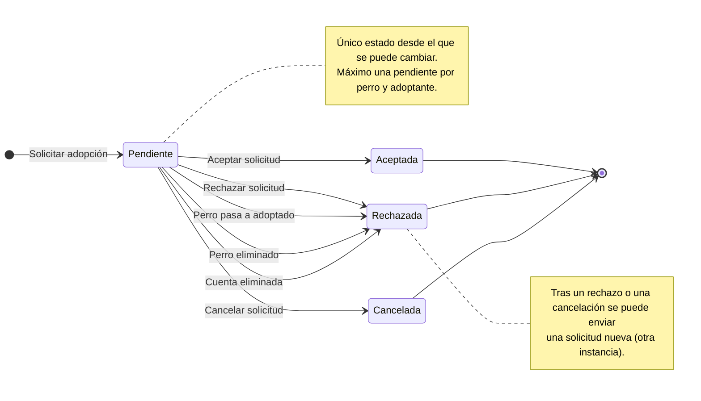

# Diagrama de estados: Solicitud de adopción

> **Fuentes:** `adog_MER.md` (entidad `SOLICITUD_ADOPCION`, campo `estado`), `adog_RN.md` (RN-10, RN-23, RN-25, RN-28 a RN-34), `adog_RF.md` (RF-16, RF-17, RF-18, RF-22, RF-23, RF-21).

## 1. Diagrama

## 2. Plantilla de documentación

| Campo | Descripción |
|---|---|
| Nombre | Diagrama de estados de la solicitud de adopción |
| Objetivo | Explicar el ciclo de vida de una solicitud de adopción, desde que el adoptante la envía hasta que queda resuelta, y qué eventos (de las personas o del sistema) provocan cada cambio. |
| Elementos principales | **Estados:** Pendiente (inicial), Aceptada, Rechazada y Cancelada (finales). **Actores que disparan eventos:** adoptante (solicita y cancela), publicador (acepta y rechaza) y el sistema (rechaza solicitudes al adoptar o eliminar un perro o una cuenta). **Entidad asociada:** `SOLICITUD_ADOPCION.estado`. |
| Reglas aplicadas | Solo las solicitudes pendientes pueden aceptarse, rechazarse o cancelarse. Un adoptante tiene como máximo una solicitud pendiente por perro. No se solicita un perro propio ni adoptado, y los refugios no solicitan. Aceptar una solicitud marca al perro como adoptado y rechaza las demás pendientes. Los estados finales no cambian ni se reabren. |
| Justificación | La solicitud es el objeto con más reglas de avance y cierre del sistema: tres personas o procesos pueden resolverla y varias reglas la rechazan de forma automática. El diagrama deja claro que la resolución es única e irreversible, lo que explica por qué el campo `fecha_resolucion` solo se llena al salir de Pendiente. |

## 3. Transiciones

| Estado origen | Evento | Estado destino | Regla de negocio |
|---|---|---|---|
| (inicial) | Solicitar adopción | Pendiente | El perro debe estar disponible y no ser del solicitante; el solicitante no puede ser un refugio ni tener otra solicitud pendiente para ese perro. Se genera el mensaje con nombre, teléfono y enlace al perfil. |
| Pendiente | Aceptar solicitud | Aceptada | Solo el publicador del perro resuelve la solicitud. El perro pasa a adoptado y las demás pendientes de ese perro se rechazan. |
| Pendiente | Rechazar solicitud | Rechazada | Solo si está pendiente. No se registra comentario ni se envía notificación. |
| Pendiente | Cancelar solicitud | Cancelada | La cancela el adoptante, y solo si sigue pendiente: «La solicitud ya no está pendiente y no puede cancelarse». |
| Pendiente | Perro pasa a adoptado (aceptar otra solicitud o marcarlo manualmente) | Rechazada | Las demás solicitudes pendientes del perro se rechazan. |
| Pendiente | Perro eliminado | Rechazada | La eliminación del perro rechaza sus solicitudes pendientes, sin motivo ni aviso. |
| Pendiente | Cuenta eliminada del publicador o adoptante | Rechazada | Las solicitudes pendientes enviadas y recibidas por la cuenta eliminada se rechazan; al restaurarla no se reabren. |

## 4. Observaciones para la coherencia con otros diagramas

- **Con el diagrama de Gestión de perro:** el evento «Perro pasa a adoptado» es la transición `Disponible → Adoptado` del perro. Si el perro vuelve a disponible, las solicitudes aceptadas se mantienen como aceptadas (RN-24).
- **Con el diagrama objeto-estado:** una solicitud `Aceptada` debe pertenecer a un perro `Adoptado` (salvo que el publicador lo haya devuelto a disponible después). Si el perro está `Eliminado`, ninguna de sus solicitudes puede estar `Pendiente`.
- **Estados finales:** `fecha_resolucion` es NULL solo en Pendiente y tiene valor en los otros tres (restricción del modelo de datos).
