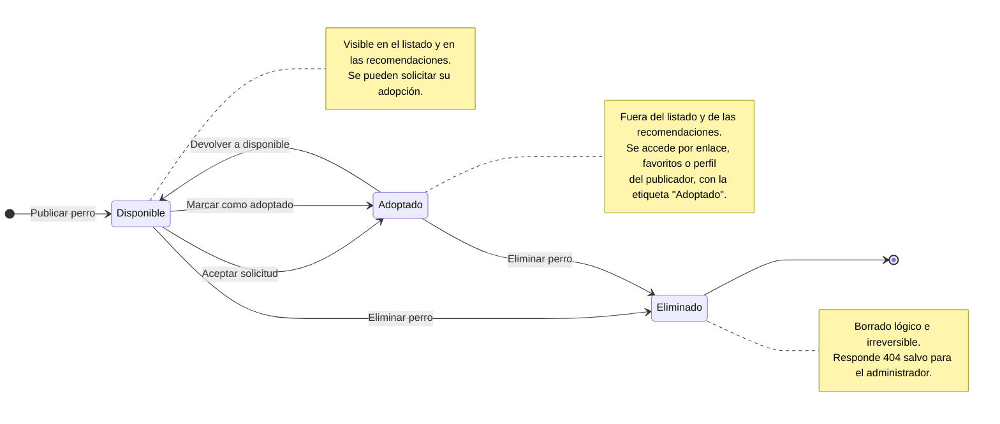

# Diagrama de estados: Gestión de perro

> **Fuentes:** `adog_MER.md` (entidad `PERRO`, campos `estado`, `eliminado`, `fecha_publicacion`), `adog_RN.md` (RN-10, RN-16, RN-17, RN-22 a RN-25), `adog_RF.md` (RF-19 a RF-23, RF-32).

## 1. Diagrama

## 2. Plantilla de documentación

| Campo | Descripción |
|---|---|
| Nombre | Diagrama de estados de la gestión de perro |
| Objetivo | Explicar cómo cambia un perro publicado a lo largo de su vida en la plataforma: cuándo está disponible para adopción, cuándo se considera adoptado y cuándo deja de existir para el sistema. |
| Elementos principales | **Estados:** Disponible (inicial), Adoptado y Eliminado (final). **Actores que disparan eventos:** publicador (publica, cambia el estado de adopción y elimina), administrador (solo elimina perros ajenos) y el sistema (al aceptarse una solicitud de adopción). **Entidad asociada:** `PERRO.estado` (disponible, adoptado) y `PERRO.eliminado`. |
| Reglas aplicadas | Un perro solo puede estar disponible o adoptado. Solo el publicador cambia el estado de adopción; el administrador solo elimina. Al marcar adoptado, las solicitudes pendientes se rechazan. Al volver a disponible se conserva la fecha de publicación original y las solicitudes aceptadas se mantienen. La eliminación es lógica e irreversible. |
| Justificación | El estado del perro condiciona qué puede hacer el sistema con él: aparecer en el listado y en las recomendaciones, recibir solicitudes o solo consultarse. Modelar su ciclo de vida permite distinguir la reversibilidad de Disponible ↔ Adoptado de la irreversibilidad de Eliminado, y conecta el diagrama con el de solicitud de adopción, que provoca uno de los cambios. |

## 3. Transiciones

| Estado origen | Evento | Estado destino | Regla de negocio |
|---|---|---|---|
| (inicial) | Publicar perro | Disponible | Pueden publicar personas, rescatistas, refugios y administradores. Se registra `fecha_publicacion`, y la raza y el color deben estar activos. |
| Disponible | Aceptar solicitud de adopción | Adoptado | Las demás solicitudes pendientes del perro pasan a rechazadas. |
| Disponible | Marcar como adoptado | Adoptado | Puede hacerse sin una solicitud aceptada; las solicitudes pendientes pasan a rechazadas. Solo el publicador. |
| Adoptado | Devolver a disponible | Disponible | Conserva su fecha de publicación original; las solicitudes aceptadas siguen aceptadas. Solo el publicador. |
| Disponible | Eliminar perro | Eliminado | El publicador (o el administrador) confirma la eliminación; las solicitudes pendientes pasan a rechazadas, sin motivo ni aviso. |
| Adoptado | Eliminar perro | Eliminado | Igual que la anterior. Ya no se pueden consultar el perro ni sus datos, salvo el administrador. |

## 4. Observaciones para la coherencia con otros diagramas

- **Ocultamiento por publicador eliminado:** cuando se elimina la cuenta del publicador, sus perros dejan de mostrarse, pero **no cambian de estado** (`PERRO.eliminado` sigue en false); es un filtro de lectura que se revierte al restaurar la cuenta (RN-10, RN-16). Por eso no se representa como estado ni como transición.
- **Con el diagrama de solicitud de adopción:** `Disponible → Adoptado` coincide con el evento «Perro pasa a adoptado», que rechaza las solicitudes pendientes. Desde `Eliminado` no puede existir ninguna solicitud pendiente.
- **Con el diagrama objeto-estado:** un perro `Adoptado` normalmente tiene una solicitud `Aceptada` (salvo que se haya marcado manualmente, RN-25), y un perro `Eliminado` no puede tener solicitudes `Pendientes`.
