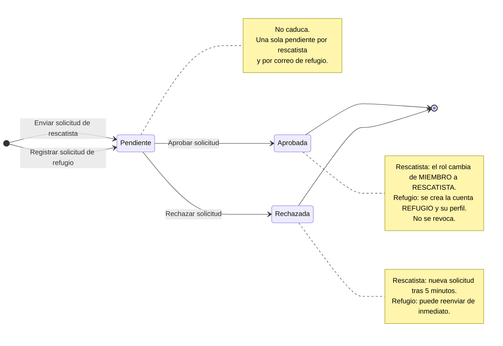

# Diagrama de estados: Solicitud de verificación

> **Fuentes:** `adog_MER.md` (entidad `SOLICITUD_VERIFICACION`, campo `estado`), `adog_RN.md` (RN-01, RN-35 a RN-38, CRV-01, CRV-02), `adog_RF.md` (RF-06, RF-24, RF-25), `support/dev/solicitudes_verificacion.md` (secciones 3 a 5).

## 1. Diagrama

## 2. Plantilla de documentación

| Campo | Descripción |
|---|---|
| Nombre | Diagrama de estados de la solicitud de verificación |
| Objetivo | Explicar el ciclo de vida de una solicitud con la que una persona pide ser rescatista verificado, o una institución pide obtener una cuenta de refugio, hasta que un administrador la resuelve. |
| Elementos principales | **Estados:** Pendiente (inicial), Aprobada y Rechazada (finales). **Actores:** persona con sesión iniciada (solicitud de rescatista), visitante sin cuenta (solicitud de refugio) y administrador (resuelve la solicitud). **Entidad asociada:** `SOLICITUD_VERIFICACION.estado`, con `tipo` = rescatista o refugio. |
| Reglas aplicadas | Una sola solicitud pendiente por rescatista y por correo de refugio. Las pendientes no caducan. Solo se resuelve una vez y una verificación aprobada no se revoca. El resultado se informa por correo, sin motivo de rechazo. Un rescatista espera 5 minutos tras un rechazo; el refugio puede reenviar de inmediato. El administrador aplica los criterios CRV-01 y CRV-02 fuera del sistema. |
| Justificación | Las dos variantes comparten el mismo ciclo (pendiente, y luego aprobada o rechazada) y la misma entidad, y solo cambian los efectos de la aprobación porque el rescatista ya tiene cuenta y el refugio no. Un único diagrama deja ver la simetría del ciclo y las diferencias quedan en la tabla de transiciones. |

## 3. Transiciones

| Estado origen | Evento | Estado destino | Regla de negocio |
|---|---|---|---|
| (inicial) | Enviar solicitud de rescatista | Pendiente | Solo una persona con rol MIEMBRO y sesión iniciada; sin otra solicitud pendiente («Ya tienes una solicitud de verificación pendiente») y con más de 5 minutos desde un rechazo («Podrás enviar una nueva solicitud en unos minutos»). Mientras está pendiente, la persona sigue publicando y adoptando. |
| (inicial) | Registrar solicitud de refugio | Pendiente | Lo hace un visitante sin cuenta. El correo no puede pertenecer a ninguna cuenta ni tener otra solicitud pendiente. No se crea ninguna cuenta ni se pide contraseña. |
| Pendiente | Aprobar solicitud de rescatista | Aprobada | El rol de la cuenta cambia de MIEMBRO a RESCATISTA y rige de inmediato. Se registra administrador y fecha, y se envía correo con el resultado. |
| Pendiente | Aprobar solicitud de refugio | Aprobada | En una sola operación atómica: se crea la cuenta (correo confirmado, sin contraseña, rol REFUGIO), su perfil y el enlace para definir la contraseña (10 min); se vincula `id_usuario` y se borran `correo_solicitante` y `datos_registro`. |
| Pendiente | Rechazar solicitud | Rechazada | Se registra administrador y fecha, y se envía correo sin motivo. En refugio se borran `correo_solicitante` y `datos_registro`. Si la solicitud ya fue resuelta por otro administrador: «La solicitud ya fue resuelta». |

## 4. Observaciones para la coherencia con otros diagramas

- **Con el diagrama de componentes y el de clases:** la aprobación de un refugio involucra varias operaciones (crear cuenta, perfil y enlace) que deben ejecutarse de forma atómica; el envío del correo se hace después de confirmar y su fallo no deshace nada (RNF-11).
- **Con el diagrama objeto-estado:** una solicitud pendiente de rescatista tiene `id_usuario` y no tiene `id_admin_revisor` ni `fecha_resolucion`; una resuelta tiene ambos. Una solicitud de refugio aprobada tiene `id_usuario` (la cuenta creada) y ya no conserva correo ni datos del formulario.
- **Punto pendiente (documentado en `solicitudes_verificacion.md`, punto 3):** no está definido qué ocurre con una solicitud de rescatista pendiente cuando se elimina la cuenta del solicitante. Por eso el diagrama no incluye esa transición.
