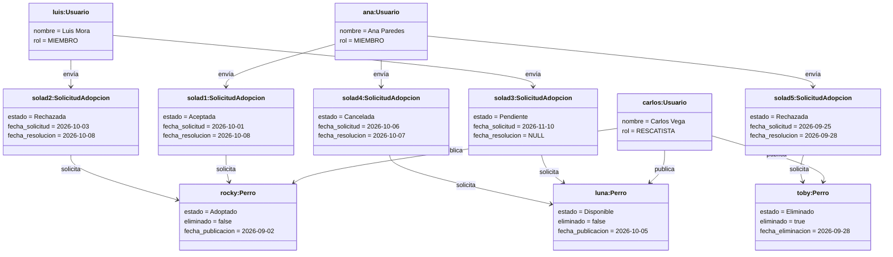

# Diagrama objeto-estado: Adopción

> **Fuentes:** `adog_MER.md` (entidades `USUARIO`, `PERRO`, `SOLICITUD_ADOPCION`), diagramas de estado `estados/01_solicitud_adopcion.md` y `estados/02_gestion_perro.md`, `adog_RN.md` (RN-10, RN-23 a RN-25, RN-28 a RN-32).
> Escenario: un rescatista publica tres perros. Uno ya fue adoptado, uno sigue disponible con una solicitud pendiente y uno fue eliminado. Los nombres de los usuarios se muestran como atributo `nombre`, sin separar `PERSONA` de `USUARIO`, para no agregar ruido.

## 1. Diagrama

## 2. Plantilla de documentación

| Campo | Descripción |
|---|---|
| Nombre | Diagrama de objeto-estado de la adopción |
| Objetivo | Comprobar con instancias concretas que los diagramas de estado de la solicitud de adopción y de la gestión de perro son coherentes entre sí: qué estado tiene cada solicitud según el estado de su perro y qué valores toman las fechas en cada caso. |
| Elementos principales | **Usuarios:** un rescatista que publica (`carlos`) y dos miembros que solicitan (`ana`, `luis`). **Perros:** uno `Adoptado` (`rocky`), uno `Disponible` (`luna`) y uno `Eliminado` (`toby`). **Solicitudes:** una en cada estado posible, `Aceptada`, `Rechazada` (en dos casos distintos), `Pendiente` y `Cancelada`. **Relaciones:** un usuario publica perros, envía solicitudes, y cada solicitud se dirige a un perro. |
| Reglas aplicadas | Solo `solad3` está pendiente, y por eso es la única con `fecha_resolucion` vacía. Aceptar `solad1` marcó a `rocky` como adoptado y rechazó la pendiente `solad2` en la misma fecha. Eliminar `toby` rechazó su solicitud pendiente `solad5`. `ana` tiene una solicitud cancelada y una aceptada, y `luis` una pendiente y otra rechazada. Un adoptante tiene como máximo una solicitud pendiente por perro. |
| Justificación | Los dos diagramas de estado se enlazan por eventos: aceptar una solicitud adopta al perro, y adoptar o eliminar un perro rechaza sus pendientes. Con instancias reales se ve que ningún perro `Adoptado` o `Eliminado` conserva solicitudes pendientes, y que cada estado final de la solicitud tiene su fecha de resolución. |

## 3. Interpretación

- `carlos`: rescatista verificado que publica los tres perros del escenario.
- `ana` y `luis`: miembros que solicitan adopciones; no publican.
- `rocky`: está `Adoptado`, porque su publicador aceptó la solicitud `solad1`.
- `luna`: está `Disponible` y tiene una única solicitud pendiente (`solad3`); `solad4` ya no cuenta porque fue cancelada.
- `toby`: está `Eliminado` (borrado lógico e irreversible); ya no se puede consultar ni recibir solicitudes.
- `solad1`: `Aceptada`; es la solicitud que originó la adopción de `rocky`.
- `solad2`: `Rechazada` automáticamente, porque se aceptó `solad1`; por eso comparte la fecha de resolución con ella.
- `solad3`: `Pendiente`; es la única que puede aceptarse, rechazarse o cancelarse.
- `solad4`: `Cancelada` por `ana` antes de que se adoptara a `rocky`; `ana` podría volver a solicitar `luna`.
- `solad5`: `Rechazada` automáticamente al eliminarse `toby`; su fecha de resolución coincide con la de eliminación del perro.

## 4. Verificación de coherencia con los diagramas de estado

| Comprobación | Resultado |
|---|---|
| `rocky` está `Adoptado` y tiene una solicitud `Aceptada` (`solad1`) y ninguna `Pendiente`. | Coherente. |
| `solad2` fue rechazada por la adopción de `rocky`, con la misma `fecha_resolucion` que `solad1`. | Coherente (evento «Perro pasa a adoptado»). |
| `luna` está `Disponible` y su única solicitud pendiente es `solad3`; `solad4` está en un estado final. | Coherente. |
| `toby` está `Eliminado` y su solicitud `solad5` no quedó pendiente. | Coherente (evento «Perro eliminado»). |
| `fecha_resolucion` vacía solo en la solicitud `Pendiente`. | Coherente con el modelo de datos. |
| Ninguna solicitud en estado final (`solad1`, `solad2`, `solad4`, `solad5`) vuelve a `Pendiente`. | Coherente con el diagrama de estados. |
| `toby` tiene `estado = Eliminado`, que en el modelo de datos es `eliminado = true` más `fecha_eliminacion`. | Se muestra como estado por claridad, según el diagrama de gestión de perro. |
