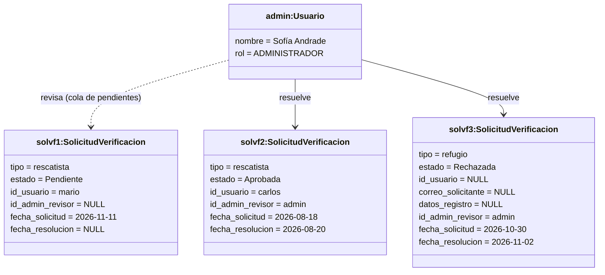

# Diagrama objeto-estado: Verificación

> **Fuentes:** `adog_MER.md` (entidad `SOLICITUD_VERIFICACION`), diagrama de estados `estados/03_solicitud_verificacion.md`, `support/dev/solicitudes_verificacion.md` (secciones 2.4, 3, 4 y 5), `adog_RN.md` (RN-35 a RN-37).
> Escenario: un administrador resuelve solicitudes de verificación. `carlos` es el mismo rescatista del diagrama de adopción, ya verificado.

## 1. Diagrama

## 2. Plantilla de documentación

| Campo | Descripción |
|---|---|
| Nombre | Diagrama de objeto-estado de la verificación |
| Objetivo | Comprobar con instancias concretas que el diagrama de estados de la solicitud de verificación es coherente con el modelo de datos: qué columnas tienen valor o están vacías según el tipo de solicitud y su estado. |
| Elementos principales | **Usuario:** un administrador que resuelve (`admin`). **Solicitudes:** una de rescatista `Pendiente` (`solvf1`, de `mario`), una de rescatista `Aprobada` (`solvf2`, de `carlos`) y una de refugio `Rechazada` (`solvf3`, sin cuenta). **Relaciones:** el administrador resuelve las solicitudes (flecha continua, guardada en `id_admin_revisor`) y revisa la cola de pendientes (flecha punteada, flujo de trabajo que aún no se guarda). |
| Reglas aplicadas | Una solicitud pendiente no tiene revisor ni fecha de resolución; una resuelta tiene ambos. La solicitud de rescatista siempre conserva `id_usuario`. Una solicitud de refugio rechazada no conserva `id_usuario`, correo ni datos del formulario. Una verificación aprobada no se revoca. |
| Justificación | Las tres instancias cubren los tres estados del ciclo y las dos variantes de solicitud, de modo que se ve que el estado y el tipo condicionan qué columnas están llenas. `solvf2` conecta con `carlos`, el rescatista del diagrama de adopción: su verificación aprobada es la que le permite figurar como rescatista. |

## 3. Interpretación

- `admin`: administrador que revisa la cola de pendientes y resuelve las solicitudes; solo queda registrado como revisor al resolver (flecha continua), por eso la relación con `solvf1` es punteada.
- `solvf1`: solicitud de `rescatista` `Pendiente` enviada por `mario`; sin revisor ni fecha de resolución, y no caduca. Mientras esté pendiente, `mario` sigue publicando y adoptando.
- `solvf2`: solicitud de `rescatista` `Aprobada`; el rol de `carlos` cambió de MIEMBRO a RESCATISTA y no se revoca.
- `solvf3`: solicitud de `refugio` `Rechazada`; al resolverse se borraron el correo y los datos del formulario, y el refugio puede enviar una nueva de inmediato.

## 4. Verificación de coherencia con el diagrama de estados

| Comprobación | Resultado |
|---|---|
| `solvf1` está `Pendiente`: sin `id_admin_revisor` ni `fecha_resolucion`; el administrador la ve en su cola (relación punteada), pero aún no queda asignada. | Coherente. |
| `solvf2` está `Aprobada`: con revisor y fecha, y su solicitante `carlos` tiene el rol RESCATISTA. | Coherente (efecto de la aprobación). |
| `solvf3` es de refugio y está `Rechazada`: `id_usuario`, correo y datos en NULL, con revisor y fecha. | Coherente con las restricciones de consistencia del modelo de datos. |
| Ninguna solicitud resuelta (`solvf2`, `solvf3`) vuelve a `Pendiente`. | Coherente con el diagrama de estados. |
| Una solicitud de rescatista siempre conserva `id_usuario` (`solvf1`, `solvf2`). | Coherente con el modelo de datos. |
